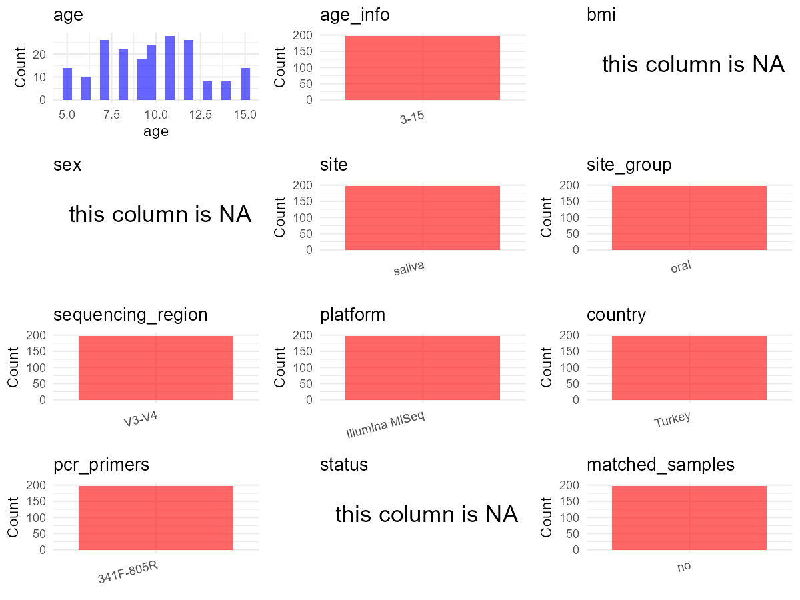

R Notebook: Metadata Processing Workflow
================

# Step 1: Obtain Initial Metadata from Each Project

This step sets the project directory, loads the raw SRA metadata, and
optionally merges supplement tables.

``` r
# Load libraries
library(dplyr)
library(ggplot2)
library(cowplot)

# (1) Setting working directory
project_id <- "PRJNA613586"

base_dir <- "D:/metadata_collect/oral_metadata_new/update"
setwd(file.path(base_dir, project_id))

# (2) Loading raw SRA metadata file
sra_file <- "SraRunTable.csv"
initial_meta <- read.csv(sra_file, header = TRUE)
```

``` r
# =============================================================
# Curation Notes - PRJNA613586
# Paper: "Oral microbiota and dental caries data from
#   monozygotic and dizygotic twin children" (Scientific Data, 2020)
#
# sample_id    : initial_meta column 'Run' (SRR IDs)
# subject_id   : extracted from 'Sample Name' (format "NUM-Txx"), numeric part
# age          : initial_meta column 'Host_age' (numeric, years)
# age_info     : Paper Methods — "3-15" (children 3-15 years old)
# sex          : NA — not available in CSV or paper
# bmi          : NA — not recorded
# platform     : Paper Methods — Illumina MiSeq (300 bp paired-end)
# region       : Paper Methods — V3-V4
# pcr_primers  : Paper Methods — 341F-805R (Bakt_341F / Bakt_805R)
# country      : initial_meta column 'geo_loc_name_country' = "Turkey"
# site         : initial_meta column 'host_body_product' = "saliva"
# disease_study: "yes" — dental caries study
# status       : NA — no per-sample disease status in CSV
# is_time_series: "no" — cross-sectional twin design
# controls     : none in SRA data; paper mentions negative PCR control only
# non-human    : none — all samples Homo sapiens
# =============================================================
```

# Step 2: Data Overview

First, you need to get an overview of the data, which includes two
steps: reading the article and reading the initial metadata. This step
is very IMPORTANT!

``` r
# (1) Read the article in the following order: abstract, the beginning of the results section, and the methods. Understand the sample size, experimental design, and disease group overview. Clarify the sampling sites; for oral and gut samples, specify the exact sites like supragingival plaque, tongue, etc.

# (2) IMPORTANT: MUST go through each column of initial_meta
head(initial_meta, 10)
```

    ##            Run Assay.Type AvgSpotLen    Bases  BioProject    BioSample
    ## 1  SRR11355925   AMPLICON        601 37228216 PRJNA613586 SAMN14410005
    ## 2  SRR11355926   AMPLICON        601 38456474 PRJNA613586 SAMN14410004
    ## 3  SRR11355927   AMPLICON        601 42026525 PRJNA613586 SAMN14410003
    ## 4  SRR11355928   AMPLICON        601 26038457 PRJNA613586 SAMN14410002
    ## 5  SRR11355929   AMPLICON        600 20839275 PRJNA613586 SAMN14410001
    ## 6  SRR11355930   AMPLICON        600 21782134 PRJNA613586 SAMN14410000
    ## 7  SRR11355931   AMPLICON        600 16433303 PRJNA613586 SAMN14409999
    ## 8  SRR11355932   AMPLICON        600 23985136 PRJNA613586 SAMN14409998
    ## 9  SRR11355933   AMPLICON        600 19182131 PRJNA613586 SAMN14409917
    ## 10 SRR11355934   AMPLICON        600 23741883 PRJNA613586 SAMN14409997
    ##                          BioSampleModel    Bytes         Center.Name
    ## 1  MIMS.me,MIGS/MIMS/MIMARKS.human-oral 20849203 ISTANBUL UNIVERSITY
    ## 2  MIMS.me,MIGS/MIMS/MIMARKS.human-oral 21424152 ISTANBUL UNIVERSITY
    ## 3  MIMS.me,MIGS/MIMS/MIMARKS.human-oral 23639305 ISTANBUL UNIVERSITY
    ## 4  MIMS.me,MIGS/MIMS/MIMARKS.human-oral 14931337 ISTANBUL UNIVERSITY
    ## 5  MIMS.me,MIGS/MIMS/MIMARKS.human-oral 12532937 ISTANBUL UNIVERSITY
    ## 6  MIMS.me,MIGS/MIMS/MIMARKS.human-oral 12476038 ISTANBUL UNIVERSITY
    ## 7  MIMS.me,MIGS/MIMS/MIMARKS.human-oral  9425266 ISTANBUL UNIVERSITY
    ## 8  MIMS.me,MIGS/MIMS/MIMARKS.human-oral 13630388 ISTANBUL UNIVERSITY
    ## 9  MIMS.me,MIGS/MIMS/MIMARKS.human-oral 10755344 ISTANBUL UNIVERSITY
    ## 10 MIMS.me,MIGS/MIMS/MIMARKS.human-oral 13520507 ISTANBUL UNIVERSITY
    ##    Collection_Date Consent DATASTORE.filetype DATASTORE.provider
    ## 1             2016  public   fastq,run.zq,sra         gs,ncbi,s3
    ## 2             2016  public   fastq,run.zq,sra         gs,ncbi,s3
    ## 3             2016  public   fastq,run.zq,sra         gs,ncbi,s3
    ## 4             2016  public   fastq,run.zq,sra         gs,ncbi,s3
    ## 5             2016  public   fastq,run.zq,sra         gs,ncbi,s3
    ## 6             2016  public   fastq,run.zq,sra         gs,ncbi,s3
    ## 7             2016  public   fastq,run.zq,sra         gs,ncbi,s3
    ## 8             2016  public   fastq,run.zq,sra         gs,ncbi,s3
    ## 9             2016  public   fastq,run.zq,sra         gs,ncbi,s3
    ## 10            2016  public   fastq,run.zq,sra         gs,ncbi,s3
    ##                        DATASTORE.region env_broad_scale env_local_scale
    ## 1  gs.us-east1,ncbi.public,s3.us-east-1   ENVO:02000019   ENVO:02000036
    ## 2  gs.us-east1,ncbi.public,s3.us-east-1   ENVO:02000019   ENVO:02000036
    ## 3  gs.us-east1,ncbi.public,s3.us-east-1   ENVO:02000019   ENVO:02000036
    ## 4  gs.us-east1,ncbi.public,s3.us-east-1   ENVO:02000019   ENVO:02000036
    ## 5  gs.us-east1,ncbi.public,s3.us-east-1   ENVO:02000019   ENVO:02000036
    ## 6  gs.us-east1,ncbi.public,s3.us-east-1   ENVO:02000019   ENVO:02000036
    ## 7  gs.us-east1,ncbi.public,s3.us-east-1   ENVO:02000019   ENVO:02000036
    ## 8  gs.us-east1,ncbi.public,s3.us-east-1   ENVO:02000019   ENVO:02000036
    ## 9  gs.us-east1,ncbi.public,s3.us-east-1   ENVO:02000019   ENVO:02000036
    ## 10 gs.us-east1,ncbi.public,s3.us-east-1   ENVO:02000019   ENVO:02000036
    ##       env_medium Experiment geo_loc_name_country geo_loc_name_country_continent
    ## 1  ENVO:02000036 SRX7957973               Turkey                           Asia
    ## 2  ENVO:02000036 SRX7957972               Turkey                           Asia
    ## 3  ENVO:02000036 SRX7957971               Turkey                           Asia
    ## 4  ENVO:02000036 SRX7957970               Turkey                           Asia
    ## 5  ENVO:02000036 SRX7957969               Turkey                           Asia
    ## 6  ENVO:02000036 SRX7957968               Turkey                           Asia
    ## 7  ENVO:02000036 SRX7957967               Turkey                           Asia
    ## 8  ENVO:02000036 SRX7957966               Turkey                           Asia
    ## 9  ENVO:02000036 SRX7957965               Turkey                           Asia
    ## 10 ENVO:02000036 SRX7957964               Turkey                           Asia
    ##        geo_loc_name Host_age host_body_product         Host     Instrument
    ## 1  Turkey: Istanbul       10            saliva Homo sapiens Illumina MiSeq
    ## 2  Turkey: Istanbul       10            saliva Homo sapiens Illumina MiSeq
    ## 3  Turkey: Istanbul        7            saliva Homo sapiens Illumina MiSeq
    ## 4  Turkey: Istanbul        7            saliva Homo sapiens Illumina MiSeq
    ## 5  Turkey: Istanbul       15            saliva Homo sapiens Illumina MiSeq
    ## 6  Turkey: Istanbul       15            saliva Homo sapiens Illumina MiSeq
    ## 7  Turkey: Istanbul       11            saliva Homo sapiens Illumina MiSeq
    ## 8  Turkey: Istanbul       11            saliva Homo sapiens Illumina MiSeq
    ## 9  Turkey: Istanbul       10            saliva Homo sapiens Illumina MiSeq
    ## 10 Turkey: Istanbul       10            saliva Homo sapiens Illumina MiSeq
    ##    isolate         lat_lon Library.Name LibraryLayout LibrarySelection
    ## 1  186-T49 41.01 N 28.98 E          186        PAIRED              PCR
    ## 2  185-T49 41.01 N 28.98 E          185        PAIRED              PCR
    ## 3  184-T48 41.01 N 28.98 E          184        PAIRED              PCR
    ## 4  183-T48 41.01 N 28.98 E          183        PAIRED              PCR
    ## 5  180-T47 41.01 N 28.98 E          180        PAIRED              PCR
    ## 6  179-T47 41.01 N 28.98 E          179        PAIRED              PCR
    ## 7  178-T46 41.01 N 28.98 E          178        PAIRED              PCR
    ## 8  177-T46 41.01 N 28.98 E          177        PAIRED              PCR
    ## 9    20-T5 41.01 N 28.98 E           20        PAIRED              PCR
    ## 10 168-T45 41.01 N 28.98 E          168        PAIRED              PCR
    ##    LibrarySource                Organism Platform          ReleaseDate
    ## 1    METAGENOMIC human saliva metagenome ILLUMINA 2020-09-05T00:00:00Z
    ## 2    METAGENOMIC human saliva metagenome ILLUMINA 2020-09-05T00:00:00Z
    ## 3    METAGENOMIC human saliva metagenome ILLUMINA 2020-09-05T00:00:00Z
    ## 4    METAGENOMIC human saliva metagenome ILLUMINA 2020-09-05T00:00:00Z
    ## 5    METAGENOMIC human saliva metagenome ILLUMINA 2020-09-05T00:00:00Z
    ## 6    METAGENOMIC human saliva metagenome ILLUMINA 2020-09-05T00:00:00Z
    ## 7    METAGENOMIC human saliva metagenome ILLUMINA 2020-09-05T00:00:00Z
    ## 8    METAGENOMIC human saliva metagenome ILLUMINA 2020-09-05T00:00:00Z
    ## 9    METAGENOMIC human saliva metagenome ILLUMINA 2020-09-05T00:00:00Z
    ## 10   METAGENOMIC human saliva metagenome ILLUMINA 2020-09-05T00:00:00Z
    ##             create_date version Sample.Name SRA.Study twin_id
    ## 1  2020-03-20T09:03:00Z       1         186 SRP253432     T49
    ## 2  2020-03-20T09:04:00Z       1         185 SRP253432     T49
    ## 3  2020-03-20T09:03:00Z       1         184 SRP253432     T48
    ## 4  2020-03-20T09:03:00Z       1         183 SRP253432     T48
    ## 5  2020-03-20T09:04:00Z       1         180 SRP253432     T47
    ## 6  2020-03-20T09:03:00Z       1         179 SRP253432     T47
    ## 7  2020-03-20T09:03:00Z       1         178 SRP253432     T46
    ## 8  2020-03-20T09:03:00Z       1         177 SRP253432     T46
    ## 9  2020-03-20T09:03:00Z       1          20 SRP253432      T5
    ## 10 2020-03-20T09:04:00Z       1         168 SRP253432     T45

``` r
# IMPORTANT: Check the unique values in the column of interest or query column.
table(initial_meta$host_body_product)       # all "saliva"
```

    ## 
    ## saliva 
    ##    198

``` r
table(initial_meta$Host)                     # all "Homo sapiens"
```

    ## 
    ## Homo sapiens 
    ##          198

``` r
table(initial_meta$Organism)                 # all "Homo sapiens"
```

    ## 
    ## human saliva metagenome 
    ##                     198

``` r
table(initial_meta$geo_loc_name_country)     # all "Turkey"
```

    ## 
    ## Turkey 
    ##    198

``` r
table(initial_meta$Instrument)               # all "Illumina MiSeq"
```

    ## 
    ## Illumina MiSeq 
    ##            198

``` r
table(initial_meta$platform..exp.)           # all "ILLUMINA"
```

    ## < table of extent 0 >

``` r
unique(initial_meta$Host_age)                # ages 5-15
```

    ##  [1] 10  7 15 11 12 13  5  9  6 14  8

``` r
table(initial_meta$twin_id)                  # twin pair groups (T1-T99)
```

    ## 
    ##  T1 T10 T11 T12 T13 T14 T15 T16 T17 T18 T19  T2 T20 T21 T22 T23 T24 T25 T26 T27 
    ##   2   2   2   2   2   2   2   2   2   2   2   2   2   2   2   2   2   2   2   2 
    ## T28 T29  T3 T30 T31 T32 T33 T34 T35 T36 T37 T38 T39  T4 T40 T41 T42 T43 T44 T45 
    ##   2   2   2   2   2   2   2   2   2   2   2   2   2   2   2   2   2   2   2   2 
    ## T46 T47 T48 T49  T5 T50 T51 T52 T53 T54 T55 T56 T57 T58 T59  T6 T60 T61 T62 T63 
    ##   2   2   2   2   2   2   2   2   2   2   2   2   2   2   2   2   2   2   2   2 
    ## T64 T65 T66 T67 T68 T69  T7 T70 T71 T72 T73 T74 T75 T76 T77 T78 T79  T8 T80 T81 
    ##   2   2   2   2   2   2   2   2   2   2   2   2   2   2   2   2   2   2   2   2 
    ## T82 T83 T84 T85 T86 T87 T88 T89  T9 T90 T91 T92 T93 T94 T95 T96 T97 T98 T99 
    ##   2   2   2   2   2   2   2   2   2   2   2   2   2   2   2   2   2   2   2

# Step 3: Removing Control and Non-human Samples

First, we need to remove control samples(including both negative
controls and positive controls) and non-human samples.

``` r
# (1) Parameter setup
control_column <- ""   # no control column in initial_meta; paper mentions PCR negative control but not in SRA table
control_keywords <- c()     # no controls to filter

species_column <- "Organism"          # column name in initial_meta
unique(initial_meta[[species_column]])
```

    ## [1] "human saliva metagenome"

``` r
non_human_keywords <- c()            # all samples are Homo sapiens, no non-human to filter


# (2) Remove controls and non-human samples. DO NOT need to modify code in this part, just run it.
n_samples <- nrow(initial_meta)
# Control evaluation
if (length(control_keywords) > 0) {
  if (is.null(control_column) || control_column == "") {
    stop("Error: control_keywords provided but control_column is missing.")
  }

  if (!(control_column %in% colnames(initial_meta))) {
    stop(sprintf("Error: Column '%s' not found in initial_meta.", control_column))
  }

  control_pattern <- paste(control_keywords, collapse = "|")
  control_text <- initial_meta[[control_column]]
  is_control <- grepl(control_pattern, control_text)

} else {
  is_control <- rep(FALSE, n_samples)
}

# Non-human evaluation
if (length(non_human_keywords) > 0) {
  if (is.null(species_column) || species_column == "") {
    stop("Error: non_human_keywords provided but species_column is missing.")
  }

  if (!(species_column %in% colnames(initial_meta))) {
    stop(sprintf("Error: Column '%s' not found in initial_meta.", species_column))
  }

  non_human_pattern <- paste(non_human_keywords, collapse = "|")
  species_text <- initial_meta[[species_column]]
  is_non_human <- grepl(non_human_pattern, species_text)
} else {
  is_non_human <- rep(FALSE, n_samples)
}

# Execute removal
samples_to_remove <- is_control | is_non_human
initial_meta <- initial_meta[!samples_to_remove, ]

cat("Initial samples counts:",n_samples,"\n")
```

    ## Initial samples counts: 198

``` r
cat("Removed control samples:", sum(is_control), "\n")
```

    ## Removed control samples: 0

``` r
cat("Removed non-human samples:", sum(is_non_human), "\n")
```

    ## Removed non-human samples: 0

``` r
cat("Total samples removed ", sum(samples_to_remove), "\n")
```

    ## Total samples removed  0

``` r
cat("Remaining samples after Step 2:", nrow(initial_meta), "\n")
```

    ## Remaining samples after Step 2: 198

# Step 4: Creating a Uniform Metadata Template

This step converts the raw SRA table into the standard metadata format
used in our meta-analysis. The uniform metadata should include the
following columns: 1. **bioproject**: Project ID from SRA or other
database e.g. `PRJNA1234`, `CNP1234`, ‘OEP1234’, ‘qiita_1234’ 2.
**sample_id**: SRA sample/run ID. Unique id for each sample!
e.g. `DRR1234567`, `ERR1234567` and `SRR1234567`. If no such column
exists, can use column like sample_name. 3. **subject_id**: subject id
for each person if available. e.g. `patient_01`, `Host_03_before`,
`subject12` 4. **age**: Age of the subject if available. e.g. `35`, `42`
\| not `adult`, `chilren` 5. **age_info**: If the age is not explicitly
stated but approximate age range information is available, mark it in
this column. e.g., `18-55`, `children`, `infant`, `elder` 6. **bmi**:
Body Mass Index if available. e.g. `22.5`, `18.9` \| not `normal`,
`overweight` 7. **sex**: Sex of the subject. Mandatory to write as M/F
\| not `female`, `woman` 8. **sequencing_region**: Targeted 16S rRNA
region. e.g. `V3-V4`, `V4` 9. **platform**: Sequencing platform.
e.g. `Illumina MiSeq`, `454 GS FLX Titanium`, `Ion Torrent` 10.
**country**: Country of sample origin. e.g. `China`, `Japan` \| not city
name like `Beijing` 11. **site**: Sampling site. For oral and gut sites,
specify the exact sites as detailed as possible. For example, if it is
known to be supragingival plaque, do not record it as ‘dental plaque’,
unless the original text provides only a vague description.
e.g. `saliva`, `tongue coating` \| not broad term like `oral` 12.
**site_group**: only accepts one of following three values: ‘oral’,
‘gut’, or ‘other’. 13. **public_time**: Data release date.
e.g. `2021-06-22` \| not `June 2021` 14. **pcr_primers**: PCR primers
used. e.g. `515F-806R`, `27F-338R` \| not primer sequences 15.
**title**: Title of the associated publication. 16. **disease_study**:
Whether the study involves disease samples. If it’s not clear, can
record as NA. Only three values accepted: ‘yes’, ‘no’ or NA 17.
**status**: Disease status for each sample if available, else record as
NA. Only accept following abbreviations, Write full names for all other
diseases. HC: healthy control CD: Crohn’s disease CRC: colorectal cancer
COPD: chronic obstructive pulmonary disease HIV: human immunodeficiency
virus ICU: intensive care unit OSCC: oral squamous cell carcinoma RA:
rheumatoid arthritis UC: ulcerative colitis 18. **matched_samples**:
Whether the subject has matched samples. Only accept ‘yes’ or ‘no’. 19.
**is_time_series**: Whether the study is a time series study. Only
accept ‘yes’ or ‘no’.

``` r
# Extract columns from initial_meta as follows: (1) No modification needed -> extract directly. (2) Modification needed -> create a new column with the prefix raw_ and mark the original column as "pending". (3) Need to find or determine based on the article.
metadata <- data.frame(
  bioproject = initial_meta$BioProject,
  sample_id = initial_meta$Run,
  subject_id = sub("-.*", "", initial_meta$Sample.Name),  # extract numeric part from "NUM-Txx" format
  age = initial_meta$Host_age,
  age_info = "3-15",                          # Paper Methods: "Children between 3-15 years old"
  bmi = NA,                                   # not recorded in CSV or paper
  sex = NA_character_,                        # no sex column in CSV, not reported per-sample in paper
  sequencing_region = "V3-V4",               # Paper Methods: "V3-V4 region of the bacterial 16S rRNA gene"
  platform = "Illumina MiSeq",               # Paper Methods: "MiSeq instrument (Illumina, USA)"
  country = initial_meta$geo_loc_name_country,
  site = initial_meta$host_body_product,      # all "saliva" from initial_meta column
  site_group = "pending",                     # modify later
  public_time = initial_meta$ReleaseDate,
  pcr_primers = "341F-805R",                 # Paper Methods: Bakt_341F / Bakt_805R
  title = "Oral microbiota and dental caries data from monozygotic and dizygotic twin children",
  disease_study = "yes",                      # Paper title + abstract: dental caries study
  status = NA,                                # no per-sample disease status in CSV
  matched_samples = "pending",                # modify later
  is_time_series = "no",                      # cross-sectional twin design, no repeated sampling
  stringsAsFactors = FALSE
)
metadata$public_time <- as.Date(metadata$public_time)
```

# Step 5: Manually solving pending issues

This step involves two parts: (1) handle the columns with the `raw_`
prefix, and next (2) handle the `site_group` and `matched_samples`
columns.

``` r
# (1) No raw_ columns to resolve: sex is NA (data not available), site is directly extracted as "saliva"
```

``` r
# (2) Filling the 'site_group' and 'matched_samples' columns
# editing site_group
unique(metadata$site)
```

    ## [1] "saliva"

``` r
# Oral sites: saliva
Oral_site = c("saliva")
# Gut sites: none
Gut_site = c()
# just run
metadata <- metadata %>%
  mutate(site_group = case_when(
    site %in% Oral_site ~ "oral",
    site %in% Gut_site ~ "gut",
    TRUE ~ "other"
  ))

# editing matched_samples, just run.
metadata$matched_samples <- ifelse(
  ave(metadata$subject_id, metadata$subject_id, FUN = length) > 1,
  "yes",
  "no"
)
```

``` r
# (3) check if there is pending value in metadata. If there is pending value, go on modify the metadata.
# Function to check if a column contains "pending"
has_pending <- function(col) {
  if (is.character(col) || is.factor(col)) {
    any(col == "pending", na.rm = TRUE)
  } else {
    FALSE
  }
}

# Check for any pending value
any_pending_value <- any(sapply(metadata, has_pending))

if (!any_pending_value) {
  message("Good! No cell contains the value 'pending'.")
} else {
  pending_cols <- names(metadata)[sapply(metadata, has_pending)]
  message("Columns containing 'pending': ", paste(pending_cols, collapse = ", "))
  message("Please continue to resolve these pending columns!")
}
```

    ## Good! No cell contains the value 'pending'.

# Step 6: Visualize the Metadata

This step makes a quick set of plots for checking the distribution of
key metadata fields.

``` r
# Select columns for visualization, just run
plot_data <- metadata %>%
  select(-bioproject, -sample_id, -subject_id, -title)

create_simple_plots <- function(data) {
  plots <- list()
  continuous_vars <- c("age", "bmi")

  for (col in colnames(data)) {
    if (all(is.na(data[[col]]))) {
      p <- ggplot() +
        annotate("text", x = 0.5, y = 0.5, label = "this column is NA", size = 6) +
        labs(title = col) +
        theme_void()
    } else if (col %in% continuous_vars && is.numeric(data[[col]])) {
      p <- ggplot(data, aes(x = .data[[col]])) +
        geom_histogram(fill = "blue", alpha = 0.6, bins = 20, na.rm = TRUE) +
        labs(title = col, x = col, y = "Count") +
        theme_minimal()
    } else {
      count_data <- as.data.frame(table(data[[col]], useNA = "ifany"))
      p <- ggplot(count_data, aes(x = reorder(Var1, -Freq), y = Freq)) +
        geom_col(fill = "red", alpha = 0.6) +
        labs(title = col, x = NULL, y = "Count") +
        theme_minimal() +
        theme(axis.text.x = element_text(angle = 15, hjust = 1))
    }
    plots[[col]] <- p
  }

  return(plots)
}

# Generate and arrange plots
plots <- create_simple_plots(plot_data)
p <- plot_grid(plots$age,
               plots$age_info,
               plots$bmi,
               plots$sex,
               plots$site,
               plots$site_group,
               plots$sequencing_region,
               plots$platform,
               plots$country,
               plots$pcr_primers,
               plots$status,
               plots$matched_samples,
               ncol = 3, align = "hv", axis = "lb")
ggsave("Metadata_Summary_v2.png", plot = p, width = 8, height = 6, dpi = 150)
```

``` r
# Insert Metadata_Summary_v2.png into the current Rmd output

```

<!-- -->

# Step 7: Sort and export the metadata

This step saves the cleaned metadata table as the final `metadata.csv`
file.

``` r
# Reorder the data frame
fixed_cols <- c("bioproject", "sample_id", "subject_id", "age", "age_info",
                "bmi", "sex", "platform", "sequencing_region", "pcr_primers",
                "country", "site", "site_group", "disease_study", "status",
                "title", "public_time", "matched_samples", "is_time_series")
metadata <- metadata %>%
  select(all_of(fixed_cols), everything())

# save metadata
# head(metadata)
write.csv(metadata, file = "metadata_v2.csv", quote = TRUE)
```
