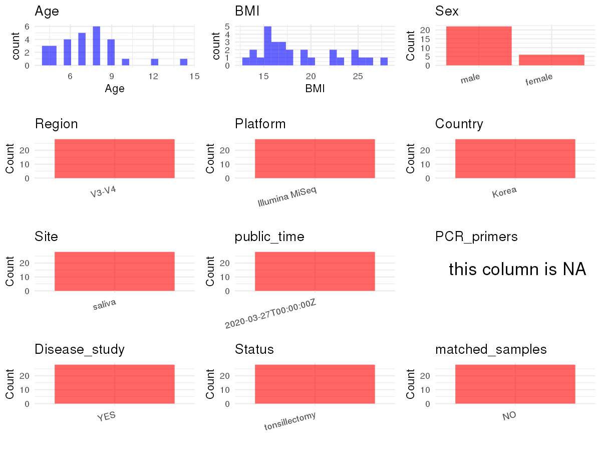

R Notebook: Metadata Processing Workflow
================

# Step 1: Obtain Initial Metadata from Each Project

To obtain the initial metadata: 1. Search for the BioProject ID (e.g.,
“PRJEBXXXX”) on the [NCBI SRA
website](https://www.ncbi.nlm.nih.gov/Traces/study/). 2. In the “Select”
table, click on “Metadata” and download the file. 3. The downloaded file
is typically named “SraRunTable.csv” and contains metadata for the
project.

``` r
# Load necessary libraries
library(dplyr)
library(stringr)
library(ggplot2)
library(cowplot)

# Set working directory (update this path to your local directory)
setwd("/home/dongbiao/word_embedding_microbiome/all_data/oral/global-oral-microbiome/data/projects/PRJNA615768")

# Read the initial metadata files
initial_meta <- read.csv("SraRunTable.csv", header = T) %>% filter(sample_type == "oral saliva")

# Display the first few rows of the metadata
head(initial_meta)
```

    ##           Run AGE Assay.Type AvgSpotLen    Bases  BioProject    BioSample
    ## 1 SRR11432252   7    RNA-Seq        540  5123924 PRJNA615768 SAMN14466389
    ## 2 SRR11432253   8    RNA-Seq        466  6614514 PRJNA615768 SAMN14466388
    ## 3 SRR11432254  12    RNA-Seq        525 11481522 PRJNA615768 SAMN14466387
    ## 4 SRR11432255   6    RNA-Seq        493 14506563 PRJNA615768 SAMN14466386
    ## 5 SRR11432256   8    RNA-Seq        541 11578223 PRJNA615768 SAMN14466385
    ## 6 SRR11432257   6    RNA-Seq        567 10644026 PRJNA615768 SAMN14466384
    ##             BioSampleModel   Bytes                  Center.Name Consent
    ## 1 Model organism or animal 3093718 CHUNGBUK NATIONAL UNIVERSITY  public
    ## 2 Model organism or animal 3962478 CHUNGBUK NATIONAL UNIVERSITY  public
    ## 3 Model organism or animal 6927508 CHUNGBUK NATIONAL UNIVERSITY  public
    ## 4 Model organism or animal 8460949 CHUNGBUK NATIONAL UNIVERSITY  public
    ## 5 Model organism or animal 7087614 CHUNGBUK NATIONAL UNIVERSITY  public
    ## 6 Model organism or animal 6486896 CHUNGBUK NATIONAL UNIVERSITY  public
    ##   DATASTORE.filetype DATASTORE.provider                     DATASTORE.region
    ## 1   fastq,run.zq,sra         gs,ncbi,s3 gs.us-east1,ncbi.public,s3.us-east-1
    ## 2   fastq,run.zq,sra         gs,ncbi,s3 gs.us-east1,ncbi.public,s3.us-east-1
    ## 3   fastq,run.zq,sra         gs,ncbi,s3 gs.us-east1,ncbi.public,s3.us-east-1
    ## 4   fastq,run.zq,sra         gs,ncbi,s3 gs.us-east1,ncbi.public,s3.us-east-1
    ## 5   fastq,run.zq,sra         gs,ncbi,s3 gs.us-east1,ncbi.public,s3.us-east-1
    ## 6   fastq,run.zq,sra         gs,ncbi,s3 gs.us-east1,ncbi.public,s3.us-east-1
    ##   Experiment host_body_mass_index     Instrument     isolate Library.Name
    ## 1 SRX8010513                23.39 Illumina MiSeq oral cavity      SAL0462
    ## 2 SRX8010512                22.37 Illumina MiSeq oral cavity      SAL0461
    ## 3 SRX8010511                25.00 Illumina MiSeq oral cavity      SAL0460
    ## 4 SRX8010510                25.00 Illumina MiSeq oral cavity      SAL0459
    ## 5 SRX8010509                25.27 Illumina MiSeq oral cavity      SAL0458
    ## 6 SRX8010508                26.58 Illumina MiSeq oral cavity      SAL0457
    ##   LibraryLayout LibrarySelection LibrarySource              Organism Platform
    ## 1        PAIRED              PCR   METAGENOMIC human oral metagenome ILLUMINA
    ## 2        PAIRED              PCR   METAGENOMIC human oral metagenome ILLUMINA
    ## 3        PAIRED              PCR   METAGENOMIC human oral metagenome ILLUMINA
    ## 4        PAIRED              PCR   METAGENOMIC human oral metagenome ILLUMINA
    ## 5        PAIRED              PCR   METAGENOMIC human oral metagenome ILLUMINA
    ## 6        PAIRED              PCR   METAGENOMIC human oral metagenome ILLUMINA
    ##            ReleaseDate          create_date version              Sample.Name
    ## 1 2020-03-27T00:00:00Z 2020-03-27T10:19:00Z       1 microbiome  of saliva 29
    ## 2 2020-03-27T00:00:00Z 2020-03-27T10:19:00Z       1 microbiome  of saliva 28
    ## 3 2020-03-27T00:00:00Z 2020-03-27T10:19:00Z       1 microbiome  of saliva 27
    ## 4 2020-03-27T00:00:00Z 2020-03-27T10:19:00Z       1 microbiome  of saliva 26
    ## 5 2020-03-27T00:00:00Z 2020-03-27T10:19:00Z       1 microbiome  of saliva 25
    ## 6 2020-03-27T00:00:00Z 2020-03-27T10:19:00Z       1 microbiome  of saliva 24
    ##   sample_type    sex SRA.Study      tissue host_height
    ## 1 oral saliva female SRP254290 oral saliva          NA
    ## 2 oral saliva   male SRP254290 oral saliva          NA
    ## 3 oral saliva   male SRP254290 oral saliva          NA
    ## 4 oral saliva   male SRP254290 oral saliva          NA
    ## 5 oral saliva   male SRP254290 oral saliva          NA
    ## 6 oral saliva   male SRP254290 oral saliva          NA

# Step 2: Create a Uniform Metadata Template

The uniform metadata should include the following columns:

1.  **BioProject**: Project ID (e.g., “PRJNA339212”)
2.  **Run**: Sample ID (e.g., “ERRXXXXXX” or “SRRXXXXXX”)
3.  **sample_name**: Original sample name submitted by the authors (not
    the database-assigned ID)
4.  **Age**: Age of the subject (if available)
5.  **BMI**: Body Mass Index (if available)
6.  **Sex**: Sex of the subject (“F” or “M”)
7.  **Region**: Targeted 16S rRNA region (e.g., “V3-V4”)
8.  **Platform**: Sequencing platform (e.g., “Illumina MiSeq”)
9.  **Country**: Country of sample origin (e.g., “China”)
10. **Site**: Sample site (e.g., “saliva”, “dental plaque”)
11. **public_time**: Data release date (format: “YYYY-MM-DD”)
12. **PCR_primers**: PCR primers used (e.g., “515F-806R”)
13. **title**: Title of the associated publication
14. **Disease_study**: Whether the study involves a disease (“YES” or
    “NO”)
15. **Status**: Disease status (e.g., “T2DM”, “HC”). Note: If the study
    includes both disease and healthy samples, this must be specified
    per sample.
16. **matched_samples**: matched samples (“YES” or “NO”)

``` r
# Create a uniform metadata dataframe
metadata <- data.frame(
  BioProject = initial_meta$BioProject,
  Run = initial_meta$Run,
  sample_name = initial_meta$Sample.Name,
  Age = initial_meta$AGE,
  Sex = initial_meta$sex,
  BMI = initial_meta$host_body_mass_index,  
  Region = "V3-V4",
  Platform = initial_meta$Instrument,
  Country = "Korea",
  Site = "saliva",
  public_time = initial_meta$ReleaseDate,
  stringsAsFactors = FALSE
)
```

# Step 3: Manually Add Information from the Publication

Some information (e.g. PCR primers, study title, disease status) must be
manually extracted from the publication and added to the metadata.

``` r
# Add information obtained from the publication
metadata$PCR_primers <- NA
metadata$title <- "Association between the microbiomes of tonsil and saliva samples isolated from pediatric patients subjected to tonsillectomy for the treatment of tonsillar hyperplasia"
metadata$Disease_study <- "YES"

metadata$Status <- "tonsillectomy"

# Check initial data distribution
cat("Initial sample distribution:\n")
```

    ## Initial sample distribution:

``` r
table(metadata$sample_name)
```

    ## 
    ## microbiome  of saliva 01 microbiome  of saliva 02 microbiome  of saliva 03 
    ##                        1                        1                        1 
    ## microbiome  of saliva 04 microbiome  of saliva 05 microbiome  of saliva 06 
    ##                        1                        1                        1 
    ## microbiome  of saliva 07 microbiome  of saliva 08 microbiome  of saliva 09 
    ##                        1                        1                        1 
    ## microbiome  of saliva 10 microbiome  of saliva 11 microbiome  of saliva 12 
    ##                        1                        1                        1 
    ## microbiome  of saliva 13 microbiome  of saliva 15 microbiome  of saliva 16 
    ##                        1                        1                        1 
    ## microbiome  of saliva 17 microbiome  of saliva 18 microbiome  of saliva 19 
    ##                        1                        1                        1 
    ## microbiome  of saliva 20 microbiome  of saliva 21 microbiome  of saliva 22 
    ##                        1                        1                        1 
    ## microbiome  of saliva 23 microbiome  of saliva 24 microbiome  of saliva 25 
    ##                        1                        1                        1 
    ## microbiome  of saliva 26 microbiome  of saliva 27 microbiome  of saliva 28 
    ##                        1                        1                        1 
    ## microbiome  of saliva 29 
    ##                        1

``` r
table(metadata$Site)
```

    ## 
    ## saliva 
    ##     28

``` r
# Calculate sampling frequency per subject
sample_counts <- table(metadata$sample_name)
cat("\nNumber of samples per subject:\n")
```

    ## 
    ## Number of samples per subject:

``` r
print(sample_counts)
```

    ## 
    ## microbiome  of saliva 01 microbiome  of saliva 02 microbiome  of saliva 03 
    ##                        1                        1                        1 
    ## microbiome  of saliva 04 microbiome  of saliva 05 microbiome  of saliva 06 
    ##                        1                        1                        1 
    ## microbiome  of saliva 07 microbiome  of saliva 08 microbiome  of saliva 09 
    ##                        1                        1                        1 
    ## microbiome  of saliva 10 microbiome  of saliva 11 microbiome  of saliva 12 
    ##                        1                        1                        1 
    ## microbiome  of saliva 13 microbiome  of saliva 15 microbiome  of saliva 16 
    ##                        1                        1                        1 
    ## microbiome  of saliva 17 microbiome  of saliva 18 microbiome  of saliva 19 
    ##                        1                        1                        1 
    ## microbiome  of saliva 20 microbiome  of saliva 21 microbiome  of saliva 22 
    ##                        1                        1                        1 
    ## microbiome  of saliva 23 microbiome  of saliva 24 microbiome  of saliva 25 
    ##                        1                        1                        1 
    ## microbiome  of saliva 26 microbiome  of saliva 27 microbiome  of saliva 28 
    ##                        1                        1                        1 
    ## microbiome  of saliva 29 
    ##                        1

``` r
# Create matched_samples column
metadata$matched_samples <- "NO"
```

# Step 4: Summarize and Validate the Metadata

``` r
# Check the number of unique runs and sample names
print(paste("Number of unique runs:", length(unique(metadata$Run))))
```

    ## [1] "Number of unique runs: 28"

``` r
print(paste("Number of unique sample names:", length(unique(metadata$sample_name))))
```

    ## [1] "Number of unique sample names: 28"

# Step 5: Visualize the Metadata

``` r

```


# Step 6: Finalize and Export the Metadata

``` r
# Reorder columns to match the desired format
metadata <- metadata[, c(
  "BioProject", "Run", "sample_name", "Age", "BMI", "Sex", 
  "Region", "Platform", "Country", "Site", "public_time", 
  "PCR_primers", "title", "Disease_study", "Status", "matched_samples"
)]

# Export the uniform metadata to a CSV file
write.csv(metadata, file = "metadata.csv", quote = TRUE)
head(metadata)
```

    ##    BioProject         Run              sample_name Age   BMI    Sex Region
    ## 1 PRJNA615768 SRR11432252 microbiome  of saliva 29   7 23.39 female  V3-V4
    ## 2 PRJNA615768 SRR11432253 microbiome  of saliva 28   8 22.37   male  V3-V4
    ## 3 PRJNA615768 SRR11432254 microbiome  of saliva 27  12 25.00   male  V3-V4
    ## 4 PRJNA615768 SRR11432255 microbiome  of saliva 26   6 25.00   male  V3-V4
    ## 5 PRJNA615768 SRR11432256 microbiome  of saliva 25   8 25.27   male  V3-V4
    ## 6 PRJNA615768 SRR11432257 microbiome  of saliva 24   6 26.58   male  V3-V4
    ##         Platform Country   Site          public_time PCR_primers
    ## 1 Illumina MiSeq   Korea saliva 2020-03-27T00:00:00Z          NA
    ## 2 Illumina MiSeq   Korea saliva 2020-03-27T00:00:00Z          NA
    ## 3 Illumina MiSeq   Korea saliva 2020-03-27T00:00:00Z          NA
    ## 4 Illumina MiSeq   Korea saliva 2020-03-27T00:00:00Z          NA
    ## 5 Illumina MiSeq   Korea saliva 2020-03-27T00:00:00Z          NA
    ## 6 Illumina MiSeq   Korea saliva 2020-03-27T00:00:00Z          NA
    ##                                                                                                                                                                     title
    ## 1 Association between the microbiomes of tonsil and saliva samples isolated from pediatric patients subjected to tonsillectomy for the treatment of tonsillar hyperplasia
    ## 2 Association between the microbiomes of tonsil and saliva samples isolated from pediatric patients subjected to tonsillectomy for the treatment of tonsillar hyperplasia
    ## 3 Association between the microbiomes of tonsil and saliva samples isolated from pediatric patients subjected to tonsillectomy for the treatment of tonsillar hyperplasia
    ## 4 Association between the microbiomes of tonsil and saliva samples isolated from pediatric patients subjected to tonsillectomy for the treatment of tonsillar hyperplasia
    ## 5 Association between the microbiomes of tonsil and saliva samples isolated from pediatric patients subjected to tonsillectomy for the treatment of tonsillar hyperplasia
    ## 6 Association between the microbiomes of tonsil and saliva samples isolated from pediatric patients subjected to tonsillectomy for the treatment of tonsillar hyperplasia
    ##   Disease_study        Status matched_samples
    ## 1           YES tonsillectomy              NO
    ## 2           YES tonsillectomy              NO
    ## 3           YES tonsillectomy              NO
    ## 4           YES tonsillectomy              NO
    ## 5           YES tonsillectomy              NO
    ## 6           YES tonsillectomy              NO

## Notes for Students:

1.  **Metadata Accuracy**: Always cross-check the metadata with the
    original publication to ensure accuracy.
2.  **Manual Entries**: Columns like `PCR_primers`, and `Status` often
    require manual entry based on the publication.
3.  **Disease Status**: Be careful when assigning `Status`—some studies
    include both disease and healthy samples.
4.  **Visualization**: The plots help quickly identify the distribution
    of values in each column, which is useful for quality control.
5.  **Reproducibility**: Update the working directory and file paths to
    match your local environment.
