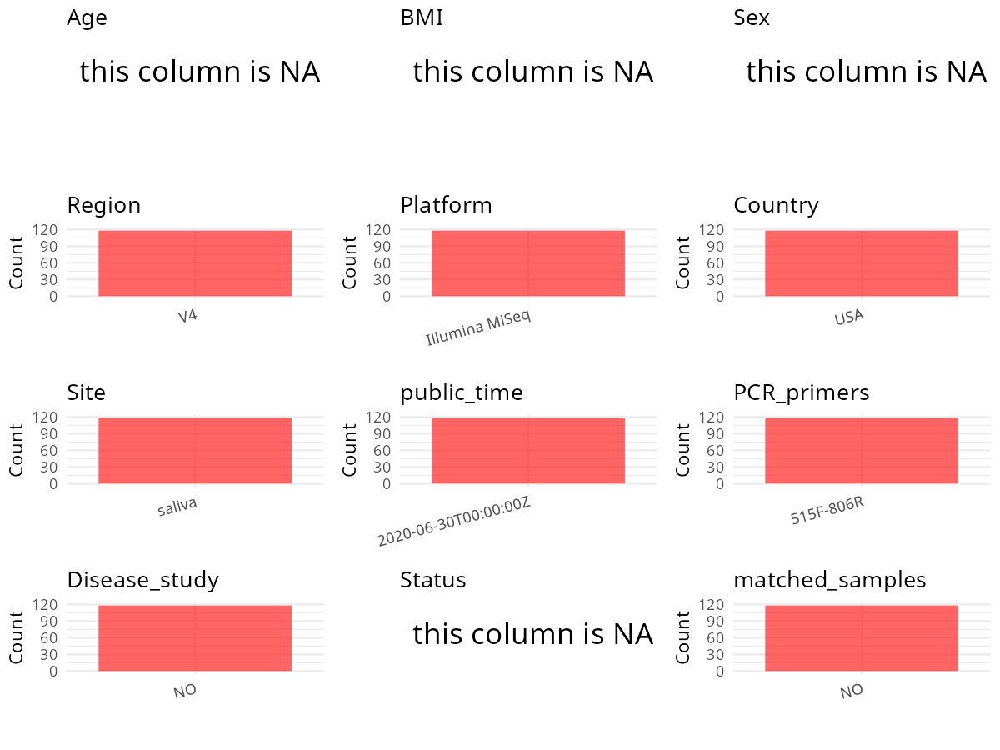

R Notebook: Metadata Processing Workflow
================

# Step 1: Obtain Initial Metadata from Each Project

To obtain the initial metadata: 1. Search for the BioProject ID (e.g.,
“PRJEBXXXX”) on the [NCBI SRA
website](https://www.ncbi.nlm.nih.gov/Traces/study/). 2. In the “Select”
table, click on “Metadata” and download the file. 3. The downloaded file
is typically named “SraRunTable.csv” and contains metadata for the
project.

``` r
# Load necessary libraries
library(dplyr)
library(ggplot2)
library(cowplot)
library(stringr)

# Set working directory (update this path to your local directory)
setwd("/home/hby/oral_project/PRJNA634162")

# Read the initial metadata files
initial_meta <- read.csv("SraRunTable.csv", header = T)

# Combine the two metadata files
# meta <- rbind(initial_meta, initial_meta1)

# Remove entries non-oral samples
# initial_meta <- subset(initial_meta,isolate %in% c("saliva","tongue coat"))

# Check the number of samples containing "HT" in Sample.Name (e.g., healthy controls)
# nrow(subset(meta, grepl("HT", Sample.Name)))

# Display the first few rows of the metadata
head(initial_meta)
```

    ##           Run       Assay.Type AvgSpotLen     Bases  BioProject    BioSample              BioSampleModel    Bytes Center.Name Collection_Date       Collection Consent DATASTORE.filetype
    ## 1 SRR11821894 Targeted-Capture        500  55296723 PRJNA634162 SAMN14985929 Metagenome or environmental 35183361         NCI              NA             WASH  public   fastq,run.zq,sra
    ## 2 SRR11821895 Targeted-Capture        500  52417539 PRJNA634162 SAMN14985928 Metagenome or environmental 32911016         NCI              NA             WASH  public   fastq,run.zq,sra
    ## 3 SRR11821896 Targeted-Capture        500  44401223 PRJNA634162 SAMN14985927 Metagenome or environmental 27641124         NCI              NA             WASH  public   fastq,run.zq,sra
    ## 4 SRR11821897 Targeted-Capture        500  43334925 PRJNA634162 SAMN14985926 Metagenome or environmental 27167685         NCI              NA             WASH  public   fastq,run.zq,sra
    ## 5 SRR11821898 Targeted-Capture        500 141920523 PRJNA634162 SAMN14985925 Metagenome or environmental 85571836         NCI              NA artificialcolony  public   fastq,run.zq,sra
    ## 6 SRR11821899 Targeted-Capture        500  51522472 PRJNA634162 SAMN14985907 Metagenome or environmental 31473289         NCI              NA          robogut  public   fastq,run.zq,sra
    ##   DATASTORE.provider                     DATASTORE.region Experiment geo_loc_name_country geo_loc_name_country_continent geo_loc_name         HOST     Instrument lat_lon
    ## 1         gs,ncbi,s3 gs.us-east1,ncbi.public,s3.us-east-1 SRX8372624                  USA                  North America          USA Homo sapiens Illumina MiSeq      NA
    ## 2         gs,ncbi,s3 gs.us-east1,ncbi.public,s3.us-east-1 SRX8372623                  USA                  North America          USA Homo sapiens Illumina MiSeq      NA
    ## 3         gs,ncbi,s3 gs.us-east1,ncbi.public,s3.us-east-1 SRX8372622                  USA                  North America          USA Homo sapiens Illumina MiSeq      NA
    ## 4         gs,ncbi,s3 gs.us-east1,ncbi.public,s3.us-east-1 SRX8372621                  USA                  North America          USA Homo sapiens Illumina MiSeq      NA
    ## 5         gs,ncbi,s3 gs.us-east1,ncbi.public,s3.us-east-1 SRX8372620                  USA                  North America          USA Homo sapiens Illumina MiSeq      NA
    ## 6         gs,ncbi,s3 gs.us-east1,ncbi.public,s3.us-east-1 SRX8372619                  USA                  North America          USA Homo sapiens Illumina MiSeq      NA
    ##   lib_const_method Library.Name LibraryLayout LibrarySelection LibrarySource   Organism Platform randomID          ReleaseDate          create_date version Sample_Name SampleID
    ## 1       paired-end     SC087363        PAIRED              PCR       GENOMIC metagenome ILLUMINA TVOM1082 2020-06-30T00:00:00Z 2020-05-20T21:48:00Z       1    SC087363 SC087363
    ## 2       paired-end     SC087362        PAIRED              PCR       GENOMIC metagenome ILLUMINA TVOM1021 2020-06-30T00:00:00Z 2020-05-20T21:48:00Z       1    SC087362 SC087362
    ## 3       paired-end     SC087359        PAIRED              PCR       GENOMIC metagenome ILLUMINA TVOM1033 2020-06-30T00:00:00Z 2020-05-20T21:48:00Z       1    SC087359 SC087359
    ## 4       paired-end     SC087358        PAIRED              PCR       GENOMIC metagenome ILLUMINA TVOM1043 2020-06-30T00:00:00Z 2020-05-20T21:48:00Z       1    SC087358 SC087358
    ## 5       paired-end     SC087343        PAIRED              PCR       GENOMIC metagenome ILLUMINA SC087343 2020-06-30T00:00:00Z 2020-05-20T21:49:00Z       1    SC087343 SC087343
    ## 6       paired-end     SC087069        PAIRED              PCR       GENOMIC metagenome ILLUMINA SC087069 2020-06-30T00:00:00Z 2020-05-20T21:48:00Z       1    SC087069 SC087069
    ##         sampletype    seq_methods SRA.Study target_gene target_subfragment Visit
    ## 1            Study Illumina MiSeq SRP262534    16S rRNA                 V4     4
    ## 2            Study Illumina MiSeq SRP262534    16S rRNA                 V4     4
    ## 3            Study Illumina MiSeq SRP262534    16S rRNA                 V4     4
    ## 4            Study Illumina MiSeq SRP262534    16S rRNA                 V4     4
    ## 5 artificialcolony Illumina MiSeq SRP262534    16S rRNA                 V4    NA
    ## 6          robogut Illumina MiSeq SRP262534    16S rRNA                 V4    NA

# Step 2: Create a Uniform Metadata Template

The uniform metadata should include the following columns:

1.  **BioProject**: Project ID (e.g., “PRJNA339212”)
2.  **Run**: Sample ID (e.g., “ERRXXXXXX” or “SRRXXXXXX”)
3.  **sample_name**: Original sample name submitted by the authors (not
    the database-assigned ID)
4.  **Age**: Age of the subject (if available)
5.  **BMI**: Body Mass Index (if available)
6.  **Sex**: Sex of the subject (“F” or “M”)
7.  **Region**: Targeted 16S rRNA region (e.g., “V3-V4”)
8.  **Platform**: Sequencing platform (e.g., “Illumina MiSeq”)
9.  **Country**: Country of sample origin (e.g., “China”)
10. **Site**: Sample site (e.g., “saliva”, “dental plaque”)
11. **public_time**: Data release date (format: “YYYY-MM-DD”)
12. **PCR_primers**: PCR primers used (e.g., “515F-806R”)
13. **title**: Title of the associated publication
14. **Disease_study**: Whether the study involves a disease (“YES” or
    “NO”)
15. **Status**: Disease status (e.g., “T2DM”, “HC”). Note: If the study
    includes both disease and healthy samples, this must be specified
    per sample.
16. **matched_samples**: matched samples (“YES” or “NO”)

``` r
# Create a uniform metadata dataframe
metadata <- data.frame(
  BioProject = initial_meta$BioProject,
  Run = initial_meta$Run,
  sample_name = initial_meta$SampleID,
  Platform = initial_meta$Instrument,
  public_time = initial_meta$ReleaseDate,
  Region = initial_meta$target_subfragment,
  Country = initial_meta$geo_loc_name,
  Sex = NA,
  Age = NA,
  BMI = NA,
  Status = NA
)
```

# Step 3: Manually Add Information from the Publication

Some information (e.g. PCR primers, study title, disease status) must be
manually extracted from the publication and added to the metadata.

``` r
# Add information obtained from the publication
metadata$Site <- "saliva"
metadata$PCR_primers <- "515F-806R"
metadata$title <- "Comparison of Oral Microbiota Collected Using Multiple Methods and Recommendations for New Epidemiologic Studies"
metadata$Disease_study <- "NO"
metadata$matched_samples <- "NO"
```

# Step 4: Summarize and Validate the Metadata

``` r
# Check the number of unique runs and sample names
print(paste("Number of unique runs:", length(unique(metadata$Run))))
```

    ## [1] "Number of unique runs: 118"

``` r
print(paste("Number of unique sample names:", length(unique(metadata$sample_name))))
```

    ## [1] "Number of unique sample names: 118"

# Step 5: Visualize the Metadata

``` r

```


# Step 6: Finalize and Export the Metadata

``` r
# Reorder columns to match the desired format
metadata <- metadata[, c(
  "BioProject", "Run", "sample_name", "Age", "BMI", "Sex",
  "Region", "Platform", "Country", "Site", "public_time",
  "PCR_primers", "title", "Disease_study", "Status", "matched_samples"
)]

# Export the uniform metadata to a CSV file
write.csv(metadata, file = "metadata.csv", quote = FALSE)
head(metadata)
```

    ##    BioProject         Run sample_name Age BMI Sex Region       Platform Country   Site          public_time PCR_primers
    ## 1 PRJNA634162 SRR11821894    SC087363  NA  NA  NA     V4 Illumina MiSeq     USA saliva 2020-06-30T00:00:00Z   515F-806R
    ## 2 PRJNA634162 SRR11821895    SC087362  NA  NA  NA     V4 Illumina MiSeq     USA saliva 2020-06-30T00:00:00Z   515F-806R
    ## 3 PRJNA634162 SRR11821896    SC087359  NA  NA  NA     V4 Illumina MiSeq     USA saliva 2020-06-30T00:00:00Z   515F-806R
    ## 4 PRJNA634162 SRR11821897    SC087358  NA  NA  NA     V4 Illumina MiSeq     USA saliva 2020-06-30T00:00:00Z   515F-806R
    ## 5 PRJNA634162 SRR11821898    SC087343  NA  NA  NA     V4 Illumina MiSeq     USA saliva 2020-06-30T00:00:00Z   515F-806R
    ## 6 PRJNA634162 SRR11821899    SC087069  NA  NA  NA     V4 Illumina MiSeq     USA saliva 2020-06-30T00:00:00Z   515F-806R
    ##                                                                                                              title Disease_study Status matched_samples
    ## 1 Comparison of Oral Microbiota Collected Using Multiple Methods and Recommendations for New Epidemiologic Studies            NO     NA              NO
    ## 2 Comparison of Oral Microbiota Collected Using Multiple Methods and Recommendations for New Epidemiologic Studies            NO     NA              NO
    ## 3 Comparison of Oral Microbiota Collected Using Multiple Methods and Recommendations for New Epidemiologic Studies            NO     NA              NO
    ## 4 Comparison of Oral Microbiota Collected Using Multiple Methods and Recommendations for New Epidemiologic Studies            NO     NA              NO
    ## 5 Comparison of Oral Microbiota Collected Using Multiple Methods and Recommendations for New Epidemiologic Studies            NO     NA              NO
    ## 6 Comparison of Oral Microbiota Collected Using Multiple Methods and Recommendations for New Epidemiologic Studies            NO     NA              NO

## Notes for Students:

1.  **Metadata Accuracy**: Always cross-check the metadata with the
    original publication to ensure accuracy.
2.  **Manual Entries**: Columns like `PCR_primers`, and `Status` often
    require manual entry based on the publication.
3.  **Disease Status**: Be careful when assigning `Status`—some studies
    include both disease and healthy samples.
4.  **Visualization**: The plots help quickly identify the distribution
    of values in each column, which is useful for quality control.
5.  **Reproducibility**: Update the working directory and file paths to
    match your local environment.
