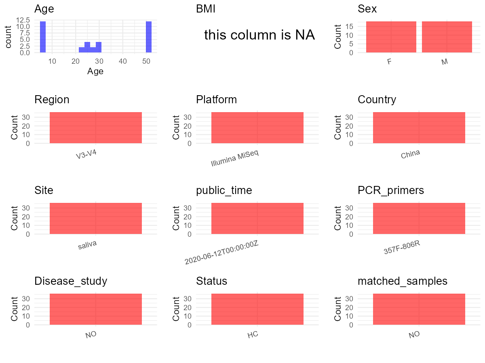

R Notebook: Metadata Processing Workflow
================

# Step 1: Obtain Initial Metadata from Each Project

To obtain the initial metadata: 1. Search for the BioProject ID (e.g.,
“PRJEBXXXX”) on the [NCBI SRA
website](https://www.ncbi.nlm.nih.gov/Traces/study/). 2. In the “Select”
table, click on “Metadata” and download the file. 3. The downloaded file
is typically named “SraRunTable.csv” and contains metadata for the
project.

``` r
# Load necessary libraries
library(dplyr)
library(ggplot2)
library(cowplot)

# Set working directory (update this path to your local directory)
setwd("E:/bioproject_YSD/PRJNA639033")

# Read the initial metadata files
initial_meta <- read.csv("SraRunTable.csv", header = T)

# Display the first few rows of the metadata
head(initial_meta)
```

    ##           Run Assay.Type AvgSpotLen    Bases  BioProject    BioSample
    ## 1 SRR12003710   AMPLICON        600 20075400 PRJNA639033 SAMN15221711
    ## 2 SRR12003711   AMPLICON        600 20602800 PRJNA639033 SAMN15221710
    ## 3 SRR12003712   AMPLICON        600 18202800 PRJNA639033 SAMN15221709
    ## 4 SRR12003713   AMPLICON        600 25188600 PRJNA639033 SAMN15221708
    ## 5 SRR12003714   AMPLICON        600 23433000 PRJNA639033 SAMN15221707
    ## 6 SRR12003715   AMPLICON        600 18582600 PRJNA639033 SAMN15221706
    ##                BioSampleModel    Bytes
    ## 1 Metagenome or environmental 10487818
    ## 2 Metagenome or environmental 10572655
    ## 3 Metagenome or environmental  9385953
    ## 4 Metagenome or environmental 13064104
    ## 5 Metagenome or environmental 11946223
    ## 6 Metagenome or environmental  9574769
    ##                                            Center.Name Collection_Date Consent
    ## 1 PEKING UNIVERSITY SCHOOL AND HOSPITAL OF STOMATOLOGY         missing  public
    ## 2 PEKING UNIVERSITY SCHOOL AND HOSPITAL OF STOMATOLOGY         missing  public
    ## 3 PEKING UNIVERSITY SCHOOL AND HOSPITAL OF STOMATOLOGY         missing  public
    ## 4 PEKING UNIVERSITY SCHOOL AND HOSPITAL OF STOMATOLOGY         missing  public
    ## 5 PEKING UNIVERSITY SCHOOL AND HOSPITAL OF STOMATOLOGY         missing  public
    ## 6 PEKING UNIVERSITY SCHOOL AND HOSPITAL OF STOMATOLOGY         missing  public
    ##   DATASTORE.filetype DATASTORE.provider                     DATASTORE.region
    ## 1   fastq,run.zq,sra         gs,ncbi,s3 gs.us-east1,ncbi.public,s3.us-east-1
    ## 2   fastq,run.zq,sra         gs,ncbi,s3 gs.us-east1,ncbi.public,s3.us-east-1
    ## 3   fastq,run.zq,sra         gs,ncbi,s3 gs.us-east1,ncbi.public,s3.us-east-1
    ## 4   fastq,run.zq,sra         gs,ncbi,s3 gs.us-east1,ncbi.public,s3.us-east-1
    ## 5   fastq,run.zq,sra         gs,ncbi,s3 gs.us-east1,ncbi.public,s3.us-east-1
    ## 6   fastq,run.zq,sra         gs,ncbi,s3 gs.us-east1,ncbi.public,s3.us-east-1
    ##   Experiment geo_loc_name_country geo_loc_name_country_continent geo_loc_name
    ## 1 SRX8536983         uncalculated                   uncalculated      missing
    ## 2 SRX8536982         uncalculated                   uncalculated      missing
    ## 3 SRX8536981         uncalculated                   uncalculated      missing
    ## 4 SRX8536980         uncalculated                   uncalculated      missing
    ## 5 SRX8536979         uncalculated                   uncalculated      missing
    ## 6 SRX8536978         uncalculated                   uncalculated      missing
    ##      HOST               host_sex     Instrument isolation_source lat_lon
    ## 1 missing pooled male and female Illumina MiSeq          missing missing
    ## 2 missing pooled male and female Illumina MiSeq          missing missing
    ## 3 missing pooled male and female Illumina MiSeq          missing missing
    ## 4 missing pooled male and female Illumina MiSeq          missing missing
    ## 5 missing pooled male and female Illumina MiSeq          missing missing
    ## 6 missing pooled male and female Illumina MiSeq          missing missing
    ##              Library.Name LibraryLayout LibrarySelection LibrarySource
    ## 1 control-female-18~30y-1        PAIRED              PCR       GENOMIC
    ## 2   control-male-18~30y-3        PAIRED              PCR       GENOMIC
    ## 3   control-male-18~30y-2        PAIRED              PCR       GENOMIC
    ## 4   control-male-18~30y-1        PAIRED              PCR       GENOMIC
    ## 5   control-female-4~6y-3        PAIRED              PCR       GENOMIC
    ## 6   control-female-4~6y-2        PAIRED              PCR       GENOMIC
    ##                  Organism Platform          ReleaseDate              replicates
    ## 1 human saliva metagenome ILLUMINA 2020-06-12T00:00:00Z control-female-18~30y-1
    ## 2 human saliva metagenome ILLUMINA 2020-06-12T00:00:00Z   control-male-18~30y-3
    ## 3 human saliva metagenome ILLUMINA 2020-06-12T00:00:00Z   control-male-18~30y-2
    ## 4 human saliva metagenome ILLUMINA 2020-06-12T00:00:00Z   control-male-18~30y-1
    ## 5 human saliva metagenome ILLUMINA 2020-06-12T00:00:00Z   control-female-4~6y-3
    ## 6 human saliva metagenome ILLUMINA 2020-06-12T00:00:00Z   control-female-4~6y-2
    ##            create_date version Sample.Name SRA.Study            tissue
    ## 1 2020-06-12T10:55:00Z       1       C_F21 SRP267056 epithelial tissue
    ## 2 2020-06-12T10:55:00Z       1       C_M23 SRP267056 epithelial tissue
    ## 3 2020-06-12T10:55:00Z       1       C_M22 SRP267056 epithelial tissue
    ## 4 2020-06-12T10:55:00Z       1       C_M21 SRP267056 epithelial tissue
    ## 5 2020-06-12T10:55:00Z       1       C_F13 SRP267056 epithelial tissue
    ## 6 2020-06-12T10:55:00Z       1       C_F12 SRP267056 epithelial tissue

# Step 2: Create a Uniform Metadata Template

The uniform metadata should include the following columns:

1.  **BioProject**: Project ID (e.g., “PRJNA339212”)
2.  **Run**: Sample ID (e.g., “ERRXXXXXX” or “SRRXXXXXX”)
3.  **sample_name**: Original sample name submitted by the authors (not
    the database-assigned ID)
4.  **Age**: Age of the subject (if available)
5.  **BMI**: Body Mass Index (if available)
6.  **Sex**: Sex of the subject (“F” or “M”)
7.  **Region**: Targeted 16S rRNA region (e.g., “V3-V4”)
8.  **Platform**: Sequencing platform (e.g., “Illumina MiSeq”)
9.  **Country**: Country of sample origin (e.g., “China”)
10. **Site**: Sample site (e.g., “saliva”, “dental plaque”)
11. **public_time**: Data release date (format: “YYYY-MM-DD”)
12. **PCR_primers**: PCR primers used (e.g., “515F-806R”)
13. **title**: Title of the associated publication
14. **Disease_study**: Whether the study involves a disease (“YES” or
    “NO”)
15. **Status**: Disease status (e.g., “T2DM”, “HC”). Note: If the study
    includes both disease and healthy samples, this must be specified
    per sample.
16. **matched_samples**: matched samples (“YES” or “NO”)

``` r
# Create a uniform metadata dataframe
metadata <- data.frame(
  BioProject = initial_meta$BioProject,
  Run = initial_meta$Run,
  sample_name = initial_meta$Sample.Name,
  BMI = NA,  
  Region = "V3-V4",
  Platform = initial_meta$Instrument,
  Country = "China",
  Site = "saliva",
  public_time = initial_meta$ReleaseDate,
  stringsAsFactors = FALSE
)

# Set the corresponding Age value for each sample_name value
age_groups <- c("1" = 6, "2" = 28, "3" = 50)
metadata$Age <- age_groups[substr(metadata$sample_name, 4, 4)]
exceptions <- c("C_M22"=24, "C_M23"=29, "C_F21"=23, "C_F22"=29, 
                "C_F23"=26, "P_M22"=24, "P_M23"=29, "P_F21"=23, 
                "P_F22"=29, "P_F23"=26, "C_M33"=51, "P_M33"=51)
metadata$Age[metadata$sample_name %in% names(exceptions)] <-
  exceptions[metadata$sample_name[metadata$sample_name %in%
                                    names(exceptions)]]

# Assign Sex based on sample_name patterns
metadata <- metadata %>%
  mutate(Sex = ifelse(grepl("F", sample_name), "F", 
                     ifelse(grepl("M", sample_name), "M", NA)))
```

# Step 3: Manually Add Information from the Publication

Some information (e.g. PCR primers, study title, disease status) must be
manually extracted from the publication and added to the metadata.

``` r
# Add information obtained from the publication
metadata$PCR_primers <- "357F-806R"
metadata$title <- "The effects of removing dead bacteria by propidium monoazide on the profile of salivary microbiome"
metadata$Disease_study <- "NO"
# Assign disease status based on sample_name patterns
metadata$Status <- "HC"

# Check initial data distribution
cat("Initial sample distribution:\n")
```

    ## Initial sample distribution:

``` r
table(metadata$sample_name)
```

    ## 
    ## C_F11 C_F12 C_F13 C_F21 C_F22 C_F23 C_F31 C_F32 C_F33 C_M11 C_M12 C_M13 C_M21 
    ##     1     1     1     1     1     1     1     1     1     1     1     1     1 
    ## C_M22 C_M23 C_M31 C_M32 C_M33 P_F11 P_F12 P_F13 P_F21 P_F22 P_F23 P_F31 P_F32 
    ##     1     1     1     1     1     1     1     1     1     1     1     1     1 
    ## P_F33 P_M11 P_M12 P_M13 P_M21 P_M22 P_M23 P_M31 P_M32 P_M33 
    ##     1     1     1     1     1     1     1     1     1     1

``` r
table(metadata$Site)
```

    ## 
    ## saliva 
    ##     36

``` r
# Calculate sampling frequency per subject
sample_counts <- table(metadata$sample_name)
cat("\nNumber of samples per subject:\n")
```

    ## 
    ## Number of samples per subject:

``` r
print(sample_counts)
```

    ## 
    ## C_F11 C_F12 C_F13 C_F21 C_F22 C_F23 C_F31 C_F32 C_F33 C_M11 C_M12 C_M13 C_M21 
    ##     1     1     1     1     1     1     1     1     1     1     1     1     1 
    ## C_M22 C_M23 C_M31 C_M32 C_M33 P_F11 P_F12 P_F13 P_F21 P_F22 P_F23 P_F31 P_F32 
    ##     1     1     1     1     1     1     1     1     1     1     1     1     1 
    ## P_F33 P_M11 P_M12 P_M13 P_M21 P_M22 P_M23 P_M31 P_M32 P_M33 
    ##     1     1     1     1     1     1     1     1     1     1

``` r
# Create matched_samples column
metadata$matched_samples <- ifelse(metadata$sample_name %in% names(sample_counts[sample_counts >= 2]), "YES", "NO")

cat("\nMatched samples distribution:\n")
```

    ## 
    ## Matched samples distribution:

``` r
table(metadata$matched_samples)
```

    ## 
    ## NO 
    ## 36

``` r
# Identify samples for removal: single samples excluding saliva
single_samples <- names(sample_counts[sample_counts == 1])
samples_to_remove <- metadata$sample_name %in% single_samples & 
                     !(metadata$Site %in% c("saliva"))

cat("\nNumber of samples to be removed:", sum(samples_to_remove), "\n")
```

    ## 
    ## Number of samples to be removed: 0

``` r
# Remove identified samples
metadata_clean <- metadata[!samples_to_remove, ]

cat("\nFinal sample distribution after cleaning:\n")
```

    ## 
    ## Final sample distribution after cleaning:

``` r
table(metadata_clean$sample_name)
```

    ## 
    ## C_F11 C_F12 C_F13 C_F21 C_F22 C_F23 C_F31 C_F32 C_F33 C_M11 C_M12 C_M13 C_M21 
    ##     1     1     1     1     1     1     1     1     1     1     1     1     1 
    ## C_M22 C_M23 C_M31 C_M32 C_M33 P_F11 P_F12 P_F13 P_F21 P_F22 P_F23 P_F31 P_F32 
    ##     1     1     1     1     1     1     1     1     1     1     1     1     1 
    ## P_F33 P_M11 P_M12 P_M13 P_M21 P_M22 P_M23 P_M31 P_M32 P_M33 
    ##     1     1     1     1     1     1     1     1     1     1

``` r
table(metadata_clean$Site)
```

    ## 
    ## saliva 
    ##     36

``` r
table(metadata_clean$matched_samples)
```

    ## 
    ## NO 
    ## 36

``` r
# Use cleaned dataset for subsequent analysis
metadata <- metadata_clean
```

# Step 4: Summarize and Validate the Metadata

``` r
# Check the number of unique runs and sample names
print(paste("Number of unique runs:", length(unique(metadata$Run))))
```

    ## [1] "Number of unique runs: 36"

``` r
print(paste("Number of unique sample names:", length(unique(metadata$sample_name))))
```

    ## [1] "Number of unique sample names: 36"

# Step 5: Visualize the Metadata

``` r

```


# Step 6: Finalize and Export the Metadata

``` r
# Reorder columns to match the desired format
metadata <- metadata[, c(
  "BioProject", "Run", "sample_name", "Age", "BMI", "Sex", 
  "Region", "Platform", "Country", "Site", "public_time", 
  "PCR_primers", "title", "Disease_study", "Status", "matched_samples"
)]

# Export the uniform metadata to a CSV file
write.csv(metadata, file = "metadata.csv", quote = TRUE)
head(metadata)
```

    ##    BioProject         Run sample_name Age BMI Sex Region       Platform Country
    ## 1 PRJNA639033 SRR12003710       C_F21  23  NA   F  V3-V4 Illumina MiSeq   China
    ## 2 PRJNA639033 SRR12003711       C_M23  29  NA   M  V3-V4 Illumina MiSeq   China
    ## 3 PRJNA639033 SRR12003712       C_M22  24  NA   M  V3-V4 Illumina MiSeq   China
    ## 4 PRJNA639033 SRR12003713       C_M21  28  NA   M  V3-V4 Illumina MiSeq   China
    ## 5 PRJNA639033 SRR12003714       C_F13   6  NA   F  V3-V4 Illumina MiSeq   China
    ## 6 PRJNA639033 SRR12003715       C_F12   6  NA   F  V3-V4 Illumina MiSeq   China
    ##     Site          public_time PCR_primers
    ## 1 saliva 2020-06-12T00:00:00Z   357F-806R
    ## 2 saliva 2020-06-12T00:00:00Z   357F-806R
    ## 3 saliva 2020-06-12T00:00:00Z   357F-806R
    ## 4 saliva 2020-06-12T00:00:00Z   357F-806R
    ## 5 saliva 2020-06-12T00:00:00Z   357F-806R
    ## 6 saliva 2020-06-12T00:00:00Z   357F-806R
    ##                                                                                                title
    ## 1 The effects of removing dead bacteria by propidium monoazide on the profile of salivary microbiome
    ## 2 The effects of removing dead bacteria by propidium monoazide on the profile of salivary microbiome
    ## 3 The effects of removing dead bacteria by propidium monoazide on the profile of salivary microbiome
    ## 4 The effects of removing dead bacteria by propidium monoazide on the profile of salivary microbiome
    ## 5 The effects of removing dead bacteria by propidium monoazide on the profile of salivary microbiome
    ## 6 The effects of removing dead bacteria by propidium monoazide on the profile of salivary microbiome
    ##   Disease_study Status matched_samples
    ## 1            NO     HC              NO
    ## 2            NO     HC              NO
    ## 3            NO     HC              NO
    ## 4            NO     HC              NO
    ## 5            NO     HC              NO
    ## 6            NO     HC              NO

## Notes for Students:

1.  **Metadata Accuracy**: Always cross-check the metadata with the
    original publication to ensure accuracy.
2.  **Manual Entries**: Columns like `PCR_primers`, and `Status` often
    require manual entry based on the publication.
3.  **Disease Status**: Be careful when assigning `Status`—some studies
    include both disease and healthy samples.
4.  **Visualization**: The plots help quickly identify the distribution
    of values in each column, which is useful for quality control.
5.  **Reproducibility**: Update the working directory and file paths to
    match your local environment.
