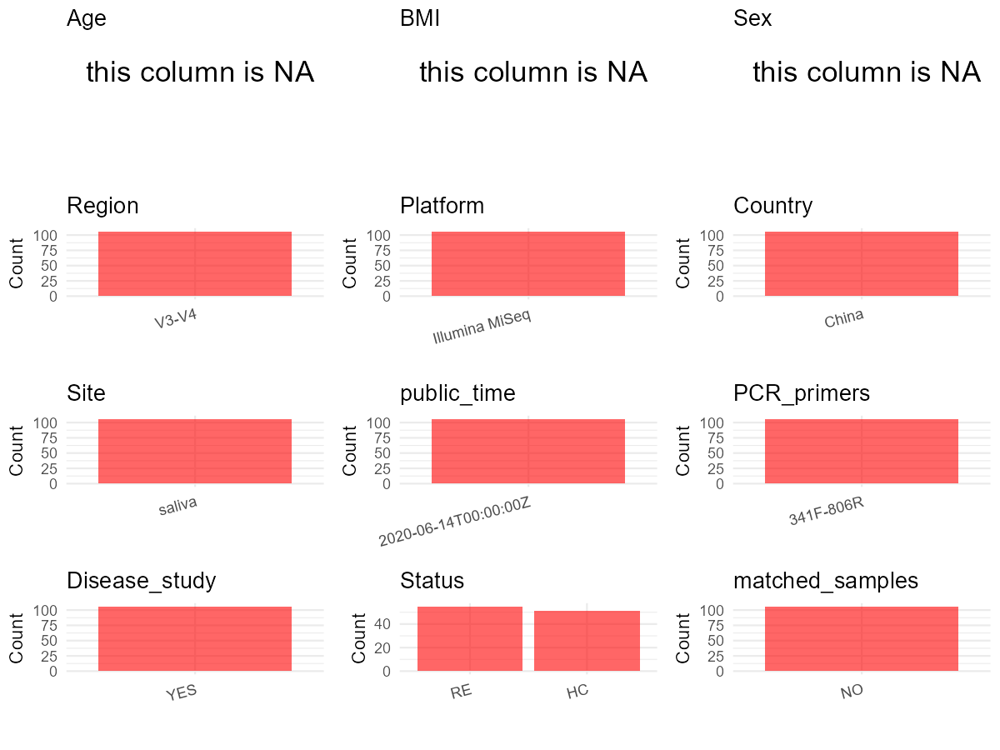

R Notebook: Metadata Processing Workflow
================

# Step 1: Obtain Initial Metadata from Each Project

To obtain the initial metadata: 1. Search for the BioProject ID (e.g.,
“PRJEBXXXX”) on the [NCBI SRA
website](https://www.ncbi.nlm.nih.gov/Traces/study/). 2. In the “Select”
table, click on “Metadata” and download the file. 3. The downloaded file
is typically named “SraRunTable.csv” and contains metadata for the
project.

``` r
# Load necessary libraries
library(dplyr)
library(ggplot2)
library(cowplot)

# Set working directory (update this path to your local directory)
setwd("D:/studylearning/董彪师兄项目/任务4_20251009/PRJNA639327")

# Read the initial metadata files
initial_meta<-read.csv("SraRunTable.csv",header = T)

# Display the first few rows of the metadata
head(initial_meta)
```

    ##           Run Assay.Type AvgSpotLen    Bases  BioProject    BioSample
    ## 1 SRR12009814   AMPLICON        499 20591367 PRJNA639327 SAMN15233074
    ## 2 SRR12009815   AMPLICON        501 19996632 PRJNA639327 SAMN15233073
    ## 3 SRR12009816   AMPLICON        500 22762889 PRJNA639327 SAMN15232983
    ## 4 SRR12009817   AMPLICON        500 26675354 PRJNA639327 SAMN15232974
    ## 5 SRR12009818   AMPLICON        500 25702625 PRJNA639327 SAMN15232973
    ## 6 SRR12009819   AMPLICON        500 25235947 PRJNA639327 SAMN15233072
    ##                         BioSampleModel    Bytes
    ## 1 MIMS.me,MIGS/MIMS/MIMARKS.human-oral 10709606
    ## 2 MIMS.me,MIGS/MIMS/MIMARKS.human-oral 10427228
    ## 3 MIMS.me,MIGS/MIMS/MIMARKS.human-oral 11542349
    ## 4 MIMS.me,MIGS/MIMS/MIMARKS.human-oral 13557014
    ## 5 MIMS.me,MIGS/MIMS/MIMARKS.human-oral 13024065
    ## 6 MIMS.me,MIGS/MIMS/MIMARKS.human-oral 12965236
    ##                                                      Center.Name
    ## 1 LUOYANG CENTRAL HOSPITAL AFFILIATED TO ZHENGZHOU UNIVERSITY.\\
    ## 2 LUOYANG CENTRAL HOSPITAL AFFILIATED TO ZHENGZHOU UNIVERSITY.\\
    ## 3 LUOYANG CENTRAL HOSPITAL AFFILIATED TO ZHENGZHOU UNIVERSITY.\\
    ## 4 LUOYANG CENTRAL HOSPITAL AFFILIATED TO ZHENGZHOU UNIVERSITY.\\
    ## 5 LUOYANG CENTRAL HOSPITAL AFFILIATED TO ZHENGZHOU UNIVERSITY.\\
    ## 6 LUOYANG CENTRAL HOSPITAL AFFILIATED TO ZHENGZHOU UNIVERSITY.\\
    ##   Collection_Date Consent   data_type DATASTORE.filetype DATASTORE.provider
    ## 1            2018  public RE51rawdata   fastq,run.zq,sra         gs,ncbi,s3
    ## 2            2018  public RE50rawdata   fastq,run.zq,sra         gs,ncbi,s3
    ## 3            2018  public  C11rawdata   fastq,run.zq,sra         gs,ncbi,s3
    ## 4            2018  public   C2rawdata   fastq,run.zq,sra         gs,ncbi,s3
    ## 5            2018  public   C1rawdata   fastq,run.zq,sra         gs,ncbi,s3
    ## 6            2018  public RE49rawdata   fastq,run.zq,sra         gs,ncbi,s3
    ##                       DATASTORE.region env_broad_scale env_local_scale
    ## 1 gs.us-east1,ncbi.public,s3.us-east-1      Human oral oral microbiome
    ## 2 gs.us-east1,ncbi.public,s3.us-east-1      Human oral oral microbiome
    ## 3 gs.us-east1,ncbi.public,s3.us-east-1      Human oral oral microbiome
    ## 4 gs.us-east1,ncbi.public,s3.us-east-1      Human oral oral microbiome
    ## 5 gs.us-east1,ncbi.public,s3.us-east-1      Human oral oral microbiome
    ## 6 gs.us-east1,ncbi.public,s3.us-east-1      Human oral oral microbiome
    ##   env_medium Experiment geo_loc_name_country geo_loc_name_country_continent
    ## 1     saliva SRX8542651                China                           Asia
    ## 2     saliva SRX8542650                China                           Asia
    ## 3     saliva SRX8542649                China                           Asia
    ## 4     saliva SRX8542648                China                           Asia
    ## 5     saliva SRX8542647                China                           Asia
    ## 6     saliva SRX8542646                China                           Asia
    ##   geo_loc_name         HOST     Instrument          lat_lon Library.Name
    ## 1  China:Henan Homo sapiens Illumina MiSeq 34.66 N 112.43 E         RE51
    ## 2  China:Henan Homo sapiens Illumina MiSeq 34.66 N 112.43 E         RE50
    ## 3  China:Henan Homo sapiens Illumina MiSeq 34.66 N 112.43 E          C11
    ## 4  China:Henan Homo sapiens Illumina MiSeq 34.66 N 112.43 E           C2
    ## 5  China:Henan Homo sapiens Illumina MiSeq 34.66 N 112.43 E           C1
    ## 6  China:Henan Homo sapiens Illumina MiSeq 34.66 N 112.43 E         RE49
    ##   LibraryLayout LibrarySelection LibrarySource        Organism Platform
    ## 1        PAIRED              PCR   METAGENOMIC oral metagenome ILLUMINA
    ## 2        PAIRED              PCR   METAGENOMIC oral metagenome ILLUMINA
    ## 3        PAIRED              PCR   METAGENOMIC oral metagenome ILLUMINA
    ## 4        PAIRED              PCR   METAGENOMIC oral metagenome ILLUMINA
    ## 5        PAIRED              PCR   METAGENOMIC oral metagenome ILLUMINA
    ## 6        PAIRED              PCR   METAGENOMIC oral metagenome ILLUMINA
    ##            ReleaseDate          create_date version Sample.Name SRA.Study
    ## 1 2020-06-14T00:00:00Z 2020-06-14T10:02:00Z       1        RE51 SRP267231
    ## 2 2020-06-14T00:00:00Z 2020-06-14T10:02:00Z       1        RE50 SRP267231
    ## 3 2020-06-14T00:00:00Z 2020-06-14T10:02:00Z       1         C11 SRP267231
    ## 4 2020-06-14T00:00:00Z 2020-06-14T10:02:00Z       1          C2 SRP267231
    ## 5 2020-06-14T00:00:00Z 2020-06-14T10:02:00Z       1          C1 SRP267231
    ## 6 2020-06-14T00:00:00Z 2020-06-14T10:02:00Z       1        RE49 SRP267231

# Step 2: Create a Uniform Metadata Template

The uniform metadata should include the following columns:

1.  **BioProject**: Project ID (e.g., “PRJNA339212”)
2.  **Run**: Sample ID (e.g., “ERRXXXXXX” or “SRRXXXXXX”)
3.  **sample_name**: Original sample name submitted by the authors (not
    the database-assigned ID)
4.  **Age**: Age of the subject (if available)
5.  **BMI**: Body Mass Index (if available)
6.  **Sex**: Sex of the subject (“F” or “M”)
7.  **Region**: Targeted 16S rRNA region (e.g., “V3-V4”)
8.  **Platform**: Sequencing platform (e.g., “Illumina MiSeq”)
9.  **Country**: Country of sample origin (e.g., “China”)
10. **Site**: Sample site (e.g., “saliva”, “dental plaque”)
11. **public_time**: Data release date (format: “YYYY-MM-DD”)
12. **PCR_primers**: PCR primers used (e.g., “515F-806R”)
13. **title**: Title of the associated publication
14. **Disease_study**: Whether the study involves a disease (“YES” or
    “NO”)
15. **Status**: Disease status (e.g., “T2DM”, “HC”). Note: If the study
    includes both disease and healthy samples, this must be specified
    per sample.

``` r
# Create a uniform metadata dataframe
metadata <- data.frame(
  BioProject = initial_meta$BioProject,
  Run = initial_meta$Run,
  sample_name = initial_meta$Sample.Name,
  Age = NA,
  BMI = NA,
  Sex= NA,
  Region = "V3-V4",
  Platform = initial_meta$Instrument,
  Country = initial_meta$geo_loc_name_country,
  Site = initial_meta$env_medium,
  public_time = initial_meta$ReleaseDate,
  stringsAsFactors = FALSE
)
```

# Step 3: Manually Add Information from the Publication

Some information (e.g. PCR primers, study title, disease status) must be
manually extracted from the publication and added to the metadata.

``` r
# Add information obtained from the publication
metadata$PCR_primers <- "341F-806R"  # Update based on the publication
metadata$title <- "Patients With Reflux Esophagitis Possess a Possible Different Oral Microbiota Compared With Healthy Controls"
metadata$Disease_study <- "YES"
metadata <- metadata %>% 
  mutate(Status=case_when(
    grepl("RE",sample_name)~"RE",
    grepl("C",sample_name)~"HC"
  ))

#extract subject id by remove prefix of sample_name
#metadata$sample_name <- gsub("_st|_sal", "", metadata$sample_name)

# Check initial data distribution
cat("Initial sample distribution:\n")
```

    ## Initial sample distribution:

``` r
table(metadata$sample_name)
```

    ## 
    ##   C1  C10  C11  C12  C13  C14  C15  C16  C17  C18  C19   C2  C20  C21  C22  C23 
    ##    1    1    1    1    1    1    1    1    1    1    1    1    1    1    1    1 
    ##  C24  C25  C26  C27  C28  C29   C3  C30  C31  C32  C33  C34  C35  C36  C37  C38 
    ##    1    1    1    1    1    1    1    1    1    1    1    1    1    1    1    1 
    ##  C39   C4  C40  C41  C42  C43  C44  C45  C46  C47  C48  C49   C5  C50  C51   C6 
    ##    1    1    1    1    1    1    1    1    1    1    1    1    1    1    1    1 
    ##   C7   C8   C9  RE1 RE10 RE11 RE12 RE13 RE14 RE15 RE16 RE17 RE18 RE19  RE2 RE20 
    ##    1    1    1    1    1    1    1    1    1    1    1    1    1    1    1    1 
    ## RE21 RE22 RE23 RE24 RE25 RE26 RE27 RE28 RE29  RE3 RE30 RE31 RE32 RE33 RE34 RE35 
    ##    1    1    1    1    1    1    1    1    1    1    1    1    1    1    1    1 
    ## RE36 RE37 RE38 RE39  RE4 RE40 RE41 RE42 RE43 RE44 RE45 RE46 RE47 RE48 RE49  RE5 
    ##    1    1    1    1    1    1    1    1    1    1    1    1    1    1    1    1 
    ## RE50 RE51 RE52 RE53 RE54 RE55  RE6  RE7  RE8  RE9 
    ##    1    1    1    1    1    1    1    1    1    1

``` r
table(metadata$Site)
```

    ## 
    ## saliva 
    ##    106

``` r
# Calculate sampling frequency per subject
sample_counts <- table(metadata$sample_name)
cat("\nNumber of samples per subject:\n")
```

    ## 
    ## Number of samples per subject:

``` r
print(sample_counts)
```

    ## 
    ##   C1  C10  C11  C12  C13  C14  C15  C16  C17  C18  C19   C2  C20  C21  C22  C23 
    ##    1    1    1    1    1    1    1    1    1    1    1    1    1    1    1    1 
    ##  C24  C25  C26  C27  C28  C29   C3  C30  C31  C32  C33  C34  C35  C36  C37  C38 
    ##    1    1    1    1    1    1    1    1    1    1    1    1    1    1    1    1 
    ##  C39   C4  C40  C41  C42  C43  C44  C45  C46  C47  C48  C49   C5  C50  C51   C6 
    ##    1    1    1    1    1    1    1    1    1    1    1    1    1    1    1    1 
    ##   C7   C8   C9  RE1 RE10 RE11 RE12 RE13 RE14 RE15 RE16 RE17 RE18 RE19  RE2 RE20 
    ##    1    1    1    1    1    1    1    1    1    1    1    1    1    1    1    1 
    ## RE21 RE22 RE23 RE24 RE25 RE26 RE27 RE28 RE29  RE3 RE30 RE31 RE32 RE33 RE34 RE35 
    ##    1    1    1    1    1    1    1    1    1    1    1    1    1    1    1    1 
    ## RE36 RE37 RE38 RE39  RE4 RE40 RE41 RE42 RE43 RE44 RE45 RE46 RE47 RE48 RE49  RE5 
    ##    1    1    1    1    1    1    1    1    1    1    1    1    1    1    1    1 
    ## RE50 RE51 RE52 RE53 RE54 RE55  RE6  RE7  RE8  RE9 
    ##    1    1    1    1    1    1    1    1    1    1

``` r
# Create matched_samples column
metadata$matched_samples <- ifelse(metadata$sample_name %in% names(sample_counts[sample_counts >= 2]), "YES", "NO")

cat("\nMatched samples distribution:\n")
```

    ## 
    ## Matched samples distribution:

``` r
table(metadata$matched_samples)
```

    ## 
    ##  NO 
    ## 106

``` r
# Identify samples for removal: single samples excluding saliva
single_samples <- names(sample_counts[sample_counts == 1])
samples_to_remove <- metadata$sample_name %in% single_samples & !(metadata$Site %in% c("saliva"))

cat("\nNumber of samples to be removed:", sum(samples_to_remove), "\n")
```

    ## 
    ## Number of samples to be removed: 0

``` r
# Remove identified samples
metadata_clean <- metadata[!samples_to_remove, ]

cat("\nFinal sample distribution after cleaning:\n")
```

    ## 
    ## Final sample distribution after cleaning:

``` r
table(metadata_clean$sample_name)
```

    ## 
    ##   C1  C10  C11  C12  C13  C14  C15  C16  C17  C18  C19   C2  C20  C21  C22  C23 
    ##    1    1    1    1    1    1    1    1    1    1    1    1    1    1    1    1 
    ##  C24  C25  C26  C27  C28  C29   C3  C30  C31  C32  C33  C34  C35  C36  C37  C38 
    ##    1    1    1    1    1    1    1    1    1    1    1    1    1    1    1    1 
    ##  C39   C4  C40  C41  C42  C43  C44  C45  C46  C47  C48  C49   C5  C50  C51   C6 
    ##    1    1    1    1    1    1    1    1    1    1    1    1    1    1    1    1 
    ##   C7   C8   C9  RE1 RE10 RE11 RE12 RE13 RE14 RE15 RE16 RE17 RE18 RE19  RE2 RE20 
    ##    1    1    1    1    1    1    1    1    1    1    1    1    1    1    1    1 
    ## RE21 RE22 RE23 RE24 RE25 RE26 RE27 RE28 RE29  RE3 RE30 RE31 RE32 RE33 RE34 RE35 
    ##    1    1    1    1    1    1    1    1    1    1    1    1    1    1    1    1 
    ## RE36 RE37 RE38 RE39  RE4 RE40 RE41 RE42 RE43 RE44 RE45 RE46 RE47 RE48 RE49  RE5 
    ##    1    1    1    1    1    1    1    1    1    1    1    1    1    1    1    1 
    ## RE50 RE51 RE52 RE53 RE54 RE55  RE6  RE7  RE8  RE9 
    ##    1    1    1    1    1    1    1    1    1    1

``` r
table(metadata_clean$Site)
```

    ## 
    ## saliva 
    ##    106

``` r
table(metadata_clean$matched_samples)
```

    ## 
    ##  NO 
    ## 106

``` r
# Use cleaned dataset for subsequent analysis
metadata <- metadata_clean
```

# Step 4: Summarize and Validate the Metadata

``` r
# Check the number of unique runs and sample names
print(paste("Number of unique runs:", length(unique(metadata$Run))))
```

    ## [1] "Number of unique runs: 106"

``` r
print(paste("Number of unique sample names:", length(unique(metadata$sample_name))))
```

    ## [1] "Number of unique sample names: 106"

# Step 5: Visualize the Metadata

``` r

```


# Step 6: Finalize and Export the Metadata

``` r
# Reorder columns to match the desired format
metadata <- metadata[, c(
  "BioProject", "Run", "sample_name", "Age", "BMI", "Sex", 
  "Region", "Platform", "Country", "Site", "public_time", 
  "PCR_primers", "title", "Disease_study", "Status","matched_samples"
)]

# Export the uniform metadata to a CSV file
write.csv(metadata, file = "metadata.csv", quote = FALSE)
head(metadata)
```

    ##    BioProject         Run sample_name Age BMI Sex Region       Platform Country
    ## 1 PRJNA639327 SRR12009814        RE51  NA  NA  NA  V3-V4 Illumina MiSeq   China
    ## 2 PRJNA639327 SRR12009815        RE50  NA  NA  NA  V3-V4 Illumina MiSeq   China
    ## 3 PRJNA639327 SRR12009816         C11  NA  NA  NA  V3-V4 Illumina MiSeq   China
    ## 4 PRJNA639327 SRR12009817          C2  NA  NA  NA  V3-V4 Illumina MiSeq   China
    ## 5 PRJNA639327 SRR12009818          C1  NA  NA  NA  V3-V4 Illumina MiSeq   China
    ## 6 PRJNA639327 SRR12009819        RE49  NA  NA  NA  V3-V4 Illumina MiSeq   China
    ##     Site          public_time PCR_primers
    ## 1 saliva 2020-06-14T00:00:00Z   341F-806R
    ## 2 saliva 2020-06-14T00:00:00Z   341F-806R
    ## 3 saliva 2020-06-14T00:00:00Z   341F-806R
    ## 4 saliva 2020-06-14T00:00:00Z   341F-806R
    ## 5 saliva 2020-06-14T00:00:00Z   341F-806R
    ## 6 saliva 2020-06-14T00:00:00Z   341F-806R
    ##                                                                                                          title
    ## 1 Patients With Reflux Esophagitis Possess a Possible Different Oral Microbiota Compared With Healthy Controls
    ## 2 Patients With Reflux Esophagitis Possess a Possible Different Oral Microbiota Compared With Healthy Controls
    ## 3 Patients With Reflux Esophagitis Possess a Possible Different Oral Microbiota Compared With Healthy Controls
    ## 4 Patients With Reflux Esophagitis Possess a Possible Different Oral Microbiota Compared With Healthy Controls
    ## 5 Patients With Reflux Esophagitis Possess a Possible Different Oral Microbiota Compared With Healthy Controls
    ## 6 Patients With Reflux Esophagitis Possess a Possible Different Oral Microbiota Compared With Healthy Controls
    ##   Disease_study Status matched_samples
    ## 1           YES     RE              NO
    ## 2           YES     RE              NO
    ## 3           YES     HC              NO
    ## 4           YES     HC              NO
    ## 5           YES     HC              NO
    ## 6           YES     RE              NO

## Notes for Students:

1.  **Metadata Accuracy**: Always cross-check the metadata with the
    original publication to ensure accuracy.
2.  **Manual Entries**: Columns like `PCR_primers`, and `Status` often
    require manual entry based on the publication.
3.  **Disease Status**: Be careful when assigning `Status`—some studies
    include both disease and healthy samples.
4.  **Visualization**: The plots help quickly identify the distribution
    of values in each column, which is useful for quality control.
5.  **Reproducibility**: Update the working directory and file paths to
    match your local environment.
