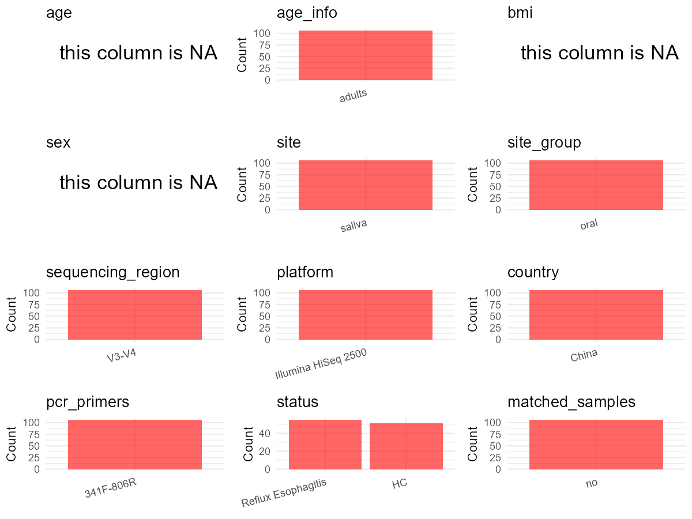

R Notebook: Metadata Processing Workflow
================

# Step 1: Obtain Initial Metadata from Each Project

This step sets the project directory, loads the raw SRA metadata, and
optionally merges supplement tables.

``` r
# Load libraries
library(dplyr)
library(ggplot2)
library(cowplot)

# (1) Setting working directory
# EDIT HERE: change project_id for each study
project_id <- "PRJNA639327"

base_dir <- "D:/metadata_collect/oral_metadata_new/update"
setwd(file.path(base_dir, project_id))

# (2) Loading raw SRA metadata file
sra_file <- "SraRunTable.csv"
initial_meta <- read.csv(sra_file, header = TRUE)

# (3) OPTIONAL: If extra metadata (e.g., Table.x or supplemental materials) are available from the article, you may need to merge the file with initial_meta manually. Below is example code for merging. Depending on the specific case of each study, you can customize the code as needed.
# supp_table <- read.csv("supplemental_table.csv", header = TRUE)
# initial_meta <- left_join(initial_meta, supp_table, by = merge_col_name)
```

# Step 2: Data Overview

First, you need to get an overview of the data, which includes two
steps: reading the article and reading the initial metadata. This step
is very IMPORTANT!

``` r
# (1) Read the article in the following order: abstract, the beginning of the results section, and the methods. Understand the sample size, experimental design, and disease group overview. Clarify the sampling sites; for oral and gut samples, specify the exact sites like supragingival plaque, tongue, etc.

# (2) IMPORTANT: MUST go through each column of initial_meta
head(initial_meta, 10)
```

    ##            Run Assay.Type AvgSpotLen    Bases  BioProject    BioSample
    ## 1  SRR12009814   AMPLICON        499 20591367 PRJNA639327 SAMN15233074
    ## 2  SRR12009815   AMPLICON        501 19996632 PRJNA639327 SAMN15233073
    ## 3  SRR12009816   AMPLICON        500 22762889 PRJNA639327 SAMN15232983
    ## 4  SRR12009817   AMPLICON        500 26675354 PRJNA639327 SAMN15232974
    ## 5  SRR12009818   AMPLICON        500 25702625 PRJNA639327 SAMN15232973
    ## 6  SRR12009819   AMPLICON        500 25235947 PRJNA639327 SAMN15233072
    ## 7  SRR12009820   AMPLICON        500 26120183 PRJNA639327 SAMN15233071
    ## 8  SRR12009821   AMPLICON        501  5915291 PRJNA639327 SAMN15233070
    ## 9  SRR12009822   AMPLICON        500 22483480 PRJNA639327 SAMN15233069
    ## 10 SRR12009823   AMPLICON        501 23303576 PRJNA639327 SAMN15233068
    ##                          BioSampleModel    Bytes
    ## 1  MIMS.me,MIGS/MIMS/MIMARKS.human-oral 10709606
    ## 2  MIMS.me,MIGS/MIMS/MIMARKS.human-oral 10427228
    ## 3  MIMS.me,MIGS/MIMS/MIMARKS.human-oral 11542349
    ## 4  MIMS.me,MIGS/MIMS/MIMARKS.human-oral 13557014
    ## 5  MIMS.me,MIGS/MIMS/MIMARKS.human-oral 13024065
    ## 6  MIMS.me,MIGS/MIMS/MIMARKS.human-oral 12965236
    ## 7  MIMS.me,MIGS/MIMS/MIMARKS.human-oral 13363267
    ## 8  MIMS.me,MIGS/MIMS/MIMARKS.human-oral  3182701
    ## 9  MIMS.me,MIGS/MIMS/MIMARKS.human-oral 11594641
    ## 10 MIMS.me,MIGS/MIMS/MIMARKS.human-oral 12113660
    ##                                                       Center.Name
    ## 1  LUOYANG CENTRAL HOSPITAL AFFILIATED TO ZHENGZHOU UNIVERSITY.\\
    ## 2  LUOYANG CENTRAL HOSPITAL AFFILIATED TO ZHENGZHOU UNIVERSITY.\\
    ## 3  LUOYANG CENTRAL HOSPITAL AFFILIATED TO ZHENGZHOU UNIVERSITY.\\
    ## 4  LUOYANG CENTRAL HOSPITAL AFFILIATED TO ZHENGZHOU UNIVERSITY.\\
    ## 5  LUOYANG CENTRAL HOSPITAL AFFILIATED TO ZHENGZHOU UNIVERSITY.\\
    ## 6  LUOYANG CENTRAL HOSPITAL AFFILIATED TO ZHENGZHOU UNIVERSITY.\\
    ## 7  LUOYANG CENTRAL HOSPITAL AFFILIATED TO ZHENGZHOU UNIVERSITY.\\
    ## 8  LUOYANG CENTRAL HOSPITAL AFFILIATED TO ZHENGZHOU UNIVERSITY.\\
    ## 9  LUOYANG CENTRAL HOSPITAL AFFILIATED TO ZHENGZHOU UNIVERSITY.\\
    ## 10 LUOYANG CENTRAL HOSPITAL AFFILIATED TO ZHENGZHOU UNIVERSITY.\\
    ##    Collection_Date Consent   data_type DATASTORE.filetype DATASTORE.provider
    ## 1             2018  public RE51rawdata   fastq,run.zq,sra         gs,ncbi,s3
    ## 2             2018  public RE50rawdata   fastq,run.zq,sra         gs,ncbi,s3
    ## 3             2018  public  C11rawdata   fastq,run.zq,sra         gs,ncbi,s3
    ## 4             2018  public   C2rawdata   fastq,run.zq,sra         gs,ncbi,s3
    ## 5             2018  public   C1rawdata   fastq,run.zq,sra         gs,ncbi,s3
    ## 6             2018  public RE49rawdata   fastq,run.zq,sra         gs,ncbi,s3
    ## 7             2018  public RE48rawdata   fastq,run.zq,sra         gs,ncbi,s3
    ## 8             2018  public RE47rawdata   fastq,run.zq,sra         gs,ncbi,s3
    ## 9             2018  public RE46rawdata   fastq,run.zq,sra         gs,ncbi,s3
    ## 10            2018  public RE45rawdata   fastq,run.zq,sra         gs,ncbi,s3
    ##                        DATASTORE.region env_broad_scale env_local_scale
    ## 1  gs.us-east1,ncbi.public,s3.us-east-1      Human oral oral microbiome
    ## 2  gs.us-east1,ncbi.public,s3.us-east-1      Human oral oral microbiome
    ## 3  gs.us-east1,ncbi.public,s3.us-east-1      Human oral oral microbiome
    ## 4  gs.us-east1,ncbi.public,s3.us-east-1      Human oral oral microbiome
    ## 5  gs.us-east1,ncbi.public,s3.us-east-1      Human oral oral microbiome
    ## 6  gs.us-east1,ncbi.public,s3.us-east-1      Human oral oral microbiome
    ## 7  gs.us-east1,ncbi.public,s3.us-east-1      Human oral oral microbiome
    ## 8  gs.us-east1,ncbi.public,s3.us-east-1      Human oral oral microbiome
    ## 9  gs.us-east1,ncbi.public,s3.us-east-1      Human oral oral microbiome
    ## 10 gs.us-east1,ncbi.public,s3.us-east-1      Human oral oral microbiome
    ##    env_medium Experiment geo_loc_name_country geo_loc_name_country_continent
    ## 1      saliva SRX8542651                China                           Asia
    ## 2      saliva SRX8542650                China                           Asia
    ## 3      saliva SRX8542649                China                           Asia
    ## 4      saliva SRX8542648                China                           Asia
    ## 5      saliva SRX8542647                China                           Asia
    ## 6      saliva SRX8542646                China                           Asia
    ## 7      saliva SRX8542645                China                           Asia
    ## 8      saliva SRX8542644                China                           Asia
    ## 9      saliva SRX8542643                China                           Asia
    ## 10     saliva SRX8542642                China                           Asia
    ##    geo_loc_name         HOST     Instrument          lat_lon Library.Name
    ## 1   China:Henan Homo sapiens Illumina MiSeq 34.66 N 112.43 E         RE51
    ## 2   China:Henan Homo sapiens Illumina MiSeq 34.66 N 112.43 E         RE50
    ## 3   China:Henan Homo sapiens Illumina MiSeq 34.66 N 112.43 E          C11
    ## 4   China:Henan Homo sapiens Illumina MiSeq 34.66 N 112.43 E           C2
    ## 5   China:Henan Homo sapiens Illumina MiSeq 34.66 N 112.43 E           C1
    ## 6   China:Henan Homo sapiens Illumina MiSeq 34.66 N 112.43 E         RE49
    ## 7   China:Henan Homo sapiens Illumina MiSeq 34.66 N 112.43 E         RE48
    ## 8   China:Henan Homo sapiens Illumina MiSeq 34.66 N 112.43 E         RE47
    ## 9   China:Henan Homo sapiens Illumina MiSeq 34.66 N 112.43 E         RE46
    ## 10  China:Henan Homo sapiens Illumina MiSeq 34.66 N 112.43 E         RE45
    ##    LibraryLayout LibrarySelection LibrarySource        Organism Platform
    ## 1         PAIRED              PCR   METAGENOMIC oral metagenome ILLUMINA
    ## 2         PAIRED              PCR   METAGENOMIC oral metagenome ILLUMINA
    ## 3         PAIRED              PCR   METAGENOMIC oral metagenome ILLUMINA
    ## 4         PAIRED              PCR   METAGENOMIC oral metagenome ILLUMINA
    ## 5         PAIRED              PCR   METAGENOMIC oral metagenome ILLUMINA
    ## 6         PAIRED              PCR   METAGENOMIC oral metagenome ILLUMINA
    ## 7         PAIRED              PCR   METAGENOMIC oral metagenome ILLUMINA
    ## 8         PAIRED              PCR   METAGENOMIC oral metagenome ILLUMINA
    ## 9         PAIRED              PCR   METAGENOMIC oral metagenome ILLUMINA
    ## 10        PAIRED              PCR   METAGENOMIC oral metagenome ILLUMINA
    ##             ReleaseDate          create_date version Sample.Name SRA.Study
    ## 1  2020-06-14T00:00:00Z 2020-06-14T10:02:00Z       1        RE51 SRP267231
    ## 2  2020-06-14T00:00:00Z 2020-06-14T10:02:00Z       1        RE50 SRP267231
    ## 3  2020-06-14T00:00:00Z 2020-06-14T10:02:00Z       1         C11 SRP267231
    ## 4  2020-06-14T00:00:00Z 2020-06-14T10:02:00Z       1          C2 SRP267231
    ## 5  2020-06-14T00:00:00Z 2020-06-14T10:02:00Z       1          C1 SRP267231
    ## 6  2020-06-14T00:00:00Z 2020-06-14T10:02:00Z       1        RE49 SRP267231
    ## 7  2020-06-14T00:00:00Z 2020-06-14T10:03:00Z       1        RE48 SRP267231
    ## 8  2020-06-14T00:00:00Z 2020-06-14T10:02:00Z       1        RE47 SRP267231
    ## 9  2020-06-14T00:00:00Z 2020-06-14T10:03:00Z       1        RE46 SRP267231
    ## 10 2020-06-14T00:00:00Z 2020-06-14T10:03:00Z       1        RE45 SRP267231

``` r
# IMPORTANT: Check the unique values in the column of interest or query column.
# lapply(initial_meta[c('body_habitat', 'body_product', 'body_site')], table) # site
# lapply(initial_meta[c('common_name', 'env_biome', 'env_feature', 'env_matter', 'host_common_name', 'Organism', 'role', 'pet_farm_animal')], table) # organism: the dog sample counts in these columns are different! 512 in pet_farm_animal,217 in env_biome, env_feature and role, 210 in host_common_name. Majority rule, so we determine to use column role to filter dog samples
# table(initial_meta$host_subject_id) # subject id
# table(initial_meta$sequencing_meth..exp.) # output is pyrosequencing
# table(initial_meta$platform..exp.) # output is Illumina. according to the methods, Illumina is correct.
# table(initial_meta$target_subfragment..exp.)
```

# Step 3: Removing Control and Non-human Samples

First, we need to remove control samples(including both negative
controls and positive controls) and non-human samples.

``` r
# (1) EDIT HERE: Parameter setup
# control_column / control_keywords: from paper Methods, 51 healthy controls with Sample Name starting with "C"
# These are NOT negative/positive controls but healthy comparators — keep them, do not remove.
control_column <- ""   # no negative/positive controls in this dataset
# unique(initial_meta[[control_column]])
control_keywords <- c()     # no control samples to remove

# All samples are Homo sapiens per paper and initial_meta$Organism column
species_column <- "Organism"          # column name in initial_meta
unique(initial_meta[[species_column]])
```

    ## [1] "oral metagenome"

``` r
non_human_keywords <- c()            # no non-human samples; all are Homo sapiens


# (2) Remove controls and non-human samples. DO NOT need to modify code in this part, just run it.
n_samples <- nrow(initial_meta)
# Control evaluation
if (length(control_keywords) > 0) {
  if (is.null(control_column) || control_column == "") {
    stop("Error: control_keywords provided but control_column is missing.")
  }

  if (!(control_column %in% colnames(initial_meta))) {
    stop(sprintf("Error: Column '%s' not found in initial_meta.", control_column))
  }

  control_pattern <- paste(control_keywords, collapse = "|")
  control_text <- initial_meta[[control_column]]
  is_control <- grepl(control_pattern, control_text)

} else {
  is_control <- rep(FALSE, n_samples)
}

# Non-human evaluation
if (length(non_human_keywords) > 0) {
  if (is.null(species_column) || species_column == "") {
    stop("Error: non_human_keywords provided but species_column is missing.")
  }

  if (!(species_column %in% colnames(initial_meta))) {
    stop(sprintf("Error: Column '%s' not found in initial_meta.", species_column))
  }

  non_human_pattern <- paste(non_human_keywords, collapse = "|")
  species_text <- initial_meta[[species_column]]
  is_non_human <- grepl(non_human_pattern, species_text)
} else {
  is_non_human <- rep(FALSE, n_samples)
}

# Execute removal
samples_to_remove <- is_control | is_non_human
initial_meta <- initial_meta[!samples_to_remove, ]

cat("Initial samples counts:",n_samples,"\n")
```

    ## Initial samples counts: 106

``` r
cat("Removed control samples:", sum(is_control), "\n")
```

    ## Removed control samples: 0

``` r
cat("Removed non-human samples:", sum(is_non_human), "\n")
```

    ## Removed non-human samples: 0

``` r
cat("Total samples removed ", sum(samples_to_remove), "\n")
```

    ## Total samples removed  0

``` r
cat("Remaining samples after Step 2:", nrow(initial_meta), "\n")
```

    ## Remaining samples after Step 2: 106

# Step 4: Creating a Uniform Metadata Template

This step converts the raw SRA table into the standard metadata format
used in our meta-analysis. The uniform metadata should include the
following columns: 1. **bioproject**: Project ID from SRA or other
database e.g. `PRJNA1234`, `CNP1234`, ‘OEP1234’, ‘qiita_1234’ 2.
**sample_id**: SRA sample/run ID. Unique id for each sample!
e.g. `DRR1234567`, `ERR1234567` and `SRR1234567`. If no such column
exists, can use column like sample_name. 3. **subject_id**: subject id
for each person if available. e.g. `patient_01`, `Host_03_before`,
`subject12` 4. **age**: Age of the subject if available. e.g. `35`, `42`
\| not `adult`, `chilren` 5. **age_info**: If the age is not explicitly
stated but approximate age range information is available, mark it in
this column. e.g., `18-55`, `children`, `infant`, `elder` 6. **bmi**:
Body Mass Index if available. e.g. `22.5`, `18.9` \| not `normal`,
`overweight` 7. **sex**: Sex of the subject. Mandatory to write as M/F
\| not `female`, `woman` 8. **sequencing_region**: Targeted 16S rRNA
region. e.g. `V3-V4`, `V4` 9. **platform**: Sequencing platform.
e.g. `Illumina MiSeq`, `454 GS FLX Titanium`, `Ion Torrent` 10.
**country**: Country of sample origin. e.g. `China`, `Japan` \| not city
name like `Beijing` 11. **site**: Sampling site. For oral and gut sites,
specify the exact sites as detailed as possible. For example, if it is
known to be supragingival plaque, do not record it as ‘dental plaque’,
unless the original text provides only a vague description.
e.g. `saliva`, `tongue coating` \| not broad term like `oral` 12.
**site_group**: only accepts one of following three values: ‘oral’,
‘gut’, or ‘other’. 13. **public_time**: Data release date.
e.g. `2021-06-22` \| not `June 2021` 14. **pcr_primers**: PCR primers
used. e.g. `515F-806R`, `27F-338R` \| not primer sequences 15.
**title**: Title of the associated publication. 16. **disease_study**:
Whether the study involves disease samples. If it’s not clear, can
record as NA. Only three values accepted: ‘yes’, ‘no’ or NA 17.
**status**: Disease status for each sample if available, else record as
NA. Only accept following abbreviations, Write full names for all other
diseases. HC: healthy control CD: Crohn’s disease CRC: colorectal cancer
COPD: chronic obstructive pulmonary disease HIV: human immunodeficiency
virus ICU: intensive care unit OSCC: oral squamous cell carcinoma RA:
rheumatoid arthritis UC: ulcerative colitis 18. **matched_samples**:
Whether the subject has matched samples. Only accept ‘yes’ or ‘no’. 19.
**is_time_series**: Whether the study is a time series study. Only
accept ‘yes’ or ‘no’.

``` r
# Extract columns from initial_meta as follows: (1) No modification needed -> extract directly. (2) Modification needed -> create a new column with the prefix raw_ and mark the original column as "pending". (3) Need to find or determine based on the article.
metadata <- data.frame(
  bioproject = initial_meta$BioProject,  # From initial_meta column 'BioProject'; all PRJNA639327
  sample_id = initial_meta$Run,          # From initial_meta column 'Run'; SRR IDs
  subject_id = initial_meta$Sample.Name,       # From initial_meta column 'Sample.Name'; e.g. RE1, C51
  age = NA,                              # No individual age in metadata; paper Table 1 gives group mean only (RE: 52.55, HC: 48.94)
  age_info = "adults",                   # Paper Methods: enrolled adults from hospital outpatients
  bmi = NA,                              # No individual BMI in metadata; paper Table 1 gives group mean only (RE: 24.54, HC: 25.57)
  sex = NA,                              # No sex column in SRA metadata; paper Table 1 gives group counts only (RE: 30F/25M, HC: 24F/27M)
  sequencing_region = "V3-V4",           # Paper Methods: "V3-V4 hypervariable regions of the bacterial 16S rDNA gene"
  platform = "Illumina HiSeq 2500",      # Paper Methods: "Illumina Hiseq 2500 instrument" (NOT from metadata Platform column)
  country = initial_meta$geo_loc_name_country,  # From initial_meta column 'geo_loc_name_country'; all "China"
  site = "saliva",                       # Paper Methods: "Fresh saliva samples"; initial_meta env_medium column confirms all "saliva"
  site_group = "pending",                # modify later
  public_time = initial_meta$ReleaseDate,       # From initial_meta column 'ReleaseDate'; 2020-06-14
  pcr_primers = "341F-806R",             # Paper Methods: primers F341F and R806R
  title = "Patients With Reflux Esophagitis Possess a Possible Different Oral Microbiota Compared With Healthy Controls",  # Paper title
  disease_study = "yes",                 # Paper: RE patients vs healthy controls — disease comparison study
  status = NA,                           # pending: derive from Sample Name pattern below
  matched_samples = "pending",           # modify later
  is_time_series = "no",                 # Paper Methods: single timepoint saliva collection; no repeated sampling of same individual
  stringsAsFactors = FALSE
)
metadata$public_time <- as.Date(metadata$public_time)

# Derive status from Sample Name: RE-prefix = Reflux Esophagitis, C-prefix = healthy control (HC)
# From paper Table 1: 55 RE patients, 51 healthy controls
# From initial_meta Sample Name column: RE1-RE55, C1-C51
metadata$status <- ifelse(
  grepl("^RE", initial_meta$Sample.Name),
  "Reflux Esophagitis",
  ifelse(grepl("^C", initial_meta$Sample.Name), "HC", NA)
)
```

# Step 5: Manually solving pending issues

This step involves two parts: (1) handle the columns with the `raw_`
prefix, and next (2) handle the `site_group` and `matched_samples`
columns.

``` r
# (1) Handle the columns with the `raw_` prefix.
# No raw_ columns in this project — all fields resolved in Step 4.
```

``` r
# (2) Filling the 'site_group' and 'matched_samples' columns
# editing site_group
unique(metadata$site)
```

    ## [1] "saliva"

``` r
# EDIT HERE: add oral sites
# Paper Methods: "fresh saliva samples" — all samples are saliva, an oral site
Oral_site = c("saliva")
# EDIT HERE: add gut sites
Gut_site = c()
# just run
metadata <- metadata %>%
  mutate(site_group = case_when(
    site %in% Oral_site ~ "oral",
    site %in% Gut_site ~ "gut",
    TRUE ~ "other"
  ))

# editing matched_samples, just run.
# Paper: each subject provided one saliva sample; no matched/repeated sampling
metadata$matched_samples <- ifelse(
  ave(metadata$subject_id, metadata$subject_id, FUN = length) > 1,
  "yes",
  "no"
)
```

``` r
# (3) check if there is pending value in metadata. If there is pending value, go on modify the metadata.
# Function to check if a column contains "pending"
has_pending <- function(col) {
  if (is.character(col) || is.factor(col)) {
    any(col == "pending", na.rm = TRUE)
  } else {
    FALSE
  }
}

# Check for any pending value
any_pending_value <- any(sapply(metadata, has_pending))

if (!any_pending_value) {
  message("Good! No cell contains the value 'pending'.")
} else {
  pending_cols <- names(metadata)[sapply(metadata, has_pending)]
  message("Columns containing 'pending': ", paste(pending_cols, collapse = ", "))
  message("Please continue to resolve these pending columns!")
}
```

    ## Good! No cell contains the value 'pending'.

# Step 6: Visualize the Metadata

This step makes a quick set of plots for checking the distribution of
key metadata fields.

``` r
# Select columns for visualization, just run
plot_data <- metadata %>%
  select(-bioproject, -sample_id, -subject_id, -title)

create_simple_plots <- function(data) {
  plots <- list()
  continuous_vars <- c("age", "bmi")

  for (col in colnames(data)) {
    if (all(is.na(data[[col]]))) {
      p <- ggplot() +
        annotate("text", x = 0.5, y = 0.5, label = "this column is NA", size = 6) +
        labs(title = col) +
        theme_void()
    } else if (col %in% continuous_vars && is.numeric(data[[col]])) {
      p <- ggplot(data, aes(x = .data[[col]])) +
        geom_histogram(fill = "blue", alpha = 0.6, bins = 20, na.rm = TRUE) +
        labs(title = col, x = col, y = "Count") +
        theme_minimal()
    } else {
      count_data <- as.data.frame(table(data[[col]], useNA = "ifany"))
      p <- ggplot(count_data, aes(x = reorder(Var1, -Freq), y = Freq)) +
        geom_col(fill = "red", alpha = 0.6) +
        labs(title = col, x = NULL, y = "Count") +
        theme_minimal() +
        theme(axis.text.x = element_text(angle = 15, hjust = 1))
    }
    plots[[col]] <- p
  }

  return(plots)
}

# Generate and arrange plots
plots <- create_simple_plots(plot_data)
p <- plot_grid(plots$age,
               plots$age_info,
               plots$bmi,
               plots$sex,
               plots$site,
               plots$site_group,
               plots$sequencing_region,
               plots$platform,
               plots$country,
               plots$pcr_primers,
               plots$status,
               plots$matched_samples,
               ncol = 3, align = "hv", axis = "lb")
ggsave("Metadata_Summary_v2.png", plot = p, width = 8, height = 6, dpi = 150)
```

``` r
# Insert Metadata_Summary_v2.png into the current Rmd output

```

<!-- -->

# Step 7: Sort and export the metadata

This step saves the cleaned metadata table as the final `metadata.csv`
file.

``` r
# Reorder the data frame
fixed_cols <- c("bioproject", "sample_id", "subject_id", "age", "age_info",
                "bmi", "sex", "platform", "sequencing_region", "pcr_primers",
                "country", "site", "site_group", "disease_study", "status",
                "title", "public_time", "matched_samples", "is_time_series")
metadata <- metadata %>%
  select(all_of(fixed_cols), everything())

# save metadata
# head(metadata)
write.csv(metadata, file = "metadata_v2.csv", quote = TRUE)
```
