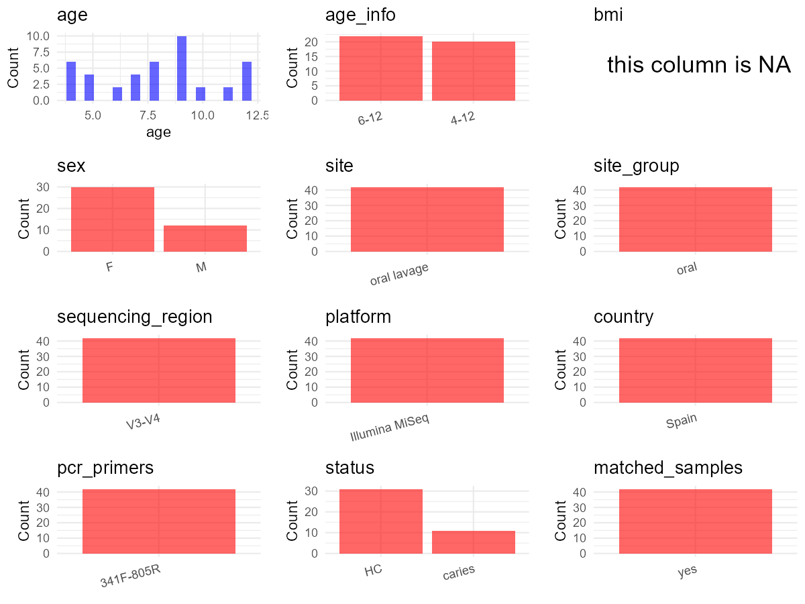

# Step 1: Obtain Initial Metadata from Each Project

This step sets the project directory, loads the raw SRA metadata, and optionally merges supplement tables.

```{r message=FALSE, warning=FALSE}
# Load libraries
library(dplyr)
library(ggplot2)
library(cowplot)

# (1) Setting working directory
project_id <- "PRJNA643173"

base_dir <- "D:/metadata_collect"
setwd(file.path(base_dir, project_id))

# (2) Loading raw SRA metadata file
sra_file <- "SraRunTable.csv"
initial_meta <- read.csv(sra_file, header = TRUE)

# (3) OPTIONAL: If extra metadata (e.g., Table.x or supplemental materials) are available from the article, you may need to merge the file with initial_meta manually. Below is example code for merging. Depending on the specific case of each study, you can customize the code as needed.
# supp_table <- read.csv("supplemental_table.csv", header = TRUE)
# initial_meta <- left_join(initial_meta, supp_table, by = merge_col_name)
```

# Step 2: Data Overview

First, you need to get an overview of the data, which includes two steps: reading the article and reading the initial metadata. This step is very IMPORTANT!

**Paper summary** (from abstract, methods, and Table 1):
- Title: "Machine Learning Study in Caries Markers in Oral Microbiota from Monozygotic Twin Children"
- 21 monozygotic twin pairs (42 children total), recruited Jan-May 2018 in Madrid, Spain
- Caries group: 11 pairs (22 infants, 73% females, median age 9, range 6-12)
- Control group: 10 pairs (20 infants, 70% females, median age 6.7, range 4-12)
- Sample type: oral lavage (whole-mouth rinse with 10 mL sterile water)
- Sequencing: Illumina MiSeq, 2x300 bp, targeting 16S rRNA V3-V4 regions
- All participants recruited during orthodontic treatment; no prior caries diagnosis

```{r message=FALSE, warning=FALSE}
# (1) Read the article in the following order: abstract, the beginning of the results section, and the methods. Understand the sample size, experimental design, and disease group overview. Clarify the sampling sites; for oral and gut samples, specify the exact sites like supragingival plaque, tongue, etc.

# (2) IMPORTANT: MUST go through each column of initial_meta
head(initial_meta, 10)

# IMPORTANT: Check the unique values in the column of interest or query column.
# Source: CSV columns - geo_loc_name_country is "Spain" for all 42 runs
table(initial_meta$geo_loc_name_country)

# Source: CSV column - Organism is "human oral metagenome" for all runs
table(initial_meta$Organism)

# Source: CSV column - Platform is "ILLUMINA" for all runs
table(initial_meta$Platform)

# Source: CSV column - Instrument is "Illumina MiSeq" for all runs
table(initial_meta$Instrument)

# Source: CSV column - Collection_Date is sample collection year "2017", NOT subject age
table(initial_meta$Collection_Date)

# Source: CSV column - ReleaseDate is "2021-07-01T00:00:00Z" for all runs
table(initial_meta$ReleaseDate)

# Source: CSV column - isolation_source: all are "oral sample from subject X"
table(initial_meta$isolation_source)

# Source: CSV column - Sample Name: unique values like OTWIN1, OTWIN2, ..., OTWIN42
table(initial_meta$Sample.Name)
```

# Step 3: Removing Control and Non-human Samples

First, we need to remove control samples(including both negative controls and positive controls) and non-human samples.

```{r}
# (1) Parameter setup
# Source: CSV - Organism column; all samples are "human oral metagenome", no controls or non-human present
control_column <- NA_character_
control_keywords <- c()

species_column <- "Organism"
unique(initial_meta[[species_column]])
non_human_keywords <- c()


# (2) Remove controls and non-human samples. DO NOT need to modify code in this part, just run it.
n_samples <- nrow(initial_meta)
# Control evaluation
if (length(control_keywords) > 0) {
  if (is.null(control_column) || control_column == "") {
    stop("Error: control_keywords provided but control_column is missing.")
  }

  if (!(control_column %in% colnames(initial_meta))) {
    stop(sprintf("Error: Column '%s' not found in initial_meta.", control_column))
  }

  control_pattern <- paste(control_keywords, collapse = "|")
  control_text <- initial_meta[[control_column]]
  is_control <- grepl(control_pattern, control_text)

} else {
  is_control <- rep(FALSE, n_samples)
}

# Non-human evaluation
if (length(non_human_keywords) > 0) {
  if (is.null(species_column) || species_column == "") {
    stop("Error: non_human_keywords provided but species_column is missing.")
  }

  if (!(species_column %in% colnames(initial_meta))) {
    stop(sprintf("Error: Column '%s' not found in initial_meta.", species_column))
  }

  non_human_pattern <- paste(non_human_keywords, collapse = "|")
  species_text <- initial_meta[[species_column]]
  is_non_human <- grepl(non_human_pattern, species_text)
} else {
  is_non_human <- rep(FALSE, n_samples)
}

# Execute removal
samples_to_remove <- is_control | is_non_human
initial_meta <- initial_meta[!samples_to_remove, ]

cat("Initial samples counts:",n_samples,"\n")
cat("Removed control samples:", sum(is_control), "\n")
cat("Removed non-human samples:", sum(is_non_human), "\n")
cat("Total samples removed ", sum(samples_to_remove), "\n")
cat("Remaining samples after Step 2:", nrow(initial_meta), "\n")
```

# Step 4: Creating a Uniform Metadata Template

This step converts the raw SRA table into the standard metadata format used in our meta-analysis.
The uniform metadata should include the following columns:
1. **bioproject**: Project ID from SRA or other database
2. **sample_id**: SRA sample/run ID. Unique id for each sample!
3. **subject_id**: subject id for each person if available.
4. **age**: Age of the exact number.
5. **age_info**: Age range information if available.
6. **bmi**: Body Mass Index if available.
7. **sex**: Sex of the subject.
8. **sequencing_region**: Targeted 16S rRNA region.
9. **platform**: Sequencing platform.
10. **country**: Country of sample origin.
11. **site**: Sampling site. For oral and gut sites, specify the exact sites as detailed as possible.
12. **site_group**: only accepts one of following three values: 'oral', 'gut', or 'other'.
13. **public_time**: Data release date.
14. **pcr_primers**: PCR primers used.
15. **title**: Title of the associated publication.
16. **disease_study**: Whether the study involves disease samples.
17. **status**: Disease status for each sample if available.
18. **matched_samples**: Whether the subject has matched samples.
19. **is_time_series**: Whether the study is a time series study.

```{r}
# Extract columns from initial_meta as follows:
# (1) No modification needed -> extract directly
# (2) Modification needed -> create a new column with the prefix raw_ and mark the original column as "pending"
# (3) Need to find or determine based on the article -> mark as NA or "pending"

# Mapping logic for subject_id:
#   CSV "isolation_source" e.g. "oral sample from subject 7A" -> extract "7A" as subject_id
#   Twin pair number is the numeric prefix (e.g., "7A" -> pair 7)
#   Per paper Table 1: pairs 1-11 = caries group; pairs 12-21 = control group
#   Total: 42 samples from 21 monozygotic twin pairs
#   Caries group: 22 children (11 pairs, only one twin per pair has caries)
#   Control group: 20 children (10 pairs, neither twin has caries)

# Mapping logic for sex and age (from paper Table 1, "Main characteristics of the 42 participants"):
#   Caries group: pair1-F(12), pair2-F(7), pair3-F(8), pair4-F(6), pair5-F(11), pair6-M(9),
#                 pair7-F(8), pair8-M(10), pair9-F(12), pair10-F(9), pair11-M(9)
#   Control group: pair12-F(12), pair13-F(7), pair14-M(4), pair15-F(8), pair16-F(9),
#                  pair17-F(5), pair18-F(9), pair19-M(4), pair20-F(4), pair21-M(5)

metadata <- data.frame(
  bioproject = initial_meta$BioProject,                                    # Source: CSV BioProject column, all "PRJNA643173"
  sample_id = initial_meta$Run,                                            # Source: CSV Run column, e.g. "SRR12117916"
  subject_id = gsub(".*subject ", "", initial_meta$isolation_source),      # Source: CSV isolation_source column, e.g. "oral sample from subject 7A" -> "7A"
  age = "pending",                                                         # Source: paper Table 1; pending resolution in Step 5
  age_info = "pending",                                                    # Source: paper Section 2.1 - ranges: caries 6-12 yrs, control 4-12 yrs; pending resolution
  bmi = NA,                                                                # Source: NA - BMI not measured or reported in paper
  sample_name = gsub(".*subject ", "", initial_meta$isolation_source),     # Source: CSV isolation_source, e.g. "7A", used for sex/age lookup in Step 5
  sex = "pending",                                                         # Source: paper Table 1; pending resolution in Step 5
  sequencing_region = "V3-V4",                                             # Source: paper Section 2.2 "V3 and V4 regions of the 16S rRNA gene"
  platform = "Illumina MiSeq",                                             # Source: paper Section 2.2 "MiSeq, Illumina"
  country = initial_meta$geo_loc_name_country,                             # Source: CSV geo_loc_name_country column, all "Spain"
  raw_site = initial_meta$isolation_source,                                # Source: CSV isolation_source column, e.g. "oral sample from subject 7A"
  site = "pending",                                                        # Source: paper Section 2.1 "oral lavage"; pending resolution in Step 5
  site_group = "pending",                                                  # Will be set based on resolved site
  public_time = initial_meta$ReleaseDate,                                  # Source: CSV ReleaseDate column, all "2021-07-01"
  pcr_primers = "341F-805R",                                               # Source: paper Section 2.2 primers: F=CTACGGGNGGCWGCAG (16S 341F degenerate), R=GACTACHVGGGTATCTAATCC (16S 805R degenerate)
  title = "Machine Learning Study in Caries Markers in Oral Microbiota from Monozygotic Twin Children", # Source: paper title
  disease_study = "yes",                                                   # Source: paper abstract and methods - caries vs healthy twin study
  status = "pending",                                                      # Source: paper Table 1 - each pair has caries (C) and healthy (H); pending resolution
  matched_samples = "pending",                                             # Will be computed from subject_id
  is_time_series = "no",                                                   # Source: paper Methods - single sample per participant ("Each child contributed with a single oral lavage sample")
  stringsAsFactors = FALSE
)
metadata$public_time <- as.Date(metadata$public_time)
```

# Step 5: Manually solving pending issues

This step involves two parts: (1) handle the columns with the `raw_` prefix, and next (2) handle the `site_group` and `matched_samples` columns.

```{r}
# (1) Handle the columns with the `raw_` prefix.

# Resolve sex and age: map from paper Table 1 based on subject_id (pair number + twin suffix)
# sample_name format: "7A" -> pair 7, "7B" -> pair 7 (monozygotic twins, same age)
# subject_id: same as sample_name here, extracted from CSV isolation_source

# Sex classification verified against paper Table 1:
#   Caries group: pairs 1,2,3,4,5,7,9,10 = F; pairs 6,8,11 = M
#   Control group: pairs 12,13,15,16,17,18,20 = F; pairs 14,19,21 = M
metadata <- metadata %>%
  mutate(sex = case_when(
    grepl("^1[AB]|^2[AB]|^3[AB]|^4[AB]|^5[AB]|^7[AB]|^9[AB]|^10[AB]|^12[AB]|^13[AB]|^15[AB]|^16[AB]|^17[AB]|^18[AB]|^20[AB]$", sample_name) ~ "F",
    grepl("^6[AB]|^8[AB]|^11[AB]|^14[AB]|^19[AB]|^21[AB]$", sample_name) ~ "M",
    TRUE ~ NA_character_
  )) # Source: paper Table 1, sex column for each twin pair

# Age classification verified against paper Table 1:
#   pair1-12, pair2-7, pair3-8, pair4-6, pair5-11, pair6-9, pair7-8, pair8-10, pair9-12, pair10-9, pair11-9
#   pair12-12, pair13-7, pair14-4, pair15-8, pair16-9, pair17-5, pair18-9, pair19-4, pair20-4, pair21-5
metadata <- metadata %>%
  mutate(age = case_when(
    grepl("^1[AB]|^9[AB]|^12[AB]$", sample_name) ~ 12,
    grepl("^2[AB]|^13[AB]$", sample_name) ~ 7,
    grepl("^3[AB]|^7[AB]|^15[AB]$", sample_name) ~ 8,
    grepl("^4[AB]$", sample_name) ~ 6,
    grepl("^5[AB]$", sample_name) ~ 11,
    grepl("^6[AB]|^10[AB]|^11[AB]|^16[AB]|^18[AB]$", sample_name) ~ 9,
    grepl("^8[AB]$", sample_name) ~ 10,
    grepl("^14[AB]|^19[AB]|^20[AB]$", sample_name) ~ 4,
    grepl("^17[AB]|^21[AB]$", sample_name) ~ 5,
    TRUE ~ NA_real_
  )) # Source: paper Table 1, age column for each twin pair

# Resolve age_info: paper Section 2.1 gives age ranges per group
# Caries group (pairs 1-11): range 6-12 years
# Control group (pairs 12-21): range 4-12 years
metadata <- metadata %>%
  mutate(age_info = case_when(
    grepl("^1[AB]|^2[AB]|^3[AB]|^4[AB]|^5[AB]|^6[AB]|^7[AB]|^8[AB]|^9[AB]|^10[AB]|^11[AB]$", sample_name) ~ "6-12",
    grepl("^12[AB]|^13[AB]|^14[AB]|^15[AB]|^16[AB]|^17[AB]|^18[AB]|^19[AB]|^20[AB]|^21[AB]$", sample_name) ~ "4-12",
    TRUE ~ NA_character_
  )) # Source: paper Section 2.1 "Patients and Samples"

# Resolve site: all samples are oral lavage (whole-mouth rinse)
# Source: paper Section 2.1 "oral lavage sample after 5 min of vigorous rinsing with 10 mL of sterile water"
# Also: Discussion "we decided to use rinsing of the total oral microbiota"
metadata$site <- "oral lavage" # Source: paper Section 2.1 "Materials and Methods"

# Resolve status: per paper Table 1, identify caries (C) vs healthy (H) for each sample
# sample_name format: "7A" or "7B" -> suffix A/B indicates which twin
# Paper Table 1: e.g. "1C/1H" means twin A=C(caries), twin B=H(healthy) for pair 1
# Pattern: for pairs 1-11, suffix A = caries, suffix B = healthy; pairs 12-21 both healthy
metadata <- metadata %>%
  mutate(status = case_when(
    grepl("A$", sample_name) & grepl("^1[AB]|^2[AB]|^3[AB]|^4[AB]|^5[AB]|^6[AB]|^7[AB]|^8[AB]|^9[AB]|^10[AB]|^11[AB]$", sample_name) ~ "caries",
    grepl("B$", sample_name) & grepl("^1[AB]|^2[AB]|^3[AB]|^4[AB]|^5[AB]|^6[AB]|^7[AB]|^8[AB]|^9[AB]|^10[AB]|^11[AB]$", sample_name) ~ "HC",
    grepl("^(12|13|14|15|16|17|18|19|20|21)[AB]$", sample_name) ~ "HC",
    TRUE ~ NA_character_
  )) # Source: paper Table 1
```

```{r}
# (2) Filling the 'site_group' and 'matched_samples' columns

# editing site_group
unique(metadata$site)
# EDIT HERE: add oral sites
Oral_site = c("oral lavage")
# EDIT HERE: add gut sites
Gut_site = c()
# just run
metadata <- metadata %>%
  mutate(site_group = case_when(
    site %in% Oral_site ~ "oral",
    site %in% Gut_site ~ "gut",
    TRUE ~ "other"
  ))

# editing matched_samples: group by pair number (strip suffix A/B from sample_name)
pair_id <- gsub("[A-Z]$", "", metadata$sample_name)
metadata$matched_samples <- ifelse(
  ave(pair_id, pair_id, FUN = length) > 1,
  "yes",
  "no"
)
```

```{r}
# (3) check if there is pending value in metadata. If there is pending value, go on modify the metadata.
# Function to check if a column contains "pending"
has_pending <- function(col) {
  if (is.character(col) || is.factor(col)) {
    any(col == "pending", na.rm = TRUE)
  } else {
    FALSE
  }
}

# Check for any pending value
any_pending_value <- any(sapply(metadata, has_pending))

if (!any_pending_value) {
  message("Good! No cell contains the value 'pending'.")
} else {
  pending_cols <- names(metadata)[sapply(metadata, has_pending)]
  message("Columns containing 'pending': ", paste(pending_cols, collapse = ", "))
  message("Please continue to resolve these pending columns!")
}
```

# Step 6: Visualize the Metadata

This step makes a quick set of plots for checking the distribution of key metadata fields.

```{r}
# Select columns for visualization, just run
plot_data <- metadata %>%
  select(-bioproject, -sample_id, -subject_id, -title)

create_simple_plots <- function(data) {
  plots <- list()
  continuous_vars <- c("age", "bmi")

  for (col in colnames(data)) {
    if (all(is.na(data[[col]]))) {
      p <- ggplot() +
        annotate("text", x = 0.5, y = 0.5, label = "this column is NA", size = 6) +
        labs(title = col) +
        theme_void()
    } else if (col %in% continuous_vars && is.numeric(data[[col]])) {
      p <- ggplot(data, aes(x = .data[[col]])) +
        geom_histogram(fill = "blue", alpha = 0.6, bins = 20, na.rm = TRUE) +
        labs(title = col, x = col, y = "Count") +
        theme_minimal()
    } else {
      count_data <- as.data.frame(table(data[[col]], useNA = "ifany"))
      p <- ggplot(count_data, aes(x = reorder(Var1, -Freq), y = Freq)) +
        geom_col(fill = "red", alpha = 0.6) +
        labs(title = col, x = NULL, y = "Count") +
        theme_minimal() +
        theme(axis.text.x = element_text(angle = 15, hjust = 1))
    }
    plots[[col]] <- p
  }

  return(plots)
}

# Generate and arrange plots
plots <- create_simple_plots(plot_data)
p <- plot_grid(plots$age,
               plots$age_info,
               plots$bmi,
               plots$sex,
               plots$site,
               plots$site_group,
               plots$sequencing_region,
               plots$platform,
               plots$country,
               plots$pcr_primers,
               plots$status,
               plots$matched_samples,
               ncol = 3, align = "hv", axis = "lb")
ggsave("Metadata_Summary_v2.png", plot = p, width = 8, height = 6, dpi = 150)
```

```{r}
# Insert Metadata_Summary_v2.png into the current Rmd output

```

# Step 7: Sort and export the metadata

This step saves the cleaned metadata table as the final `metadata.csv` file.

```{r}
# Reorder the data frame
fixed_cols <- c("bioproject", "sample_id", "subject_id", "age", "age_info",
                "bmi", "sex", "platform", "sequencing_region", "pcr_primers",
                "country", "site", "site_group", "disease_study", "status",
                "title", "public_time", "matched_samples", "is_time_series")
metadata <- metadata %>%
  select(all_of(fixed_cols), everything())

# save metadata
# head(metadata)
write.csv(metadata, file = "metadata_v2.csv", quote = TRUE)
```
