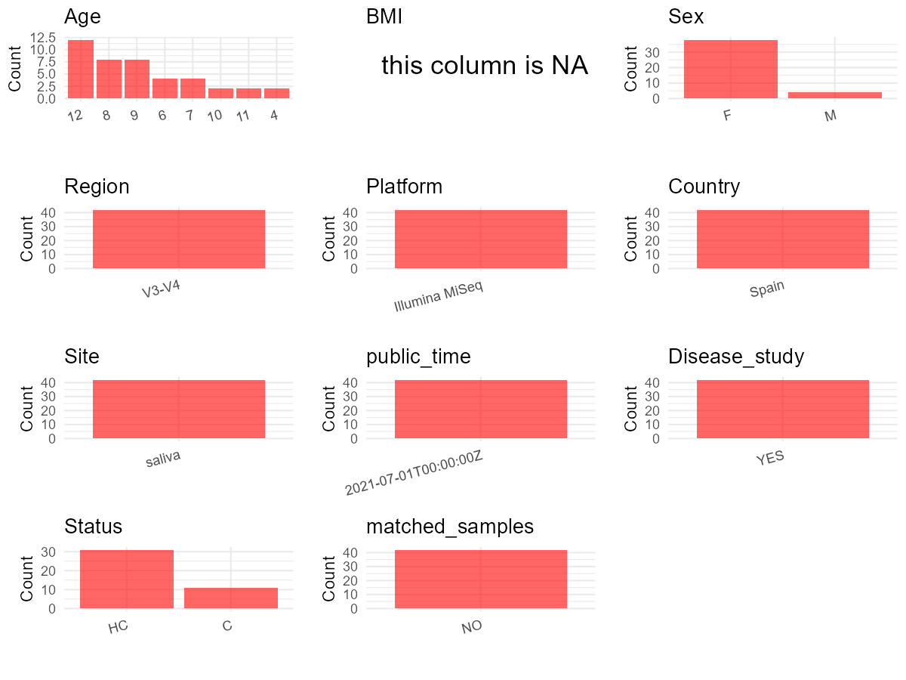

R Notebook: Metadata Processing Workflow
================

# Step 1: Obtain Initial Metadata from Each Project

To obtain the initial metadata: 1. Search for the BioProject ID (e.g.,
“PRJEBXXXX”) on the [NCBI SRA
website](https://www.ncbi.nlm.nih.gov/Traces/study/). 2. In the “Select”
table, click on “Metadata” and download the file. 3. The downloaded file
is typically named “SraRunTable.csv” and contains metadata for the
project.

``` r
# Load necessary libraries
library(dplyr)
library(ggplot2)
library(cowplot)

# Set working directory (update this path to your local directory)
setwd("D:/oral_project/PRJNA643173")

# Read the initial metadata files
initial_meta<-read.csv("SraRunTable.csv",header = T)

# Combine the two metadata files
#meta <- rbind(initial_meta, initial_meta1)

#Remove entries non-oral samples
#initial_meta <- subset(initial_meta,isolate %in% c("saliva","tongue coat"))

# Check the number of samples containing "HT" in Sample.Name (e.g., healthy controls)
#nrow(subset(meta, grepl("HT", Sample.Name)))

# Display the first few rows of the metadata
head(initial_meta)
```

    ##           Run Assay.Type AvgSpotLen    Bases  BioProject    BioSample
    ## 1 SRR12117916   AMPLICON        598 40612609 PRJNA643173 SAMN15404492
    ## 2 SRR12117917   AMPLICON        598 46021349 PRJNA643173 SAMN15404491
    ## 3 SRR12117918   AMPLICON        598  7956142 PRJNA643173 SAMN15404490
    ## 4 SRR12117919   AMPLICON        598 51533347 PRJNA643173 SAMN15404481
    ## 5 SRR12117920   AMPLICON        598 44135413 PRJNA643173 SAMN15404480
    ## 6 SRR12117921   AMPLICON        598 41925529 PRJNA643173 SAMN15404489
    ##                BioSampleModel    Bytes
    ## 1 Metagenome or environmental 21238059
    ## 2 Metagenome or environmental 24036888
    ## 3 Metagenome or environmental  4259744
    ## 4 Metagenome or environmental 26994467
    ## 5 Metagenome or environmental 23083374
    ## 6 Metagenome or environmental 22045745
    ##                                          Center.Name Collection_Date Consent
    ## 1 INSTITUTO RAMON Y CAJAL DE INVESTIGACION SANITARIA            2017  public
    ## 2 INSTITUTO RAMON Y CAJAL DE INVESTIGACION SANITARIA            2017  public
    ## 3 INSTITUTO RAMON Y CAJAL DE INVESTIGACION SANITARIA            2017  public
    ## 4 INSTITUTO RAMON Y CAJAL DE INVESTIGACION SANITARIA            2017  public
    ## 5 INSTITUTO RAMON Y CAJAL DE INVESTIGACION SANITARIA            2017  public
    ## 6 INSTITUTO RAMON Y CAJAL DE INVESTIGACION SANITARIA            2017  public
    ##   DATASTORE.filetype DATASTORE.provider                     DATASTORE.region
    ## 1   fastq,run.zq,sra         gs,ncbi,s3 gs.us-east1,ncbi.public,s3.us-east-1
    ## 2   fastq,run.zq,sra         gs,ncbi,s3 gs.us-east1,ncbi.public,s3.us-east-1
    ## 3   fastq,run.zq,sra         gs,ncbi,s3 gs.us-east1,ncbi.public,s3.us-east-1
    ## 4   fastq,run.zq,sra         gs,ncbi,s3 gs.us-east1,ncbi.public,s3.us-east-1
    ## 5   fastq,run.zq,sra         gs,ncbi,s3 gs.us-east1,ncbi.public,s3.us-east-1
    ## 6   fastq,run.zq,sra         gs,ncbi,s3 gs.us-east1,ncbi.public,s3.us-east-1
    ##   Experiment geo_loc_name_country geo_loc_name_country_continent geo_loc_name
    ## 1 SRX8639691                Spain                         Europe Spain:Madrid
    ## 2 SRX8639690                Spain                         Europe Spain:Madrid
    ## 3 SRX8639689                Spain                         Europe Spain:Madrid
    ## 4 SRX8639688                Spain                         Europe Spain:Madrid
    ## 5 SRX8639687                Spain                         Europe Spain:Madrid
    ## 6 SRX8639686                Spain                         Europe Spain:Madrid
    ##           HOST     Instrument            isolation_source        lat_lon
    ## 1 Homo sapiens Illumina MiSeq oral sample from subject 7A 40.48 N 3.69 W
    ## 2 Homo sapiens Illumina MiSeq oral sample from subject 6B 40.48 N 3.69 W
    ## 3 Homo sapiens Illumina MiSeq oral sample from subject 6A 40.48 N 3.69 W
    ## 4 Homo sapiens Illumina MiSeq oral sample from subject 1B 40.48 N 3.69 W
    ## 5 Homo sapiens Illumina MiSeq oral sample from subject 1A 40.48 N 3.69 W
    ## 6 Homo sapiens Illumina MiSeq oral sample from subject 5B 40.48 N 3.69 W
    ##   Library.Name LibraryLayout LibrarySelection LibrarySource
    ## 1      OTWIN13        PAIRED              PCR   METAGENOMIC
    ## 2      OTWIN12        PAIRED              PCR   METAGENOMIC
    ## 3      OTWIN11        PAIRED              PCR   METAGENOMIC
    ## 4       OTWIN2        PAIRED              PCR   METAGENOMIC
    ## 5       OTWIN1        PAIRED              PCR   METAGENOMIC
    ## 6      OTWIN10        PAIRED              PCR   METAGENOMIC
    ##                Organism Platform          ReleaseDate          create_date
    ## 1 human oral metagenome ILLUMINA 2021-07-01T00:00:00Z 2020-06-30T11:11:00Z
    ## 2 human oral metagenome ILLUMINA 2021-07-01T00:00:00Z 2020-06-30T11:11:00Z
    ## 3 human oral metagenome ILLUMINA 2021-07-01T00:00:00Z 2020-06-30T11:11:00Z
    ## 4 human oral metagenome ILLUMINA 2021-07-01T00:00:00Z 2020-06-30T11:11:00Z
    ## 5 human oral metagenome ILLUMINA 2021-07-01T00:00:00Z 2020-06-30T11:11:00Z
    ## 6 human oral metagenome ILLUMINA 2021-07-01T00:00:00Z 2020-06-30T11:11:00Z
    ##   version Sample.Name SRA.Study
    ## 1       1     OTWIN13 SRP269349
    ## 2       1     OTWIN12 SRP269349
    ## 3       1     OTWIN11 SRP269349
    ## 4       1      OTWIN2 SRP269349
    ## 5       1      OTWIN1 SRP269349
    ## 6       1     OTWIN10 SRP269349

# Step 2: Create a Uniform Metadata Template

The uniform metadata should include the following columns:

1.  **BioProject**: Project ID (e.g., “PRJNA339212”)
2.  **Run**: Sample ID (e.g., “ERRXXXXXX” or “SRRXXXXXX”)
3.  **sample_name**: Original sample name submitted by the authors (not
    the database-assigned ID)
4.  **Age**: Age of the subject (if available)
5.  **BMI**: Body Mass Index (if available)
6.  **Sex**: Sex of the subject (“F” or “M”)
7.  **Region**: Targeted 16S rRNA region (e.g., “V3-V4”)
8.  **Platform**: Sequencing platform (e.g., “Illumina MiSeq”)
9.  **Country**: Country of sample origin (e.g., “China”)
10. **Site**: Sample site (e.g., “saliva”, “dental plaque”)
11. **public_time**: Data release date (format: “YYYY-MM-DD”)
12. **PCR_primers**: PCR primers used (e.g., “515F-806R”)
13. **title**: Title of the associated publication
14. **Disease_study**: Whether the study involves a disease (“YES” or
    “NO”)
15. **Status**: Disease status (e.g., “T2DM”, “HC”). Note: If the study
    includes both disease and healthy samples, this must be specified
    per sample.
16. **matched_samples**: matched samples (“YES” or “NO”)

``` r
# Create a uniform metadata dataframe
metadata <- data.frame(
  BioProject = initial_meta$BioProject,
  Run = initial_meta$Run,
  sample_name = initial_meta$isolation_source,
  #Age = NA,
  BMI = NA,
  #Sex = NA,
  Region = "V3-V4",
  Platform = initial_meta$Instrument,
  Country = initial_meta$geo_loc_name_country,
  Site = replace(initial_meta$Organism, initial_meta$Organism == "human oral metagenome", "saliva"),
  public_time = initial_meta$ReleaseDate,
  stringsAsFactors = FALSE
)
```

``` r
metadata <- metadata %>%
  mutate(Sex = case_when(
    grepl("1A|1B|2A|2B|2B|3A|3B|4A|4B|5A|5B|7A|7B|9A|9B|10A|10B|12A|12B|13A|13B|15A|15B|16A|16B|17A|17B|18A|18B|20A|20B", sample_name) ~ "F",
    grepl("6A|6B|8A|8B|11A|11B|14A|14B|19A|19B|21A|21B", sample_name) ~ "M"
  ))
metadata <- metadata %>%
  mutate(Age = case_when(
    grepl("1A|1B|9A|9B|12A|12B", sample_name) ~ "12",
    grepl("2A|2B|13A|13B", sample_name) ~ "7",
    grepl("3A|3B|7A|7B|15A|15B", sample_name) ~ "8",
    grepl("4A|4B", sample_name) ~ "6",
    grepl("5A|5B", sample_name) ~ "11",
    grepl("6A|6B|10A|10B|11A|11B|16A|16B|18A|18B", sample_name) ~ "9",
    grepl("8A|8B", sample_name) ~ "10",
    grepl("14A|14B|19A|19B|20A|20B", sample_name) ~ "4",
    grepl("17A|17B|21A|21B", sample_name) ~ "5"
  ))
```

# Step 3: Manually Add Information from the Publication

Some information (e.g. PCR primers, study title, disease status) must be
manually extracted from the publication and added to the metadata.

``` r
# Add information obtained from the publication
metadata$PCR_primers <- "TCGTCGGCAGCGTCAGATGTGTATAAGAGACAGC CTACGGGNGGCWGCAG-GTCTCGTGGGCTCGGAGATGTGTATAAGAGACAGGACTACHVGG GT ATCTAATCC"
metadata$title <- "Machine Learning Study in Caries Markers in Oral Microbiota from Monozygotic Twin Children"
metadata$Disease_study <- "YES"
# Assign disease status based on sample_name patterns
metadata <- metadata %>%
  mutate(Status = case_when(
    grepl("A|12B|13B|14B|15B|16B|17B|18B|19B|20B|21B", sample_name) ~ "HC",
    grepl("1B|2B|3B|4B|5B|6B|7B|8B|9B|10B|11B", sample_name) ~ "C"
  ))

#get subjects id according to sample id
metadata$sample_name<-gsub("oral sample from subject ","",metadata$sample_name)
#get subjects id with Saliva available
keep_subjects<-subset(metadata,Site %in% "saliva")
#remove subjects without Saliva samples
metadata<-subset(metadata,sample_name %in% keep_subjects$sample_name)
#get subjects sampling counts
sample_counts <- table(metadata$sample_name)
# Create matched_samples column, any subjects have >=2 samples will be label "YES", otherwise "NO"
metadata$matched_samples <- ifelse(metadata$sample_name %in% names(sample_counts[sample_counts >= 2]), "YES", "NO")
```

# Step 4: Summarize and Validate the Metadata

``` r
# Check the number of unique runs and sample names
print(paste("Number of unique runs:", length(unique(metadata$Run))))
```

    ## [1] "Number of unique runs: 42"

``` r
print(paste("Number of unique sample names:", length(unique(metadata$sample_name))))
```

    ## [1] "Number of unique sample names: 42"

# Step 5: Visualize the Metadata

``` r

```


# Step 6: Finalize and Export the Metadata

``` r
# Reorder columns to match the desired format
metadata <- metadata[, c(
  "BioProject", "Run", "sample_name", "Age", "BMI", "Sex", 
  "Region", "Platform", "Country", "Site", "public_time", 
  "PCR_primers", "title", "Disease_study", "Status","matched_samples"
)]

# Export the uniform metadata to a CSV file
write.csv(metadata, file = "metadata.csv", quote = TRUE)
head(metadata)
```

    ##    BioProject         Run sample_name Age BMI Sex Region       Platform Country
    ## 1 PRJNA643173 SRR12117916          7A   8  NA   F  V3-V4 Illumina MiSeq   Spain
    ## 2 PRJNA643173 SRR12117917          6B   9  NA   M  V3-V4 Illumina MiSeq   Spain
    ## 3 PRJNA643173 SRR12117918          6A   9  NA   M  V3-V4 Illumina MiSeq   Spain
    ## 4 PRJNA643173 SRR12117919          1B  12  NA   F  V3-V4 Illumina MiSeq   Spain
    ## 5 PRJNA643173 SRR12117920          1A  12  NA   F  V3-V4 Illumina MiSeq   Spain
    ## 6 PRJNA643173 SRR12117921          5B  11  NA   F  V3-V4 Illumina MiSeq   Spain
    ##     Site          public_time
    ## 1 saliva 2021-07-01T00:00:00Z
    ## 2 saliva 2021-07-01T00:00:00Z
    ## 3 saliva 2021-07-01T00:00:00Z
    ## 4 saliva 2021-07-01T00:00:00Z
    ## 5 saliva 2021-07-01T00:00:00Z
    ## 6 saliva 2021-07-01T00:00:00Z
    ##                                                                                                     PCR_primers
    ## 1 TCGTCGGCAGCGTCAGATGTGTATAAGAGACAGC CTACGGGNGGCWGCAG-GTCTCGTGGGCTCGGAGATGTGTATAAGAGACAGGACTACHVGG GT ATCTAATCC
    ## 2 TCGTCGGCAGCGTCAGATGTGTATAAGAGACAGC CTACGGGNGGCWGCAG-GTCTCGTGGGCTCGGAGATGTGTATAAGAGACAGGACTACHVGG GT ATCTAATCC
    ## 3 TCGTCGGCAGCGTCAGATGTGTATAAGAGACAGC CTACGGGNGGCWGCAG-GTCTCGTGGGCTCGGAGATGTGTATAAGAGACAGGACTACHVGG GT ATCTAATCC
    ## 4 TCGTCGGCAGCGTCAGATGTGTATAAGAGACAGC CTACGGGNGGCWGCAG-GTCTCGTGGGCTCGGAGATGTGTATAAGAGACAGGACTACHVGG GT ATCTAATCC
    ## 5 TCGTCGGCAGCGTCAGATGTGTATAAGAGACAGC CTACGGGNGGCWGCAG-GTCTCGTGGGCTCGGAGATGTGTATAAGAGACAGGACTACHVGG GT ATCTAATCC
    ## 6 TCGTCGGCAGCGTCAGATGTGTATAAGAGACAGC CTACGGGNGGCWGCAG-GTCTCGTGGGCTCGGAGATGTGTATAAGAGACAGGACTACHVGG GT ATCTAATCC
    ##                                                                                        title
    ## 1 Machine Learning Study in Caries Markers in Oral Microbiota from Monozygotic Twin Children
    ## 2 Machine Learning Study in Caries Markers in Oral Microbiota from Monozygotic Twin Children
    ## 3 Machine Learning Study in Caries Markers in Oral Microbiota from Monozygotic Twin Children
    ## 4 Machine Learning Study in Caries Markers in Oral Microbiota from Monozygotic Twin Children
    ## 5 Machine Learning Study in Caries Markers in Oral Microbiota from Monozygotic Twin Children
    ## 6 Machine Learning Study in Caries Markers in Oral Microbiota from Monozygotic Twin Children
    ##   Disease_study Status matched_samples
    ## 1           YES     HC              NO
    ## 2           YES      C              NO
    ## 3           YES     HC              NO
    ## 4           YES      C              NO
    ## 5           YES     HC              NO
    ## 6           YES      C              NO

## Notes for Students:

1.  **Metadata Accuracy**: Always cross-check the metadata with the
    original publication to ensure accuracy.
2.  **Manual Entries**: Columns like `PCR_primers`, and `Status` often
    require manual entry based on the publication.
3.  **Disease Status**: Be careful when assigning `Status`—some studies
    include both disease and healthy samples.
4.  **Visualization**: The plots help quickly identify the distribution
    of values in each column, which is useful for quality control.
5.  **Reproducibility**: Update the working directory and file paths to
    match your local environment.
