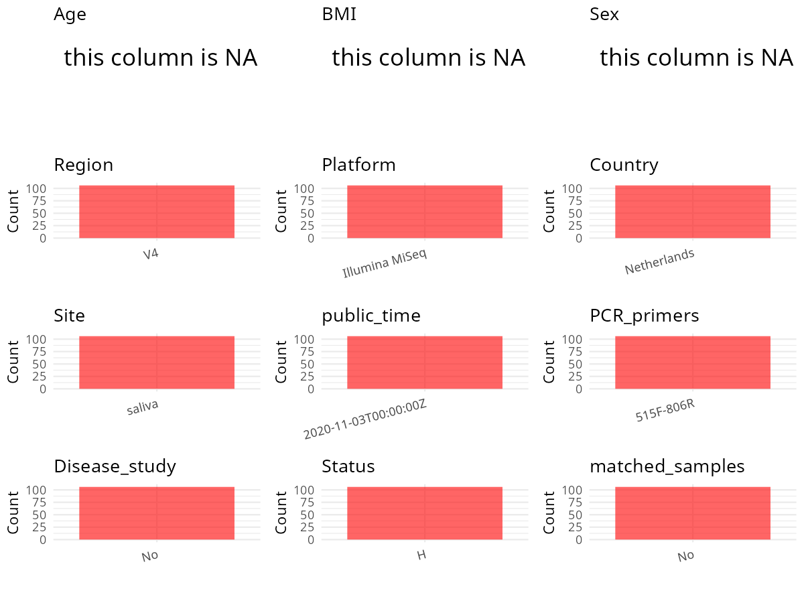

R Notebook: Metadata Processing Workflow
================

# Step 1: Obtain Initial Metadata from Each Project

To obtain the initial metadata: 1. Search for the BioProject ID (e.g.,
“PRJEBXXXX”) on the [NCBI SRA
website](https://www.ncbi.nlm.nih.gov/Traces/study/). 2. In the “Select”
table, click on “Metadata” and download the file. 3. The downloaded file
is typically named “SraRunTable.csv” and contains metadata for the
project.

``` r
# Load necessary libraries
library(dplyr)
library(ggplot2)
library(cowplot)
library(stringr)

# Set working directory (update this path to your local directory)
setwd("/home/hby/oral_project/PRJNA643400")

# Read the initial metadata files
initial_meta <- read.csv("SraRunTable.csv", header = T)

# Combine the two metadata files
# meta <- rbind(initial_meta, initial_meta1)

# Remove entries non-oral samples
# initial_meta <- subset(initial_meta,isolate %in% c("saliva","tongue coat"))

# Check the number of samples containing "HT" in Sample.Name (e.g., healthy controls)
# nrow(subset(meta, grepl("HT", Sample.Name)))

# Display the first few rows of the metadata
head(initial_meta)
```

    ##           Run Assay.Type AvgSpotLen    Bases biofilm_age_days  BioProject    BioSample                              BioSampleModel    Bytes                             Center.Name
    ## 1 SRR12124602   AMPLICON        502 78050458                7 PRJNA643400 SAMN15413250 MIMARKS.survey,MIGS/MIMS/MIMARKS.human-oral 41823289 ACADEMIC CENTRE FOR DENTISTRY AMSTERDAM
    ## 2 SRR12124603   AMPLICON        502 43437558                3 PRJNA643400 SAMN15413249 MIMARKS.survey,MIGS/MIMS/MIMARKS.human-oral 23020674 ACADEMIC CENTRE FOR DENTISTRY AMSTERDAM
    ## 3 SRR12124604   AMPLICON        502 35134478                3 PRJNA643400 SAMN15413248 MIMARKS.survey,MIGS/MIMS/MIMARKS.human-oral 19237375 ACADEMIC CENTRE FOR DENTISTRY AMSTERDAM
    ## 4 SRR12124605   AMPLICON        502 11414476                3 PRJNA643400 SAMN15413247 MIMARKS.survey,MIGS/MIMS/MIMARKS.human-oral  6333191 ACADEMIC CENTRE FOR DENTISTRY AMSTERDAM
    ## 5 SRR12124607   AMPLICON        502 42283460               10 PRJNA643400 SAMN15413245 MIMARKS.survey,MIGS/MIMS/MIMARKS.human-oral 23060349 ACADEMIC CENTRE FOR DENTISTRY AMSTERDAM
    ## 6 SRR12124608   AMPLICON        502 51832002               10 PRJNA643400 SAMN15413244 MIMARKS.survey,MIGS/MIMS/MIMARKS.human-oral 26924873 ACADEMIC CENTRE FOR DENTISTRY AMSTERDAM
    ##   Consent DATASTORE.filetype DATASTORE.provider                     DATASTORE.region env_broad_scale env_local_scale env_medium exp_n Experiment geo_loc_name_country
    ## 1  public   fastq,run.zq,sra         gs,ncbi,s3 gs.us-east1,ncbi.public,s3.us-east-1           human     oral cavity     saliva     3 SRX8646007          Netherlands
    ## 2  public   fastq,run.zq,sra         gs,ncbi,s3 gs.us-east1,ncbi.public,s3.us-east-1           human     oral cavity     saliva     3 SRX8646006          Netherlands
    ## 3  public   fastq,run.zq,sra         gs,ncbi,s3 gs.us-east1,ncbi.public,s3.us-east-1           human     oral cavity     saliva     3 SRX8646005          Netherlands
    ## 4  public   fastq,run.zq,sra         gs,ncbi,s3 gs.us-east1,ncbi.public,s3.us-east-1           human     oral cavity     saliva     3 SRX8646004          Netherlands
    ## 5  public   fastq,run.zq,sra         gs,ncbi,s3 gs.us-east1,ncbi.public,s3.us-east-1           human     oral cavity     saliva     3 SRX8646002          Netherlands
    ## 6  public   fastq,run.zq,sra         gs,ncbi,s3 gs.us-east1,ncbi.public,s3.us-east-1           human     oral cavity     saliva     3 SRX8646001          Netherlands
    ##   geo_loc_name_country_continent geo_loc_name Group         HOST     Instrument Library.Name LibraryLayout LibrarySelection LibrarySource   Organism Platform          ReleaseDate
    ## 1                         Europe  Netherlands   PgL Homo sapiens Illumina MiSeq         3E71        PAIRED              PCR   METAGENOMIC metagenome ILLUMINA 2020-11-03T00:00:00Z
    ## 2                         Europe  Netherlands   PgL Homo sapiens Illumina MiSeq         3E33        PAIRED              PCR   METAGENOMIC metagenome ILLUMINA 2020-11-03T00:00:00Z
    ## 3                         Europe  Netherlands   PgL Homo sapiens Illumina MiSeq         3E32        PAIRED              PCR   METAGENOMIC metagenome ILLUMINA 2020-11-03T00:00:00Z
    ## 4                         Europe  Netherlands   PgL Homo sapiens Illumina MiSeq         3E31        PAIRED              PCR   METAGENOMIC metagenome ILLUMINA 2020-11-03T00:00:00Z
    ## 5                         Europe  Netherlands   PgM Homo sapiens Illumina MiSeq        3D102        PAIRED              PCR   METAGENOMIC metagenome ILLUMINA 2020-11-03T00:00:00Z
    ## 6                         Europe  Netherlands   PgM Homo sapiens Illumina MiSeq        3D101        PAIRED              PCR   METAGENOMIC metagenome ILLUMINA 2020-11-03T00:00:00Z
    ##            create_date version sample_n Sample_Name sample_type SRA.Study
    ## 1 2020-07-01T11:33:00Z       1        1        3E71   Microcosm SRP269488
    ## 2 2020-07-01T11:33:00Z       1        3        3E33   Microcosm SRP269488
    ## 3 2020-07-01T11:33:00Z       1        2        3E32   Microcosm SRP269488
    ## 4 2020-07-01T11:33:00Z       1        1        3E31   Microcosm SRP269488
    ## 5 2020-07-01T11:33:00Z       1        2       3D102   Microcosm SRP269488
    ## 6 2020-07-01T11:33:00Z       1        1       3D101   Microcosm SRP269488

# Step 2: Create a Uniform Metadata Template

The uniform metadata should include the following columns:

1.  **BioProject**: Project ID (e.g., “PRJNA339212”)
2.  **Run**: Sample ID (e.g., “ERRXXXXXX” or “SRRXXXXXX”)
3.  **sample_name**: Original sample name submitted by the authors (not
    the database-assigned ID)
4.  **Age**: Age of the subject (if available)
5.  **BMI**: Body Mass Index (if available)
6.  **Sex**: Sex of the subject (“F” or “M”)
7.  **Region**: Targeted 16S rRNA region (e.g., “V3-V4”)
8.  **Platform**: Sequencing platform (e.g., “Illumina MiSeq”)
9.  **Country**: Country of sample origin (e.g., “China”)
10. **Site**: Sample site (e.g., “saliva”, “dental plaque”)
11. **public_time**: Data release date (format: “YYYY-MM-DD”)
12. **PCR_primers**: PCR primers used (e.g., “515F-806R”)
13. **title**: Title of the associated publication
14. **Disease_study**: Whether the study involves a disease (“YES” or
    “NO”)
15. **Status**: Disease status (e.g., “T2DM”, “HC”). Note: If the study
    includes both disease and healthy samples, this must be specified
    per sample.
16. **matched_samples**: matched samples (“YES” or “NO”)

``` r
# Create a uniform metadata dataframe
metadata <- data.frame(
  BioProject = initial_meta$BioProject,
  Run = initial_meta$Run,
  sample_name = initial_meta$Sample_Name,
  Platform = initial_meta$Instrument,
  Country = initial_meta$geo_loc_name_country,
  public_time = initial_meta$ReleaseDate,
  Site = initial_meta$env_medium,
  Sex = NA,
  Age = NA,
  BMI = NA
)
```

# Step 3: Manually Add Information from the Publication

Some information (e.g. PCR primers, study title, disease status) must be
manually extracted from the publication and added to the metadata.

``` r
# Add information obtained from the publication
metadata$Status <- "H"
metadata$Region <- "V4"
metadata$PCR_primers <- "515F-806R"
metadata$title <- "Manipulation of Saliva-Derived Microcosm Biofilms To Resemble Dysbiotic Subgingival Microbiota"
metadata$Disease_study <- "No"
metadata$matched_samples <- "No"
```

# Step 4: Summarize and Validate the Metadata

``` r
# Check the number of unique runs and sample names
print(paste("Number of unique runs:", length(unique(metadata$Run))))
```

    ## [1] "Number of unique runs: 106"

``` r
print(paste("Number of unique sample names:", length(unique(metadata$sample_name))))
```

    ## [1] "Number of unique sample names: 106"

# Step 5: Visualize the Metadata

``` r

```


# Step 6: Finalize and Export the Metadata

``` r
# Reorder columns to match the desired format
metadata <- metadata[, c(
  "BioProject", "Run", "sample_name", "Age", "BMI", "Sex",
  "Region", "Platform", "Country", "Site", "public_time",
  "PCR_primers", "title", "Disease_study", "Status", "matched_samples"
)]

# Export the uniform metadata to a CSV file
write.csv(metadata, file = "metadata.csv", quote = FALSE)
head(metadata)
```

    ##    BioProject         Run sample_name Age BMI Sex Region       Platform     Country   Site          public_time PCR_primers
    ## 1 PRJNA643400 SRR12124602        3E71  NA  NA  NA     V4 Illumina MiSeq Netherlands saliva 2020-11-03T00:00:00Z   515F-806R
    ## 2 PRJNA643400 SRR12124603        3E33  NA  NA  NA     V4 Illumina MiSeq Netherlands saliva 2020-11-03T00:00:00Z   515F-806R
    ## 3 PRJNA643400 SRR12124604        3E32  NA  NA  NA     V4 Illumina MiSeq Netherlands saliva 2020-11-03T00:00:00Z   515F-806R
    ## 4 PRJNA643400 SRR12124605        3E31  NA  NA  NA     V4 Illumina MiSeq Netherlands saliva 2020-11-03T00:00:00Z   515F-806R
    ## 5 PRJNA643400 SRR12124607       3D102  NA  NA  NA     V4 Illumina MiSeq Netherlands saliva 2020-11-03T00:00:00Z   515F-806R
    ## 6 PRJNA643400 SRR12124608       3D101  NA  NA  NA     V4 Illumina MiSeq Netherlands saliva 2020-11-03T00:00:00Z   515F-806R
    ##                                                                                            title Disease_study Status matched_samples
    ## 1 Manipulation of Saliva-Derived Microcosm Biofilms To Resemble Dysbiotic Subgingival Microbiota            No      H              No
    ## 2 Manipulation of Saliva-Derived Microcosm Biofilms To Resemble Dysbiotic Subgingival Microbiota            No      H              No
    ## 3 Manipulation of Saliva-Derived Microcosm Biofilms To Resemble Dysbiotic Subgingival Microbiota            No      H              No
    ## 4 Manipulation of Saliva-Derived Microcosm Biofilms To Resemble Dysbiotic Subgingival Microbiota            No      H              No
    ## 5 Manipulation of Saliva-Derived Microcosm Biofilms To Resemble Dysbiotic Subgingival Microbiota            No      H              No
    ## 6 Manipulation of Saliva-Derived Microcosm Biofilms To Resemble Dysbiotic Subgingival Microbiota            No      H              No

## Notes for Students:

1.  **Metadata Accuracy**: Always cross-check the metadata with the
    original publication to ensure accuracy.
2.  **Manual Entries**: Columns like `PCR_primers`, and `Status` often
    require manual entry based on the publication.
3.  **Disease Status**: Be careful when assigning `Status`—some studies
    include both disease and healthy samples.
4.  **Visualization**: The plots help quickly identify the distribution
    of values in each column, which is useful for quality control.
5.  **Reproducibility**: Update the working directory and file paths to
    match your local environment.
