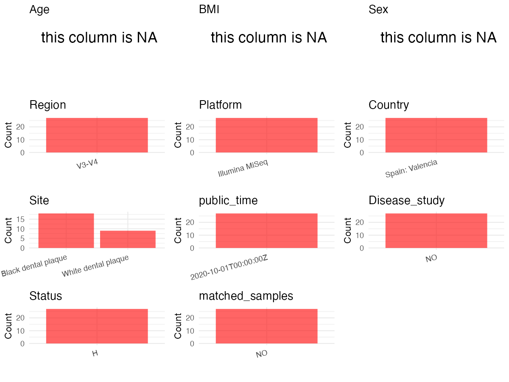

R Notebook: Metadata Processing Workflow
================

# Step 1: Obtain Initial Metadata from Each Project

To obtain the initial metadata: 1. Search for the BioProject ID (e.g.,
“PRJEBXXXX”) on the [NCBI SRA
website](https://www.ncbi.nlm.nih.gov/Traces/study/). 2. In the “Select”
table, click on “Metadata” and download the file. 3. The downloaded file
is typically named “SraRunTable.csv” and contains metadata for the
project.

``` r
# Load necessary libraries
library(dplyr)
library(ggplot2)
library(cowplot)
# Set working directory (update this path to your local directory)
setwd("/Users/dongbiao/Documents/oral/global-oral-microbiome/data/projects/PRJNA644495/")

# Read the initial metadata files
initial_meta<-read.csv("SraRunTable.csv",header = T)

head(initial_meta)
```

    ##           Run Assay.Type AvgSpotLen    Bases  BioProject    BioSample
    ## 1 SRR12161681   AMPLICON        602 58003302 PRJNA644495 SAMN15462038
    ## 2 SRR12161682   AMPLICON        602 46912054 PRJNA644495 SAMN15462029
    ## 3 SRR12161683   AMPLICON        602 34223098 PRJNA644495 SAMN15462018
    ## 4 SRR12161684   AMPLICON        602 62495426 PRJNA644495 SAMN15462037
    ## 5 SRR12161685   AMPLICON        602 54996914 PRJNA644495 SAMN15462028
    ## 6 SRR12161686   AMPLICON        602 60377590 PRJNA644495 SAMN15462036
    ##                BioSampleModel    Bytes                      Center.Name
    ## 1 Metagenome or environmental 35087529 UNIVERSIDAD CARDENAL HERRERA-CEU
    ## 2 Metagenome or environmental 28699637 UNIVERSIDAD CARDENAL HERRERA-CEU
    ## 3 Metagenome or environmental 20906390 UNIVERSIDAD CARDENAL HERRERA-CEU
    ## 4 Metagenome or environmental 37319176 UNIVERSIDAD CARDENAL HERRERA-CEU
    ## 5 Metagenome or environmental 33197391 UNIVERSIDAD CARDENAL HERRERA-CEU
    ## 6 Metagenome or environmental 37313022 UNIVERSIDAD CARDENAL HERRERA-CEU
    ##   Collection_Date Consent DATASTORE.filetype DATASTORE.provider
    ## 1            2019  public   fastq,run.zq,sra         gs,ncbi,s3
    ## 2            2019  public   fastq,run.zq,sra         gs,ncbi,s3
    ## 3            2019  public   fastq,run.zq,sra         gs,ncbi,s3
    ## 4            2019  public   fastq,run.zq,sra         gs,ncbi,s3
    ## 5            2019  public   fastq,run.zq,sra         gs,ncbi,s3
    ## 6            2019  public   fastq,run.zq,sra         gs,ncbi,s3
    ##                       DATASTORE.region Experiment geo_loc_name_country
    ## 1 gs.us-east1,ncbi.public,s3.us-east-1 SRX8677213                Spain
    ## 2 gs.us-east1,ncbi.public,s3.us-east-1 SRX8677212                Spain
    ## 3 gs.us-east1,ncbi.public,s3.us-east-1 SRX8677211                Spain
    ## 4 gs.us-east1,ncbi.public,s3.us-east-1 SRX8677210                Spain
    ## 5 gs.us-east1,ncbi.public,s3.us-east-1 SRX8677209                Spain
    ## 6 gs.us-east1,ncbi.public,s3.us-east-1 SRX8677208                Spain
    ##   geo_loc_name_country_continent    geo_loc_name         HOST     Instrument
    ## 1                         Europe Spain: Valencia Homo sapiens Illumina MiSeq
    ## 2                         Europe Spain: Valencia Homo sapiens Illumina MiSeq
    ## 3                         Europe Spain: Valencia Homo sapiens Illumina MiSeq
    ## 4                         Europe Spain: Valencia Homo sapiens Illumina MiSeq
    ## 5                         Europe Spain: Valencia Homo sapiens Illumina MiSeq
    ## 6                         Europe Spain: Valencia Homo sapiens Illumina MiSeq
    ##      isolation_source        lat_lon  Library.Name LibraryLayout
    ## 1 Black dental plaque 39.55 N 0.39 W HP2A_amplicon        PAIRED
    ## 2 Black dental plaque 39.55 N 0.39 W GL6A_amplicon        PAIRED
    ## 3 White dental plaque 39.55 N 0.39 W EQ8A_amplicon        PAIRED
    ## 4 Black dental plaque 39.55 N 0.39 W EM4A_amplicon        PAIRED
    ## 5 Black dental plaque 39.55 N 0.39 W DW8A_amplicon        PAIRED
    ## 6 Black dental plaque 39.55 N 0.39 W BR8A_amplicon        PAIRED
    ##   LibrarySelection LibrarySource   Organism    patient Platform
    ## 1              PCR   METAGENOMIC metagenome Patient 22 ILLUMINA
    ## 2              PCR   METAGENOMIC metagenome Patient 13 ILLUMINA
    ## 3              PCR   METAGENOMIC metagenome  Patient 2 ILLUMINA
    ## 4              PCR   METAGENOMIC metagenome Patient 21 ILLUMINA
    ## 5              PCR   METAGENOMIC metagenome Patient 12 ILLUMINA
    ## 6              PCR   METAGENOMIC metagenome Patient 20 ILLUMINA
    ##            ReleaseDate          create_date version     samp_collect_device
    ## 1 2020-10-01T00:00:00Z 2020-07-07T07:15:00Z       1 plastic dental curettes
    ## 2 2020-10-01T00:00:00Z 2020-07-07T07:15:00Z       1 plastic dental curettes
    ## 3 2020-10-01T00:00:00Z 2020-07-07T07:15:00Z       1 plastic dental curettes
    ## 4 2020-10-01T00:00:00Z 2020-07-07T07:15:00Z       1 plastic dental curettes
    ## 5 2020-10-01T00:00:00Z 2020-07-07T07:15:00Z       1 plastic dental curettes
    ## 6 2020-10-01T00:00:00Z 2020-07-07T07:15:00Z       1 plastic dental curettes
    ##   Sample.Name SRA.Study
    ## 1        HP2A SRP270606
    ## 2        GL6A SRP270606
    ## 3        EQ8A SRP270606
    ## 4        EM4A SRP270606
    ## 5        DW8A SRP270606
    ## 6        BR8A SRP270606

# Step 2: Create a Uniform Metadata Template

The uniform metadata should include the following columns:

1.  **BioProject**: Project ID (e.g., “PRJNA339212”)
2.  **Run**: Sample ID (e.g., “ERRXXXXXX” or “SRRXXXXXX”)
3.  **sample_name**: Original sample name submitted by the authors (not
    the database-assigned ID)
4.  **Age**: Age of the subject (if available)
5.  **BMI**: Body Mass Index (if available)
6.  **Sex**: Sex of the subject (“F” or “M”)
7.  **Region**: Targeted 16S rRNA region (e.g., “V3-V4”)
8.  **Platform**: Sequencing platform (e.g., “Illumina MiSeq”)
9.  **Country**: Country of sample origin (e.g., “China”)
10. **Site**: Sample site (e.g., “saliva”, “dental plaque”)
11. **public_time**: Data release date (format: “YYYY-MM-DD”)
12. **PCR_primers**: PCR primers used (e.g., “515F-806R”)
13. **title**: Title of the associated publication
14. **Disease_study**: Whether the study involves a disease (“YES” or
    “NO”)
15. **Status**: Disease status (e.g., “T2DM”, “HC”). Note: If the study
    includes both disease and healthy samples, this must be specified
    per sample.
16. **matched_samples** : matched samples (“YES” or “NO”)

``` r
# Create a uniform metadata dataframe
metadata <- data.frame(
  BioProject = initial_meta$BioProject,
  Run = initial_meta$Run,
  sample_name = initial_meta$patient,
  Age = NA,
  BMI = NA,
  Sex=NA,
  Region = "V3-V4",
  Platform = initial_meta$Instrument,
  Country = initial_meta$geo_loc_name,
  Site = initial_meta$isolation_source,
  public_time = initial_meta$ReleaseDate,
  stringsAsFactors = FALSE
)
```

# Step 3: Manually Add Information from the Publication

Some information (e.g. PCR primers, study title, disease status) must be
manually extracted from the publication and added to the metadata.

``` r
# Add information obtained from the publication
metadata$PCR_primers <- "341F-806R"
metadata$title <- "Dental black plaque: metagenomic characterization and comparative analysis with white‑plaque"
metadata$Disease_study <- "NO"

# Assign disease status based on sample_name patterns
metadata$Status <- "H"

# Create matched_samples column
metadata$matched_samples <- "NO"

# Check initial data distribution
cat("Initial sample distribution:\n")
```

    ## Initial sample distribution:

``` r
table(metadata$sample_name)
```

    ## 
    ##  Patient 1 Patient 10 Patient 11 Patient 12 Patient 13 Patient 14 Patient 15 
    ##          1          1          1          1          1          1          1 
    ## Patient 16 Patient 17 Patient 18 Patient 19  Patient 2 Patient 20 Patient 21 
    ##          1          1          1          1          1          1          1 
    ## Patient 22 Patient 23 Patient 24 Patient 25 Patient 26 Patient 27  Patient 3 
    ##          1          1          1          1          1          1          1 
    ##  Patient 4  Patient 5  Patient 6  Patient 7  Patient 8  Patient 9 
    ##          1          1          1          1          1          1

``` r
table(metadata$Site)
```

    ## 
    ## Black dental plaque White dental plaque 
    ##                  18                   9

# Step 4: Summarize and Validate the Metadata

``` r
# Check the number of unique runs and sample names
print(paste("Number of unique runs:", length(unique(metadata$Run))))
```

    ## [1] "Number of unique runs: 27"

``` r
print(paste("Number of unique sample names:", length(unique(metadata$sample_name))))
```

    ## [1] "Number of unique sample names: 27"

# Step 5: Visualize the Metadata

``` r
# Select columns for visualization
plot_data <- metadata %>%
  select(-BioProject, -Run, -sample_name, -title)

# Function to create simple plots for each column
create_simple_plots <- function(data) {
  plots <- list()
  
  for (col in colnames(data)) {
    # Check if the column is all NA
    if (all(is.na(data[[col]]))) {
      # Create an empty plot with text indicating all NA
      p <- ggplot() +
        annotate("text", x = 0.5, y = 0.5, label = "this column is NA", size = 6) +
        labs(title = col) +
        theme_void()
    } else if (is.numeric(data[[col]])) {
      # Numeric variable: histogram
      p <- ggplot(data, aes(x = .data[[col]])) +
        geom_histogram(fill = "blue", alpha = 0.6, bins = 20, na.rm = TRUE) +
        labs(title = col) +
        theme_minimal()
    } else {
      # Categorical variable: bar plot (remove NA values)
      count_data <- as.data.frame(table(data[[col]], useNA = "ifany"))
      p <- ggplot(count_data, aes(x = reorder(Var1, -Freq), y = Freq)) +
        geom_col(fill = "red", alpha = 0.6) +
        labs(title = col, x = NULL, y = "Count") +
        theme_minimal() +
        theme(axis.text.x = element_text(angle = 15, hjust = 1))
    }
    plots[[col]] <- p
  }
  
  return(plots)
}

# Generate and arrange plots
plots <- create_simple_plots(plot_data)
p<-plot_grid(plots$Age, 
          plots$BMI, 
          plots$Sex, 
          plots$Region, 
          plots$Platform, 
          plots$Country, 
          plots$Site,
          plots$public_time, 
          plots$Disease_study,
          plots$Status,
          plots$matched_samples,# add 
          ncol = 3, align = "hv", axis = "lb")
ggsave("Metadata_Summary.png", plot = p, width = 8, height = 6, dpi = 150)
```

``` r

```


# Step 6: Finalize and Export the Metadata

``` r
# Reorder columns to match the desired format
metadata <- metadata[, c(
  "BioProject", "Run", "sample_name", "Age", "BMI", "Sex", 
  "Region", "Platform", "Country", "Site", "public_time", 
  "PCR_primers", "title", "Disease_study", "Status","matched_samples"
)]

# Export the uniform metadata to a CSV file
write.csv(metadata, file = "metadata.csv", quote = FALSE)
head(metadata)
```

    ##    BioProject         Run sample_name Age BMI Sex Region       Platform
    ## 1 PRJNA644495 SRR12161681  Patient 22  NA  NA  NA  V3-V4 Illumina MiSeq
    ## 2 PRJNA644495 SRR12161682  Patient 13  NA  NA  NA  V3-V4 Illumina MiSeq
    ## 3 PRJNA644495 SRR12161683   Patient 2  NA  NA  NA  V3-V4 Illumina MiSeq
    ## 4 PRJNA644495 SRR12161684  Patient 21  NA  NA  NA  V3-V4 Illumina MiSeq
    ## 5 PRJNA644495 SRR12161685  Patient 12  NA  NA  NA  V3-V4 Illumina MiSeq
    ## 6 PRJNA644495 SRR12161686  Patient 20  NA  NA  NA  V3-V4 Illumina MiSeq
    ##           Country                Site          public_time PCR_primers
    ## 1 Spain: Valencia Black dental plaque 2020-10-01T00:00:00Z   341F-806R
    ## 2 Spain: Valencia Black dental plaque 2020-10-01T00:00:00Z   341F-806R
    ## 3 Spain: Valencia White dental plaque 2020-10-01T00:00:00Z   341F-806R
    ## 4 Spain: Valencia Black dental plaque 2020-10-01T00:00:00Z   341F-806R
    ## 5 Spain: Valencia Black dental plaque 2020-10-01T00:00:00Z   341F-806R
    ## 6 Spain: Valencia Black dental plaque 2020-10-01T00:00:00Z   341F-806R
    ##                                                                                          title
    ## 1 Dental black plaque: metagenomic characterization and comparative analysis with white‑plaque
    ## 2 Dental black plaque: metagenomic characterization and comparative analysis with white‑plaque
    ## 3 Dental black plaque: metagenomic characterization and comparative analysis with white‑plaque
    ## 4 Dental black plaque: metagenomic characterization and comparative analysis with white‑plaque
    ## 5 Dental black plaque: metagenomic characterization and comparative analysis with white‑plaque
    ## 6 Dental black plaque: metagenomic characterization and comparative analysis with white‑plaque
    ##   Disease_study Status matched_samples
    ## 1            NO      H              NO
    ## 2            NO      H              NO
    ## 3            NO      H              NO
    ## 4            NO      H              NO
    ## 5            NO      H              NO
    ## 6            NO      H              NO

## Notes for Students:

1.  **Metadata Accuracy**: Always cross-check the metadata with the
    original publication to ensure accuracy.
2.  **Manual Entries**: Columns like `PCR_primers`, and `Status` often
    require manual entry based on the publication.
3.  **Disease Status**: Be careful when assigning `Status`—some studies
    include both disease and healthy samples.
4.  **Visualization**: The plots help quickly identify the distribution
    of values in each column, which is useful for quality control.
5.  **Reproducibility**: Update the working directory and file paths to
    match your local environment.
