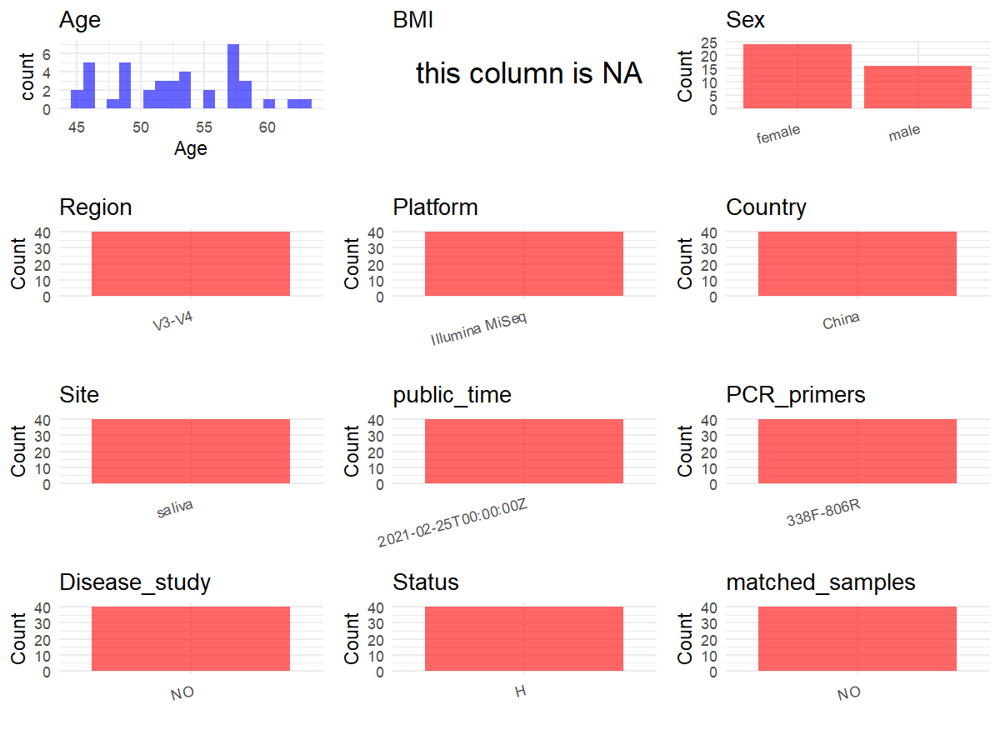

R Notebook: Metadata Processing Workflow
================

# Step 1: Obtain Initial Metadata from Each Project

To obtain the initial metadata: 1. Search for the BioProject ID (e.g.,
“PRJEBXXXX”) on the [NCBI SRA
website](https://www.ncbi.nlm.nih.gov/Traces/study/). 2. In the “Select”
table, click on “Metadata” and download the file. 3. The downloaded file
is typically named “SraRunTable.csv” and contains metadata for the
project.

``` r
# Load necessary libraries
library(dplyr)
library(ggplot2)
library(cowplot)

# Set working directory (update this path to your local directory)
setwd("D:/metadata/3/PRJNA648473")

# Read the initial metadata files
initial_meta<-read.csv("SraRunTable.csv",header = T)

# Combine the two metadata files
#meta <- rbind(initial_meta, initial_meta1)

#Remove entries non-oral samples
#initial_meta <- subset(initial_meta,BioSampleModel != "Metagenome or environmental")

# Check the number of samples containing "HT" in Sample.Name (e.g., healthy controls)
#nrow(subset(meta, grepl("HT", Sample.Name)))

# Display the first few rows of the metadata
head(initial_meta)
```

    ##           Run AGE Assay.Type AvgSpotLen    Bases BIOMATERIAL_PROVIDER
    ## 1 SRR12325051  57   AMPLICON        602 30770628              missing
    ## 2 SRR12325052  52   AMPLICON        602 31317244              missing
    ## 3 SRR12325054  54   AMPLICON        602 34551790              missing
    ## 4 SRR12325075  62   AMPLICON        602 27336218              missing
    ## 5 SRR12325076  51   AMPLICON        602 32556160              missing
    ## 6 SRR12325077  55   AMPLICON        602 29883882              missing
    ##    BioProject    BioSample              BioSampleModel    Bytes
    ## 1 PRJNA648473 SAMN15642552 Metagenome or environmental 17151575
    ## 2 PRJNA648473 SAMN15642551 Metagenome or environmental 17238657
    ## 3 PRJNA648473 SAMN15642549 Metagenome or environmental 18350651
    ## 4 PRJNA648473 SAMN15642565 Metagenome or environmental 14696061
    ## 5 PRJNA648473 SAMN15642564 Metagenome or environmental 17244853
    ## 6 PRJNA648473 SAMN15642563 Metagenome or environmental 15983499
    ##                                                                           Center.Name
    ## 1 SHANGHAI NINTH PEOPLE'S HOSPITAL,  SHANGHAI JIAO TONG UNIVERSITY SCHOOL OF MEDICINE
    ## 2 SHANGHAI NINTH PEOPLE'S HOSPITAL,  SHANGHAI JIAO TONG UNIVERSITY SCHOOL OF MEDICINE
    ## 3 SHANGHAI NINTH PEOPLE'S HOSPITAL,  SHANGHAI JIAO TONG UNIVERSITY SCHOOL OF MEDICINE
    ## 4 SHANGHAI NINTH PEOPLE'S HOSPITAL,  SHANGHAI JIAO TONG UNIVERSITY SCHOOL OF MEDICINE
    ## 5 SHANGHAI NINTH PEOPLE'S HOSPITAL,  SHANGHAI JIAO TONG UNIVERSITY SCHOOL OF MEDICINE
    ## 6 SHANGHAI NINTH PEOPLE'S HOSPITAL,  SHANGHAI JIAO TONG UNIVERSITY SCHOOL OF MEDICINE
    ##   Collection_Date Consent DATASTORE.filetype DATASTORE.provider
    ## 1         missing  public   fastq,run.zq,sra         gs,ncbi,s3
    ## 2         missing  public   fastq,run.zq,sra         gs,ncbi,s3
    ## 3         missing  public   fastq,run.zq,sra         gs,ncbi,s3
    ## 4         missing  public   fastq,run.zq,sra         gs,ncbi,s3
    ## 5         missing  public   fastq,run.zq,sra         gs,ncbi,s3
    ## 6         missing  public   fastq,run.zq,sra         gs,ncbi,s3
    ##                       DATASTORE.region Experiment geo_loc_name_country
    ## 1 gs.us-east1,ncbi.public,s3.us-east-1 SRX8825311         uncalculated
    ## 2 gs.us-east1,ncbi.public,s3.us-east-1 SRX8825310         uncalculated
    ## 3 gs.us-east1,ncbi.public,s3.us-east-1 SRX8825308         uncalculated
    ## 4 gs.us-east1,ncbi.public,s3.us-east-1 SRX8825287         uncalculated
    ## 5 gs.us-east1,ncbi.public,s3.us-east-1 SRX8825286         uncalculated
    ## 6 gs.us-east1,ncbi.public,s3.us-east-1 SRX8825285         uncalculated
    ##   geo_loc_name_country_continent geo_loc_name    HOST     Instrument isolate
    ## 1                   uncalculated      missing missing Illumina MiSeq     S18
    ## 2                   uncalculated      missing missing Illumina MiSeq     S16
    ## 3                   uncalculated      missing missing Illumina MiSeq    S113
    ## 4                   uncalculated      missing missing Illumina MiSeq     S42
    ## 5                   uncalculated      missing missing Illumina MiSeq     S41
    ## 6                   uncalculated      missing missing Illumina MiSeq     S40
    ##   isolation_source lat_lon Library.Name LibraryLayout LibrarySelection
    ## 1          missing missing          S18        PAIRED              PCR
    ## 2          missing missing          S16        PAIRED              PCR
    ## 3          missing missing         S113        PAIRED              PCR
    ## 4          missing missing          S42        PAIRED              PCR
    ## 5          missing missing          S41        PAIRED              PCR
    ## 6          missing missing          S40        PAIRED              PCR
    ##   LibrarySource                Organism Platform          ReleaseDate
    ## 1   METAGENOMIC human saliva metagenome ILLUMINA 2021-02-25T00:00:00Z
    ## 2   METAGENOMIC human saliva metagenome ILLUMINA 2021-02-25T00:00:00Z
    ## 3   METAGENOMIC human saliva metagenome ILLUMINA 2021-02-25T00:00:00Z
    ## 4   METAGENOMIC human saliva metagenome ILLUMINA 2021-02-25T00:00:00Z
    ## 5   METAGENOMIC human saliva metagenome ILLUMINA 2021-02-25T00:00:00Z
    ## 6   METAGENOMIC human saliva metagenome ILLUMINA 2021-02-25T00:00:00Z
    ##            create_date version Sample.Name    sex SRA.Study tissue
    ## 1 2020-07-25T18:11:00Z       1         S18 female SRP273570 saliva
    ## 2 2020-07-25T18:11:00Z       1         S16   male SRP273570 saliva
    ## 3 2020-07-25T18:11:00Z       1        S113 female SRP273570 saliva
    ## 4 2020-07-25T18:11:00Z       1         S42   male SRP273570 saliva
    ## 5 2020-07-25T18:11:00Z       1         S41 female SRP273570 saliva
    ## 6 2020-07-25T18:11:00Z       1         S40 female SRP273570 saliva

# Step 2: Create a Uniform Metadata Template

The uniform metadata should include the following columns:

1.  **BioProject**: Project ID (e.g., “PRJNA339212”)
2.  **Run**: Sample ID (e.g., “ERRXXXXXX” or “SRRXXXXXX”)
3.  **sample_name**: Original sample name submitted by the authors (not
    the database-assigned ID)
4.  **Age**: Age of the subject (if available)
5.  **BMI**: Body Mass Index (if available)
6.  **Sex**: Sex of the subject (“F” or “M”)
7.  **Region**: Targeted 16S rRNA region (e.g., “V3-V4”)
8.  **Platform**: Sequencing platform (e.g., “Illumina MiSeq”)
9.  **Country**: Country of sample origin (e.g., “China”)
10. **Site**: Sample site (e.g., “saliva”, “dental plaque”)
11. **public_time**: Data release date (format: “YYYY-MM-DD”)
12. **PCR_primers**: PCR primers used (e.g., “515F-806R”)
13. **title**: Title of the associated publication
14. **Disease_study**: Whether the study involves a disease (“YES” or
    “NO”)
15. **Status**: Disease status (e.g., “T2DM”, “HC”). Note: If the study
    includes both disease and healthy samples, this must be specified
    per sample.
16. **matched_samples**: matched samples (“YES” or “NO”)

``` r
# Create a uniform metadata dataframe
metadata <- data.frame(
  BioProject = initial_meta$BioProject,
  Run = initial_meta$Run,
  sample_name = initial_meta$Sample.Name,
  Age = initial_meta$AGE,
  BMI = NA,
  Sex=initial_meta$sex,
  Region = "V3-V4",
  Platform = initial_meta$Instrument,
  Country = "China",
  Site = initial_meta$tissue,
  public_time = initial_meta$ReleaseDate,
  Status      = "H",
  stringsAsFactors = FALSE
)
```

# Step 3: Manually Add Information from the Publication

Some information (e.g. PCR primers, study title, disease status) must be
manually extracted from the publication and added to the metadata.

``` r
# Add information obtained from the publication
metadata$PCR_primers <- "338F-806R"
metadata$title <- "Association Between Serum Thyroid-Stimulating Hormone Levels and Salivary Microbiome Shifts"
metadata$Disease_study <- "NO"
# Assign disease status based on sample_name patterns


metadata$matched_samples <- "NO"
```

# Step 4: Summarize and Validate the Metadata

``` r
# Check the number of unique runs and sample names
print(paste("Number of unique runs:", length(unique(metadata$Run))))
```

    ## [1] "Number of unique runs: 40"

``` r
print(paste("Number of unique sample names:", length(unique(metadata$sample_name))))
```

    ## [1] "Number of unique sample names: 40"

# Step 5: Visualize the Metadata

``` r

```

<!-- -->

# Step 6: Finalize and Export the Metadata

``` r
# Reorder columns to match the desired format
metadata <- metadata[, c(
  "BioProject", "Run", "sample_name", "Age", "BMI", "Sex", 
  "Region", "Platform", "Country", "Site", "public_time", 
  "PCR_primers", "title", "Disease_study", "Status","matched_samples"
)]

# Export the uniform metadata to a CSV file
write.csv(metadata, file = "metadata.csv", quote = TRUE)
head(metadata)
```

    ##    BioProject         Run sample_name Age BMI    Sex Region       Platform
    ## 1 PRJNA648473 SRR12325051         S18  57  NA female  V3-V4 Illumina MiSeq
    ## 2 PRJNA648473 SRR12325052         S16  52  NA   male  V3-V4 Illumina MiSeq
    ## 3 PRJNA648473 SRR12325054        S113  54  NA female  V3-V4 Illumina MiSeq
    ## 4 PRJNA648473 SRR12325075         S42  62  NA   male  V3-V4 Illumina MiSeq
    ## 5 PRJNA648473 SRR12325076         S41  51  NA female  V3-V4 Illumina MiSeq
    ## 6 PRJNA648473 SRR12325077         S40  55  NA female  V3-V4 Illumina MiSeq
    ##   Country   Site          public_time PCR_primers
    ## 1   China saliva 2021-02-25T00:00:00Z   338F-806R
    ## 2   China saliva 2021-02-25T00:00:00Z   338F-806R
    ## 3   China saliva 2021-02-25T00:00:00Z   338F-806R
    ## 4   China saliva 2021-02-25T00:00:00Z   338F-806R
    ## 5   China saliva 2021-02-25T00:00:00Z   338F-806R
    ## 6   China saliva 2021-02-25T00:00:00Z   338F-806R
    ##                                                                                         title
    ## 1 Association Between Serum Thyroid-Stimulating Hormone Levels and Salivary Microbiome Shifts
    ## 2 Association Between Serum Thyroid-Stimulating Hormone Levels and Salivary Microbiome Shifts
    ## 3 Association Between Serum Thyroid-Stimulating Hormone Levels and Salivary Microbiome Shifts
    ## 4 Association Between Serum Thyroid-Stimulating Hormone Levels and Salivary Microbiome Shifts
    ## 5 Association Between Serum Thyroid-Stimulating Hormone Levels and Salivary Microbiome Shifts
    ## 6 Association Between Serum Thyroid-Stimulating Hormone Levels and Salivary Microbiome Shifts
    ##   Disease_study Status matched_samples
    ## 1            NO      H              NO
    ## 2            NO      H              NO
    ## 3            NO      H              NO
    ## 4            NO      H              NO
    ## 5            NO      H              NO
    ## 6            NO      H              NO

## Notes for Students:

1.  **Metadata Accuracy**: Always cross-check the metadata with the
    original publication to ensure accuracy.
2.  **Manual Entries**: Columns like `PCR_primers`, and `Status` often
    require manual entry based on the publication.
3.  **Disease Status**: Be careful when assigning `Status`—some studies
    include both disease and healthy samples.
4.  **Visualization**: The plots help quickly identify the distribution
    of values in each column, which is useful for quality control.
5.  **Reproducibility**: Update the working directory and file paths to
    match your local environment.
