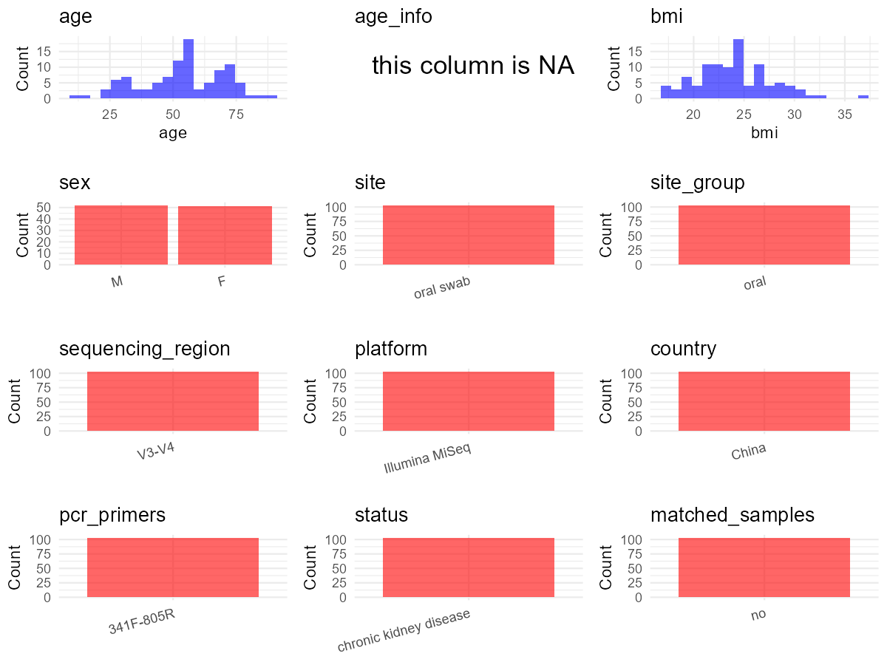

R Notebook: Metadata Processing Workflow
================

# Step 1: Obtain Initial Metadata from Each Project

This step sets the project directory, loads the raw SRA metadata, and
optionally merges supplement tables.

``` r
# Load libraries
library(dplyr)
library(ggplot2)
library(cowplot)

# (1) Setting working directory
# EDIT HERE: change project_id for each study
project_id <- "PRJNA649074" 

base_dir <- "E:/oral/26/metadata-2604/Oral-Metadata-YL-02"
setwd(file.path(base_dir, project_id))

# (2) Loading raw SRA metadata file
sra_file <- "SraRunTable.csv"
initial_meta <- read.csv(sra_file, header = TRUE)

# (3) OPTIONAL: If extra metadata (e.g., Table.x or supplemental materials) are available from the article, you may need to merge the file with initial_meta manually. Below is example code for merging. Depending on the specific case of each study, you can customize the code as needed.
supp_table <- read.csv("supplemental_table_v2.csv", header = TRUE)
supp_table <- supp_table %>%
  mutate(number = ifelse(grepl("^hz", number) & !grepl("^Ohz", number), 
                         paste0("O", number), 
                         number))
initial_meta <- supp_table %>%
  left_join(initial_meta, by = c("number" = "Sample.Name"))
```

# Step 2: Data Overview

First, you need to get an overview of the data, which includes two
steps: reading the article and reading the initial metadata. This step
is very IMPORTANT!

``` r
# (1) Read the article in the following order: abstract, the beginning of the results section, and the methods. Understand the sample size, experimental design, and disease group overview. Clarify the sampling sites; for oral and gut samples, specify the exact sites like supragingival plaque, tongue, etc.

# (2) IMPORTANT: MUST go through each column of initial_meta
head(initial_meta, 10)
```

    ##    number age gender.male.0.female.1. BMI..kg... hypertension..no.0.yes.1.
    ## 1   CKD_1  56                       0      26.12                         0
    ## 2   CKD_2  23                       1      18.43                         0
    ## 3   CKD_3  30                       1      30.84                         1
    ## 4   CKD_4  55                       1      22.17                         1
    ## 5   CKD_5  58                       1      24.08                         1
    ## 6   CKD_6  52                       0      17.57                         1
    ## 7   CKD_8  27                       1      21.09                         0
    ## 8  CKD_10  30                       0      23.24                         1
    ## 9  CKD_11  35                       1      21.33                         1
    ## 10 CKD_15  33                       0      24.11                         0
    ##                   WBC  RBC X24hUTP  ALB  BUN Scr  UA    eGFR    TG calcium.
    ## 1  4.9000000000000004 4.37    8.89 30.1  6.9  58 314 108.341  6.01     2.09
    ## 2                 7.5 4.54    1.44 46.7  5.8  83 369  85.904  0.73     2.29
    ## 3                 5.7 3.95    3.85 39.0  8.7 199 579  28.413 11.11     2.40
    ## 4                 6.6 5.41    0.58 43.6  7.0  97 479  56.826  1.30     2.33
    ## 5  8.3000000000000007 3.88    1.28 44.5  4.5  74 287  77.180  3.05     2.38
    ## 6                 6.6 3.25    1.30 40.4 26.9 616 345   8.240  0.17     1.75
    ## 7                 5.4 4.63    1.89 46.7  3.9  60 381 120.337  1.16     2.51
    ## 8                 5.2 4.28    2.76 39.4  7.7 198 460  37.929  0.78     2.27
    ## 9                 4.3 3.87    0.92 44.3 13.3 239 311  22.138  1.86     2.15
    ## 10                5.9 4.32    2.89 29.0  4.0  65 436 121.513  8.08     2.06
    ##    phosphate.         Run Assay.Type AvgSpotLen    Bases  BioProject
    ## 1        1.05 SRR12338156   AMPLICON        600 39325094 PRJNA649074
    ## 2        0.97 SRR12338155   AMPLICON        600 34861858 PRJNA649074
    ## 3        1.39 SRR12338141   AMPLICON        595 23483820 PRJNA649074
    ## 4        1.03 SRR12338130   AMPLICON        599 23038032 PRJNA649074
    ## 5        1.13 SRR12338119   AMPLICON        597 26352707 PRJNA649074
    ## 6        2.72 SRR12338108   AMPLICON        598 19412685 PRJNA649074
    ## 7        1.65 SRR12338097   AMPLICON        596 19778667 PRJNA649074
    ## 8        1.12 SRR12338086   AMPLICON        598 53559059 PRJNA649074
    ## 9        1.18 SRR12338075   AMPLICON        595 18260246 PRJNA649074
    ## 10       1.34 SRR12338064   AMPLICON        588 21369912 PRJNA649074
    ##       BioSample              BioSampleModel    Bytes
    ## 1  SAMN15658623 Metagenome or environmental 22827922
    ## 2  SAMN15658624 Metagenome or environmental 20015518
    ## 3  SAMN15658625 Metagenome or environmental 13623530
    ## 4  SAMN15658626 Metagenome or environmental 13134568
    ## 5  SAMN15658627 Metagenome or environmental 15095719
    ## 6  SAMN15658628 Metagenome or environmental 11240500
    ## 7  SAMN15658629 Metagenome or environmental 11567808
    ## 8  SAMN15658630 Metagenome or environmental 31144360
    ## 9  SAMN15658631 Metagenome or environmental 10657856
    ## 10 SAMN15658632 Metagenome or environmental 12288185
    ##                                              Center.Name Collection_Date
    ## 1  THE FIRST AFFILIATED HOSPITAL OF ZHENGZHOU UNIVERSITY      2019-04-05
    ## 2  THE FIRST AFFILIATED HOSPITAL OF ZHENGZHOU UNIVERSITY      2019-04-06
    ## 3  THE FIRST AFFILIATED HOSPITAL OF ZHENGZHOU UNIVERSITY      2019-04-09
    ## 4  THE FIRST AFFILIATED HOSPITAL OF ZHENGZHOU UNIVERSITY      2019-04-17
    ## 5  THE FIRST AFFILIATED HOSPITAL OF ZHENGZHOU UNIVERSITY      2019-04-26
    ## 6  THE FIRST AFFILIATED HOSPITAL OF ZHENGZHOU UNIVERSITY      2019-04-26
    ## 7  THE FIRST AFFILIATED HOSPITAL OF ZHENGZHOU UNIVERSITY      2019-05-07
    ## 8  THE FIRST AFFILIATED HOSPITAL OF ZHENGZHOU UNIVERSITY      2019-05-13
    ## 9  THE FIRST AFFILIATED HOSPITAL OF ZHENGZHOU UNIVERSITY      2019-05-15
    ## 10 THE FIRST AFFILIATED HOSPITAL OF ZHENGZHOU UNIVERSITY      2019-05-15
    ##    Consent DATASTORE.filetype DATASTORE.provider
    ## 1   public   fastq,run.zq,sra         gs,ncbi,s3
    ## 2   public   fastq,run.zq,sra         gs,ncbi,s3
    ## 3   public   fastq,run.zq,sra         gs,ncbi,s3
    ## 4   public   fastq,run.zq,sra         gs,ncbi,s3
    ## 5   public   fastq,run.zq,sra         gs,ncbi,s3
    ## 6   public   fastq,run.zq,sra         gs,ncbi,s3
    ## 7   public   fastq,run.zq,sra         gs,ncbi,s3
    ## 8   public   fastq,run.zq,sra         gs,ncbi,s3
    ## 9   public   fastq,run.zq,sra         gs,ncbi,s3
    ## 10  public   fastq,run.zq,sra         gs,ncbi,s3
    ##                        DATASTORE.region Experiment geo_loc_name_country
    ## 1  gs.us-east1,ncbi.public,s3.us-east-1 SRX8837970                China
    ## 2  gs.us-east1,ncbi.public,s3.us-east-1 SRX8837971                China
    ## 3  gs.us-east1,ncbi.public,s3.us-east-1 SRX8837985                China
    ## 4  gs.us-east1,ncbi.public,s3.us-east-1 SRX8837996                China
    ## 5  gs.us-east1,ncbi.public,s3.us-east-1 SRX8838007                China
    ## 6  gs.us-east1,ncbi.public,s3.us-east-1 SRX8838018                China
    ## 7  gs.us-east1,ncbi.public,s3.us-east-1 SRX8838029                China
    ## 8  gs.us-east1,ncbi.public,s3.us-east-1 SRX8838040                China
    ## 9  gs.us-east1,ncbi.public,s3.us-east-1 SRX8838051                China
    ## 10 gs.us-east1,ncbi.public,s3.us-east-1 SRX8838062                China
    ##    geo_loc_name_country_continent     geo_loc_name    HOST     Instrument
    ## 1                            Asia China:Zheng'zhou  CKD001 Illumina MiSeq
    ## 2                            Asia China:Zheng'zhou  CKD002 Illumina MiSeq
    ## 3                            Asia China:Zheng'zhou  CKD003 Illumina MiSeq
    ## 4                            Asia China:Zheng'zhou  CKD004 Illumina MiSeq
    ## 5                            Asia China:Zheng'zhou  CKD005 Illumina MiSeq
    ## 6                            Asia China:Zheng'zhou  CKD006 Illumina MiSeq
    ## 7                            Asia China:Zheng'zhou  CKD008 Illumina MiSeq
    ## 8                            Asia China:Zheng'zhou CKD0010 Illumina MiSeq
    ## 9                            Asia China:Zheng'zhou CKD0011 Illumina MiSeq
    ## 10                           Asia China:Zheng'zhou CKD0015 Illumina MiSeq
    ##    isolation_source          lat_lon Library.Name LibraryLayout
    ## 1              oral 34.44 N 113.42 E        CKD_1        PAIRED
    ## 2              oral 34.44 N 113.42 E        CKD_2        PAIRED
    ## 3              oral 34.44 N 113.42 E        CKD_3        PAIRED
    ## 4              oral 34.44 N 113.42 E        CKD_4        PAIRED
    ## 5              oral 34.44 N 113.42 E        CKD_5        PAIRED
    ## 6              oral 34.44 N 113.42 E        CKD_6        PAIRED
    ## 7              oral 34.44 N 113.42 E        CKD_8        PAIRED
    ## 8              oral 34.44 N 113.42 E       CKD_10        PAIRED
    ## 9              oral 34.44 N 113.42 E       CKD_11        PAIRED
    ## 10             oral 34.44 N 113.42 E       CKD_15        PAIRED
    ##    LibrarySelection LibrarySource              Organism Platform
    ## 1               PCR         OTHER human oral metagenome ILLUMINA
    ## 2               PCR         OTHER human oral metagenome ILLUMINA
    ## 3               PCR         OTHER human oral metagenome ILLUMINA
    ## 4               PCR         OTHER human oral metagenome ILLUMINA
    ## 5               PCR         OTHER human oral metagenome ILLUMINA
    ## 6               PCR         OTHER human oral metagenome ILLUMINA
    ## 7               PCR         OTHER human oral metagenome ILLUMINA
    ## 8               PCR         OTHER human oral metagenome ILLUMINA
    ## 9               PCR         OTHER human oral metagenome ILLUMINA
    ## 10              PCR         OTHER human oral metagenome ILLUMINA
    ##             ReleaseDate          create_date version SRA.Study
    ## 1  2020-07-28T00:00:00Z 2020-07-28T10:07:00Z       1 SRP273916
    ## 2  2020-07-28T00:00:00Z 2020-07-28T10:07:00Z       1 SRP273916
    ## 3  2020-07-28T00:00:00Z 2020-07-28T10:07:00Z       1 SRP273916
    ## 4  2020-07-28T00:00:00Z 2020-07-28T10:07:00Z       1 SRP273916
    ## 5  2020-07-28T00:00:00Z 2020-07-28T10:07:00Z       1 SRP273916
    ## 6  2020-07-28T00:00:00Z 2020-07-28T10:07:00Z       1 SRP273916
    ## 7  2020-07-28T00:00:00Z 2020-07-28T10:07:00Z       1 SRP273916
    ## 8  2020-07-28T00:00:00Z 2020-07-28T10:07:00Z       1 SRP273916
    ## 9  2020-07-28T00:00:00Z 2020-07-28T10:06:00Z       1 SRP273916
    ## 10 2020-07-28T00:00:00Z 2020-07-28T10:06:00Z       1 SRP273916

``` r
# IMPORTANT: Check the unique values in the column of interest or query column.
lapply(initial_meta[c('isolation_source')], table) # site
```

    ## $isolation_source
    ## 
    ## oral 
    ##  103

``` r
lapply(initial_meta[c('HOST', 'Organism')], table) # organism
```

    ## $HOST
    ## 
    ##    CKD001   CKD0010   CKD0011   CKD0015   CKD0017   CKD0018   CKD0019    CKD002 
    ##         1         1         1         1         1         1         1         1 
    ##   CKD0020   CKD0021   CKD0025   CKD0027   CKD0028   CKD0029    CKD003   CKD0030 
    ##         1         1         1         1         1         1         1         1 
    ##   CKD0031   CKD0032   CKD0034   CKD0036   CKD0037   CKD0038   CKD0039    CKD004 
    ##         1         1         1         1         1         1         1         1 
    ##   CKD0040   CKD0043   CKD0044   CKD0045   CKD0046   CKD0047   CKD0048    CKD005 
    ##         1         1         1         1         1         1         1         1 
    ##   CKD0050   CKD0051   CKD0052   CKD0054   CKD0057   CKD0058   CKD0059    CKD006 
    ##         1         1         1         1         1         1         1         1 
    ##   CKD0061   CKD0064   CKD0066    CKD008  hzCKD001 hzCKD0010 hzCKD0011 hzCKD0012 
    ##         1         1         1         1         1         1         1         1 
    ## hzCKD0013 hzCKD0014 hzCKD0015 hzCKD0016 hzCKD0017 hzCKD0018 hzCKD0019  hzCKD002 
    ##         1         1         1         1         1         1         1         1 
    ## hzCKD0020 hzCKD0021 hzCKD0022 hzCKD0023 hzCKD0024 hzCKD0025 hzCKD0026 hzCKD0027 
    ##         1         1         1         1         1         1         1         1 
    ## hzCKD0028 hzCKD0029  hzCKD003 hzCKD0030 hzCKD0031 hzCKD0032 hzCKD0033 hzCKD0034 
    ##         1         1         1         1         1         1         1         1 
    ## hzCKD0035 hzCKD0036 hzCKD0037 hzCKD0038 hzCKD0039  hzCKD004 hzCKD0040 hzCKD0041 
    ##         1         1         1         1         1         1         1         1 
    ## hzCKD0042 hzCKD0043 hzCKD0044 hzCKD0045 hzCKD0046 hzCKD0047 hzCKD0048 hzCKD0049 
    ##         1         1         1         1         1         1         1         1 
    ##  hzCKD005 hzCKD0050 hzCKD0051 hzCKD0052 hzCKD0053 hzCKD0054 hzCKD0055 hzCKD0056 
    ##         1         1         1         1         1         1         1         1 
    ## hzCKD0057 hzCKD0058 hzCKD0059  hzCKD006  hzCKD007  hzCKD008  hzCKD009 
    ##         1         1         1         1         1         1         1 
    ## 
    ## $Organism
    ## 
    ## human oral metagenome 
    ##                   103

``` r
table(initial_meta$number) # subject id
```

    ## 
    ##     CKD_1    CKD_10    CKD_11    CKD_15    CKD_17    CKD_18    CKD_19     CKD_2 
    ##         1         1         1         1         1         1         1         1 
    ##    CKD_20    CKD_21    CKD_25    CKD_27    CKD_28    CKD_29     CKD_3    CKD_30 
    ##         1         1         1         1         1         1         1         1 
    ##    CKD_31    CKD_32    CKD_34    CKD_36    CKD_37    CKD_38    CKD_39     CKD_4 
    ##         1         1         1         1         1         1         1         1 
    ##    CKD_40    CKD_43    CKD_44    CKD_45    CKD_46    CKD_47    CKD_48     CKD_5 
    ##         1         1         1         1         1         1         1         1 
    ##    CKD_50    CKD_51    CKD_52    CKD_54    CKD_57    CKD_58    CKD_59     CKD_6 
    ##         1         1         1         1         1         1         1         1 
    ##    CKD_61    CKD_64    CKD_66     CKD_8  OhzCKD_1 OhzCKD_10 OhzCKD_11 OhzCKD_12 
    ##         1         1         1         1         1         1         1         1 
    ## OhzCKD_13 OhzCKD_14 OhzCKD_15 OhzCKD_16 OhzCKD_17 OhzCKD_18 OhzCKD_19  OhzCKD_2 
    ##         1         1         1         1         1         1         1         1 
    ## OhzCKD_20 OhzCKD_21 OhzCKD_22 OhzCKD_23 OhzCKD_24 OhzCKD_25 OhzCKD_26 OhzCKD_27 
    ##         1         1         1         1         1         1         1         1 
    ## OhzCKD_28 OhzCKD_29  OhzCKD_3 OhzCKD_30 OhzCKD_31 OhzCKD_32 OhzCKD_33 OhzCKD_34 
    ##         1         1         1         1         1         1         1         1 
    ## OhzCKD_35 OhzCKD_36 OhzCKD_37 OhzCKD_38 OhzCKD_39  OhzCKD_4 OhzCKD_40 OhzCKD_41 
    ##         1         1         1         1         1         1         1         1 
    ## OhzCKD_42 OhzCKD_43 OhzCKD_44 OhzCKD_45 OhzCKD_46 OhzCKD_47 OhzCKD_48 OhzCKD_49 
    ##         1         1         1         1         1         1         1         1 
    ##  OhzCKD_5 OhzCKD_50 OhzCKD_51 OhzCKD_52 OhzCKD_53 OhzCKD_54 OhzCKD_55 OhzCKD_56 
    ##         1         1         1         1         1         1         1         1 
    ## OhzCKD_57 OhzCKD_58 OhzCKD_59  OhzCKD_6  OhzCKD_7  OhzCKD_8  OhzCKD_9 
    ##         1         1         1         1         1         1         1

``` r
#table(initial_meta$sequencing_meth..exp.) # output is Sequencing by synthesis
table(initial_meta$Platform) # output is Illumina. according to the methods,  Illumina is correct.
```

    ## 
    ## ILLUMINA 
    ##      103

``` r
#table(initial_meta$target_subfragment..exp.)
```

# Step 3: Removing Control and Non-human Samples

First, we need to remove control samples(including both negative
controls and positive controls) and non-human samples.

``` r
# (1) EDIT HERE: Parameter setup
control_column <- "" # column name in initial_meta
# unique(initial_meta[[control_column]])
control_keywords <- c() # Enter exact keywords

species_column <- "" # column name in initial_meta
unique(initial_meta[[species_column]])
```

    ## NULL

``` r
non_human_keywords <- c() # Enter exact keywords

# (2) Remove controls and non-human samples. DO NOT need to modify code in this part, just run it.
n_samples <- nrow(initial_meta)
# Control evaluation
if (length(control_keywords) > 0) {
  if (is.null(control_column) || control_column == "") {
    stop("Error: control_keywords provided but control_column is missing.")
  }
  
  if (!(control_column %in% colnames(initial_meta))) {
    stop(sprintf("Error: Column '%s' not found in initial_meta.", control_column))
  }
  
  control_pattern <- paste(control_keywords, collapse = "|")
  control_text <- initial_meta[[control_column]]
  is_control <- grepl(control_pattern, control_text)
  
} else {
  is_control <- rep(FALSE, n_samples)
}

# Non-human evaluation
if (length(non_human_keywords) > 0) {
  if (is.null(species_column) || species_column == "") {
    stop("Error: non_human_keywords provided but species_column is missing.")
  }
  
  if (!(species_column %in% colnames(initial_meta))) {
    stop(sprintf("Error: Column '%s' not found in initial_meta.", species_column))
  }
  
  non_human_pattern <- paste(non_human_keywords, collapse = "|")
  species_text <- initial_meta[[species_column]]
  is_non_human <- grepl(non_human_pattern, species_text)
} else {
  is_non_human <- rep(FALSE, n_samples)
}

# Execute removal
samples_to_remove <- is_control | is_non_human
initial_meta <- initial_meta[!samples_to_remove, ]

cat("Initial samples counts:",n_samples,"\n")
```

    ## Initial samples counts: 103

``` r
cat("Removed control samples:", sum(is_control), "\n")
```

    ## Removed control samples: 0

``` r
cat("Removed non-human samples:", sum(is_non_human), "\n")
```

    ## Removed non-human samples: 0

``` r
cat("Total samples removed ", sum(samples_to_remove), "\n")
```

    ## Total samples removed  0

``` r
cat("Remaining samples after Step 2:", nrow(initial_meta), "\n")
```

    ## Remaining samples after Step 2: 103

# Step 4: Creating a Uniform Metadata Template

This step converts the raw SRA table into the standard metadata format
used in our meta-analysis. The uniform metadata should include the
following columns: 1. **bioproject**: Project ID from SRA or other
database e.g. `PRJNA1234`, `CNP1234`, ‘OEP1234’, ‘qiita_1234’ 2.
**sample_id**: SRA sample/run ID. Unique id for each sample!
e.g. `DRR1234567`, `ERR1234567` and `SRR1234567`. If no such column
exists, can use column like sample_name. 3. **subject_id**: subject id
for each person if available. e.g. `patient_01`, `Host_03_before`,
`subject12` 4. **age**: Age of the subject if available. e.g. `35`, `42`
\| not `adult`, `chilren` 5. **age_info**: If the age is not explicitly
stated but approximate age range information is available, mark it in
this column. e.g., `18-55`, `children`, `infant`, `elder` 6. **bmi**:
Body Mass Index if available. e.g. `22.5`, `18.9` \| not `normal`,
`overweight` 7. **sex**: Sex of the subject. Mandatory to write as M/F
\| not `female`, `woman` 8. **sequencing_region**: Targeted 16S rRNA
region. e.g. `V3-V4`, `V4` 9. **platform**: Sequencing platform.
e.g. `Illumina MiSeq`, `454 GS FLX Titanium`, `Ion Torrent` 10.
**country**: Country of sample origin. e.g. `China`, `Japan` \| not city
name like `Beijing` 11. **site**: Sampling site. For oral and gut sites,
specify the exact sites as detailed as possible. For example, if it is
known to be supragingival plaque, do not record it as ‘dental plaque’,
unless the original text provides only a vague description.
e.g. `saliva`, `tongue coating` \| not broad term like `oral` 12.
**site_group**: only accepts one of following three values: ‘oral’,
‘gut’, or ‘other’. 13. **public_time**: Data release date.
e.g. `2021-06-22` \| not `June 2021` 14. **pcr_primers**: PCR primers
used. e.g. `515F-806R`, `27F-338R` \| not primer sequences 15.
**title**: Title of the associated publication. 16. **disease_study**:
Whether the study involves disease samples. If it’s not clear, can
record as NA. Only three values accepted: ‘yes’, ‘no’ or NA 17.
**status**: Disease status for each sample if available, else record as
NA. Only accept following abbreviations, Write full names for all other
diseases. HC: healthy control CD: Crohn’s disease CRC: colorectal cancer
COPD: chronic obstructive pulmonary disease HIV: human immunodeficiency
virus ICU: intensive care unit OSCC: oral squamous cell carcinoma RA:
rheumatoid arthritis UC: ulcerative colitis 18. **matched_samples**:
Whether the subject has matched samples. Only accept ‘yes’ or ‘no’. 19.
**is_time_series**: Whether the study is a time series study. Only
accept ‘yes’ or ‘no’.

``` r
# Extract columns from initial_meta as follows: (1) No modification needed → extract directly. (2) Modification needed → create a new column with the prefix raw_ and mark the original column as “pending”. (3) Need to find or determine based on the article.
metadata <- data.frame(
  bioproject = initial_meta$BioProject,
  sample_id = initial_meta$Run,
  subject_id = initial_meta$number,
  age = initial_meta$age,
  age_info = NA,
  bmi = initial_meta$BMI..kg...,
  raw_sex = initial_meta$gender.male.0.female.1., 
  sex = "pending", # modify later
  sequencing_region = "V3-V4", # extract from methods section
  platform = "Illumina MiSeq", # extract from methods section, NOT initial_meta
  country = initial_meta$geo_loc_name_country,
  site = "oral swab",
  site_group = "pending", # modify later
  public_time = initial_meta$ReleaseDate,
  pcr_primers = "341F-805R", # Format: xxF-xxR
  title = "Characteristics of human oral microbiome and its non-invasive diagnostic value in chronic kidney disease", # extract from article
  disease_study = "yes", # determine according to the article
  status = "chronic kidney disease", 
  matched_samples = "pending", # modify later
  is_time_series = "no", 
  stringsAsFactors = FALSE
)
metadata$public_time <- as.Date(metadata$public_time)
```

# Step 5: Manually solving pending issues

This step involves two parts: (1) handle the columns with the `raw_`
prefix, and next (2) handle the `site_group` and `matched_samples`
columns.

``` r
# (1) Handle the columns with the `raw_` prefix.
# In this part, you need to customize the code based on the situation of the raw_ columns to obtain the content of the target columns. IMPORTANT: Add comments if the modification is not straightforward!!
metadata <- metadata %>%
  mutate(sex = case_when(
    raw_sex == 0 ~ "M",
    raw_sex == 1 ~ "F",
    TRUE ~ NA_character_
  )) # according to the 'gender.male.0.female.1.' column of initial_meta
```

``` r
# (2) Filling the 'site_group' and 'matched_samples' columns
# editing site_group
unique(metadata$site)
```

    ## [1] "oral swab"

``` r
# EDIT HERE: add oral sites
Oral_site = unique(metadata$site)
# EDIT HERE: add gut sites
Gut_site = c()
# just run
metadata <- metadata %>%
  mutate(site_group = case_when(
    site %in% Oral_site ~ "oral",
    site %in% Gut_site ~ "gut",
    TRUE ~ "other" 
  ))

# editing matched_samples, just run.
metadata$matched_samples <- ifelse(
  ave(metadata$subject_id, metadata$subject_id, FUN = length) > 1, 
  "yes", 
  "no"
)
```

``` r
# (3) check if there is pending value in metadata. If there is pending value, go on modify the metadata.
# Function to check if a column contains "pending"
has_pending <- function(col) {
  if (is.character(col) || is.factor(col)) {
    any(col == "pending", na.rm = TRUE)
  } else {
    FALSE
  }
}

# Check for any pending value
any_pending_value <- any(sapply(metadata, has_pending))

if (!any_pending_value) {
  message("Good! No cell contains the value 'pending'.")
} else {
  pending_cols <- names(metadata)[sapply(metadata, has_pending)]
  message("Columns containing 'pending': ", paste(pending_cols, collapse = ", "))
  message("Please continue to resolve these pending columns!")
}
```

    ## Good! No cell contains the value 'pending'.

# Step 6: Visualize the Metadata

This step makes a quick set of plots for checking the distribution of
key metadata fields.

``` r
# Select columns for visualization, just run
plot_data <- metadata %>%
  select(-bioproject, -sample_id, -subject_id, -title)

create_simple_plots <- function(data) {
  plots <- list()
  continuous_vars <- c("age", "bmi")

  for (col in colnames(data)) {
    if (all(is.na(data[[col]]))) {
      p <- ggplot() +
        annotate("text", x = 0.5, y = 0.5, label = "this column is NA", size = 6) +
        labs(title = col) +
        theme_void()
    } else if (col %in% continuous_vars && is.numeric(data[[col]])) {
      p <- ggplot(data, aes(x = .data[[col]])) +
        geom_histogram(fill = "blue", alpha = 0.6, bins = 20, na.rm = TRUE) +
        labs(title = col, x = col, y = "Count") +
        theme_minimal()
    } else {
      count_data <- as.data.frame(table(data[[col]], useNA = "ifany"))
      p <- ggplot(count_data, aes(x = reorder(Var1, -Freq), y = Freq)) +
        geom_col(fill = "red", alpha = 0.6) +
        labs(title = col, x = NULL, y = "Count") +
        theme_minimal() +
        theme(axis.text.x = element_text(angle = 15, hjust = 1))
    }
    plots[[col]] <- p
  }

  return(plots)
}

# Generate and arrange plots
plots <- create_simple_plots(plot_data)
p <- plot_grid(plots$age,
               plots$age_info,
               plots$bmi,
               plots$sex,
               plots$site,
               plots$site_group,
               plots$sequencing_region,
               plots$platform,
               plots$country,
               plots$pcr_primers,
               plots$status,
               plots$matched_samples,
               ncol = 3, align = "hv", axis = "lb")
ggsave("Metadata_Summary_v2.png", plot = p, width = 8, height = 6, dpi = 150)
```

``` r
# Insert Metadata_Summary.png into the current Rmd output

```


# Step 7: Sort and export the metadata

This step saves the cleaned metadata table as the final `metadata.csv`
file.

``` r
# Reorder the data frame
fixed_cols <- c("bioproject", "sample_id", "subject_id", "age", "age_info",
                "bmi", "sex", "platform", "sequencing_region", "pcr_primers", 
                "country", "site", "site_group", "disease_study", "status", 
                "title", "public_time", "matched_samples", "is_time_series")  
metadata <- metadata %>%
  select(all_of(fixed_cols), everything())

# save metadata 
# head(metadata)
write.csv(metadata, file = "metadata_v2.csv", quote = TRUE)
```
