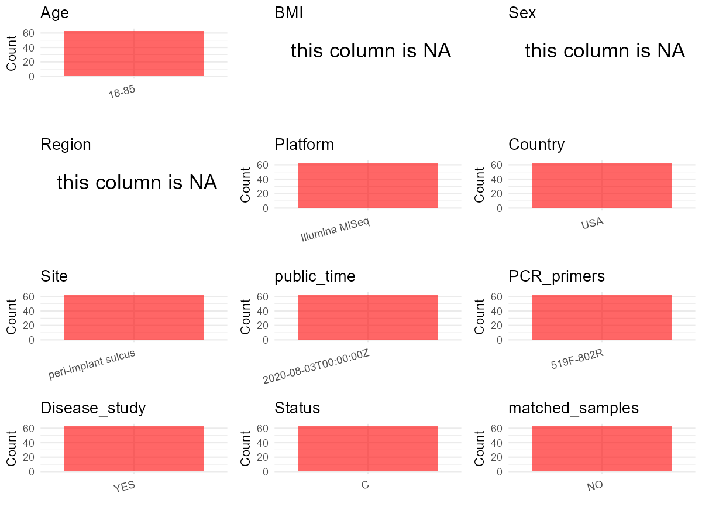

R Notebook: Metadata Processing Workflow
================

# Step 1: Obtain Initial Metadata from Each Project

To obtain the initial metadata: 1. Search for the BioProject ID (e.g.,
“PRJEBXXXX”) on the [NCBI SRA
website](https://www.ncbi.nlm.nih.gov/Traces/study/). 2. In the “Select”
table, click on “Metadata” and download the file. 3. The downloaded file
is typically named “SraRunTable.csv” and contains metadata for the
project.

``` r
# Load necessary libraries
library(dplyr)
library(ggplot2)
library(cowplot)
library(stringr)

# Set working directory (update this path to your local directory)
setwd("E:/bioproject_YL/PRJNA649980")

# Read the initial metadata files
initial_meta <- read.csv("SraRunTable.csv", header = T) 

# Remove entries non-oral samples
initial_meta <- initial_meta %>%
  filter(!str_detect(HOST, "^blank"))

# Display the first few rows of the metadata
head(initial_meta)
```

    ##           Run Assay.Type AvgSpotLen    Bases  BioProject    BioSample
    ## 1 SRR12374343   AMPLICON        574 60087621 PRJNA649980 SAMN15690740
    ## 2 SRR12374344   AMPLICON        574 20914106 PRJNA649980 SAMN15690739
    ## 3 SRR12374345   AMPLICON        575 30878451 PRJNA649980 SAMN15690738
    ## 4 SRR12374346   AMPLICON        574 18145012 PRJNA649980 SAMN15690737
    ## 5 SRR12374347   AMPLICON        575 30422749 PRJNA649980 SAMN15690736
    ## 6 SRR12374348   AMPLICON        576 16334479 PRJNA649980 SAMN15690735
    ##                                  BioSampleModel    Bytes            Center.Name
    ## 1 MIMARKS.specimen,MIGS/MIMS/MIMARKS.human-oral 37801687 STONY BROOK UNIVERSITY
    ## 2 MIMARKS.specimen,MIGS/MIMS/MIMARKS.human-oral 13355282 STONY BROOK UNIVERSITY
    ## 3 MIMARKS.specimen,MIGS/MIMS/MIMARKS.human-oral 19559866 STONY BROOK UNIVERSITY
    ## 4 MIMARKS.specimen,MIGS/MIMS/MIMARKS.human-oral 11512904 STONY BROOK UNIVERSITY
    ## 5 MIMARKS.specimen,MIGS/MIMS/MIMARKS.human-oral 18940901 STONY BROOK UNIVERSITY
    ## 6 MIMARKS.specimen,MIGS/MIMS/MIMARKS.human-oral 10474217 STONY BROOK UNIVERSITY
    ##   Collection_Date Consent DATASTORE.filetype DATASTORE.provider
    ## 1            2015  public   fastq,run.zq,sra         gs,ncbi,s3
    ## 2            2015  public   fastq,run.zq,sra         gs,ncbi,s3
    ## 3            2015  public   fastq,run.zq,sra         gs,ncbi,s3
    ## 4            2015  public   fastq,run.zq,sra         gs,ncbi,s3
    ## 5            2015  public   fastq,run.zq,sra         gs,ncbi,s3
    ## 6            2015  public   fastq,run.zq,sra         gs,ncbi,s3
    ##                       DATASTORE.region env_broad_scale
    ## 1 gs.us-east1,ncbi.public,s3.us-east-1    Homo sapiens
    ## 2 gs.us-east1,ncbi.public,s3.us-east-1    Homo sapiens
    ## 3 gs.us-east1,ncbi.public,s3.us-east-1    Homo sapiens
    ## 4 gs.us-east1,ncbi.public,s3.us-east-1    Homo sapiens
    ## 5 gs.us-east1,ncbi.public,s3.us-east-1    Homo sapiens
    ## 6 gs.us-east1,ncbi.public,s3.us-east-1    Homo sapiens
    ##                     env_local_scale    env_medium Experiment
    ## 1 mouth environment [ENVO:08000002] not collected SRX8873220
    ## 2 mouth environment [ENVO:08000002] not collected SRX8873219
    ## 3 mouth environment [ENVO:08000002] not collected SRX8873218
    ## 4 mouth environment [ENVO:08000002] not collected SRX8873217
    ## 5 mouth environment [ENVO:08000002] not collected SRX8873216
    ## 6 mouth environment [ENVO:08000002] not collected SRX8873215
    ##   geo_loc_name_country geo_loc_name_country_continent  geo_loc_name
    ## 1                  USA                  North America USA: New York
    ## 2                  USA                  North America USA: New York
    ## 3                  USA                  North America USA: New York
    ## 4                  USA                  North America USA: New York
    ## 5                  USA                  North America USA: New York
    ## 6                  USA                  North America USA: New York
    ##              HOST     Instrument isol_growth_condt
    ## 1 patient seven 8 Illumina MiSeq     not collected
    ## 2 patient seven 7 Illumina MiSeq     not collected
    ## 3 patient seven 6 Illumina MiSeq     not collected
    ## 4 patient seven 5 Illumina MiSeq     not collected
    ## 5 patient seven 4 Illumina MiSeq     not collected
    ## 6 patient seven 3 Illumina MiSeq     not collected
    ##                                                isolation_source
    ## 1 patient seven\\, location out\\, material pp cotton\\, bone 2
    ## 2    patient seven\\, location out\\, material pp pvs\\, bone 4
    ## 3   patient seven\\, location out\\, material pp foam\\, bone 3
    ## 4 patient seven\\, location out\\, material pp teflon\\, bone 2
    ## 5     patient seven\\, location in\\, material cotton\\, bone 2
    ## 6        patient seven\\, location in\\, material PVS\\, bone 4
    ##                   lat_lon   Library.Name LibraryLayout LibrarySelection
    ## 1 40.903244 N 73.120317 W dental_fill_60        PAIRED              PCR
    ## 2 40.903244 N 73.120317 W dental_fill_59        PAIRED              PCR
    ## 3 40.903244 N 73.120317 W dental_fill_58        PAIRED              PCR
    ## 4 40.903244 N 73.120317 W dental_fill_57        PAIRED              PCR
    ## 5 40.903244 N 73.120317 W dental_fill_56        PAIRED              PCR
    ## 6 40.903244 N 73.120317 W dental_fill_55        PAIRED              PCR
    ##   LibrarySource              Organism Platform          ReleaseDate
    ## 1       GENOMIC human oral metagenome ILLUMINA 2020-08-03T00:00:00Z
    ## 2       GENOMIC human oral metagenome ILLUMINA 2020-08-03T00:00:00Z
    ## 3       GENOMIC human oral metagenome ILLUMINA 2020-08-03T00:00:00Z
    ## 4       GENOMIC human oral metagenome ILLUMINA 2020-08-03T00:00:00Z
    ## 5       GENOMIC human oral metagenome ILLUMINA 2020-08-03T00:00:00Z
    ## 6       GENOMIC human oral metagenome ILLUMINA 2020-08-03T00:00:00Z
    ##            create_date version Sample.Name SRA.Study         strain
    ## 1 2020-08-03T17:21:00Z       1         X78 SRP275610 not collected'
    ## 2 2020-08-03T17:21:00Z       1         X77 SRP275610 not collected'
    ## 3 2020-08-03T17:21:00Z       1         X76 SRP275610 not collected'
    ## 4 2020-08-03T17:21:00Z       1         X75 SRP275610 not collected'
    ## 5 2020-08-03T17:21:00Z       1         X74 SRP275610 not collected'
    ## 6 2020-08-03T17:21:00Z       1         X73 SRP275610 not collected'

# Step 2: Create a Uniform Metadata Template

The uniform metadata should include the following columns:

1.  **BioProject**: Project ID (e.g., “PRJNA339212”)
2.  **Run**: Sample ID (e.g., “ERRXXXXXX” or “SRRXXXXXX”)
3.  **sample_name**: Original sample name submitted by the authors (not
    the database-assigned ID)
4.  **Age**: Age of the subject (if available)
5.  **BMI**: Body Mass Index (if available)
6.  **Sex**: Sex of the subject (“F” or “M”)
7.  **Region**: Targeted 16S rRNA region (e.g., “V3-V4”)
8.  **Platform**: Sequencing platform (e.g., “Illumina MiSeq”)
9.  **Country**: Country of sample origin (e.g., “China”)
10. **Site**: Sample site (e.g., “saliva”, “dental plaque”)
11. **public_time**: Data release date (format: “YYYY-MM-DD”)
12. **PCR_primers**: PCR primers used (e.g., “515F-806R”)
13. **title**: Title of the associated publication
14. **Disease_study**: Whether the study involves a disease (“YES” or
    “NO”)
15. **Status**: Disease status (e.g., “T2DM”, “HC”). Note: If the study
    includes both disease and healthy samples, this must be specified
    per sample.
16. **matched_samples**: matched samples (“YES” or “NO”)

``` r
# Create a uniform metadata dataframe
metadata <- data.frame(
  BioProject = initial_meta$BioProject,
  Run = initial_meta$Run,
  sample_name = initial_meta$HOST,
  Age = "18-85", 
  BMI = NA,  
  Sex = NA,
  Region = NA,
  Platform = initial_meta$Instrument,
  Country = initial_meta$geo_loc_name_country,
  Site = "peri-implant sulcus",
  public_time = initial_meta$ReleaseDate,
  stringsAsFactors = FALSE
)
```

# Step 3: Manually Add Information from the Publication

Some information (e.g. PCR primers, study title, disease status) must be
manually extracted from the publication and added to the metadata.

``` r
# Add information obtained from the publication
metadata$PCR_primers <- "519F-802R"
metadata$title <- "Evaluation of different materials used for sealing of implant abutment access channel and the peri-implant sulcus microbiota A 6-month randomized controlled trial"
metadata$Disease_study <- "YES"
# Assign disease status based on sample_name patterns
metadata$Status <- "C"

# Check initial data distribution
cat("Initial sample distribution:\n")
```

    ## Initial sample distribution:

``` r
table(metadata$sample_name)
```

    ## 
    ## patient eight 1 patient eight 2 patient eight 3 patient eight 4 patient eight 5 
    ##               1               1               1               1               1 
    ## patient eight 6 patient eight 7 patient eight 8  patient five 1  patient five 2 
    ##               1               1               1               1               1 
    ##  patient five 3  patient five 4  patient five 5  patient five 6  patient five 7 
    ##               1               1               1               1               1 
    ##  patient five 8  patient four 1  patient four 2  patient four 3  patient four 4 
    ##               1               1               1               1               1 
    ##  patient four 5  patient four 6  patient four 7  patient four 8   patient one 1 
    ##               1               1               1               1               1 
    ##   patient one 2   patient one 3   patient one 4   patient one 5   patient one 6 
    ##               1               1               1               1               1 
    ##   patient one 7   patient one 8 patient seven 1 patient seven 2 patient seven 3 
    ##               1               1               1               1               1 
    ## patient seven 4 patient seven 5 patient seven 6 patient seven 7 patient seven 8 
    ##               1               1               1               1               1 
    ##   patient six 1   patient six 2   patient six 3   patient six 4   patient six 5 
    ##               1               1               1               1               1 
    ##   patient six 6   patient six 7   patient six 8 patient three 1 patient three 2 
    ##               1               1               1               1               1 
    ## patient three 3 patient three 4 patient three 5 patient three 6 patient three 7 
    ##               1               1               1               1               1 
    ## patient three 8   patient two 1   patient two 2   patient two 3   patient two 4 
    ##               1               1               1               1               1 
    ##   patient two 6   patient two 7   patient two 8 
    ##               1               1               1

``` r
table(metadata$Site)
```

    ## 
    ## peri-implant sulcus 
    ##                  63

``` r
# Calculate sampling frequency per subject
sample_counts <- table(metadata$sample_name)
cat("\nNumber of samples per subject:\n")
```

    ## 
    ## Number of samples per subject:

``` r
print(sample_counts)
```

    ## 
    ## patient eight 1 patient eight 2 patient eight 3 patient eight 4 patient eight 5 
    ##               1               1               1               1               1 
    ## patient eight 6 patient eight 7 patient eight 8  patient five 1  patient five 2 
    ##               1               1               1               1               1 
    ##  patient five 3  patient five 4  patient five 5  patient five 6  patient five 7 
    ##               1               1               1               1               1 
    ##  patient five 8  patient four 1  patient four 2  patient four 3  patient four 4 
    ##               1               1               1               1               1 
    ##  patient four 5  patient four 6  patient four 7  patient four 8   patient one 1 
    ##               1               1               1               1               1 
    ##   patient one 2   patient one 3   patient one 4   patient one 5   patient one 6 
    ##               1               1               1               1               1 
    ##   patient one 7   patient one 8 patient seven 1 patient seven 2 patient seven 3 
    ##               1               1               1               1               1 
    ## patient seven 4 patient seven 5 patient seven 6 patient seven 7 patient seven 8 
    ##               1               1               1               1               1 
    ##   patient six 1   patient six 2   patient six 3   patient six 4   patient six 5 
    ##               1               1               1               1               1 
    ##   patient six 6   patient six 7   patient six 8 patient three 1 patient three 2 
    ##               1               1               1               1               1 
    ## patient three 3 patient three 4 patient three 5 patient three 6 patient three 7 
    ##               1               1               1               1               1 
    ## patient three 8   patient two 1   patient two 2   patient two 3   patient two 4 
    ##               1               1               1               1               1 
    ##   patient two 6   patient two 7   patient two 8 
    ##               1               1               1

``` r
# Create matched_samples column
metadata$matched_samples <- ifelse(metadata$sample_name %in% names(sample_counts[sample_counts >= 2]), "YES", "NO")

cat("\nMatched samples distribution:\n")
```

    ## 
    ## Matched samples distribution:

``` r
table(metadata$matched_samples)
```

    ## 
    ## NO 
    ## 63

``` r
# Identify samples for removal: single samples excluding peri-implant sulcus
single_samples <- names(sample_counts[sample_counts == 1])
samples_to_remove <- metadata$sample_name %in% single_samples & 
                     !(metadata$Site %in% c("peri-implant sulcus"))

cat("\nNumber of samples to be removed:", sum(samples_to_remove), "\n")
```

    ## 
    ## Number of samples to be removed: 0

``` r
# Remove identified samples
metadata_clean <- metadata[!samples_to_remove, ]

cat("\nFinal sample distribution after cleaning:\n")
```

    ## 
    ## Final sample distribution after cleaning:

``` r
table(metadata_clean$sample_name)
```

    ## 
    ## patient eight 1 patient eight 2 patient eight 3 patient eight 4 patient eight 5 
    ##               1               1               1               1               1 
    ## patient eight 6 patient eight 7 patient eight 8  patient five 1  patient five 2 
    ##               1               1               1               1               1 
    ##  patient five 3  patient five 4  patient five 5  patient five 6  patient five 7 
    ##               1               1               1               1               1 
    ##  patient five 8  patient four 1  patient four 2  patient four 3  patient four 4 
    ##               1               1               1               1               1 
    ##  patient four 5  patient four 6  patient four 7  patient four 8   patient one 1 
    ##               1               1               1               1               1 
    ##   patient one 2   patient one 3   patient one 4   patient one 5   patient one 6 
    ##               1               1               1               1               1 
    ##   patient one 7   patient one 8 patient seven 1 patient seven 2 patient seven 3 
    ##               1               1               1               1               1 
    ## patient seven 4 patient seven 5 patient seven 6 patient seven 7 patient seven 8 
    ##               1               1               1               1               1 
    ##   patient six 1   patient six 2   patient six 3   patient six 4   patient six 5 
    ##               1               1               1               1               1 
    ##   patient six 6   patient six 7   patient six 8 patient three 1 patient three 2 
    ##               1               1               1               1               1 
    ## patient three 3 patient three 4 patient three 5 patient three 6 patient three 7 
    ##               1               1               1               1               1 
    ## patient three 8   patient two 1   patient two 2   patient two 3   patient two 4 
    ##               1               1               1               1               1 
    ##   patient two 6   patient two 7   patient two 8 
    ##               1               1               1

``` r
table(metadata_clean$Site)
```

    ## 
    ## peri-implant sulcus 
    ##                  63

``` r
table(metadata_clean$matched_samples)
```

    ## 
    ## NO 
    ## 63

``` r
# Use cleaned dataset for subsequent analysis
metadata <- metadata_clean
```

# Step 4: Summarize and Validate the Metadata

``` r
# Check the number of unique runs and sample names
print(paste("Number of unique runs:", length(unique(metadata$Run))))
```

    ## [1] "Number of unique runs: 63"

``` r
print(paste("Number of unique sample names:", length(unique(metadata$sample_name))))
```

    ## [1] "Number of unique sample names: 63"

# Step 5: Visualize the Metadata

``` r

```


# Step 6: Finalize and Export the Metadata

``` r
# Reorder columns to match the desired format
metadata <- metadata[, c(
  "BioProject", "Run", "sample_name", "Age", "BMI", "Sex", 
  "Region", "Platform", "Country", "Site", "public_time", 
  "PCR_primers", "title", "Disease_study", "Status", "matched_samples"
)]

# Export the uniform metadata to a CSV file
write.csv(metadata, file = "metadata.csv", quote = FALSE)
head(metadata)
```

    ##    BioProject         Run     sample_name   Age BMI Sex Region       Platform
    ## 1 PRJNA649980 SRR12374343 patient seven 8 18-85  NA  NA     NA Illumina MiSeq
    ## 2 PRJNA649980 SRR12374344 patient seven 7 18-85  NA  NA     NA Illumina MiSeq
    ## 3 PRJNA649980 SRR12374345 patient seven 6 18-85  NA  NA     NA Illumina MiSeq
    ## 4 PRJNA649980 SRR12374346 patient seven 5 18-85  NA  NA     NA Illumina MiSeq
    ## 5 PRJNA649980 SRR12374347 patient seven 4 18-85  NA  NA     NA Illumina MiSeq
    ## 6 PRJNA649980 SRR12374348 patient seven 3 18-85  NA  NA     NA Illumina MiSeq
    ##   Country                Site          public_time PCR_primers
    ## 1     USA peri-implant sulcus 2020-08-03T00:00:00Z   519F-802R
    ## 2     USA peri-implant sulcus 2020-08-03T00:00:00Z   519F-802R
    ## 3     USA peri-implant sulcus 2020-08-03T00:00:00Z   519F-802R
    ## 4     USA peri-implant sulcus 2020-08-03T00:00:00Z   519F-802R
    ## 5     USA peri-implant sulcus 2020-08-03T00:00:00Z   519F-802R
    ## 6     USA peri-implant sulcus 2020-08-03T00:00:00Z   519F-802R
    ##                                                                                                                                                                title
    ## 1 Evaluation of different materials used for sealing of implant abutment access channel and the peri-implant sulcus microbiota A 6-month randomized controlled trial
    ## 2 Evaluation of different materials used for sealing of implant abutment access channel and the peri-implant sulcus microbiota A 6-month randomized controlled trial
    ## 3 Evaluation of different materials used for sealing of implant abutment access channel and the peri-implant sulcus microbiota A 6-month randomized controlled trial
    ## 4 Evaluation of different materials used for sealing of implant abutment access channel and the peri-implant sulcus microbiota A 6-month randomized controlled trial
    ## 5 Evaluation of different materials used for sealing of implant abutment access channel and the peri-implant sulcus microbiota A 6-month randomized controlled trial
    ## 6 Evaluation of different materials used for sealing of implant abutment access channel and the peri-implant sulcus microbiota A 6-month randomized controlled trial
    ##   Disease_study Status matched_samples
    ## 1           YES      C              NO
    ## 2           YES      C              NO
    ## 3           YES      C              NO
    ## 4           YES      C              NO
    ## 5           YES      C              NO
    ## 6           YES      C              NO

## Notes for Students:

1.  **Metadata Accuracy**: Always cross-check the metadata with the
    original publication to ensure accuracy.
2.  **Manual Entries**: Columns like `PCR_primers`, and `Status` often
    require manual entry based on the publication.
3.  **Disease Status**: Be careful when assigning `Status`—some studies
    include both disease and healthy samples.
4.  **Visualization**: The plots help quickly identify the distribution
    of values in each column, which is useful for quality control.
5.  **Reproducibility**: Update the working directory and file paths to
    match your local environment.
