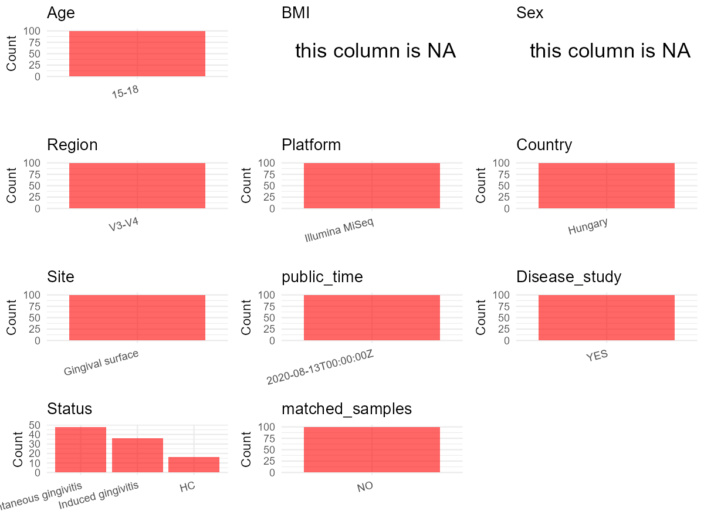

R Notebook: Metadata Processing Workflow
================

# Step 1: Obtain Initial Metadata from Each Project

To obtain the initial metadata: 1. Search for the BioProject ID (e.g.,
“PRJEBXXXX”) on the [NCBI SRA
website](https://www.ncbi.nlm.nih.gov/Traces/study/). 2. In the “Select”
table, click on “Metadata” and download the file. 3. The downloaded file
is typically named “SraRunTable.csv” and contains metadata for the
project.

``` r
# Load necessary libraries
library(dplyr)
library(ggplot2)
library(cowplot)

# Set working directory (update this path to your local directory)
setwd("D:/studylearning/董彪师兄项目/任务/张辰飞/PRJNA650272")

# Read the initial metadata files
initial_meta<-read.csv("SraRunTable.csv",header = T)

# Combine the two metadata files
#meta <- rbind(initial_meta, initial_meta1)

#Remove WGS samples
initial_meta <- subset(initial_meta,Assay.Type=="AMPLICON")

# Check the number of samples containing "HT" in Sample.Name (e.g., healthy controls)
#nrow(subset(meta, grepl("HT", Sample.Name)))

# Display the first few rows of the metadata
head(initial_meta)
```

    ##            Run   AGE Assay.Type AvgSpotLen    Bases
    ## 30 SRR12445174 15-18   AMPLICON        501 39218455
    ## 31 SRR12445175 15-18   AMPLICON        501 40827659
    ## 32 SRR12445176 15-18   AMPLICON        501 39932988
    ## 33 SRR12445177 15-18   AMPLICON        500 45704144
    ## 34 SRR12445178 15-18   AMPLICON        500 42237042
    ## 35 SRR12445179 15-18   AMPLICON        501 22783523
    ##                                  BIOMATERIAL_PROVIDER  BioProject    BioSample
    ## 30 Department of Orthodontics and Pediatric Dentistry PRJNA650272 SAMN15702156
    ## 31 Department of Orthodontics and Pediatric Dentistry PRJNA650272 SAMN15702156
    ## 32 Department of Orthodontics and Pediatric Dentistry PRJNA650272 SAMN15702156
    ## 33 Department of Orthodontics and Pediatric Dentistry PRJNA650272 SAMN15702156
    ## 34 Department of Orthodontics and Pediatric Dentistry PRJNA650272 SAMN15702156
    ## 35 Department of Orthodontics and Pediatric Dentistry PRJNA650272 SAMN15702156
    ##                 BioSampleModel    Bytes          Center.Name Collection_Date
    ## 30 Metagenome or environmental 25100187 UNIVERSITY OF SZEGED         missing
    ## 31 Metagenome or environmental 25581318 UNIVERSITY OF SZEGED         missing
    ## 32 Metagenome or environmental 25137629 UNIVERSITY OF SZEGED         missing
    ## 33 Metagenome or environmental 29227339 UNIVERSITY OF SZEGED         missing
    ## 34 Metagenome or environmental 26682848 UNIVERSITY OF SZEGED         missing
    ## 35 Metagenome or environmental 13806343 UNIVERSITY OF SZEGED         missing
    ##    Consent DATASTORE.filetype DATASTORE.provider
    ## 30  public   fastq,run.zq,sra         gs,ncbi,s3
    ## 31  public   fastq,run.zq,sra         gs,ncbi,s3
    ## 32  public   fastq,run.zq,sra         gs,ncbi,s3
    ## 33  public   fastq,run.zq,sra         gs,ncbi,s3
    ## 34  public   fastq,run.zq,sra         gs,ncbi,s3
    ## 35  public   fastq,run.zq,sra         gs,ncbi,s3
    ##                        DATASTORE.region Experiment geo_loc_name_country
    ## 30 gs.us-east1,ncbi.public,s3.us-east-1 SRX8939814         uncalculated
    ## 31 gs.us-east1,ncbi.public,s3.us-east-1 SRX8939813         uncalculated
    ## 32 gs.us-east1,ncbi.public,s3.us-east-1 SRX8939812         uncalculated
    ## 33 gs.us-east1,ncbi.public,s3.us-east-1 SRX8939811         uncalculated
    ## 34 gs.us-east1,ncbi.public,s3.us-east-1 SRX8939810         uncalculated
    ## 35 gs.us-east1,ncbi.public,s3.us-east-1 SRX8939809         uncalculated
    ##    geo_loc_name_country_continent geo_loc_name    HOST     Instrument
    ## 30                   uncalculated      missing missing Illumina MiSeq
    ## 31                   uncalculated      missing missing Illumina MiSeq
    ## 32                   uncalculated      missing missing Illumina MiSeq
    ## 33                   uncalculated      missing missing Illumina MiSeq
    ## 34                   uncalculated      missing missing Illumina MiSeq
    ## 35                   uncalculated      missing missing Illumina MiSeq
    ##             isolate isolation_source lat_lon Library.Name LibraryLayout
    ## 30 Gingival surface          missing missing      A004-13        SINGLE
    ## 31 Gingival surface          missing missing      A003-33        SINGLE
    ## 32 Gingival surface          missing missing      A003-24        SINGLE
    ## 33 Gingival surface          missing missing      A001-16        SINGLE
    ## 34 Gingival surface          missing missing      A001-14        SINGLE
    ## 35 Gingival surface          missing missing      C004-47        SINGLE
    ##    LibrarySelection LibrarySource              Organism Platform
    ## 30              PCR       GENOMIC human oral metagenome ILLUMINA
    ## 31              PCR       GENOMIC human oral metagenome ILLUMINA
    ## 32              PCR       GENOMIC human oral metagenome ILLUMINA
    ## 33              PCR       GENOMIC human oral metagenome ILLUMINA
    ## 34              PCR       GENOMIC human oral metagenome ILLUMINA
    ## 35              PCR       GENOMIC human oral metagenome ILLUMINA
    ##             ReleaseDate          create_date version     Sample.Name
    ## 30 2020-08-13T00:00:00Z 2020-08-13T09:20:00Z       1 Gingival sample
    ## 31 2020-08-13T00:00:00Z 2020-08-13T09:20:00Z       1 Gingival sample
    ## 32 2020-08-13T00:00:00Z 2020-08-13T09:20:00Z       1 Gingival sample
    ## 33 2020-08-13T00:00:00Z 2020-08-13T09:20:00Z       1 Gingival sample
    ## 34 2020-08-13T00:00:00Z 2020-08-13T09:20:00Z       1 Gingival sample
    ## 35 2020-08-13T00:00:00Z 2020-08-13T09:20:00Z       1 Gingival sample
    ##                sex SRA.Study                tissue
    ## 30 male and female SRP277335 Oral gingival surface
    ## 31 male and female SRP277335 Oral gingival surface
    ## 32 male and female SRP277335 Oral gingival surface
    ## 33 male and female SRP277335 Oral gingival surface
    ## 34 male and female SRP277335 Oral gingival surface
    ## 35 male and female SRP277335 Oral gingival surface

# Step 2: Create a Uniform Metadata Template

The uniform metadata should include the following columns:

1.  **BioProject**: Project ID (e.g., “PRJNA339212”)
2.  **Run**: Sample ID (e.g., “ERRXXXXXX” or “SRRXXXXXX”)
3.  **sample_name**: Original sample name submitted by the authors (not
    the database-assigned ID)
4.  **Age**: Age of the subject (if available)
5.  **BMI**: Body Mass Index (if available)
6.  **Sex**: Sex of the subject (“F” or “M”)
7.  **Region**: Targeted 16S rRNA region (e.g., “V3-V4”)
8.  **Platform**: Sequencing platform (e.g., “Illumina MiSeq”)
9.  **Country**: Country of sample origin (e.g., “China”)
10. **Site**: Sample site (e.g., “saliva”, “dental plaque”)
11. **public_time**: Data release date (format: “YYYY-MM-DD”)
12. **PCR_primers**: PCR primers used (e.g., “515F-806R”)
13. **title**: Title of the associated publication
14. **Disease_study**: Whether the study involves a disease (“YES” or
    “NO”)
15. **Status**: Disease status (e.g., “T2DM”, “HC”). Note: If the study
    includes both disease and healthy samples, this must be specified
    per sample.
16. **matched_samples**: matched samples (“YES” or “NO”)

``` r
# Create a uniform metadata dataframe
metadata <- data.frame(
  BioProject = initial_meta$BioProject,
  Run = initial_meta$Run,
  sample_name = initial_meta$Library.Name,
  Age = initial_meta$AGE,
  BMI = NA,
  Sex= NA,
  Region = "V3-V4",
  Platform = initial_meta$Instrument,
  Country = "Hungary",
  Site = initial_meta$isolate,
  public_time = initial_meta$ReleaseDate,
  stringsAsFactors = FALSE
)
```

# Step 3: Manually Add Information from the Publication

Some information (e.g. PCR primers, study title, disease status) must be
manually extracted from the publication and added to the metadata.

``` r
# Add information obtained from the publication
metadata$PCR_primers <-"F:5'TCGTCGGCAGCGTCAGATGTGTATAAGAGACAGCCTACGGGNGGCWGCAG; R：5'GTCTCGTGGGCTCGGAGATGTGTATAAGAGACAGGACTACHVGGGTATCTAATC"
metadata$title <- "Microbiomes in supragingival biofilms and saliva of adolescent patients with provoked and naturally occurring gingivitis relative to gingival health"
metadata$Disease_study <- "YES"
# Assign disease status based on sample_name patterns
metadata <- metadata %>% 
  mutate(Status = case_when(
    grepl("A",sample_name) ~ "Induced gingivitis",
    grepl("B",sample_name) ~ "Spontaneous gingivitis",
    grepl("C",sample_name) ~ "HC"
  ))


#extract subject id by remove prefix of sample_name
#metadata$sample_name <- gsub("T|CR|CS|C|N|S", "", metadata$sample_name)

# Check initial data distribution
cat("Initial sample distribution:\n")
```

    ## Initial sample distribution:

``` r
table(metadata$sample_name)
```

    ## 
    ## A001-14 A001-16 A001-23 A001-26 A002-16 A002-22 A002-36 A002-46 A003-14 A003-16 
    ##       1       1       1       1       1       1       1       1       1       1 
    ## A003-24 A003-33 A004-13 A004-15 A004-23 A004-41 A005-13 A005-22 A005-33 A005-36 
    ##       1       1       1       1       1       1       1       1       1       1 
    ## A006-22 A006-33 A006-44 A006-46 A007-22 A007-31 A007-33 A007-43 A008-31 A008-33 
    ##       1       1       1       1       1       1       1       1       1       1 
    ## A008-41 A008-43 A009-11 A009-12 A009-14 A009-25 B001-16 B001-22 B001-33 B001-41 
    ##       1       1       1       1       1       1       1       1       1       1 
    ## B002-13 B002-16 B002-23 B002-25 B003-12 B003-23 B003-33 B003-43 B004-11 B004-13 
    ##       1       1       1       1       1       1       1       1       1       1 
    ## B004-17 B004-22 B005-11 B005-13 B005-22 B005-25 B006-13 B006-21 B006-43 B006-44 
    ##       1       1       1       1       1       1       1       1       1       1 
    ## B007-13 B007-17 B007-22 B007-26 B008-16 B008-26 B008-33 B008-46 B009-12 B009-26 
    ##       1       1       1       1       1       1       1       1       1       1 
    ## B009-36 B009-46 B010-13 B010-21 B010-35 B010-46 B011-11 B011-22 B011-32 B011-42 
    ##       1       1       1       1       1       1       1       1       1       1 
    ## B012-13 B012-27 B012-32 B012-42 C001-15 C001-16 C001-24 C001-46 C002-21 C002-25 
    ##       1       1       1       1       1       1       1       1       1       1 
    ## C002-37 C002-46 C003-16 C003-25 C003-37 C003-46 C004-12 C004-22 C004-33 C004-47 
    ##       1       1       1       1       1       1       1       1       1       1

``` r
table(metadata$Site)
```

    ## 
    ## Gingival surface 
    ##              100

``` r
# Calculate sampling frequency per subject
sample_counts <- table(metadata$sample_name)
cat("\nNumber of samples per subject:\n")
```

    ## 
    ## Number of samples per subject:

``` r
print(sample_counts)
```

    ## 
    ## A001-14 A001-16 A001-23 A001-26 A002-16 A002-22 A002-36 A002-46 A003-14 A003-16 
    ##       1       1       1       1       1       1       1       1       1       1 
    ## A003-24 A003-33 A004-13 A004-15 A004-23 A004-41 A005-13 A005-22 A005-33 A005-36 
    ##       1       1       1       1       1       1       1       1       1       1 
    ## A006-22 A006-33 A006-44 A006-46 A007-22 A007-31 A007-33 A007-43 A008-31 A008-33 
    ##       1       1       1       1       1       1       1       1       1       1 
    ## A008-41 A008-43 A009-11 A009-12 A009-14 A009-25 B001-16 B001-22 B001-33 B001-41 
    ##       1       1       1       1       1       1       1       1       1       1 
    ## B002-13 B002-16 B002-23 B002-25 B003-12 B003-23 B003-33 B003-43 B004-11 B004-13 
    ##       1       1       1       1       1       1       1       1       1       1 
    ## B004-17 B004-22 B005-11 B005-13 B005-22 B005-25 B006-13 B006-21 B006-43 B006-44 
    ##       1       1       1       1       1       1       1       1       1       1 
    ## B007-13 B007-17 B007-22 B007-26 B008-16 B008-26 B008-33 B008-46 B009-12 B009-26 
    ##       1       1       1       1       1       1       1       1       1       1 
    ## B009-36 B009-46 B010-13 B010-21 B010-35 B010-46 B011-11 B011-22 B011-32 B011-42 
    ##       1       1       1       1       1       1       1       1       1       1 
    ## B012-13 B012-27 B012-32 B012-42 C001-15 C001-16 C001-24 C001-46 C002-21 C002-25 
    ##       1       1       1       1       1       1       1       1       1       1 
    ## C002-37 C002-46 C003-16 C003-25 C003-37 C003-46 C004-12 C004-22 C004-33 C004-47 
    ##       1       1       1       1       1       1       1       1       1       1

``` r
# Create matched_samples column
metadata$matched_samples <- ifelse(metadata$sample_name %in% names(sample_counts[sample_counts >= 2]), "YES", "NO")

cat("\nMatched samples distribution:\n")
```

    ## 
    ## Matched samples distribution:

``` r
table(metadata$matched_samples)
```

    ## 
    ##  NO 
    ## 100

``` r
# Identify samples for removal: single samples excluding Gingival surface
single_samples <- names(sample_counts[sample_counts == 1])
samples_to_remove <- metadata$sample_name %in% single_samples & !(metadata$Site %in% c("Gingival surface"))

cat("\nNumber of samples to be removed:", sum(samples_to_remove), "\n")
```

    ## 
    ## Number of samples to be removed: 0

``` r
# Remove identified samples
metadata_clean <- metadata[!samples_to_remove, ]

cat("\nFinal sample distribution after cleaning:\n")
```

    ## 
    ## Final sample distribution after cleaning:

``` r
table(metadata_clean$sample_name)
```

    ## 
    ## A001-14 A001-16 A001-23 A001-26 A002-16 A002-22 A002-36 A002-46 A003-14 A003-16 
    ##       1       1       1       1       1       1       1       1       1       1 
    ## A003-24 A003-33 A004-13 A004-15 A004-23 A004-41 A005-13 A005-22 A005-33 A005-36 
    ##       1       1       1       1       1       1       1       1       1       1 
    ## A006-22 A006-33 A006-44 A006-46 A007-22 A007-31 A007-33 A007-43 A008-31 A008-33 
    ##       1       1       1       1       1       1       1       1       1       1 
    ## A008-41 A008-43 A009-11 A009-12 A009-14 A009-25 B001-16 B001-22 B001-33 B001-41 
    ##       1       1       1       1       1       1       1       1       1       1 
    ## B002-13 B002-16 B002-23 B002-25 B003-12 B003-23 B003-33 B003-43 B004-11 B004-13 
    ##       1       1       1       1       1       1       1       1       1       1 
    ## B004-17 B004-22 B005-11 B005-13 B005-22 B005-25 B006-13 B006-21 B006-43 B006-44 
    ##       1       1       1       1       1       1       1       1       1       1 
    ## B007-13 B007-17 B007-22 B007-26 B008-16 B008-26 B008-33 B008-46 B009-12 B009-26 
    ##       1       1       1       1       1       1       1       1       1       1 
    ## B009-36 B009-46 B010-13 B010-21 B010-35 B010-46 B011-11 B011-22 B011-32 B011-42 
    ##       1       1       1       1       1       1       1       1       1       1 
    ## B012-13 B012-27 B012-32 B012-42 C001-15 C001-16 C001-24 C001-46 C002-21 C002-25 
    ##       1       1       1       1       1       1       1       1       1       1 
    ## C002-37 C002-46 C003-16 C003-25 C003-37 C003-46 C004-12 C004-22 C004-33 C004-47 
    ##       1       1       1       1       1       1       1       1       1       1

``` r
table(metadata_clean$Site)
```

    ## 
    ## Gingival surface 
    ##              100

``` r
table(metadata_clean$matched_samples)
```

    ## 
    ##  NO 
    ## 100

``` r
# Use cleaned dataset for subsequent analysis
metadata <- metadata_clean
```

# Step 4: Summarize and Validate the Metadata

``` r
# Check the number of unique runs and sample names
print(paste("Number of unique runs:", length(unique(metadata$Run))))
```

    ## [1] "Number of unique runs: 100"

``` r
print(paste("Number of unique sample names:", length(unique(metadata$sample_name))))
```

    ## [1] "Number of unique sample names: 100"

# Step 5: Visualize the Metadata

``` r

```


# Step 6: Finalize and Export the Metadata

``` r
# Reorder columns to match the desired format
metadata <- metadata[, c(
  "BioProject", "Run", "sample_name", "Age", "BMI", "Sex", 
  "Region", "Platform", "Country", "Site", "public_time", 
  "PCR_primers", "title", "Disease_study", "Status","matched_samples"
)]

# Export the uniform metadata to a CSV file
write.csv(metadata, file = "metadata.csv", quote = FALSE)
head(metadata)
```

    ##    BioProject         Run sample_name   Age BMI Sex Region       Platform
    ## 1 PRJNA650272 SRR12445174     A004-13 15-18  NA  NA  V3-V4 Illumina MiSeq
    ## 2 PRJNA650272 SRR12445175     A003-33 15-18  NA  NA  V3-V4 Illumina MiSeq
    ## 3 PRJNA650272 SRR12445176     A003-24 15-18  NA  NA  V3-V4 Illumina MiSeq
    ## 4 PRJNA650272 SRR12445177     A001-16 15-18  NA  NA  V3-V4 Illumina MiSeq
    ## 5 PRJNA650272 SRR12445178     A001-14 15-18  NA  NA  V3-V4 Illumina MiSeq
    ## 6 PRJNA650272 SRR12445179     C004-47 15-18  NA  NA  V3-V4 Illumina MiSeq
    ##   Country             Site          public_time
    ## 1 Hungary Gingival surface 2020-08-13T00:00:00Z
    ## 2 Hungary Gingival surface 2020-08-13T00:00:00Z
    ## 3 Hungary Gingival surface 2020-08-13T00:00:00Z
    ## 4 Hungary Gingival surface 2020-08-13T00:00:00Z
    ## 5 Hungary Gingival surface 2020-08-13T00:00:00Z
    ## 6 Hungary Gingival surface 2020-08-13T00:00:00Z
    ##                                                                                                           PCR_primers
    ## 1 F:5'TCGTCGGCAGCGTCAGATGTGTATAAGAGACAGCCTACGGGNGGCWGCAG; R：5'GTCTCGTGGGCTCGGAGATGTGTATAAGAGACAGGACTACHVGGGTATCTAATC
    ## 2 F:5'TCGTCGGCAGCGTCAGATGTGTATAAGAGACAGCCTACGGGNGGCWGCAG; R：5'GTCTCGTGGGCTCGGAGATGTGTATAAGAGACAGGACTACHVGGGTATCTAATC
    ## 3 F:5'TCGTCGGCAGCGTCAGATGTGTATAAGAGACAGCCTACGGGNGGCWGCAG; R：5'GTCTCGTGGGCTCGGAGATGTGTATAAGAGACAGGACTACHVGGGTATCTAATC
    ## 4 F:5'TCGTCGGCAGCGTCAGATGTGTATAAGAGACAGCCTACGGGNGGCWGCAG; R：5'GTCTCGTGGGCTCGGAGATGTGTATAAGAGACAGGACTACHVGGGTATCTAATC
    ## 5 F:5'TCGTCGGCAGCGTCAGATGTGTATAAGAGACAGCCTACGGGNGGCWGCAG; R：5'GTCTCGTGGGCTCGGAGATGTGTATAAGAGACAGGACTACHVGGGTATCTAATC
    ## 6 F:5'TCGTCGGCAGCGTCAGATGTGTATAAGAGACAGCCTACGGGNGGCWGCAG; R：5'GTCTCGTGGGCTCGGAGATGTGTATAAGAGACAGGACTACHVGGGTATCTAATC
    ##                                                                                                                                                  title
    ## 1 Microbiomes in supragingival biofilms and saliva of adolescent patients with provoked and naturally occurring gingivitis relative to gingival health
    ## 2 Microbiomes in supragingival biofilms and saliva of adolescent patients with provoked and naturally occurring gingivitis relative to gingival health
    ## 3 Microbiomes in supragingival biofilms and saliva of adolescent patients with provoked and naturally occurring gingivitis relative to gingival health
    ## 4 Microbiomes in supragingival biofilms and saliva of adolescent patients with provoked and naturally occurring gingivitis relative to gingival health
    ## 5 Microbiomes in supragingival biofilms and saliva of adolescent patients with provoked and naturally occurring gingivitis relative to gingival health
    ## 6 Microbiomes in supragingival biofilms and saliva of adolescent patients with provoked and naturally occurring gingivitis relative to gingival health
    ##   Disease_study             Status matched_samples
    ## 1           YES Induced gingivitis              NO
    ## 2           YES Induced gingivitis              NO
    ## 3           YES Induced gingivitis              NO
    ## 4           YES Induced gingivitis              NO
    ## 5           YES Induced gingivitis              NO
    ## 6           YES                 HC              NO

## Notes for Students:

1.  **Metadata Accuracy**: Always cross-check the metadata with the
    original publication to ensure accuracy.
2.  **Manual Entries**: Columns like `PCR_primers`, and `Status` often
    require manual entry based on the publication.
3.  **Disease Status**: Be careful when assigning `Status`—some studies
    include both disease and healthy samples.
4.  **Visualization**: The plots help quickly identify the distribution
    of values in each column, which is useful for quality control.
5.  **Reproducibility**: Update the working directory and file paths to
    match your local environment.
