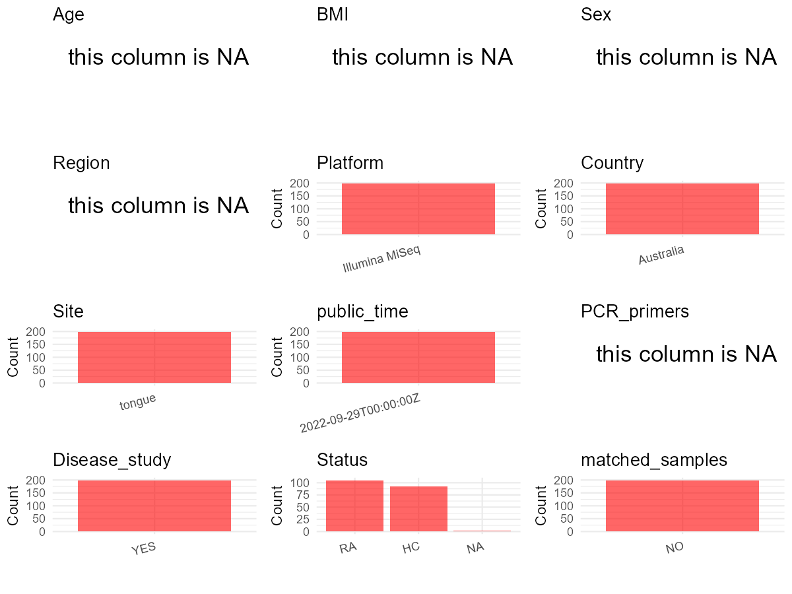

# Step 1: Obtain Initial Metadata from Each Project

This step sets the project directory, loads the raw SRA metadata, and optionally merges supplement tables.

```{r message=FALSE, warning=FALSE}
# Load libraries
library(dplyr)
library(ggplot2)
library(cowplot)

# (1) Setting working directory
# EDIT HERE: change project_id for each study
project_id <- "PRJNA656387"

base_dir <- "D:/metadata_collect"
setwd(file.path(base_dir, project_id))

# (2) Loading raw SRA metadata file
sra_file <- "SraRunTable.csv"
initial_meta <- read.csv(sra_file, header = TRUE)

# (3) OPTIONAL: If extra metadata (e.g., Table.x or supplemental materials) are available from the article, you may need to merge the file with initial_meta manually. Below is example code for merging. Depending on the specific case of each study, you can customize the code as needed.
# supp_table <- read.csv("supplemental_table.csv", header = TRUE)
# initial_meta <- left_join(initial_meta, supp_table, by = merge_col_name)
```

# Step 2: Data Overview

First, you need to get an overview of the data, which includes two steps: reading the article and reading the initial metadata. This step is very IMPORTANT!

```{r message=FALSE, warning=FALSE}
# (1) Read the article in the following order: abstract, the beginning of the results section, and the methods. Understand the sample size, experimental design, and disease group overview. Clarify the sampling sites; for oral and gut samples, specify the exact sites like supragingival plaque, tongue, etc.
#
# Paper summary (source: paper.pdf):
# - Title: "Streptococcus species enriched in the oral cavity of patients with RA are a source of peptidoglycan-polysaccharide polymers that can induce arthritis in mice"
# - Authors: Moentadj R, et al. Ann Rheum Dis 2021.
# - Cohort: 116 RA patients, 63 first-degree relatives (FDR), 43 healthy controls (HC) = 222 total (source: paper.pdf, Table 1)
# - Sampling site: tongue swabs / tongue scraping (source: paper.pdf, Methods "Cohort and oral swab collection": "Two oral swabs taken from the centre of the tongue")
# - Sequencing: targeted 16S rRNA gene amplicon sequencing (source: paper.pdf, Abstract + Methods)
# - Sequencing platform: Illumina MiSeq (source: paper.pdf, Methods; confirmed by CSV Instrument column)
# - Country: Australia (source: paper.pdf, Methods: "predominantly from an Australian urban environment"; confirmed by CSV geo_loc_name_country)
# - Study design: cross-sectional (not time series, not matched) (source: paper.pdf, Methods)
# - Individual-level age/sex/BMI: NOT available in CSV. Paper reports only group-level stats (Table 1: age mean(SD) RA=53.5(14), FDR=45.7(16), HC=51.2(15); sex %female RA=79.3%, FDR=66.7%, HC=72.1%)

# (2) IMPORTANT: MUST go through each column of initial_meta
head(initial_meta, 10)

# IMPORTANT: Check the unique values in the column of interest or query column.
# lapply(initial_meta[c('body_habitat', 'body_product', 'body_site')], table) # site
# lapply(initial_meta[c('common_name', 'env_biome', 'env_feature', 'env_matter', 'host_common_name', 'Organism', 'role', 'pet_farm_animal')], table) # organism
# table(initial_meta$host_subject_id) # subject id
table(initial_meta$Host_disease) # output: Rheumatoid arthritis=105, Healthy=92, not applicable=2 (batch controls)
# table(initial_meta$host_family_relationship) # Healthy samples: First-degree relative of RA patient; Rheumatoid arthritis: not applicable
table(initial_meta$host_tissue_sampled) # Tongue scraping + not applicable (for batch controls)
# table(initial_meta$sequencing_meth..exp.) # not present in this CSV
# table(initial_meta$Platform) # ILLUMINA
table(initial_meta$Instrument) # Illumina MiSeq
# table(initial_meta$sample_description) # sample codes: T_R* (RA), T_F* (FDR), T_H* (HC), Batch*_ExCo (controls)
table(initial_meta$Collection_Date) # 2016 (all samples)
table(initial_meta$LibraryLayout) # SINGLE + PAIRED
```

# Step 3: Removing Control and Non-human Samples

First, we need to remove control samples(including both negative controls and positive controls) and non-human samples.

```{r}
# (1) EDIT HERE: Parameter setup
control_column <- "Host_disease"   # column name in initial_meta (source: SraRunTable.csv)
# unique(initial_meta[[control_column]])
control_keywords <- c("not applicable")     # Enter exact keywords (source: SraRunTable.csv, Host_disease column; 2 batch control rows: Batch1_ExCo, Batch2_ExCo)

species_column <- "Host"          # column name in initial_meta (source: SraRunTable.csv)
unique(initial_meta[[species_column]])
non_human_keywords <- c()            # All samples are Homo sapiens; no non-human samples to remove

# (2) Remove controls and non-human samples. DO NOT need to modify code in this part, just run it.
n_samples <- nrow(initial_meta)
# Control evaluation
if (length(control_keywords) > 0) {
  if (is.null(control_column) || control_column == "") {
    stop("Error: control_keywords provided but control_column is missing.")
  }

  if (!(control_column %in% colnames(initial_meta))) {
    stop(sprintf("Error: Column '%s' not found in initial_meta.", control_column))
  }

  control_pattern <- paste(control_keywords, collapse = "|")
  control_text <- as.character(initial_meta[[control_column]])
  is_control <- control_text %in% control_keywords

} else {
  is_control <- rep(FALSE, n_samples)
}

# Non-human evaluation
if (length(non_human_keywords) > 0) {
  if (is.null(species_column) || species_column == "") {
    stop("Error: non_human_keywords provided but species_column is missing.")
  }

  if (!(species_column %in% colnames(initial_meta))) {
    stop(sprintf("Error: Column '%s' not found in initial_meta.", species_column))
  }

  non_human_pattern <- paste(non_human_keywords, collapse = "|")
  species_text <- initial_meta[[species_column]]
  is_non_human <- grepl(non_human_pattern, species_text)
} else {
  is_non_human <- rep(FALSE, n_samples)
}

# Execute removal
samples_to_remove <- is_control | is_non_human
initial_meta <- initial_meta[!samples_to_remove, ]

cat("Initial samples counts:",n_samples,"\n")
cat("Removed control samples:", sum(is_control), "\n")
cat("Removed non-human samples:", sum(is_non_human), "\n")
cat("Total samples removed ", sum(samples_to_remove), "\n")
cat("Remaining samples after Step 2:", nrow(initial_meta), "\n")
```

# Step 4: Creating a Uniform Metadata Template

This step converts the raw SRA table into the standard metadata format used in our meta-analysis.
The uniform metadata should include the following columns:
1. **bioproject**: Project ID from SRA or other database
   e.g. `PRJNA1234`, `CNP1234`, 'OEP1234', 'qiita_1234'
2. **sample_id**: SRA sample/run ID. Unique id for each sample!
   e.g. `DRR1234567`, `ERR1234567` and `SRR1234567`. If no such column exists, can use column like sample_name.
3. **subject_id**: subject id for each person if available.
   e.g. `patient_01`, `Host_03_before`, `subject12`
4. **age**: Age of the subject if available.
   e.g. `35`, `42` | not `adult`, `chilren`
5. **age_info**: If the age is not explicitly stated but approximate age range information is available, mark it in this column.
   e.g., `18-55`, `children`, `infant`, `elder`
6. **bmi**: Body Mass Index if available.
   e.g. `22.5`, `18.9` | not `normal`, `overweight`
7. **sex**: Sex of the subject.
   Mandatory to write as M/F | not `female`, `woman`
8. **sequencing_region**: Targeted 16S rRNA region.
   e.g. `V3-V4`, `V4`
9. **platform**: Sequencing platform.
   e.g. `Illumina MiSeq`, `454 GS FLX Titanium`, `Ion Torrent`
10. **country**: Country of sample origin.
    e.g. `China`, `Japan` | not city name like `Beijing`
11. **site**: Sampling site. For oral and gut sites, specify the exact sites as detailed as possible. For example, if it is known to be supragingival plaque, do not record it as 'dental plaque', unless the original text provides only a vague description.
    e.g. `saliva`, `tongue coating` | not broad term like `oral`
12. **site_group**: only accepts one of following three values: 'oral', 'gut', or 'other'.
13. **public_time**: Data release date.
    e.g. `2021-06-22` | not `June 2021`
14. **pcr_primers**: PCR primers used.
    e.g. `515F-806R`, `27F-338R` | not primer sequences
15. **title**: Title of the associated publication.
16. **disease_study**: Whether the study involves disease samples. If it's not clear, can record as NA. Only three values accepted: 'yes', 'no' or NA
17. **status**: Disease status for each sample if available, else record as NA. Only accept following abbreviations, Write full names for all other diseases.
    HC: healthy control
    CD: Crohn's disease
    CRC: colorectal cancer
    COPD: chronic obstructive pulmonary disease
    HIV: human immunodeficiency virus
    ICU: intensive care unit
    OSCC: oral squamous cell carcinoma
    RA: rheumatoid arthritis
    UC: ulcerative colitis
18. **matched_samples**: Whether the subject has matched samples. Only accept 'yes' or 'no'.
19. **is_time_series**: Whether the study is a time series study. Only accept 'yes' or 'no'.

```{r}
# Extract columns from initial_meta as follows: (1) No modification needed -> extract directly. (2) Modification needed -> create a new column with the prefix raw_ and mark the original column as "pending". (3) Need to find or determine based on the article.
metadata <- data.frame(
  bioproject = initial_meta$BioProject,  # source: SraRunTable.csv, BioProject column
  sample_id = initial_meta$Run,          # source: SraRunTable.csv, Run column (SRR IDs)
  subject_id = initial_meta$Sample.Name, # source: SraRunTable.csv, Sample Name column
  age = NA,                              # NA: individual age not in CSV; paper only reports group-level mean(SD) (source: paper.pdf, Table 1)
  age_info = NA,                         # NA: paper gives group-level age only (source: paper.pdf, Table 1: RA=53.5(14), FDR=45.7(16), HC=51.2(15))
  bmi = NA,                              # NA: BMI only available for 15 cultured isolates in paper Table 2, not for all 197 sequencing samples
  sex = "pending",                       # pending: paper reports group-level sex % (Table 1) but no per-subject sex in CSV
  sequencing_region = NA,              # NA: 16S amplicon sequencing mentioned in paper but specific region (e.g. V3-V4, V4) not stated in main text or supplemental material
  platform = "Illumina MiSeq",           # source: paper.pdf Methods "Additional methods for DNA extraction, amplicon sequencing..." + SraRunTable.csv Instrument column
  country = initial_meta$geo_loc_name_country, # source: SraRunTable.csv, geo_loc_name_country column (all "Australia")
  raw_site = initial_meta$host_tissue_sampled, # source: SraRunTable.csv, host_tissue_sampled column; needs cleanup (contains "Tongue scraping" + "not applicable" for remaining batch rows)
  site = "pending",
  site_group = "pending", # modify later
  public_time = as.Date("2021-01-04"), # source: paper.pdf, "Published online: 4 January 2021" (Ann Rheum Dis header)
  pcr_primers = NA,                    # NA: primer names not specified in main text or supplemental material
  title = "Streptococcus species enriched in the oral cavity of patients with RA are a source of peptidoglycan-polysaccharide polymers that can induce arthritis in mice", # source: paper.pdf, article title
  disease_study = "yes",               # source: paper.pdf, study compares RA patients vs controls
  status = dplyr::case_when(           # source: SraRunTable.csv, Host_disease column mapping
    initial_meta$Host_disease == "Rheumatoid arthritis" ~ "RA",
    initial_meta$Host_disease == "Healthy" ~ "HC",
    TRUE ~ NA_character_
  ),
  matched_samples = "pending", # modify later
  is_time_series = "no",       # source: paper.pdf, cross-sectional study design (Methods: single time point sampling)
  stringsAsFactors = FALSE
)
metadata$public_time <- as.Date(metadata$public_time)
```

# Step 5: Manually solving pending issues

This step involves two parts: (1) handle the columns with the `raw_` prefix, and next (2) handle the `site_group` and `matched_samples` columns.

```{r}
# (1) Handle the columns with the `raw_` prefix.
# raw_site: "Tongue scraping" -> "tongue"
# Note: after Step 3 control removal, all remaining samples have host_tissue_sampled = "Tongue scraping"
metadata <- metadata %>%
  mutate(site = gsub("Tongue scraping", "tongue", raw_site)) # source: SraRunTable.csv host_tissue_sampled column; paper.pdf confirms "centre of the tongue" sampling

# sex: paper reports group-level sex distribution (Table 1: RA 79.3% F, FDR 66.7% F, HC 72.1% F) but no per-subject data in CSV.
# Cannot resolve pending without supplemental data -> mark as NA for now
metadata <- metadata %>%
  mutate(sex = ifelse(sex == "pending", NA_character_, sex)) # NA: no per-subject sex available in SraRunTable.csv; paper Table 1 only provides group-level percentages

# sequencing_region: NA - paper does not specify 16S region; supplemental material also lacks primer info
# pcr_primers: NA - paper does not specify primer names; supplemental material also lacks this info
# Both set to NA as unavailable in any source
```

```{r}
# (2) Filling the 'site_group' and 'matched_samples' columns
# editing site_group
unique(metadata$site)
# EDIT HERE: add oral sites
Oral_site = c("tongue")
# EDIT HERE: add gut sites
Gut_site = c()
# just run
metadata <- metadata %>%
  mutate(site_group = case_when(
    site %in% Oral_site ~ "oral",
    site %in% Gut_site ~ "gut",
    TRUE ~ "other"
  ))

# editing matched_samples, just run.
metadata$matched_samples <- ifelse(
  ave(metadata$subject_id, metadata$subject_id, FUN = length) > 1,
  "yes",
  "no"
)
```

```{r}
# (3) check if there is pending value in metadata. If there is pending value, go on modify the metadata.
# Function to check if a column contains "pending"
has_pending <- function(col) {
  if (is.character(col) || is.factor(col)) {
    any(col == "pending", na.rm = TRUE)
  } else {
    FALSE
  }
}

# Check for any pending value
any_pending_value <- any(sapply(metadata, has_pending))

if (!any_pending_value) {
  message("Good! No cell contains the value 'pending'.")
} else {
  pending_cols <- names(metadata)[sapply(metadata, has_pending)]
  message("Columns containing 'pending': ", paste(pending_cols, collapse = ", "))
  message("Please continue to resolve these pending columns!")
}
```

# Step 6: Visualize the Metadata

This step makes a quick set of plots for checking the distribution of key metadata fields.

```{r}
# Select columns for visualization, just run
plot_data <- metadata %>%
  select(-bioproject, -sample_id, -subject_id, -title)

create_simple_plots <- function(data) {
  plots <- list()
  continuous_vars <- c("age", "bmi")

  for (col in colnames(data)) {
    if (all(is.na(data[[col]]))) {
      p <- ggplot() +
        annotate("text", x = 0.5, y = 0.5, label = "this column is NA", size = 6) +
        labs(title = col) +
        theme_void()
    } else if (col %in% continuous_vars && is.numeric(data[[col]])) {
      p <- ggplot(data, aes(x = .data[[col]])) +
        geom_histogram(fill = "blue", alpha = 0.6, bins = 20, na.rm = TRUE) +
        labs(title = col, x = col, y = "Count") +
        theme_minimal()
    } else {
      count_data <- as.data.frame(table(data[[col]], useNA = "ifany"))
      p <- ggplot(count_data, aes(x = reorder(Var1, -Freq), y = Freq)) +
        geom_col(fill = "red", alpha = 0.6) +
        labs(title = col, x = NULL, y = "Count") +
        theme_minimal() +
        theme(axis.text.x = element_text(angle = 15, hjust = 1))
    }
    plots[[col]] <- p
  }

  return(plots)
}

# Generate and arrange plots
plots <- create_simple_plots(plot_data)
p <- plot_grid(plots$age,
               plots$age_info,
               plots$bmi,
               plots$sex,
               plots$site,
               plots$site_group,
               plots$sequencing_region,
               plots$platform,
               plots$country,
               plots$pcr_primers,
               plots$status,
               plots$matched_samples,
               ncol = 3, align = "hv", axis = "lb")
ggsave("Metadata_Summary.png", plot = p, width = 8, height = 6, dpi = 150)
```

```{r}
# Insert Metadata_Summary.png into the current Rmd output

```

# Step 7: Sort and export the metadata

This step saves the cleaned metadata table as the final `metadata.csv` file.

```{r}
# Reorder the data frame
fixed_cols <- c("bioproject", "sample_id", "subject_id", "age", "age_info",
                "bmi", "sex", "platform", "sequencing_region", "pcr_primers",
                "country", "site", "site_group", "disease_study", "status",
                "title", "public_time", "matched_samples", "is_time_series")
metadata <- metadata %>%
  select(all_of(fixed_cols), everything())

# save metadata
# head(metadata)
write.csv(metadata, file = "metadata_v2.csv", quote = TRUE)
```
