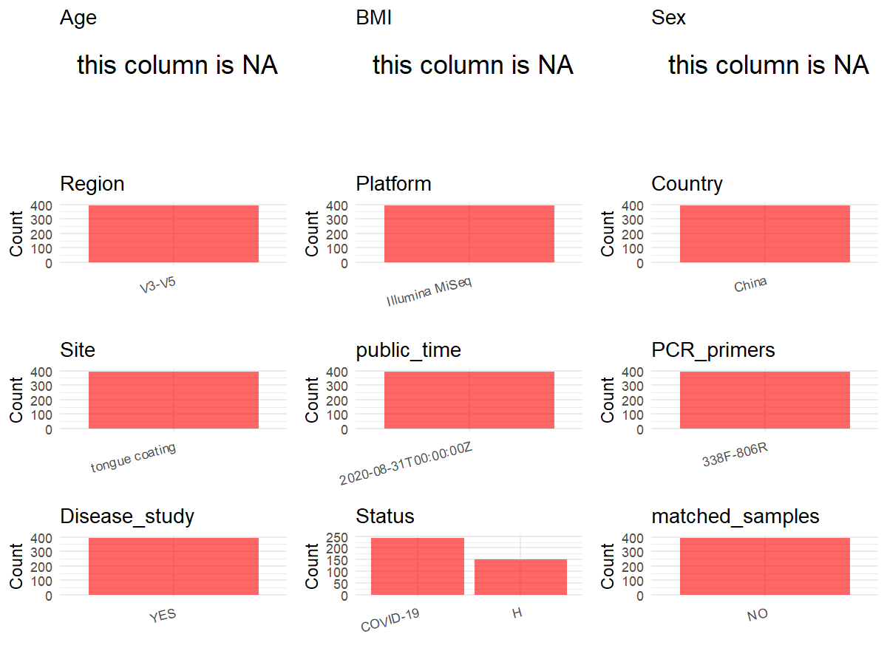

R Notebook: Metadata Processing Workflow
================

# Step 1: Obtain Initial Metadata from Each Project

To obtain the initial metadata: 1. Search for the BioProject ID (e.g.,
“PRJEBXXXX”) on the [NCBI SRA
website](https://www.ncbi.nlm.nih.gov/Traces/study/). 2. In the “Select”
table, click on “Metadata” and download the file. 3. The downloaded file
is typically named “SraRunTable.csv” and contains metadata for the
project.

``` r
# Load necessary libraries
library(dplyr)
library(ggplot2)
library(cowplot)

# Set working directory (update this path to your local directory)
setwd("D:/metadata/3/PRJNA660302")

# Read the initial metadata files
initial_meta<-read.csv("SraRunTable.csv",header = T)

# Combine the two metadata files
#meta <- rbind(initial_meta, initial_meta1)

#Remove entries non-oral samples
#initial_meta <- subset(initial_meta,BioSampleModel != "Metagenome or environmental")

# Check the number of samples containing "HT" in Sample.Name (e.g., healthy controls)
#nrow(subset(meta, grepl("HT", Sample.Name)))

# Display the first few rows of the metadata
head(initial_meta)
```

    ##           Run Assay.Type AvgSpotLen    Bases  BioProject    BioSample
    ## 1 SRR12553637   AMPLICON        602 50133356 PRJNA660302 SAMN15946147
    ## 2 SRR12553638   AMPLICON        602 37758042 PRJNA660302 SAMN15946146
    ## 3 SRR12553639   AMPLICON        602 49457310 PRJNA660302 SAMN15946145
    ## 4 SRR12553640   AMPLICON        602 25880582 PRJNA660302 SAMN15946144
    ## 5 SRR12553641   AMPLICON        602 24989020 PRJNA660302 SAMN15946143
    ## 6 SRR12553642   AMPLICON        602 47021016 PRJNA660302 SAMN15946142
    ##                BioSampleModel    Bytes
    ## 1 Metagenome or environmental 29103273
    ## 2 Metagenome or environmental 22928544
    ## 3 Metagenome or environmental 28256170
    ## 4 Metagenome or environmental 15004736
    ## 5 Metagenome or environmental 12291221
    ## 6 Metagenome or environmental 28497679
    ##                                             Center.Name Collection_Date Consent
    ## 1 THE FIRST AFFILIATED HOSPITAL OF ZHENGZHOU UNIVERSITY         2020-02  public
    ## 2 THE FIRST AFFILIATED HOSPITAL OF ZHENGZHOU UNIVERSITY         2020-02  public
    ## 3 THE FIRST AFFILIATED HOSPITAL OF ZHENGZHOU UNIVERSITY         2020-02  public
    ## 4 THE FIRST AFFILIATED HOSPITAL OF ZHENGZHOU UNIVERSITY         2020-02  public
    ## 5 THE FIRST AFFILIATED HOSPITAL OF ZHENGZHOU UNIVERSITY         2020-02  public
    ## 6 THE FIRST AFFILIATED HOSPITAL OF ZHENGZHOU UNIVERSITY         2020-02  public
    ##   DATASTORE.filetype DATASTORE.provider                     DATASTORE.region
    ## 1   fastq,run.zq,sra         gs,ncbi,s3 gs.us-east1,ncbi.public,s3.us-east-1
    ## 2   fastq,run.zq,sra         gs,ncbi,s3 gs.us-east1,ncbi.public,s3.us-east-1
    ## 3   fastq,run.zq,sra         gs,ncbi,s3 gs.us-east1,ncbi.public,s3.us-east-1
    ## 4   fastq,run.zq,sra         gs,ncbi,s3 gs.us-east1,ncbi.public,s3.us-east-1
    ## 5   fastq,run.zq,sra         gs,ncbi,s3 gs.us-east1,ncbi.public,s3.us-east-1
    ## 6   fastq,run.zq,sra         gs,ncbi,s3 gs.us-east1,ncbi.public,s3.us-east-1
    ##   Experiment geo_loc_name_country geo_loc_name_country_continent geo_loc_name
    ## 1 SRX9043020                China                           Asia  China:Henan
    ## 2 SRX9043019                China                           Asia  China:Henan
    ## 3 SRX9043018                China                           Asia  China:Henan
    ## 4 SRX9043017                China                           Asia  China:Henan
    ## 5 SRX9043016                China                           Asia  China:Henan
    ## 6 SRX9043015                China                           Asia  China:Henan
    ##        HOST     Instrument isolation_source          lat_lon Library.Name
    ## 1 Sample129 Illumina MiSeq   tongue coating 34.44 N 113.42 E     RZGC1_79
    ## 2 Sample128 Illumina MiSeq   tongue coating 34.44 N 113.42 E     RZGC1_78
    ## 3 Sample127 Illumina MiSeq   tongue coating 34.44 N 113.42 E     RZGC1_77
    ## 4 Sample126 Illumina MiSeq   tongue coating 34.44 N 113.42 E     RZGC1_76
    ## 5 Sample125 Illumina MiSeq   tongue coating 34.44 N 113.42 E     RZGC1_75
    ## 6 Sample124 Illumina MiSeq   tongue coating 34.44 N 113.42 E     RZGC1_74
    ##   LibraryLayout LibrarySelection LibrarySource              Organism Platform
    ## 1        PAIRED              PCR         OTHER human oral metagenome ILLUMINA
    ## 2        PAIRED              PCR         OTHER human oral metagenome ILLUMINA
    ## 3        PAIRED              PCR         OTHER human oral metagenome ILLUMINA
    ## 4        PAIRED              PCR         OTHER human oral metagenome ILLUMINA
    ## 5        PAIRED              PCR         OTHER human oral metagenome ILLUMINA
    ## 6        PAIRED              PCR         OTHER human oral metagenome ILLUMINA
    ##            ReleaseDate          create_date version Sample.Name SRA.Study
    ## 1 2020-08-31T00:00:00Z 2020-08-31T13:21:00Z       1    RZGC1_79 SRP279453
    ## 2 2020-08-31T00:00:00Z 2020-08-31T13:21:00Z       1    RZGC1_78 SRP279453
    ## 3 2020-08-31T00:00:00Z 2020-08-31T13:21:00Z       1    RZGC1_77 SRP279453
    ## 4 2020-08-31T00:00:00Z 2020-08-31T13:21:00Z       1    RZGC1_76 SRP279453
    ## 5 2020-08-31T00:00:00Z 2020-08-31T13:21:00Z       1    RZGC1_75 SRP279453
    ## 6 2020-08-31T00:00:00Z 2020-08-31T13:21:00Z       1    RZGC1_74 SRP279453

# Step 2: Create a Uniform Metadata Template

The uniform metadata should include the following columns:

1.  **BioProject**: Project ID (e.g., “PRJNA339212”)
2.  **Run**: Sample ID (e.g., “ERRXXXXXX” or “SRRXXXXXX”)
3.  **sample_name**: Original sample name submitted by the authors (not
    the database-assigned ID)
4.  **Age**: Age of the subject (if available)
5.  **BMI**: Body Mass Index (if available)
6.  **Sex**: Sex of the subject (“F” or “M”)
7.  **Region**: Targeted 16S rRNA region (e.g., “V3-V4”)
8.  **Platform**: Sequencing platform (e.g., “Illumina MiSeq”)
9.  **Country**: Country of sample origin (e.g., “China”)
10. **Site**: Sample site (e.g., “saliva”, “dental plaque”)
11. **public_time**: Data release date (format: “YYYY-MM-DD”)
12. **PCR_primers**: PCR primers used (e.g., “515F-806R”)
13. **title**: Title of the associated publication
14. **Disease_study**: Whether the study involves a disease (“YES” or
    “NO”)
15. **Status**: Disease status (e.g., “T2DM”, “HC”). Note: If the study
    includes both disease and healthy samples, this must be specified
    per sample.
16. **matched_samples**: matched samples (“YES” or “NO”)

``` r
# Create a uniform metadata dataframe
metadata <- data.frame(
  BioProject = initial_meta$BioProject,
  Run = initial_meta$Run,
  sample_name = initial_meta$Sample.Name,
  Age = NA,
  BMI = NA,
  Sex=NA,
  Region = "V3-V5",
  Platform = initial_meta$Instrument,
  Country = initial_meta$geo_loc_name_country,
  Site = initial_meta$isolation_source,
  public_time = initial_meta$ReleaseDate,
  Status      = ifelse(grepl("^RZGC",  initial_meta$Sample.Name), "COVID-19",
                       ifelse(grepl("^RZG2",  initial_meta$Sample.Name), "H",
                              ifelse(grepl("^RZGD", initial_meta$Sample.Name), "H",NA))),
  stringsAsFactors = FALSE
)
```

# Step 3: Manually Add Information from the Publication

Some information (e.g. PCR primers, study title, disease status) must be
manually extracted from the publication and added to the metadata.

``` r
# Add information obtained from the publication
metadata$PCR_primers <- "338F-806R"
metadata$title <- "Alterations in the human oral and gut microbiomes and lipidomics in COVID-19"
metadata$Disease_study <- "YES"
# Assign disease status based on sample_name patterns

keep_subjects <- unique(subset(metadata, Site == "tongue coating")$sample_name)
metadata <- subset(metadata, sample_name %in% keep_subjects)


metadata$matched_samples <- "NO"
```

# Step 4: Summarize and Validate the Metadata

``` r
# Check the number of unique runs and sample names
print(paste("Number of unique runs:", length(unique(metadata$Run))))
```

    ## [1] "Number of unique runs: 392"

``` r
print(paste("Number of unique sample names:", length(unique(metadata$sample_name))))
```

    ## [1] "Number of unique sample names: 392"

# Step 5: Visualize the Metadata

``` r

```

<!-- -->

# Step 6: Finalize and Export the Metadata

``` r
# Reorder columns to match the desired format
metadata <- metadata[, c(
  "BioProject", "Run", "sample_name", "Age", "BMI", "Sex", 
  "Region", "Platform", "Country", "Site", "public_time", 
  "PCR_primers", "title", "Disease_study", "Status","matched_samples"
)]

# Export the uniform metadata to a CSV file
write.csv(metadata, file = "metadata.csv", quote = TRUE)
head(metadata)
```

    ##    BioProject         Run sample_name Age BMI Sex Region       Platform Country
    ## 1 PRJNA660302 SRR12553637    RZGC1_79  NA  NA  NA  V3-V5 Illumina MiSeq   China
    ## 2 PRJNA660302 SRR12553638    RZGC1_78  NA  NA  NA  V3-V5 Illumina MiSeq   China
    ## 3 PRJNA660302 SRR12553639    RZGC1_77  NA  NA  NA  V3-V5 Illumina MiSeq   China
    ## 4 PRJNA660302 SRR12553640    RZGC1_76  NA  NA  NA  V3-V5 Illumina MiSeq   China
    ## 5 PRJNA660302 SRR12553641    RZGC1_75  NA  NA  NA  V3-V5 Illumina MiSeq   China
    ## 6 PRJNA660302 SRR12553642    RZGC1_74  NA  NA  NA  V3-V5 Illumina MiSeq   China
    ##             Site          public_time PCR_primers
    ## 1 tongue coating 2020-08-31T00:00:00Z   338F-806R
    ## 2 tongue coating 2020-08-31T00:00:00Z   338F-806R
    ## 3 tongue coating 2020-08-31T00:00:00Z   338F-806R
    ## 4 tongue coating 2020-08-31T00:00:00Z   338F-806R
    ## 5 tongue coating 2020-08-31T00:00:00Z   338F-806R
    ## 6 tongue coating 2020-08-31T00:00:00Z   338F-806R
    ##                                                                          title
    ## 1 Alterations in the human oral and gut microbiomes and lipidomics in COVID-19
    ## 2 Alterations in the human oral and gut microbiomes and lipidomics in COVID-19
    ## 3 Alterations in the human oral and gut microbiomes and lipidomics in COVID-19
    ## 4 Alterations in the human oral and gut microbiomes and lipidomics in COVID-19
    ## 5 Alterations in the human oral and gut microbiomes and lipidomics in COVID-19
    ## 6 Alterations in the human oral and gut microbiomes and lipidomics in COVID-19
    ##   Disease_study   Status matched_samples
    ## 1           YES COVID-19              NO
    ## 2           YES COVID-19              NO
    ## 3           YES COVID-19              NO
    ## 4           YES COVID-19              NO
    ## 5           YES COVID-19              NO
    ## 6           YES COVID-19              NO

## Notes for Students:

1.  **Metadata Accuracy**: Always cross-check the metadata with the
    original publication to ensure accuracy.
2.  **Manual Entries**: Columns like `PCR_primers`, and `Status` often
    require manual entry based on the publication.
3.  **Disease Status**: Be careful when assigning `Status`—some studies
    include both disease and healthy samples.
4.  **Visualization**: The plots help quickly identify the distribution
    of values in each column, which is useful for quality control.
5.  **Reproducibility**: Update the working directory and file paths to
    match your local environment.
