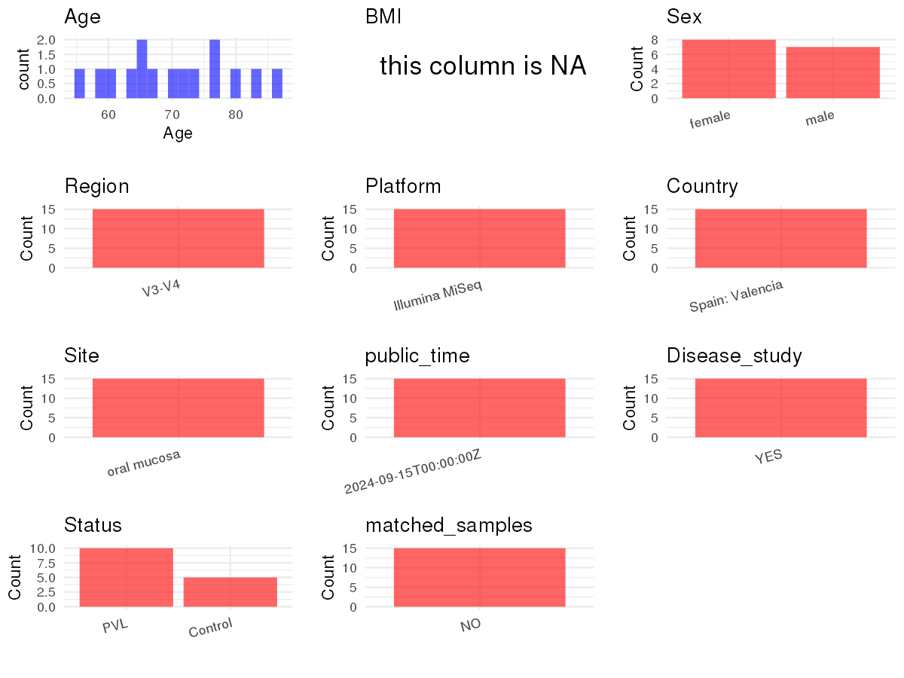

R Notebook: Metadata Processing Workflow
================

# Step 1: Obtain Initial Metadata from Each Project

To obtain the initial metadata: 1. Search for the BioProject ID (e.g.,
“PRJEBXXXX”) on the [NCBI SRA
website](https://www.ncbi.nlm.nih.gov/Traces/study/). 2. In the “Select”
table, click on “Metadata” and download the file. 3. The downloaded file
is typically named “SraRunTable.csv” and contains metadata for the
project.

``` r
# Load necessary libraries
library(dplyr)
library(ggplot2)
library(cowplot)
library(readxl)

# Set working directory (update this path to your local directory)
setwd("/home/dongbiao/word_embedding_microbiome/all_data/oral/global-oral-microbiome/data/projects/PRJNA663437")

# Read the initial metadata files
initial_meta<-read.csv("SraRunTable.csv")

head(initial_meta)
```

    ##           Run Assay.Type AvgSpotLen     Bases  BioProject    BioSample
    ## 1 SRR12665108   AMPLICON        600 107109614 PRJNA663437 SAMN16132446
    ## 2 SRR12665109   AMPLICON        600  98608343 PRJNA663437 SAMN16132445
    ## 3 SRR12665110   AMPLICON        600 118215776 PRJNA663437 SAMN16132444
    ## 4 SRR12665111   AMPLICON        600 114265548 PRJNA663437 SAMN16132443
    ## 5 SRR12665112   AMPLICON        600  87893830 PRJNA663437 SAMN16132442
    ## 6 SRR12665113   AMPLICON        600 121783841 PRJNA663437 SAMN16132441
    ##                                BioSampleModel    Bytes Center.Name
    ## 1 MIMARKS.survey,MIGS/MIMS/MIMARKS.human-oral 67491295 BIOTECHVANA
    ## 2 MIMARKS.survey,MIGS/MIMS/MIMARKS.human-oral 63475828 BIOTECHVANA
    ## 3 MIMARKS.survey,MIGS/MIMS/MIMARKS.human-oral 75027868 BIOTECHVANA
    ## 4 MIMARKS.survey,MIGS/MIMS/MIMARKS.human-oral 72169666 BIOTECHVANA
    ## 5 MIMARKS.survey,MIGS/MIMS/MIMARKS.human-oral 55671955 BIOTECHVANA
    ## 6 MIMARKS.survey,MIGS/MIMS/MIMARKS.human-oral 77736633 BIOTECHVANA
    ##   Collection_Date Consent DATASTORE.filetype DATASTORE.provider
    ## 1            2018  public   fastq,run.zq,sra         gs,ncbi,s3
    ## 2            2018  public   fastq,run.zq,sra         gs,ncbi,s3
    ## 3            2018  public   fastq,run.zq,sra         gs,ncbi,s3
    ## 4            2018  public   fastq,run.zq,sra         gs,ncbi,s3
    ## 5            2018  public   fastq,run.zq,sra         gs,ncbi,s3
    ## 6            2018  public   fastq,run.zq,sra         gs,ncbi,s3
    ##                       DATASTORE.region env_broad_scale env_local_scale
    ## 1 gs.us-east1,ncbi.public,s3.us-east-1     oral mucosa     oral mucosa
    ## 2 gs.us-east1,ncbi.public,s3.us-east-1     oral mucosa     oral mucosa
    ## 3 gs.us-east1,ncbi.public,s3.us-east-1     oral mucosa     oral mucosa
    ## 4 gs.us-east1,ncbi.public,s3.us-east-1     oral mucosa     oral mucosa
    ## 5 gs.us-east1,ncbi.public,s3.us-east-1     oral mucosa     oral mucosa
    ## 6 gs.us-east1,ncbi.public,s3.us-east-1     oral mucosa     oral mucosa
    ##    env_medium Experiment geo_loc_name_country geo_loc_name_country_continent
    ## 1 oral mucosa SRX9145764                Spain                         Europe
    ## 2 oral mucosa SRX9145763                Spain                         Europe
    ## 3 oral mucosa SRX9145762                Spain                         Europe
    ## 4 oral mucosa SRX9145761                Spain                         Europe
    ## 5 oral mucosa SRX9145760                Spain                         Europe
    ## 6 oral mucosa SRX9145759                Spain                         Europe
    ##      geo_loc_name Host_Age host_phenotype         HOST host_sex     Instrument
    ## 1 Spain: Valencia       67            PVL Homo sapiens   female Illumina MiSeq
    ## 2 Spain: Valencia       80            PVL Homo sapiens   female Illumina MiSeq
    ## 3 Spain: Valencia       70            PVL Homo sapiens     male Illumina MiSeq
    ## 4 Spain: Valencia       63            PVL Homo sapiens   female Illumina MiSeq
    ## 5 Spain: Valencia       83            PVL Homo sapiens   female Illumina MiSeq
    ## 6 Spain: Valencia       73            PVL Homo sapiens   female Illumina MiSeq
    ##   lat_lon   Library.Name LibraryLayout LibrarySelection LibrarySource
    ## 1 missing JVB-16S-10_S77        PAIRED              PCR   METAGENOMIC
    ## 2 missing  JVB-16S-9_S76        PAIRED              PCR   METAGENOMIC
    ## 3 missing  JVB-16S-8_S75        PAIRED              PCR   METAGENOMIC
    ## 4 missing  JVB-16S-7_S74        PAIRED              PCR   METAGENOMIC
    ## 5 missing  JVB-16S-6_S73        PAIRED              PCR   METAGENOMIC
    ## 6 missing  JVB-16S-5_S72        PAIRED              PCR   METAGENOMIC
    ##                Organism Platform          ReleaseDate          create_date
    ## 1 human oral metagenome ILLUMINA 2024-09-15T00:00:00Z 2020-09-17T22:21:00Z
    ## 2 human oral metagenome ILLUMINA 2024-09-15T00:00:00Z 2020-09-17T22:21:00Z
    ## 3 human oral metagenome ILLUMINA 2024-09-15T00:00:00Z 2020-09-17T22:21:00Z
    ## 4 human oral metagenome ILLUMINA 2024-09-15T00:00:00Z 2020-09-17T22:21:00Z
    ## 5 human oral metagenome ILLUMINA 2024-09-15T00:00:00Z 2020-09-17T22:21:00Z
    ## 6 human oral metagenome ILLUMINA 2024-09-15T00:00:00Z 2020-09-17T22:21:00Z
    ##   version    Sample.Name SRA.Study
    ## 1       1 JVB-16S-10_S77 SRP283159
    ## 2       1  JVB-16S-9_S76 SRP283159
    ## 3       1  JVB-16S-8_S75 SRP283159
    ## 4       1  JVB-16S-7_S74 SRP283159
    ## 5       1  JVB-16S-6_S73 SRP283159
    ## 6       1  JVB-16S-5_S72 SRP283159

# Step 2: Create a Uniform Metadata Template

The uniform metadata should include the following columns:

1.  **BioProject**: Project ID (e.g., “PRJNA339212”)
2.  **Run**: Sample ID (e.g., “ERRXXXXXX” or “SRRXXXXXX”)
3.  **sample_name**: Original sample name submitted by the authors (not
    the database-assigned ID)
4.  **Age**: Age of the subject (if available)
5.  **BMI**: Body Mass Index (if available)
6.  **Sex**: Sex of the subject (“F” or “M”)
7.  **Region**: Targeted 16S rRNA region (e.g., “V3-V4”)
8.  **Platform**: Sequencing platform (e.g., “Illumina MiSeq”)
9.  **Country**: Country of sample origin (e.g., “China”)
10. **Site**: Sample site (e.g., “saliva”, “dental plaque”)
11. **public_time**: Data release date (format: “YYYY-MM-DD”)
12. **PCR_primers**: PCR primers used (e.g., “515F-806R”)
13. **title**: Title of the associated publication
14. **Disease_study**: Whether the study involves a disease (“YES” or
    “NO”)
15. **Status**: Disease status (e.g., “T2DM”, “HC”). Note: If the study
    includes both disease and healthy samples, this must be specified
    per sample.

``` r
# Create a uniform metadata dataframe
metadata <- data.frame(
  BioProject = initial_meta$BioProject,
  Run = initial_meta$Run,
  sample_name = initial_meta$Sample.Name,
  Age = initial_meta$Host_Age,
  BMI = NA,
  Sex = initial_meta$host_sex, 
  Region = "V3-V4",
  Platform = initial_meta$Instrument,
  Country = initial_meta$geo_loc_name,
  Site = initial_meta$env_broad_scale,
  public_time = initial_meta$ReleaseDate,
  stringsAsFactors = FALSE
)
metadata<-unique(metadata)
```

# Step 3: Manually Add Information from the Publication

Some information (e.g. PCR primers, study title, disease status) must be
manually extracted from the publication and added to the metadata.

``` r
# Add information obtained from the publication
metadata$PCR_primers <- "F: 5′-TCGTCGGCAGCGTCAGATGTGTATAAGAGACAG-3′; R: 5′-GTCTCGTGGGCTCGGAGATGTGTATAAGAGACAG-3'"
metadata$title <- "Oral microbiome in Proliferative Verrucous Leukoplakia exhibits loss of diversity and enrichment of pathogens"
metadata$Disease_study <- "YES"

# Assign disease status based on sample_name patterns
metadata$Status <- initial_meta$host_phenotype
metadata$matched_samples <- "NO"
```

# Step 4: Summarize and Validate the Metadata

``` r
# Check the number of unique runs and sample names
print(paste("Number of unique runs:", length(unique(metadata$Run))))
```

    ## [1] "Number of unique runs: 15"

``` r
print(paste("Number of unique sample names:", length(unique(metadata$sample_name))))
```

    ## [1] "Number of unique sample names: 15"

# Step 5: Visualize the Metadata

``` r

```


# Step 6: Finalize and Export the Metadata

``` r
# Reorder columns to match the desired format
metadata <- metadata[, c(
  "BioProject", "Run", "sample_name", "Age", "BMI", "Sex", 
  "Region", "Platform", "Country", "Site", "public_time", 
  "PCR_primers", "title", "Disease_study", "Status","matched_samples"
)]

# Export the uniform metadata to a CSV file
metadata<-unique(metadata)
write.csv(metadata, file = "metadata.csv", quote = FALSE)
head(metadata)
```

    ##    BioProject         Run    sample_name Age BMI    Sex Region       Platform
    ## 1 PRJNA663437 SRR12665108 JVB-16S-10_S77  67  NA female  V3-V4 Illumina MiSeq
    ## 2 PRJNA663437 SRR12665109  JVB-16S-9_S76  80  NA female  V3-V4 Illumina MiSeq
    ## 3 PRJNA663437 SRR12665110  JVB-16S-8_S75  70  NA   male  V3-V4 Illumina MiSeq
    ## 4 PRJNA663437 SRR12665111  JVB-16S-7_S74  63  NA female  V3-V4 Illumina MiSeq
    ## 5 PRJNA663437 SRR12665112  JVB-16S-6_S73  83  NA female  V3-V4 Illumina MiSeq
    ## 6 PRJNA663437 SRR12665113  JVB-16S-5_S72  73  NA female  V3-V4 Illumina MiSeq
    ##           Country        Site          public_time
    ## 1 Spain: Valencia oral mucosa 2024-09-15T00:00:00Z
    ## 2 Spain: Valencia oral mucosa 2024-09-15T00:00:00Z
    ## 3 Spain: Valencia oral mucosa 2024-09-15T00:00:00Z
    ## 4 Spain: Valencia oral mucosa 2024-09-15T00:00:00Z
    ## 5 Spain: Valencia oral mucosa 2024-09-15T00:00:00Z
    ## 6 Spain: Valencia oral mucosa 2024-09-15T00:00:00Z
    ##                                                                               PCR_primers
    ## 1 F: 5′-TCGTCGGCAGCGTCAGATGTGTATAAGAGACAG-3′; R: 5′-GTCTCGTGGGCTCGGAGATGTGTATAAGAGACAG-3'
    ## 2 F: 5′-TCGTCGGCAGCGTCAGATGTGTATAAGAGACAG-3′; R: 5′-GTCTCGTGGGCTCGGAGATGTGTATAAGAGACAG-3'
    ## 3 F: 5′-TCGTCGGCAGCGTCAGATGTGTATAAGAGACAG-3′; R: 5′-GTCTCGTGGGCTCGGAGATGTGTATAAGAGACAG-3'
    ## 4 F: 5′-TCGTCGGCAGCGTCAGATGTGTATAAGAGACAG-3′; R: 5′-GTCTCGTGGGCTCGGAGATGTGTATAAGAGACAG-3'
    ## 5 F: 5′-TCGTCGGCAGCGTCAGATGTGTATAAGAGACAG-3′; R: 5′-GTCTCGTGGGCTCGGAGATGTGTATAAGAGACAG-3'
    ## 6 F: 5′-TCGTCGGCAGCGTCAGATGTGTATAAGAGACAG-3′; R: 5′-GTCTCGTGGGCTCGGAGATGTGTATAAGAGACAG-3'
    ##                                                                                                           title
    ## 1 Oral microbiome in Proliferative Verrucous Leukoplakia exhibits loss of diversity and enrichment of pathogens
    ## 2 Oral microbiome in Proliferative Verrucous Leukoplakia exhibits loss of diversity and enrichment of pathogens
    ## 3 Oral microbiome in Proliferative Verrucous Leukoplakia exhibits loss of diversity and enrichment of pathogens
    ## 4 Oral microbiome in Proliferative Verrucous Leukoplakia exhibits loss of diversity and enrichment of pathogens
    ## 5 Oral microbiome in Proliferative Verrucous Leukoplakia exhibits loss of diversity and enrichment of pathogens
    ## 6 Oral microbiome in Proliferative Verrucous Leukoplakia exhibits loss of diversity and enrichment of pathogens
    ##   Disease_study Status matched_samples
    ## 1           YES    PVL              NO
    ## 2           YES    PVL              NO
    ## 3           YES    PVL              NO
    ## 4           YES    PVL              NO
    ## 5           YES    PVL              NO
    ## 6           YES    PVL              NO

## Notes for Students:

1.  **Metadata Accuracy**: Always cross-check the metadata with the
    original publication to ensure accuracy.
2.  **Manual Entries**: Columns like `PCR_primers`, and `Status` often
    require manual entry based on the publication.
3.  **Disease Status**: Be careful when assigning `Status`—some studies
    include both disease and healthy samples.
4.  **Visualization**: The plots help quickly identify the distribution
    of values in each column, which is useful for quality control.
5.  **Reproducibility**: Update the working directory and file paths to
    match your local environment.
