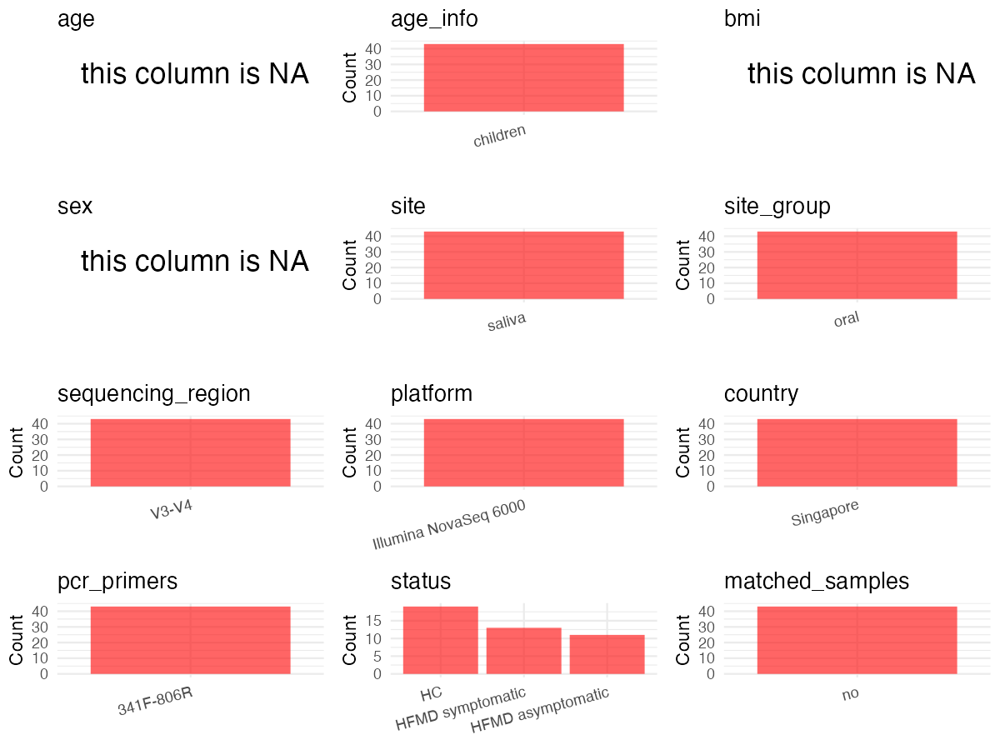

R Notebook: Metadata Processing Workflow
================

# Step 1: Obtain Initial Metadata from Each Project

To obtain the initial metadata: 1. Search for the BioProject ID (e.g.,
“PRJEBXXXX”) on the [NCBI SRA
website](https://www.ncbi.nlm.nih.gov/Traces/study/). 2. In the “Select”
table, click on “Metadata” and download the file. 3. The downloaded file
is typically named “SraRunTable.csv” and contains metadata for the
project.

``` r
# Load necessary libraries
library(dplyr)
library(ggplot2)
library(cowplot)
library(readxl)

# Set working directory (update this path to your local directory)
setwd("/home/dongbiao/word_embedding_microbiome/all_data/oral/global-oral-microbiome/data/projects/PRJNA663926")

# Read the initial metadata files
initial_meta<-read.csv("SraRunTable.csv") %>% filter(biological_replicates != "Negative Control")

head(initial_meta)
```

    ##           Run Assay.Type AvgSpotLen    Bases    biological_replicates
    ## 1 SRR12686812   AMPLICON        500 78454000     Healthy replicate 10
    ## 2 SRR12686813   AMPLICON        500 75886500      Healthy replicate 9
    ## 3 SRR12686814   AMPLICON        500 71369500      Healthy replicate 8
    ## 4 SRR12686815   AMPLICON        500 73951000      Healthy replicate 7
    ## 5 SRR12686816   AMPLICON        500 74580500      Healthy replicate 6
    ## 6 SRR12686818   AMPLICON        500 75511500 Symptomatic replicate 13
    ##    BioProject    BioSample                                BioSampleModel
    ## 1 PRJNA663926 SAMN16189040 MIMARKS.specimen,MIGS/MIMS/MIMARKS.human-oral
    ## 2 PRJNA663926 SAMN16189039 MIMARKS.specimen,MIGS/MIMS/MIMARKS.human-oral
    ## 3 PRJNA663926 SAMN16189038 MIMARKS.specimen,MIGS/MIMS/MIMARKS.human-oral
    ## 4 PRJNA663926 SAMN16189037 MIMARKS.specimen,MIGS/MIMS/MIMARKS.human-oral
    ## 5 PRJNA663926 SAMN16189036 MIMARKS.specimen,MIGS/MIMS/MIMARKS.human-oral
    ## 6 PRJNA663926 SAMN16189073 MIMARKS.specimen,MIGS/MIMS/MIMARKS.human-oral
    ##      Bytes                      Center.Name Collection_Date Consent
    ## 1 26072319 NATIONAL UNIVERSITY OF SINGAPORE       2013/2018  public
    ## 2 25128453 NATIONAL UNIVERSITY OF SINGAPORE       2013/2018  public
    ## 3 24040136 NATIONAL UNIVERSITY OF SINGAPORE       2013/2018  public
    ## 4 25185590 NATIONAL UNIVERSITY OF SINGAPORE       2013/2018  public
    ## 5 25679935 NATIONAL UNIVERSITY OF SINGAPORE       2013/2018  public
    ## 6 25000111 NATIONAL UNIVERSITY OF SINGAPORE       2013/2018  public
    ##   DATASTORE.filetype DATASTORE.provider                     DATASTORE.region
    ## 1         run.zq,sra         gs,ncbi,s3 gs.us-east1,ncbi.public,s3.us-east-1
    ## 2         run.zq,sra         gs,ncbi,s3 gs.us-east1,ncbi.public,s3.us-east-1
    ## 3         run.zq,sra         gs,ncbi,s3 gs.us-east1,ncbi.public,s3.us-east-1
    ## 4         run.zq,sra         gs,ncbi,s3 gs.us-east1,ncbi.public,s3.us-east-1
    ## 5         run.zq,sra         gs,ncbi,s3 gs.us-east1,ncbi.public,s3.us-east-1
    ## 6         run.zq,sra         gs,ncbi,s3 gs.us-east1,ncbi.public,s3.us-east-1
    ##   env_broad_scale env_local_scale     env_medium Experiment
    ## 1  not applicable  not applicable not applicable SRX9166813
    ## 2  not applicable  not applicable not applicable SRX9166812
    ## 3  not applicable  not applicable not applicable SRX9166811
    ## 4  not applicable  not applicable not applicable SRX9166810
    ## 5  not applicable  not applicable not applicable SRX9166809
    ## 6  not applicable  not applicable not applicable SRX9166807
    ##   geo_loc_name_country geo_loc_name_country_continent geo_loc_name         HOST
    ## 1            Singapore                           Asia    Singapore Homo sapiens
    ## 2            Singapore                           Asia    Singapore Homo sapiens
    ## 3            Singapore                           Asia    Singapore Homo sapiens
    ## 4            Singapore                           Asia    Singapore Homo sapiens
    ## 5            Singapore                           Asia    Singapore Homo sapiens
    ## 6            Singapore                           Asia    Singapore Homo sapiens
    ##              Instrument        lat_lon Library.Name LibraryLayout
    ## 1 Illumina NovaSeq 6000 not applicable   MARVAS_H10        PAIRED
    ## 2 Illumina NovaSeq 6000 not applicable    MARVAS_H9        PAIRED
    ## 3 Illumina NovaSeq 6000 not applicable    MARVAS_H8        PAIRED
    ## 4 Illumina NovaSeq 6000 not applicable    MARVAS_H7        PAIRED
    ## 5 Illumina NovaSeq 6000 not applicable    MARVAS_H6        PAIRED
    ## 6 Illumina NovaSeq 6000 not applicable   MARVAS_S13        PAIRED
    ##   LibrarySelection LibrarySource                Organism Platform
    ## 1              PCR   METAGENOMIC human saliva metagenome ILLUMINA
    ## 2              PCR   METAGENOMIC human saliva metagenome ILLUMINA
    ## 3              PCR   METAGENOMIC human saliva metagenome ILLUMINA
    ## 4              PCR   METAGENOMIC human saliva metagenome ILLUMINA
    ## 5              PCR   METAGENOMIC human saliva metagenome ILLUMINA
    ## 6              PCR   METAGENOMIC human saliva metagenome ILLUMINA
    ##            ReleaseDate          create_date version         Sample.Name
    ## 1 2021-02-10T00:00:00Z 2020-09-22T23:58:00Z       2 16S rRNA MARVAS H10
    ## 2 2021-02-10T00:00:00Z 2020-09-22T23:58:00Z       2  16S rRNA MARVAS H9
    ## 3 2021-02-10T00:00:00Z 2020-09-22T23:59:00Z       2  16S rRNA MARVAS H8
    ## 4 2021-02-10T00:00:00Z 2020-09-22T23:58:00Z       2  16S rRNA MARVAS H7
    ## 5 2021-02-10T00:00:00Z 2020-09-22T23:58:00Z       2  16S rRNA MARVAS H6
    ## 6 2021-02-10T00:00:00Z 2020-09-22T23:58:00Z       2 16S rRNA MARVAS S13
    ##   SRA.Study       Cultivar        Ecotype isol_growth_condt        isolate
    ## 1 SRP284053 not applicable not applicable    not applicable not applicable
    ## 2 SRP284053 not applicable not applicable    not applicable not applicable
    ## 3 SRP284053 not applicable not applicable    not applicable not applicable
    ## 4 SRP284053 not applicable not applicable    not applicable not applicable
    ## 5 SRP284053 not applicable not applicable    not applicable not applicable
    ## 6 SRP284053 not applicable not applicable    not applicable not applicable
    ##           strain Host_disease
    ## 1 not applicable           NA
    ## 2 not applicable           NA
    ## 3 not applicable           NA
    ## 4 not applicable           NA
    ## 5 not applicable           NA
    ## 6 not applicable           NA

# Step 2: Create a Uniform Metadata Template

The uniform metadata should include the following columns:

1.  **BioProject**: Project ID (e.g., “PRJNA339212”)
2.  **Run**: Sample ID (e.g., “ERRXXXXXX” or “SRRXXXXXX”)
3.  **sample_name**: Original sample name submitted by the authors (not
    the database-assigned ID)
4.  **Age**: Age of the subject (if available)
5.  **BMI**: Body Mass Index (if available)
6.  **Sex**: Sex of the subject (“F” or “M”)
7.  **Region**: Targeted 16S rRNA region (e.g., “V3-V4”)
8.  **Platform**: Sequencing platform (e.g., “Illumina MiSeq”)
9.  **Country**: Country of sample origin (e.g., “China”)
10. **Site**: Sample site (e.g., “saliva”, “dental plaque”)
11. **public_time**: Data release date (format: “YYYY-MM-DD”)
12. **PCR_primers**: PCR primers used (e.g., “515F-806R”)
13. **title**: Title of the associated publication
14. **Disease_study**: Whether the study involves a disease (“YES” or
    “NO”)
15. **Status**: Disease status (e.g., “T2DM”, “HC”). Note: If the study
    includes both disease and healthy samples, this must be specified
    per sample.

``` r
# Create a uniform metadata dataframe
metadata <- data.frame(
  BioProject = initial_meta$BioProject,
  Run = initial_meta$Run,
  sample_name = initial_meta$biological_replicates,
  Age = NA,
  BMI = NA,
  Sex=NA,
  Region = "V3-V4",
  Platform = initial_meta$Instrument,
  Country = initial_meta$geo_loc_name,
  Site = "Saliva",
  public_time = initial_meta$ReleaseDate,
  stringsAsFactors = FALSE
)
metadata<-unique(metadata)
```

# Step 3: Manually Add Information from the Publication

Some information (e.g. PCR primers, study title, disease status) must be
manually extracted from the publication and added to the metadata.

``` r
# Add information obtained from the publication
metadata$PCR_primers <- "341F-806R"
metadata$title <- "Characterization of oral virome and microbiome revealed distinctive microbiome disruptions in paediatric patients with hand, foot and mouth disease"
metadata$Disease_study <- "YES"

# Assign disease status based on sample_name patterns
metadata$Status <- sapply(strsplit(metadata$sample_name, " "), function(x) x[1])
metadata$matched_samples <- "NO"
```

# Step 4: Summarize and Validate the Metadata

``` r
# Check the number of unique runs and sample names
print(paste("Number of unique runs:", length(unique(metadata$Run))))
```

    ## [1] "Number of unique runs: 43"

``` r
print(paste("Number of unique sample names:", length(unique(metadata$sample_name))))
```

    ## [1] "Number of unique sample names: 43"

# Step 5: Visualize the Metadata

``` r

```


# Step 6: Finalize and Export the Metadata

``` r
# Reorder columns to match the desired format
metadata <- metadata[, c(
  "BioProject", "Run", "sample_name", "Age", "BMI", "Sex", 
  "Region", "Platform", "Country", "Site", "public_time", 
  "PCR_primers", "title", "Disease_study", "Status","matched_samples"
)]

# Export the uniform metadata to a CSV file
metadata<-unique(metadata)
write.csv(metadata, file = "metadata.csv", quote = TRUE)
head(metadata)
```

    ##    BioProject         Run              sample_name Age BMI Sex Region
    ## 1 PRJNA663926 SRR12686812     Healthy replicate 10  NA  NA  NA  V3-V4
    ## 2 PRJNA663926 SRR12686813      Healthy replicate 9  NA  NA  NA  V3-V4
    ## 3 PRJNA663926 SRR12686814      Healthy replicate 8  NA  NA  NA  V3-V4
    ## 4 PRJNA663926 SRR12686815      Healthy replicate 7  NA  NA  NA  V3-V4
    ## 5 PRJNA663926 SRR12686816      Healthy replicate 6  NA  NA  NA  V3-V4
    ## 6 PRJNA663926 SRR12686818 Symptomatic replicate 13  NA  NA  NA  V3-V4
    ##                Platform   Country   Site          public_time PCR_primers
    ## 1 Illumina NovaSeq 6000 Singapore Saliva 2021-02-10T00:00:00Z   341F-806R
    ## 2 Illumina NovaSeq 6000 Singapore Saliva 2021-02-10T00:00:00Z   341F-806R
    ## 3 Illumina NovaSeq 6000 Singapore Saliva 2021-02-10T00:00:00Z   341F-806R
    ## 4 Illumina NovaSeq 6000 Singapore Saliva 2021-02-10T00:00:00Z   341F-806R
    ## 5 Illumina NovaSeq 6000 Singapore Saliva 2021-02-10T00:00:00Z   341F-806R
    ## 6 Illumina NovaSeq 6000 Singapore Saliva 2021-02-10T00:00:00Z   341F-806R
    ##                                                                                                                                                 title
    ## 1 Characterization of oral virome and microbiome revealed distinctive microbiome disruptions in paediatric patients with hand, foot and mouth disease
    ## 2 Characterization of oral virome and microbiome revealed distinctive microbiome disruptions in paediatric patients with hand, foot and mouth disease
    ## 3 Characterization of oral virome and microbiome revealed distinctive microbiome disruptions in paediatric patients with hand, foot and mouth disease
    ## 4 Characterization of oral virome and microbiome revealed distinctive microbiome disruptions in paediatric patients with hand, foot and mouth disease
    ## 5 Characterization of oral virome and microbiome revealed distinctive microbiome disruptions in paediatric patients with hand, foot and mouth disease
    ## 6 Characterization of oral virome and microbiome revealed distinctive microbiome disruptions in paediatric patients with hand, foot and mouth disease
    ##   Disease_study      Status matched_samples
    ## 1           YES     Healthy              NO
    ## 2           YES     Healthy              NO
    ## 3           YES     Healthy              NO
    ## 4           YES     Healthy              NO
    ## 5           YES     Healthy              NO
    ## 6           YES Symptomatic              NO

## Notes for Students:

1.  **Metadata Accuracy**: Always cross-check the metadata with the
    original publication to ensure accuracy.
2.  **Manual Entries**: Columns like `PCR_primers`, and `Status` often
    require manual entry based on the publication.
3.  **Disease Status**: Be careful when assigning `Status`—some studies
    include both disease and healthy samples.
4.  **Visualization**: The plots help quickly identify the distribution
    of values in each column, which is useful for quality control.
5.  **Reproducibility**: Update the working directory and file paths to
    match your local environment.
