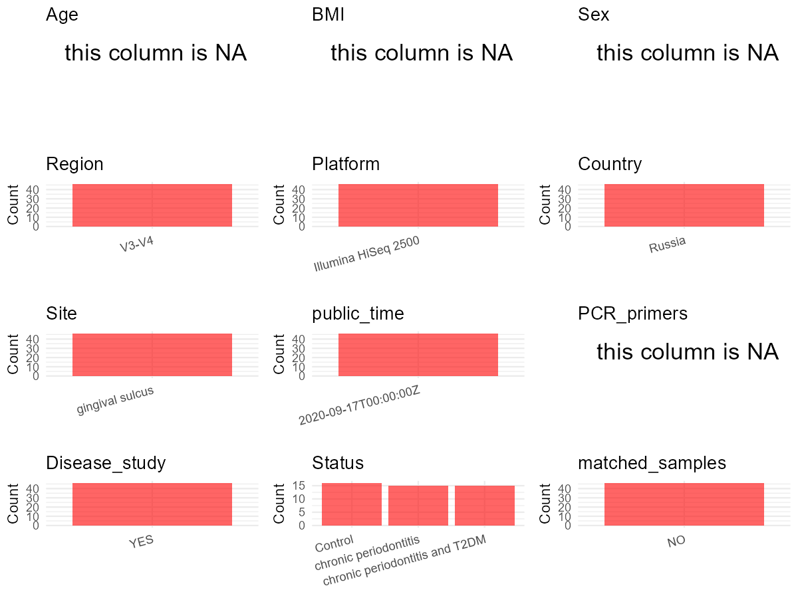

R Notebook: Metadata Processing Workflow
================

# Step 1: Obtain Initial Metadata from Each Project

To obtain the initial metadata: 1. Search for the BioProject ID (e.g.,
“PRJEBXXXX”) on the [NCBI SRA
website](https://www.ncbi.nlm.nih.gov/Traces/study/). 2. In the “Select”
table, click on “Metadata” and download the file. 3. The downloaded file
is typically named “SraRunTable.csv” and contains metadata for the
project.

``` r
# Load necessary libraries
library(dplyr)
library(ggplot2)
library(cowplot)

# Set working directory (update this path to your local directory)
setwd("D:/oral_project/PRJNA664107")

# Read the initial metadata files
initial_meta<-read.csv("SraRunTable.csv",header = T)

# Combine the two metadata files
#meta <- rbind(initial_meta, initial_meta1)

#Remove entries where Organism is "gut metagenome" (non-oral samples)
#initial_meta <- subset(initial_meta,isolation_source!= "feces")

# Check the number of samples containing "HT" in Sample.Name (e.g., healthy controls)
#nrow(subset(meta, grepl("HT", Sample.Name)))
initial_meta<-subset(initial_meta,Assay.Type=="AMPLICON")
# Display the first few rows of the metadata
head(initial_meta)
```

    ##           Run Assay.Type AvgSpotLen    Bases  BioProject    BioSample
    ## 1 SRR12660203   AMPLICON        500 32815500 PRJNA664107 SAMN16198071
    ## 2 SRR12660204   AMPLICON        500 16811500 PRJNA664107 SAMN16198070
    ## 3 SRR12660205   AMPLICON        500 25061000 PRJNA664107 SAMN16198069
    ## 4 SRR12660206   AMPLICON        500 29310500 PRJNA664107 SAMN16198068
    ## 5 SRR12660207   AMPLICON        500 12234000 PRJNA664107 SAMN16198067
    ## 9 SRR12660211   AMPLICON        500 16388000 PRJNA664107 SAMN16198107
    ##                         BioSampleModel    Bytes
    ## 1 MIMS.me,MIGS/MIMS/MIMARKS.human-oral 19348214
    ## 2 MIMS.me,MIGS/MIMS/MIMARKS.human-oral  9953828
    ## 3 MIMS.me,MIGS/MIMS/MIMARKS.human-oral 15716106
    ## 4 MIMS.me,MIGS/MIMS/MIMARKS.human-oral 17636552
    ## 5 MIMS.me,MIGS/MIMS/MIMARKS.human-oral  7135309
    ## 9 MIMS.me,MIGS/MIMS/MIMARKS.human-oral  9715961
    ##                                                          Center.Name
    ## 1 FEDERAL RESEARCH AND CLINICAL CENTRE OF PHYSICAL-CHEMICAL MEDICINE
    ## 2 FEDERAL RESEARCH AND CLINICAL CENTRE OF PHYSICAL-CHEMICAL MEDICINE
    ## 3 FEDERAL RESEARCH AND CLINICAL CENTRE OF PHYSICAL-CHEMICAL MEDICINE
    ## 4 FEDERAL RESEARCH AND CLINICAL CENTRE OF PHYSICAL-CHEMICAL MEDICINE
    ## 5 FEDERAL RESEARCH AND CLINICAL CENTRE OF PHYSICAL-CHEMICAL MEDICINE
    ## 9 FEDERAL RESEARCH AND CLINICAL CENTRE OF PHYSICAL-CHEMICAL MEDICINE
    ##   Collection_Date Consent DATASTORE.filetype DATASTORE.provider
    ## 1      2018-01-10  public   fastq,run.zq,sra         gs,ncbi,s3
    ## 2      2018-01-09  public   fastq,run.zq,sra         gs,ncbi,s3
    ## 3      2018-01-08  public   fastq,run.zq,sra         gs,ncbi,s3
    ## 4      2018-01-07  public   fastq,run.zq,sra         gs,ncbi,s3
    ## 5      2018-01-06  public   fastq,run.zq,sra         gs,ncbi,s3
    ## 9      2018-02-16  public   fastq,run.zq,sra         gs,ncbi,s3
    ##                       DATASTORE.region env_broad_scale env_local_scale
    ## 1 gs.us-east1,ncbi.public,s3.us-east-1 oral microbiome gingival sulcus
    ## 2 gs.us-east1,ncbi.public,s3.us-east-1 oral microbiome gingival sulcus
    ## 3 gs.us-east1,ncbi.public,s3.us-east-1 oral microbiome gingival sulcus
    ## 4 gs.us-east1,ncbi.public,s3.us-east-1 oral microbiome gingival sulcus
    ## 5 gs.us-east1,ncbi.public,s3.us-east-1 oral microbiome gingival sulcus
    ## 9 gs.us-east1,ncbi.public,s3.us-east-1 oral microbiome gingival sulcus
    ##      env_medium Experiment geo_loc_name_country geo_loc_name_country_continent
    ## 1 ENVO:00010483 SRX9141303               Russia                         Europe
    ## 2 ENVO:00010483 SRX9141302               Russia                         Europe
    ## 3 ENVO:00010483 SRX9141301               Russia                         Europe
    ## 4 ENVO:00010483 SRX9141300               Russia                         Europe
    ## 5 ENVO:00010483 SRX9141299               Russia                         Europe
    ## 9 ENVO:00010483 SRX9141295               Russia                         Europe
    ##     geo_loc_name         HOST          Instrument isolation_source
    ## 1 Russia: Moscow Homo sapiens Illumina HiSeq 2500  gingival sulcus
    ## 2 Russia: Moscow Homo sapiens Illumina HiSeq 2500  gingival sulcus
    ## 3 Russia: Moscow Homo sapiens Illumina HiSeq 2500  gingival sulcus
    ## 4 Russia: Moscow Homo sapiens Illumina HiSeq 2500  gingival sulcus
    ## 5 Russia: Moscow Homo sapiens Illumina HiSeq 2500  gingival sulcus
    ## 9 Russia: Moscow Homo sapiens Illumina HiSeq 2500  gingival sulcus
    ##                   lat_lon Library.Name LibraryLayout LibrarySelection
    ## 1 55.751244 N 37.618423 E          13C        PAIRED              PCR
    ## 2 55.751244 N 37.618423 E        12SDP        PAIRED              PCR
    ## 3 55.751244 N 37.618423 E          12P        PAIRED              PCR
    ## 4 55.751244 N 37.618423 E          12C        PAIRED              PCR
    ## 5 55.751244 N 37.618423 E        11SDP        PAIRED              PCR
    ## 9 55.751244 N 37.618423 E         9SDP        PAIRED              PCR
    ##   LibrarySource              Organism Platform          ReleaseDate
    ## 1   METAGENOMIC human oral metagenome ILLUMINA 2020-09-17T00:00:00Z
    ## 2   METAGENOMIC human oral metagenome ILLUMINA 2020-09-17T00:00:00Z
    ## 3   METAGENOMIC human oral metagenome ILLUMINA 2020-09-17T00:00:00Z
    ## 4   METAGENOMIC human oral metagenome ILLUMINA 2020-09-17T00:00:00Z
    ## 5   METAGENOMIC human oral metagenome ILLUMINA 2020-09-17T00:00:00Z
    ## 9   METAGENOMIC human oral metagenome ILLUMINA 2020-09-17T00:00:00Z
    ##            create_date version Sample.Name SRA.Study
    ## 1 2020-09-17T12:10:00Z       1     13C_S43 SRP282880
    ## 2 2020-09-17T12:09:00Z       1   12SDP_S27 SRP282880
    ## 3 2020-09-17T12:10:00Z       1     12P_S12 SRP282880
    ## 4 2020-09-17T12:10:00Z       1     12C_S42 SRP282880
    ## 5 2020-09-17T12:10:00Z       1   11SDP_S26 SRP282880
    ## 9 2020-09-17T12:10:00Z       1    9SDP_S24 SRP282880

# Step 2: Create a Uniform Metadata Template

The uniform metadata should include the following columns:

1.  **BioProject**: Project ID (e.g., “PRJNA339212”)
2.  **Run**: Sample ID (e.g., “ERRXXXXXX” or “SRRXXXXXX”)
3.  **sample_name**: Original sample name submitted by the authors (not
    the database-assigned ID)
4.  **Age**: Age of the subject (if available)
5.  **BMI**: Body Mass Index (if available)
6.  **Sex**: Sex of the subject (“F” or “M”)
7.  **Region**: Targeted 16S rRNA region (e.g., “V3-V4”)
8.  **Platform**: Sequencing platform (e.g., “Illumina MiSeq”)
9.  **Country**: Country of sample origin (e.g., “China”)
10. **Site**: Sample site (e.g., “saliva”, “dental plaque”)
11. **public_time**: Data release date (format: “YYYY-MM-DD”)
12. **PCR_primers**: PCR primers used (e.g., “515F-806R”)
13. **title**: Title of the associated publication
14. **Disease_study**: Whether the study involves a disease (“YES” or
    “NO”)
15. **Status**: Disease status (e.g., “T2DM”, “HC”). Note: If the study
    includes both disease and healthy samples, this must be specified
    per sample.

``` r
# Create a uniform metadata dataframe
metadata <- data.frame(
  BioProject = initial_meta$BioProject,
  Run = initial_meta$Run,
  sample_name = initial_meta$Sample.Name,
  Age = NA,
  BMI = NA,
  Sex=NA,
  Region = "V3-V4",
  Platform = initial_meta$Instrument,
  Country = initial_meta$geo_loc_name_country,
  Site = initial_meta$isolation_source,
  public_time = initial_meta$ReleaseDate,
  stringsAsFactors = FALSE
)
```

# Step 3: Manually Add Information from the Publication

Some information (e.g. PCR primers, study title, disease status) must be
manually extracted from the publication and added to the metadata.

``` r
# Add information obtained from the publication
metadata$PCR_primers <- NA
metadata$title <- "Drift of the Subgingival Periodontal Microbiome during Chronic Periodontitis in Type 2 Diabetes Mellitus Patients"
#metadata<-subset(uniform_meta,Site!="feces")
metadata$Disease_study <- "YES"
# Assign disease status based on sample_name patterns
metadata<- metadata%>%
  mutate(Status=case_when(grepl("C_",sample_name)~"Control",grepl("SDP_",sample_name)~"chronic periodontitis and T2DM",grepl("P_",sample_name)~"chronic periodontitis"))
#extract subject id by remove prefix of sample_name
#metadata$sample_name <- gsub("S-Saliva-.*|F", "", metadata$sample_name)
#get subjects id with Saliva available
#keep_subjects<-subset(metadata,Site %in% c("Saliva"))
#remove subjects without Saliva samples
#metadata<-subset(metadata,sample_name %in% keep_subjects$sample_name)
#get subjects sampling counts
#sample_counts <- table(metadata$sample_name)
# Create matched_samples column, any subjects have >=2 samples will be label "YES", otherwise "NO"
#metadata$matched_samples <- ifelse(metadata$sample_name %in% names(sample_counts[sample_counts >= 2]), "YES", "NO")
metadata$matched_samples<-"NO"
```

# Step 4: Summarize and Validate the Metadata

``` r
# Check the number of unique runs and sample names
print(paste("Number of unique runs:", length(unique(metadata$Run))))
```

    ## [1] "Number of unique runs: 46"

``` r
print(paste("Number of unique sample names:", length(unique(metadata$sample_name))))
```

    ## [1] "Number of unique sample names: 46"

# Step 5: Visualize the Metadata

``` r

```


# Step 6: Finalize and Export the Metadata

``` r
# Reorder columns to match the desired format
metadata <- metadata[, c(
  "BioProject", "Run", "sample_name", "Age", "BMI", "Sex", 
  "Region", "Platform", "Country", "Site", "public_time", 
  "PCR_primers", "title", "Disease_study", "Status","matched_samples"
)]

# Export the uniform metadata to a CSV file
write.csv(metadata, file = "metadata.csv", quote = FALSE)
head(metadata)
```

    ##    BioProject         Run sample_name Age BMI Sex Region            Platform
    ## 1 PRJNA664107 SRR12660203     13C_S43  NA  NA  NA  V3-V4 Illumina HiSeq 2500
    ## 2 PRJNA664107 SRR12660204   12SDP_S27  NA  NA  NA  V3-V4 Illumina HiSeq 2500
    ## 3 PRJNA664107 SRR12660205     12P_S12  NA  NA  NA  V3-V4 Illumina HiSeq 2500
    ## 4 PRJNA664107 SRR12660206     12C_S42  NA  NA  NA  V3-V4 Illumina HiSeq 2500
    ## 5 PRJNA664107 SRR12660207   11SDP_S26  NA  NA  NA  V3-V4 Illumina HiSeq 2500
    ## 6 PRJNA664107 SRR12660211    9SDP_S24  NA  NA  NA  V3-V4 Illumina HiSeq 2500
    ##   Country            Site          public_time PCR_primers
    ## 1  Russia gingival sulcus 2020-09-17T00:00:00Z          NA
    ## 2  Russia gingival sulcus 2020-09-17T00:00:00Z          NA
    ## 3  Russia gingival sulcus 2020-09-17T00:00:00Z          NA
    ## 4  Russia gingival sulcus 2020-09-17T00:00:00Z          NA
    ## 5  Russia gingival sulcus 2020-09-17T00:00:00Z          NA
    ## 6  Russia gingival sulcus 2020-09-17T00:00:00Z          NA
    ##                                                                                                               title
    ## 1 Drift of the Subgingival Periodontal Microbiome during Chronic Periodontitis in Type 2 Diabetes Mellitus Patients
    ## 2 Drift of the Subgingival Periodontal Microbiome during Chronic Periodontitis in Type 2 Diabetes Mellitus Patients
    ## 3 Drift of the Subgingival Periodontal Microbiome during Chronic Periodontitis in Type 2 Diabetes Mellitus Patients
    ## 4 Drift of the Subgingival Periodontal Microbiome during Chronic Periodontitis in Type 2 Diabetes Mellitus Patients
    ## 5 Drift of the Subgingival Periodontal Microbiome during Chronic Periodontitis in Type 2 Diabetes Mellitus Patients
    ## 6 Drift of the Subgingival Periodontal Microbiome during Chronic Periodontitis in Type 2 Diabetes Mellitus Patients
    ##   Disease_study                         Status matched_samples
    ## 1           YES                        Control              NO
    ## 2           YES chronic periodontitis and T2DM              NO
    ## 3           YES          chronic periodontitis              NO
    ## 4           YES                        Control              NO
    ## 5           YES chronic periodontitis and T2DM              NO
    ## 6           YES chronic periodontitis and T2DM              NO

## Notes for Students:

1.  **Metadata Accuracy**: Always cross-check the metadata with the
    original publication to ensure accuracy.
2.  **Manual Entries**: Columns like `PCR_primers`, and `Status` often
    require manual entry based on the publication.
3.  **Disease Status**: Be careful when assigning `Status`—some studies
    include both disease and healthy samples.
4.  **Visualization**: The plots help quickly identify the distribution
    of values in each column, which is useful for quality control.
5.  **Reproducibility**: Update the working directory and file paths to
    match your local environment.
