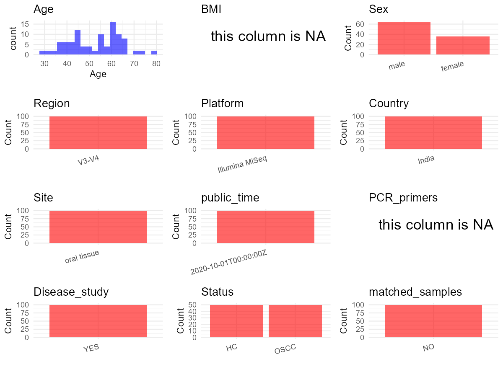

R Notebook: Metadata Processing Workflow
================

# Step 1: Obtain Initial Metadata from Each Project

To obtain the initial metadata: 1. Search for the BioProject ID (e.g.,
“PRJEBXXXX”) on the [NCBI SRA
website](https://www.ncbi.nlm.nih.gov/Traces/study/). 2. In the “Select”
table, click on “Metadata” and download the file. 3. The downloaded file
is typically named “SraRunTable.csv” and contains metadata for the
project.

``` r
# Load necessary libraries
library(dplyr)
library(ggplot2)
library(cowplot)

# Set working directory (update this path to your local directory)
setwd("D:/studylearning/董彪师兄项目/任务4_20251009/PRJNA666746")

# Read the initial metadata files
initial_meta<-read.csv("SraRunTable.csv",header = T)

# Display the first few rows of the metadata
head(initial_meta)
```

    ##           Run AGE Assay.Type AvgSpotLen     Bases
    ## 1 SRR12750669  62      OTHER        502 465811824
    ## 2 SRR12750670  65      OTHER        502 394418388
    ## 3 SRR12750671  57      OTHER        502 385509394
    ## 4 SRR12750672  55      OTHER        502 436876544
    ## 5 SRR12750673  40      OTHER        502 444222310
    ## 6 SRR12750674  42      OTHER        502 430508674
    ##                      BIOMATERIAL_PROVIDER  BioProject    BioSample
    ## 1 Dr. R Ahmed Dental College and Hospital PRJNA666746 SAMN16326768
    ## 2 Dr. R Ahmed Dental College and Hospital PRJNA666746 SAMN16326767
    ## 3 Dr. R Ahmed Dental College and Hospital PRJNA666746 SAMN16326766
    ## 4 Dr. R Ahmed Dental College and Hospital PRJNA666746 SAMN16326765
    ## 5 Dr. R Ahmed Dental College and Hospital PRJNA666746 SAMN16326764
    ## 6 Dr. R Ahmed Dental College and Hospital PRJNA666746 SAMN16326763
    ##   BioSampleModel     Bytes           Center.Name Consent DATASTORE.filetype
    ## 1          Human 230745237 PRESIDENCY UNIVERSITY  public   fastq,run.zq,sra
    ## 2          Human 194639568 PRESIDENCY UNIVERSITY  public   fastq,run.zq,sra
    ## 3          Human 189840816 PRESIDENCY UNIVERSITY  public   fastq,run.zq,sra
    ## 4          Human 215767019 PRESIDENCY UNIVERSITY  public   fastq,run.zq,sra
    ## 5          Human 219760686 PRESIDENCY UNIVERSITY  public   fastq,run.zq,sra
    ## 6          Human 212594214 PRESIDENCY UNIVERSITY  public   fastq,run.zq,sra
    ##   DATASTORE.provider                     DATASTORE.region Experiment
    ## 1         gs,ncbi,s3 gs.us-east1,ncbi.public,s3.us-east-1 SRX9222723
    ## 2         gs,ncbi,s3 gs.us-east1,ncbi.public,s3.us-east-1 SRX9222722
    ## 3         gs,ncbi,s3 gs.us-east1,ncbi.public,s3.us-east-1 SRX9222721
    ## 4         gs,ncbi,s3 gs.us-east1,ncbi.public,s3.us-east-1 SRX9222720
    ## 5         gs,ncbi,s3 gs.us-east1,ncbi.public,s3.us-east-1 SRX9222719
    ## 6         gs,ncbi,s3 gs.us-east1,ncbi.public,s3.us-east-1 SRX9222718
    ##       Instrument  isolate Library.Name LibraryLayout LibrarySelection
    ## 1 Illumina MiSeq N50_OSCC          100        PAIRED              PCR
    ## 2 Illumina MiSeq N49_OSCC           99        PAIRED              PCR
    ## 3 Illumina MiSeq N48_OSCC           98        PAIRED              PCR
    ## 4 Illumina MiSeq N47_OSCC           97        PAIRED              PCR
    ## 5 Illumina MiSeq N46_OSCC           96        PAIRED              PCR
    ## 6 Illumina MiSeq N45_OSCC           95        PAIRED              PCR
    ##   LibrarySource     Organism Platform          ReleaseDate          create_date
    ## 1   METAGENOMIC Homo sapiens ILLUMINA 2020-10-01T00:00:00Z 2020-10-01T02:54:00Z
    ## 2   METAGENOMIC Homo sapiens ILLUMINA 2020-10-01T00:00:00Z 2020-10-01T02:54:00Z
    ## 3   METAGENOMIC Homo sapiens ILLUMINA 2020-10-01T00:00:00Z 2020-10-01T02:54:00Z
    ## 4   METAGENOMIC Homo sapiens ILLUMINA 2020-10-01T00:00:00Z 2020-10-01T02:54:00Z
    ## 5   METAGENOMIC Homo sapiens ILLUMINA 2020-10-01T00:00:00Z 2020-10-01T02:54:00Z
    ## 6   METAGENOMIC Homo sapiens ILLUMINA 2020-10-01T00:00:00Z 2020-10-01T02:54:00Z
    ##   version Sample.Name    sex SRA.Study
    ## 1       1        S100 female SRP285976
    ## 2       1         S99   male SRP285976
    ## 3       1         S98   male SRP285976
    ## 4       1         S97   male SRP285976
    ## 5       1         S96   male SRP285976
    ## 6       1         S95   male SRP285976
    ##                                        tissue
    ## 1 Well differentiated Squamous Cell Carcinoma
    ## 2 Well differentiated Squamous Cell Carcinoma
    ## 3 Well differentiated Squamous Cell Carcinoma
    ## 4 Well differentiated Squamous Cell Carcinoma
    ## 5 Well differentiated Squamous Cell Carcinoma
    ## 6 Well differentiated Squamous Cell Carcinoma

# Step 2: Create a Uniform Metadata Template

The uniform metadata should include the following columns:

1.  **BioProject**: Project ID (e.g., “PRJNA339212”)
2.  **Run**: Sample ID (e.g., “ERRXXXXXX” or “SRRXXXXXX”)
3.  **sample_name**: Original sample name submitted by the authors (not
    the database-assigned ID)
4.  **Age**: Age of the subject (if available)
5.  **BMI**: Body Mass Index (if available)
6.  **Sex**: Sex of the subject (“F” or “M”)
7.  **Region**: Targeted 16S rRNA region (e.g., “V3-V4”)
8.  **Platform**: Sequencing platform (e.g., “Illumina MiSeq”)
9.  **Country**: Country of sample origin (e.g., “China”)
10. **Site**: Sample site (e.g., “saliva”, “dental plaque”)
11. **public_time**: Data release date (format: “YYYY-MM-DD”)
12. **PCR_primers**: PCR primers used (e.g., “515F-806R”)
13. **title**: Title of the associated publication
14. **Disease_study**: Whether the study involves a disease (“YES” or
    “NO”)
15. **Status**: Disease status (e.g., “T2DM”, “HC”). Note: If the study
    includes both disease and healthy samples, this must be specified
    per sample.

``` r
# Create a uniform metadata dataframe
metadata <- data.frame(
  BioProject = initial_meta$BioProject,
  Run = initial_meta$Run,
  sample_name = initial_meta$Sample.Name,
  Age = initial_meta$AGE,
  BMI = NA,
  Sex= initial_meta$sex,
  Region = "V3-V4",
  Platform = initial_meta$Instrument,
  Country = "India",
  Site = "oral tissue",
  public_time = initial_meta$ReleaseDate,
  stringsAsFactors = FALSE
)
```

# Step 3: Manually Add Information from the Publication

Some information (e.g. PCR primers, study title, disease status) must be
manually extracted from the publication and added to the metadata.

``` r
# Add information obtained from the publication
metadata$PCR_primers <- NA_character_  # Update based on the publication
metadata$title <- "Dysbiosis of Oral Microbiota During Oral Squamous Cell Carcinoma Development"
metadata$Disease_study <- "YES"
metadata$Status <- initial_meta$isolate
metadata <- metadata %>% 
  mutate(Status=case_when(
    grepl("OSCC",Status)~"OSCC",
    grepl("Control",Status)~"HC"
  ))
#extract subject id by remove prefix of sample_name
#metadata$sample_name <- gsub("_st|_sal", "", metadata$sample_name)

# Check initial data distribution
cat("Initial sample distribution:\n")
```

    ## Initial sample distribution:

``` r
table(metadata$sample_name)
```

    ## 
    ##   S1  S10 S100  S11  S12  S13  S14  S15  S16  S17  S18  S19   S2  S20  S21  S22 
    ##    1    1    1    1    1    1    1    1    1    1    1    1    1    1    1    1 
    ##  S23  S24  S25  S26  S27  S28  S29   S3  S30  S31  S32  S33  S34  S35  S36  S37 
    ##    1    1    1    1    1    1    1    1    1    1    1    1    1    1    1    1 
    ##  S38  S39   S4  S40  S41  S42  S43  S44  S45  S46  S47  S48  S49   S5  S50  S51 
    ##    1    1    1    1    1    1    1    1    1    1    1    1    1    1    1    1 
    ##  S52  S53  S54  S55  S56  S57  S58  S59   S6  S60  S61  S62  S63  S64  S65  S66 
    ##    1    1    1    1    1    1    1    1    1    1    1    1    1    1    1    1 
    ##  S67  S68  S69   S7  S70  S71  S72  S73  S74  S75  S76  S77  S78  S79   S8  S80 
    ##    1    1    1    1    1    1    1    1    1    1    1    1    1    1    1    1 
    ##  S81  S82  S83  S84  S85  S86  S87  S88  S89   S9  S90  S91  S92  S93  S94  S95 
    ##    1    1    1    1    1    1    1    1    1    1    1    1    1    1    1    1 
    ##  S96  S97  S98  S99 
    ##    1    1    1    1

``` r
table(metadata$Site)
```

    ## 
    ## oral tissue 
    ##         100

``` r
# Calculate sampling frequency per subject
sample_counts <- table(metadata$sample_name)
cat("\nNumber of samples per subject:\n")
```

    ## 
    ## Number of samples per subject:

``` r
print(sample_counts)
```

    ## 
    ##   S1  S10 S100  S11  S12  S13  S14  S15  S16  S17  S18  S19   S2  S20  S21  S22 
    ##    1    1    1    1    1    1    1    1    1    1    1    1    1    1    1    1 
    ##  S23  S24  S25  S26  S27  S28  S29   S3  S30  S31  S32  S33  S34  S35  S36  S37 
    ##    1    1    1    1    1    1    1    1    1    1    1    1    1    1    1    1 
    ##  S38  S39   S4  S40  S41  S42  S43  S44  S45  S46  S47  S48  S49   S5  S50  S51 
    ##    1    1    1    1    1    1    1    1    1    1    1    1    1    1    1    1 
    ##  S52  S53  S54  S55  S56  S57  S58  S59   S6  S60  S61  S62  S63  S64  S65  S66 
    ##    1    1    1    1    1    1    1    1    1    1    1    1    1    1    1    1 
    ##  S67  S68  S69   S7  S70  S71  S72  S73  S74  S75  S76  S77  S78  S79   S8  S80 
    ##    1    1    1    1    1    1    1    1    1    1    1    1    1    1    1    1 
    ##  S81  S82  S83  S84  S85  S86  S87  S88  S89   S9  S90  S91  S92  S93  S94  S95 
    ##    1    1    1    1    1    1    1    1    1    1    1    1    1    1    1    1 
    ##  S96  S97  S98  S99 
    ##    1    1    1    1

``` r
# Create matched_samples column
metadata$matched_samples <- ifelse(metadata$sample_name %in% names(sample_counts[sample_counts >= 2]), "YES", "NO")

cat("\nMatched samples distribution:\n")
```

    ## 
    ## Matched samples distribution:

``` r
table(metadata$matched_samples)
```

    ## 
    ##  NO 
    ## 100

``` r
# Identify samples for removal: single samples excluding oral tissue 
single_samples <- names(sample_counts[sample_counts == 1])
samples_to_remove <- metadata$sample_name %in% single_samples & !(metadata$Site %in% c("oral tissue"))

cat("\nNumber of samples to be removed:", sum(samples_to_remove), "\n")
```

    ## 
    ## Number of samples to be removed: 0

``` r
# Remove identified samples
metadata_clean <- metadata[!samples_to_remove, ]

cat("\nFinal sample distribution after cleaning:\n")
```

    ## 
    ## Final sample distribution after cleaning:

``` r
table(metadata_clean$sample_name)
```

    ## 
    ##   S1  S10 S100  S11  S12  S13  S14  S15  S16  S17  S18  S19   S2  S20  S21  S22 
    ##    1    1    1    1    1    1    1    1    1    1    1    1    1    1    1    1 
    ##  S23  S24  S25  S26  S27  S28  S29   S3  S30  S31  S32  S33  S34  S35  S36  S37 
    ##    1    1    1    1    1    1    1    1    1    1    1    1    1    1    1    1 
    ##  S38  S39   S4  S40  S41  S42  S43  S44  S45  S46  S47  S48  S49   S5  S50  S51 
    ##    1    1    1    1    1    1    1    1    1    1    1    1    1    1    1    1 
    ##  S52  S53  S54  S55  S56  S57  S58  S59   S6  S60  S61  S62  S63  S64  S65  S66 
    ##    1    1    1    1    1    1    1    1    1    1    1    1    1    1    1    1 
    ##  S67  S68  S69   S7  S70  S71  S72  S73  S74  S75  S76  S77  S78  S79   S8  S80 
    ##    1    1    1    1    1    1    1    1    1    1    1    1    1    1    1    1 
    ##  S81  S82  S83  S84  S85  S86  S87  S88  S89   S9  S90  S91  S92  S93  S94  S95 
    ##    1    1    1    1    1    1    1    1    1    1    1    1    1    1    1    1 
    ##  S96  S97  S98  S99 
    ##    1    1    1    1

``` r
table(metadata_clean$Site)
```

    ## 
    ## oral tissue 
    ##         100

``` r
table(metadata_clean$matched_samples)
```

    ## 
    ##  NO 
    ## 100

``` r
# Use cleaned dataset for subsequent analysis
metadata <- metadata_clean
```

# Step 4: Summarize and Validate the Metadata

``` r
# Check the number of unique runs and sample names
print(paste("Number of unique runs:", length(unique(metadata$Run))))
```

    ## [1] "Number of unique runs: 100"

``` r
print(paste("Number of unique sample names:", length(unique(metadata$sample_name))))
```

    ## [1] "Number of unique sample names: 100"

# Step 5: Visualize the Metadata

``` r

```


# Step 6: Finalize and Export the Metadata

``` r
# Reorder columns to match the desired format
metadata <- metadata[, c(
  "BioProject", "Run", "sample_name", "Age", "BMI", "Sex", 
  "Region", "Platform", "Country", "Site", "public_time", 
  "PCR_primers", "title", "Disease_study", "Status","matched_samples"
)]

# Export the uniform metadata to a CSV file
write.csv(metadata, file = "metadata.csv", quote = FALSE)
head(metadata)
```

    ##    BioProject         Run sample_name Age BMI    Sex Region       Platform
    ## 1 PRJNA666746 SRR12750669        S100  62  NA female  V3-V4 Illumina MiSeq
    ## 2 PRJNA666746 SRR12750670         S99  65  NA   male  V3-V4 Illumina MiSeq
    ## 3 PRJNA666746 SRR12750671         S98  57  NA   male  V3-V4 Illumina MiSeq
    ## 4 PRJNA666746 SRR12750672         S97  55  NA   male  V3-V4 Illumina MiSeq
    ## 5 PRJNA666746 SRR12750673         S96  40  NA   male  V3-V4 Illumina MiSeq
    ## 6 PRJNA666746 SRR12750674         S95  42  NA   male  V3-V4 Illumina MiSeq
    ##   Country        Site          public_time PCR_primers
    ## 1   India oral tissue 2020-10-01T00:00:00Z        <NA>
    ## 2   India oral tissue 2020-10-01T00:00:00Z        <NA>
    ## 3   India oral tissue 2020-10-01T00:00:00Z        <NA>
    ## 4   India oral tissue 2020-10-01T00:00:00Z        <NA>
    ## 5   India oral tissue 2020-10-01T00:00:00Z        <NA>
    ## 6   India oral tissue 2020-10-01T00:00:00Z        <NA>
    ##                                                                          title
    ## 1 Dysbiosis of Oral Microbiota During Oral Squamous Cell Carcinoma Development
    ## 2 Dysbiosis of Oral Microbiota During Oral Squamous Cell Carcinoma Development
    ## 3 Dysbiosis of Oral Microbiota During Oral Squamous Cell Carcinoma Development
    ## 4 Dysbiosis of Oral Microbiota During Oral Squamous Cell Carcinoma Development
    ## 5 Dysbiosis of Oral Microbiota During Oral Squamous Cell Carcinoma Development
    ## 6 Dysbiosis of Oral Microbiota During Oral Squamous Cell Carcinoma Development
    ##   Disease_study Status matched_samples
    ## 1           YES   OSCC              NO
    ## 2           YES   OSCC              NO
    ## 3           YES   OSCC              NO
    ## 4           YES   OSCC              NO
    ## 5           YES   OSCC              NO
    ## 6           YES   OSCC              NO

## Notes for Students:

1.  **Metadata Accuracy**: Always cross-check the metadata with the
    original publication to ensure accuracy.
2.  **Manual Entries**: Columns like `PCR_primers`, and `Status` often
    require manual entry based on the publication.
3.  **Disease Status**: Be careful when assigning `Status`—some studies
    include both disease and healthy samples.
4.  **Visualization**: The plots help quickly identify the distribution
    of values in each column, which is useful for quality control.
5.  **Reproducibility**: Update the working directory and file paths to
    match your local environment.
