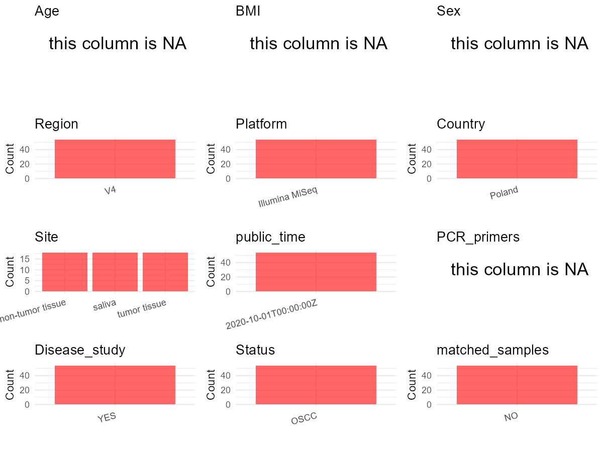

# Step 1: Obtain Initial Metadata from Each Project

This step sets the project directory, loads the raw SRA metadata, and optionally merges supplement tables.

```{r message=FALSE, warning=FALSE}
# Load libraries
library(dplyr)
library(ggplot2)
library(cowplot)

# (1) Setting working directory
# EDIT HERE: change project_id for each study
project_id <- "PRJNA666891"

base_dir <- "D:/metadata_collect"
setwd(file.path(base_dir, project_id))

# (2) Loading raw SRA metadata file
sra_file <- "SraRunTable.csv"
initial_meta <- read.csv(sra_file, header = TRUE)

# (3) OPTIONAL: If extra metadata (e.g., Table.x or supplemental materials) are available from the article, you may need to merge the file with initial_meta manually. Below is example code for merging. Depending on the specific case of each study, you can customize the code as needed.
# supp_table <- read.csv("supplemental_table.csv", header = TRUE)
# initial_meta <- left_join(initial_meta, supp_table, by = merge_col_name)
```

# Step 2: Data Overview

First, you need to get an overview of the data, which includes two steps: reading the article and reading the initial metadata. This step is very IMPORTANT!

```{r message=FALSE, warning=FALSE}
# (1) Read the article in the following order: abstract, the beginning of the results section, and the methods. Understand the sample size, experimental design, and disease group overview. Clarify the sampling sites; for oral and gut samples, specify the exact sites like supragingival plaque, tongue, etc.
# Paper: "Oral Microbial Species and Virulence Factors Associated with Oral Squamous Cell Carcinoma"
# 18 OSCC patients provided tumor tissue (n=18), matched contralateral non-tumor tissue (n=18), and saliva (n=18)
# Tumor locations: palatine tonsil (n=7), throat (n=3), bottom of oral cavity (n=3), tongue (n=5)
# Additional 5 saliva samples from same cohort selected for proteomics
# 8 patients selected for metagenomic WGS (4 tumor locations x 2 each)

# (2) IMPORTANT: MUST go through each column of initial_meta
# head(initial_meta, 10)

# IMPORTANT: Check the unique values in the column of interest or query column.
# lapply(initial_meta[c('body_habitat', 'body_product', 'body_site')], table) # site
# lapply(initial_meta[c('common_name', 'env_biome', 'env_feature', 'env_matter', 'host_common_name', 'Organism', 'role', 'pet_farm_animal')], table) # organism
# table(initial_meta$host_subject_id) # subject id
# table(initial_meta$sequencing_meth..exp.) # not applicable for this dataset
# table(initial_meta$platform..exp.) # all ILLUMINA
# table(initial_meta$Assay.Type) # WGS and AMPLICON
# table(initial_meta$host_tissue_sampled) # WGS: throat, bottom of oral cavity, tongue, palatine tonsil; 16S: empty
```

# Step 3: Removing Control and Non-human Samples

First, we need to remove control samples(including both negative controls and positive controls) and non-human samples.

```{r}
# (1) EDIT HERE: Parameter setup
# No control samples present in SRA table; paper states negative controls generated minimal reads and were excluded
control_column <- ""
control_keywords <- c()

# All samples are Homo sapiens (verified via unique(initial_meta$HOST))
species_column <- "HOST"
unique(initial_meta[[species_column]])
non_human_keywords <- c()

# (2) Remove controls and non-human samples. DO NOT need to modify code in this part, just run it.
n_samples <- nrow(initial_meta)
# Control evaluation
if (length(control_keywords) > 0) {
  if (is.null(control_column) || control_column == "") {
    stop("Error: control_keywords provided but control_column is missing.")
  }

  if (!(control_column %in% colnames(initial_meta))) {
    stop(sprintf("Error: Column '%s' not found in initial_meta.", control_column))
  }

  control_pattern <- paste(control_keywords, collapse = "|")
  control_text <- initial_meta[[control_column]]
  is_control <- grepl(control_pattern, control_text)

} else {
  is_control <- rep(FALSE, n_samples)
}

# Non-human evaluation
if (length(non_human_keywords) > 0) {
  if (is.null(species_column) || species_column == "") {
    stop("Error: non_human_keywords provided but species_column is missing.")
  }

  if (!(species_column %in% colnames(initial_meta))) {
    stop(sprintf("Error: Column '%s' not found in initial_meta.", species_column))
  }

  non_human_pattern <- paste(non_human_keywords, collapse = "|")
  species_text <- initial_meta[[species_column]]
  is_non_human <- grepl(non_human_pattern, species_text)
} else {
  is_non_human <- rep(FALSE, n_samples)
}

# Execute removal
samples_to_remove <- is_control | is_non_human
initial_meta <- initial_meta[!samples_to_remove, ]

cat("Initial samples counts:",n_samples,"\n")
cat("Removed control samples:", sum(is_control), "\n")
cat("Removed non-human samples:", sum(is_non_human), "\n")
cat("Total samples removed ", sum(samples_to_remove), "\n")
cat("Remaining samples after Step 2:", nrow(initial_meta), "\n")
```

# Step 3b: Removing WGS (Metagenomic) Samples

This study contains both 16S amplicon and WGS metagenomic samples. For the 16S microbiome meta-analysis, we retain only the 16S amplicon samples.

```{r}
# Filter by Assay.Type column: keep only AMPLICON, remove WGS
n_before <- nrow(initial_meta)
initial_meta <- initial_meta[initial_meta$Assay.Type == "AMPLICON", ]
n_removed <- n_before - nrow(initial_meta)

cat("Samples before WGS removal:", n_before, "\n")
cat("WGS samples removed:", n_removed, "\n")
cat("Remaining 16S amplicon samples:", nrow(initial_meta), "\n")
```

# Step 4: Creating a Uniform Metadata Template

This step converts the raw SRA table into the standard metadata format used in our meta-analysis.
The uniform metadata should include the following columns:
1. **bioproject**: Project ID from SRA or other database
2. **sample_id**: SRA sample/run ID. Unique id for each sample!
3. **subject_id**: subject id for each person if available.
4. **age**: Age of the subject if available.
5. **age_info**: If the age is not explicitly stated but approximate age range information is available, mark it in this column.
6. **bmi**: Body Mass Index if available.
7. **sex**: Sex of the subject.
8. **sequencing_region**: Targeted 16S rRNA region.
9. **platform**: Sequencing platform.
10. **country**: Country of sample origin.
11. **site**: Sampling site.
12. **site_group**: only accepts one of following three values: 'oral', 'gut', or 'other'.
13. **public_time**: Data release date.
14. **pcr_primers**: PCR primers used.
15. **title**: Title of the associated publication.
16. **disease_study**: Whether the study involves disease samples.
17. **status**: Disease status for each sample if available, else record as NA.
18. **matched_samples**: Whether the subject has matched samples.
19. **is_time_series**: Whether the study is a time series study.

```{r}
# Determine sample type from Sample Name suffix (16S only at this point)
# 16S: _TT = tumor tissue, _SAL = saliva, _HT = healthy/non-tumor tissue
sample_type <- ifelse(grepl("_TT$", initial_meta$Sample.Name), "tumor_tissue",
                ifelse(grepl("_SAL$", initial_meta$Sample.Name), "saliva",
                ifelse(grepl("_HT$", initial_meta$Sample.Name), "non_tumor_tissue", NA)))

# Derive subject_id: remove suffix from Sample Name
# Sample Name format: P0028_TT, etc. -> subject_id: P0028
subject_id <- sub("(_TT|_SAL|_HT)$", "", initial_meta$Sample.Name)

# Extract columns from initial_meta as follows: (1) No modification needed -> extract directly. (2) Modification needed -> create a new column with the prefix raw_ and mark the original column as "pending". (3) Need to find or determine based on the article.
metadata <- data.frame(
  bioproject = initial_meta$BioProject, # Source: CSV column BioProject
  sample_id = initial_meta$Run, # Source: CSV column Run
  subject_id = subject_id, # Source: derived from CSV column Sample Name
  age = NA, # Source: not available in CSV or paper; age collected but not reported per subject
  age_info = NA, # Source: not available in CSV or paper
  bmi = NA, # Source: not available in CSV or paper
  sex = NA, # Source: not available in CSV; paper states gender collected but not reported per subject
  sequencing_region = "V4", # Source: paper Methods (16S V4 region)
  platform = "Illumina MiSeq", # Source: CSV column Instrument + paper Methods
  country = initial_meta$geo_loc_name_country, # Source: CSV column geo_loc_name_country
  raw_site = initial_meta$host_tissue_sampled, # Source: CSV column host_tissue_sampled; needs cleaning for 16S
  site = "pending", # Source: see Step 5 for derivation
  site_group = "pending", # Source: derived from site in Step 5
  public_time = initial_meta$ReleaseDate, # Source: CSV column ReleaseDate
  pcr_primers = NA, # Source: paper Methods (V4 primers, citing Kozich et al. 2013)
  title = "Oral Microbial Species and Virulence Factors Associated with Oral Squamous Cell Carcinoma", # Source: paper title
  disease_study = "yes", # Source: paper - OSCC (oral squamous cell carcinoma) study
  status = ifelse(sample_type == "tumor_tissue", "OSCC (tumor tissue)",
    ifelse(sample_type == "non_tumor_tissue", "OSCC (non-tumor tissue)",
      ifelse(sample_type == "saliva", "OSCC (saliva)", NA))), # Source: paper - all samples from OSCC patients; parenthetical suffix indicates tissue origin
  matched_samples = "pending", # Source: derived in Step 5
  is_time_series = "no", # Source: paper - cross-sectional design, no longitudinal sampling
  stringsAsFactors = FALSE
)
metadata$public_time <- as.Date(metadata$public_time)
```

# Step 5: Manually solving pending issues

This step involves two parts: (1) handle the columns with the `raw_` prefix, and next (2) handle the `site_group` and `matched_samples` columns.

```{r}
# (1) Handle the columns with the raw_ prefix.
# For 16S AMPLICON samples: host_tissue_sampled is empty in SRA table.
# Use sample suffix to derive site: _TT and _HT are tissue samples (site depends on tumor location), _SAL = "saliva"
# Note: tumor location per subject from paper: P01/P02 (palatine tonsil), P05/P06 (bottom of oral cavity), P07 (throat), P19 (throat), P20 (tongue), P25 (tongue)
# For 16S _TT and _HT samples, site requires per-subject tumor location lookup from paper
# Paper only reports 8 WGS patient locations; 16S-only patients (P0001-P0028 range) locations not reported individually

metadata <- metadata %>%
  mutate(site = case_when(
    # 16S saliva samples
    grepl("_SAL$", initial_meta$Sample.Name) ~ "saliva",
    # 16S tissue samples: site depends on subject tumor location
    grepl("^(P01|P02)(_TT|_HT)$", initial_meta$Sample.Name) ~ "palatine tonsil",
    grepl("^(P05|P06)(_TT|_HT)$", initial_meta$Sample.Name) ~ "bottom of oral cavity",
    grepl("^P07(_TT|_HT)$", initial_meta$Sample.Name) ~ "throat",
    grepl("^P19(_TT|_HT)$", initial_meta$Sample.Name) ~ "throat",
    grepl("^P20(_TT|_HT)$", initial_meta$Sample.Name) ~ "tongue",
    grepl("^P25(_TT|_HT)$", initial_meta$Sample.Name) ~ "tongue",
    # Remaining 16S subjects: paper does not specify individual tumor locations
    TRUE ~ "oral tissue (location unspecified)"
  ))
```

```{r}
# (2) Filling the 'site_group' and 'matched_samples' columns
# editing site_group
unique(metadata$site)
# EDIT HERE: add oral sites
Oral_site = c("saliva", "tongue", "throat", "palatine tonsil", "bottom of oral cavity", "oral tissue (location unspecified)")
# EDIT HERE: add gut sites
Gut_site = c()
# just run
metadata <- metadata %>%
  mutate(site_group = case_when(
    site %in% Oral_site ~ "oral",
    site %in% Gut_site ~ "gut",
    TRUE ~ "other"
  ))

# editing matched_samples, just run.
# Each subject has multiple sample types (tumor + non-tumor + saliva or tumor + non-tumor)
metadata$matched_samples <- ifelse(
  ave(metadata$subject_id, metadata$subject_id, FUN = length) > 1,
  "yes",
  "no"
)
```

```{r}
# (3) check if there is pending value in metadata. If there is pending value, go on modify the metadata.
# Function to check if a column contains "pending"
has_pending <- function(col) {
  if (is.character(col) || is.factor(col)) {
    any(col == "pending", na.rm = TRUE)
  } else {
    FALSE
  }
}

# Check for any pending value
any_pending_value <- any(sapply(metadata, has_pending))

if (!any_pending_value) {
  message("Good! No cell contains the value 'pending'.")
} else {
  pending_cols <- names(metadata)[sapply(metadata, has_pending)]
  message("Columns containing 'pending': ", paste(pending_cols, collapse = ", "))
  message("Please continue to resolve these pending columns!")
}
```

# Step 6: Visualize the Metadata

This step makes a quick set of plots for checking the distribution of key metadata fields.

```{r}
# Select columns for visualization, just run
plot_data <- metadata %>%
  select(-bioproject, -sample_id, -subject_id, -title)

create_simple_plots <- function(data) {
  plots <- list()
  continuous_vars <- c("age", "bmi")

  for (col in colnames(data)) {
    if (all(is.na(data[[col]]))) {
      p <- ggplot() +
        annotate("text", x = 0.5, y = 0.5, label = "this column is NA", size = 6) +
        labs(title = col) +
        theme_void()
    } else if (col %in% continuous_vars && is.numeric(data[[col]])) {
      p <- ggplot(data, aes(x = .data[[col]])) +
        geom_histogram(fill = "blue", alpha = 0.6, bins = 20, na.rm = TRUE) +
        labs(title = col, x = col, y = "Count") +
        theme_minimal()
    } else {
      count_data <- as.data.frame(table(data[[col]], useNA = "ifany"))
      p <- ggplot(count_data, aes(x = reorder(Var1, -Freq), y = Freq)) +
        geom_col(fill = "red", alpha = 0.6) +
        labs(title = col, x = NULL, y = "Count") +
        theme_minimal() +
        theme(axis.text.x = element_text(angle = 15, hjust = 1))
    }
    plots[[col]] <- p
  }

  return(plots)
}

# Generate and arrange plots
plots <- create_simple_plots(plot_data)
p <- plot_grid(plots$age,
               plots$age_info,
               plots$bmi,
               plots$sex,
               plots$site,
               plots$site_group,
               plots$sequencing_region,
               plots$platform,
               plots$country,
               plots$pcr_primers,
               plots$status,
               plots$matched_samples,
               ncol = 3, align = "hv", axis = "lb")
ggsave("Metadata_Summary.png", plot = p, width = 8, height = 6, dpi = 150)
```

```{r}
# Insert Metadata_Summary.png into the current Rmd output

```

# Step 7: Sort and export the metadata

This step saves the cleaned metadata table as the final `metadata.csv` file.

```{r}
# Reorder the data frame
fixed_cols <- c("bioproject", "sample_id", "subject_id", "age", "age_info",
                "bmi", "sex", "platform", "sequencing_region", "pcr_primers",
                "country", "site", "site_group", "disease_study", "status",
                "title", "public_time", "matched_samples", "is_time_series")
metadata <- metadata %>%
  select(all_of(fixed_cols), everything())

# save metadata
# head(metadata)
write.csv(metadata, file = "metadata_v2.csv", quote = TRUE)
```
