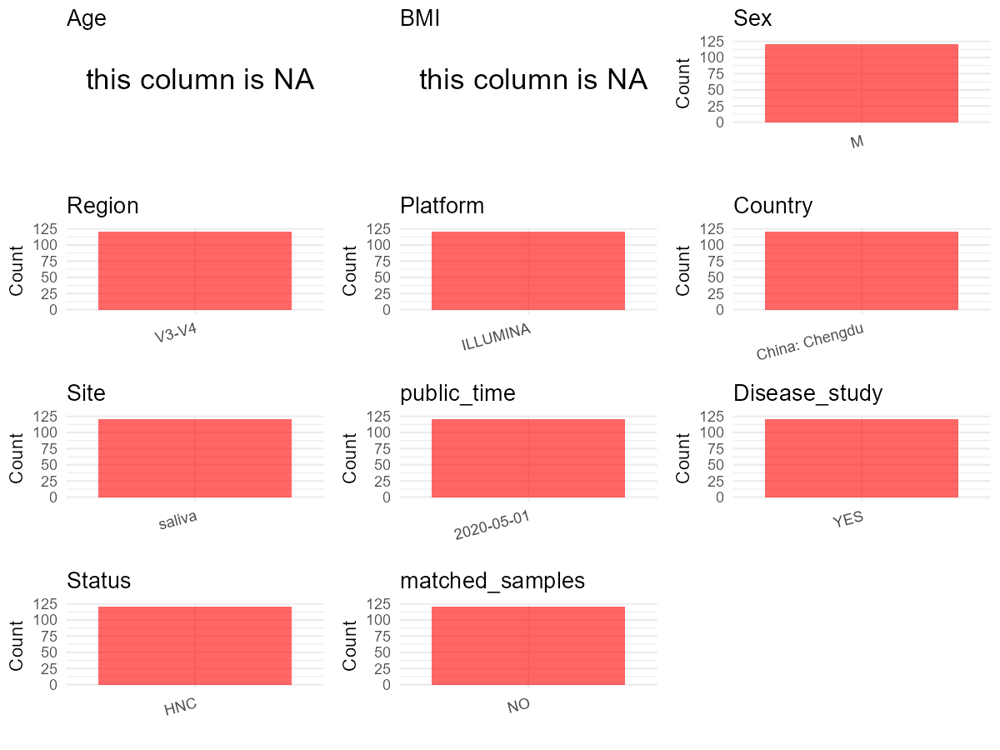

```{r}
library(dplyr)
library(ggplot2)
library(cowplot)
setwd("D:/PRJNA666972")
initial_meta<-read.csv("SraRunTable (3).csv",header = T)
head(initial_meta)
```

```{r}
metadata <- data.frame(
  BioProject = initial_meta$BioProject,
  Run = initial_meta$Run,
  sample_name = initial_meta$Library.Name,
  Platform = initial_meta$Platform,
  Country = initial_meta$geo_loc_name,
 
  public_time = initial_meta$Collection_Date,
  stringsAsFactors = FALSE
)
```

```{r}
metadata$Age <-NA
  metadata$BMI <-NA
  metadata$Sex <-"M"
  metadata$PCR_primers <-"341F-806R"
  metadata$Region <- "V3-V4"
  metadata$Site <- "saliva"
  metadata$title <- "Study on the Salivary Microbial Alteration of Men With Head and Neck Cancer and Its Relationship With Symptoms in Southwest China"
  metadata$Disease_study <- "YES"
  metadata$Status <- "HNC"
  metadata$matched_samples <- "NO"
  
  
#extract subject id by remove prefix of sample_name
metadata$sample_name <- gsub("L", "", metadata$sample_name)

# Check initial data distribution
cat("Initial sample distribution:\n")
table(metadata$sample_name)
table(metadata$Site)

# Calculate sampling frequency per subject
sample_counts <- table(metadata$sample_name)
cat("\nNumber of samples per subject:\n")
print(sample_counts)
```

# Step 4: Summarize and Validate the Metadata
```{r}
# Check the number of unique runs and sample names
print(paste("Number of unique runs:", length(unique(metadata$Run))))
print(paste("Number of unique sample names:", length(unique(metadata$sample_name))))
```
# Step 5: Visualize the Metadata
```{r,fig.width=8, fig.height=6, fig.align='center',include=FALSE}
# Select columns for visualization
plot_data <- metadata %>%
  select(-BioProject, -Run, -sample_name, -title)

# Function to create simple plots for each column
create_simple_plots <- function(data) {
  plots <- list()
  
  for (col in colnames(data)) {
    # Check if the column is all NA
    if (all(is.na(data[[col]]))) {
      # Create an empty plot with text indicating all NA
      p <- ggplot() +
        annotate("text", x = 0.5, y = 0.5, label = "this column is NA", size = 6) +
        labs(title = col) +
        theme_void()
    } else if (is.numeric(data[[col]])) {
      # Numeric variable: histogram
      p <- ggplot(data, aes(x = .data[[col]])) +
        geom_histogram(fill = "blue", alpha = 0.6, bins = 20, na.rm = TRUE) +
        labs(title = col) +
        theme_minimal()
    } else {
      # Categorical variable: bar plot (remove NA values)
      count_data <- as.data.frame(table(data[[col]], useNA = "ifany"))
      p <- ggplot(count_data, aes(x = reorder(Var1, -Freq), y = Freq)) +
        geom_col(fill = "red", alpha = 0.6) +
        labs(title = col, x = NULL, y = "Count") +
        theme_minimal() +
        theme(axis.text.x = element_text(angle = 15, hjust = 1))
    }
    plots[[col]] <- p
  }
  
  return(plots)
}

# Generate and arrange plots
plots <- create_simple_plots(plot_data)
p<-plot_grid(plots$Age, 
          plots$BMI, 
          plots$Sex, 
          plots$Region, 
          plots$Platform, 
          plots$Country, 
          plots$Site,
          plots$public_time, 
          plots$Disease_study,
          plots$Status,
          plots$matched_samples,# add 
          ncol = 3, align = "hv", axis = "lb")
ggsave("Metadata_Summary.png", plot = p, width = 8, height = 6, dpi = 150)
```


```{r}

```

# Step 6: Finalize and Export the Metadata
```{r}
# Reorder columns to match the desired format
metadata <- metadata[, c(
  "BioProject", "Run", "sample_name", "Age", "BMI", "Sex", 
  "Region", "Platform", "Country", "Site", "public_time", 
  "PCR_primers", "title", "Disease_study", "Status","matched_samples"
)]

# Export the uniform metadata to a CSV file
write.csv(metadata, file = "metadata.csv", quote = FALSE)
head(metadata)
```
