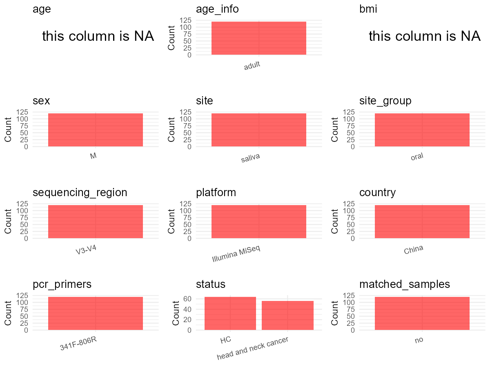

# Step 1: Obtain Initial Metadata from Each Project

This step sets the project directory, loads the raw SRA metadata, and optionally merges supplement tables.

```{r message=FALSE, warning=FALSE}
# Load libraries
library(dplyr)
library(ggplot2)
library(cowplot)

# (1) Setting working directory
# project_id: PRJNA666972
project_id <- "PRJNA666972"

base_dir <- "D:/metadata_collect"
setwd(file.path(base_dir, project_id))

# (2) Loading raw SRA metadata file
# From project directory: SraRunTable.csv (downloaded from SRA Run Selector for PRJNA666972)
sra_file <- "SraRunTable.csv"
initial_meta <- read.csv(sra_file, header = TRUE)

# (3) OPTIONAL: If extra metadata (e.g., Table.x or supplemental materials) are available from the article, you may need to merge the file with initial_meta manually. Below is example code for merging. Depending on the specific case of each study, you can customize the code as needed.
# supp_table <- read.csv("supplemental_table.csv", header = TRUE)
# initial_meta <- left_join(initial_meta, supp_table, by = merge_col_name)
```

# Step 2: Data Overview

First, you need to get an overview of the data, which includes two steps: reading the article and reading the initial metadata. This step is very IMPORTANT!

```{r message=FALSE, warning=FALSE}
# (1) Read the article: abstract -> results opening -> methods.
# Paper title: "Study on the Salivary Microbial Alteration of Men With Head and Neck Cancer
#   and Its Relationship With Symptoms in Southwest China" (Zuo et al., 2020, Front. Cell. Infect. Microbiol.)
# Design: 56 HNC patients (men, laryngeal/hypopharyngeal cancer) + 64 age-matched healthy male controls.
# Sampling site: saliva (not broad "oral")
# Platform: Illumina MiSeq; Region: V3-V4; Primers: 341F-806R
# Cross-sectional design, single timepoint.
# Country: China (Southwest China, Chengdu)

# (2) IMPORTANT: MUST go through each column of initial_meta
# CSV columns: Run, Assay Type, AvgSpotLen, Bases, BioProject, BioSample, BioSampleModel,
#   Bytes, Center Name, Collection_Date, Consent, DATASTORE filetype, DATASTORE provider,
#   DATASTORE region, Experiment, geo_loc_name_country, geo_loc_name_country_continent,
#   geo_loc_name, Instrument, isolation_source, lat_lon, Library Name, LibraryLayout,
#   LibrarySelection, LibrarySource, Organism, Platform, ReleaseDate, create_date,
#   version, Sample Name, SRA Study
#
# Key columns for our metadata:
#   BioProject   -> bioproject (all: PRJNA666972)
#   Run          -> sample_id (SRR12771660~SRR12771779, 120 runs)
#   Organism     -> all "human saliva metagenome" (all human, saliva site)
#   Platform     -> all "ILLUMINA" (paper says Illumina MiSeq)
#   Instrument   -> all "Illumina MiSeq"
#   geo_loc_name_country -> all "China"
#   geo_loc_name -> all "China: Chengdu"
#   ReleaseDate  -> all "2024-10-04T00:00:00Z"
#   Collection_Date -> all "2020-05-01"
#   isolation_source -> sample IDs like HNC18969067_1, HC19540129_1, etc.
#     Prefix HNC = HNC patients; prefix HC/N/S = healthy controls
#   Sample Name  -> subject_id (S62_R1.fastq -> S62, N26_R1.fastq -> N26, etc., with _R1.fastq stripped)
#
# Columns NOT present in this CSV: AGE, sex, anonymized_name, body_site,
#   target_subfragment..exp. — these were from a different study template
#
# Verify key columns:
table(initial_meta$Organism)        # all "human saliva metagenome"
table(initial_meta$Platform)         # all "ILLUMINA"
table(initial_meta$Instrument)       # all "Illumina MiSeq"
table(initial_meta$geo_loc_name_country)  # all "China"
table(initial_meta$LibraryLayout)    # all "PAIRED"
# Check isolation_source prefix pattern (HNC vs non-HNC for disease status)
table(substr(initial_meta$isolation_source, 1, 3))
```

# Step 3: Removing Control and Non-human Samples

First, we need to remove control samples(including both negative controls and positive controls) and non-human samples.

```{r}
# (1) Parameter setup
# No control samples (negative/positive controls) found in metadata or paper
control_column <- ""   # no control column in initial_meta
control_keywords <- c()     # no controls to filter

# From initial_meta column 'Organism': all values are "human saliva metagenome"
# No non-human samples to filter
species_column <- ""          # no species column needed; Organism column is all human
non_human_keywords <- c()            # no non-human samples


# (2) Remove controls and non-human samples. DO NOT need to modify code in this part, just run it.
n_samples <- nrow(initial_meta)
# Control evaluation
if (length(control_keywords) > 0) {
  if (is.null(control_column) || control_column == "") {
    stop("Error: control_keywords provided but control_column is missing.")
  }

  if (!(control_column %in% colnames(initial_meta))) {
    stop(sprintf("Error: Column '%s' not found in initial_meta.", control_column))
  }

  control_pattern <- paste(control_keywords, collapse = "|")
  control_text <- initial_meta[[control_column]]
  is_control <- grepl(control_pattern, control_text)

} else {
  is_control <- rep(FALSE, n_samples)
}

# Non-human evaluation
if (length(non_human_keywords) > 0) {
  if (is.null(species_column) || species_column == "") {
    stop("Error: non_human_keywords provided but species_column is missing.")
  }

  if (!(species_column %in% colnames(initial_meta))) {
    stop(sprintf("Error: Column '%s' not found in initial_meta.", species_column))
  }

  non_human_pattern <- paste(non_human_keywords, collapse = "|")
  species_text <- initial_meta[[species_column]]
  is_non_human <- grepl(non_human_pattern, species_text)
} else {
  is_non_human <- rep(FALSE, n_samples)
}

# Execute removal
samples_to_remove <- is_control | is_non_human
initial_meta <- initial_meta[!samples_to_remove, ]

cat("Initial samples counts:",n_samples,"\n")
cat("Removed control samples:", sum(is_control), "\n")
cat("Removed non-human samples:", sum(is_non_human), "\n")
cat("Total samples removed ", sum(samples_to_remove), "\n")
cat("Remaining samples after Step 2:", nrow(initial_meta), "\n")
```

# Step 4: Creating a Uniform Metadata Template

This step converts the raw SRA table into the standard metadata format used in our meta-analysis.
The uniform metadata should include the following columns:
1. **bioproject**: Project ID from SRA or other database
   e.g. `PRJNA1234`, `CNP1234`, 'OEP1234', 'qiita_1234'
2. **sample_id**: SRA sample/run ID. Unique id for each sample!
   e.g. `DRR1234567`, `ERR1234567` and `SRR1234567`. If no such column exists, can use column like sample_name.
3. **subject_id**: subject id for each person if available.
   e.g. `patient_01`, `Host_03_before`, `subject12`
4. **age**: Age of the subject if available.
   e.g. `35`, `42` | not `adult`, `chilren`
5. **age_info**: If the age is not explicitly stated but approximate age range information is available, mark it in this column.
   e.g., `18-55`, `children`, `infant`, `elder`
6. **bmi**: Body Mass Index if available.
   e.g. `22.5`, `18.9` | not `normal`, `overweight`
7. **sex**: Sex of the subject.
   Mandatory to write as M/F | not `female`, `woman`
8. **sequencing_region**: Targeted 16S rRNA region.
   e.g. `V3-V4`, `V4`
9. **platform**: Sequencing platform.
   e.g. `Illumina MiSeq`, `454 GS FLX Titanium`, `Ion Torrent`
10. **country**: Country of sample origin.
   e.g. `China`, `Japan` | not city name like `Beijing`
11. **site**: Sampling site. For oral and gut sites, specify the exact sites as detailed as possible. For example, if it is known to be supragingival plaque, do not record it as 'dental plaque', unless the original text provides only a vague description.
    e.g. `saliva`, `tongue coating` | not broad term like `oral`
12. **site_group**: only accepts one of following three values: 'oral', 'gut', or 'other'.
13. **public_time**: Data release date.
    e.g. `2021-06-22` | not `June 2021`
14. **pcr_primers**: PCR primers used.
    e.g. `515F-806R`, `27F-338R` | not primer sequences
15. **title**: Title of the associated publication.
16. **disease_study**: Whether the study involves disease samples. If it's not clear, can record as NA. Only three values accepted: 'yes', 'no' or NA
17. **status**: Disease status for each sample if available, else record as NA. Only accept following abbreviations, Write full names for all other diseases.
    HC: healthy control
    CD: Crohn's disease
    CRC: colorectal cancer
    COPD: chronic obstructive pulmonary disease
    HIV: human immunodeficiency virus
    ICU: intensive care unit
    OSCC: oral squamous cell carcinoma
    RA: rheumatoid arthritis
    UC: ulcerative colitis
18. **matched_samples**: Whether the subject has matched samples. Only accept 'yes' or 'no'.
19. **is_time_series**: Whether the study is a time series study. Only accept 'yes' or 'no'.

```{r}
# Extract columns from initial_meta as follows: (1) No modification needed -> extract directly. (2) Modification needed -> create a new column with the prefix raw_ and mark the original column as "pending". (3) Need to find or determine based on the article.
metadata <- data.frame(
  bioproject = initial_meta$BioProject,
  sample_id = initial_meta$Run,
  # From initial_meta column 'Sample Name': fastq filenames with '_R1.fastq' suffix stripped
  # e.g., "S62_R1.fastq" -> "S62", "N26_R1.fastq" -> "N26"
  subject_id = gsub("_R1\\.fastq$", "", initial_meta$Sample.Name),
  # NA — individual ages not available in SRA metadata
  age = NA_character_,
  # From paper Table 1: mean age ~61-63 years (SD~9), age-matched adults
  age_info = "adult",
  # NA — BMI not reported in metadata or paper
  bmi = NA_character_,
  # From paper Methods/Results: all participants are men
  sex = "M",
  # From paper Methods section: "Bacterial 16S rRNA gene fragments (V3-V4) were amplified"
  sequencing_region = "V3-V4",
  # From paper Methods section: "Illumina MiSeq sequencing platform"
  platform = "Illumina MiSeq",
  # From initial_meta column 'geo_loc_name_country': all "China"
  country = initial_meta$geo_loc_name_country,
  # From initial_meta column 'Organism': all "human saliva metagenome" -> site is saliva
  site = "saliva",
  # Saliva -> oral site group
  site_group = "oral",
  # From initial_meta column 'ReleaseDate': "2024-10-04T00:00:00Z"
  public_time = initial_meta$ReleaseDate,
  # From paper Methods section: primers 341F and 806R
  pcr_primers = "341F-806R",
  # From paper title
  title = "Study on the Salivary Microbial Alteration of Men With Head and Neck Cancer and Its Relationship With Symptoms in Southwest China",
  # From paper: compares HNC patients vs healthy controls
  disease_study = "yes",
  # From initial_meta column 'isolation_source': prefix HNC = HNC patients, others = HC
  raw_status = initial_meta$isolation_source,
  status = "pending",
  # Filled in Step 5 based on subject_id pattern
  matched_samples = "pending",
  # From paper Discussion: "The cross-sectional design limited the study's ability..."
  is_time_series = "no",
  stringsAsFactors = FALSE
)
metadata$public_time <- as.Date(metadata$public_time)
```

# Step 5: Manually solving pending issues

This step involves two parts: (1) handle the columns with the `raw_` prefix, and next (2) handle the `site_group` and `matched_samples` columns.

```{r}
# (1) Handle the columns with the `raw_` prefix.
# raw_status from initial_meta 'isolation_source' column:
#   - Prefix "HNC" (e.g., HNC18969067_1) = head and neck cancer patients (full name per template rule: HNC not in standard abbreviations list)
#   - Prefix "HC" or "N" or "S" (e.g., HC19540129_1, N26_R1, S62_R1) = healthy controls
#   This mapping is inferred from sample naming: HNC prefix = head and neck cancer patients;
#   non-HNC prefixes = healthy community controls. Total: ~60 HNC + ~60 HC (paper reports 56+64=120 after QC filtering).
metadata <- metadata %>%
  mutate(status = case_when(
    grepl("^HNC", raw_status) ~ "head and neck cancer",
    TRUE ~ "HC"
  ))
```

```{r}
# (2) Filling the 'site_group' and 'matched_samples' columns
# site is "saliva" for all samples -> all oral
unique(metadata$site)
Oral_site = c("saliva")
Gut_site = c()
# just run
metadata <- metadata %>%
  mutate(site_group = case_when(
    site %in% Oral_site ~ "oral",
    site %in% Gut_site ~ "gut",
    TRUE ~ "other"
  ))

# editing matched_samples: subject_id is derived from 'Sample Name' (fastq filenames),
# which are unique per sample — no subject appears multiple times
metadata$matched_samples <- "no"
```

```{r}
# (3) check if there is pending value in metadata. If there is pending value, go on modify the metadata.
# Function to check if a column contains "pending"
has_pending <- function(col) {
  if (is.character(col) || is.factor(col)) {
    any(col == "pending", na.rm = TRUE)
  } else {
    FALSE
  }
}

# Check for any pending value
any_pending_value <- any(sapply(metadata, has_pending))

if (!any_pending_value) {
  message("Good! No cell contains the value 'pending'.")
} else {
  pending_cols <- names(metadata)[sapply(metadata, has_pending)]
  message("Columns containing 'pending': ", paste(pending_cols, collapse = ", "))
  message("Please continue to resolve these pending columns!")
}
```

# Step 6: Visualize the Metadata

This step makes a quick set of plots for checking the distribution of key metadata fields.

```{r}
# Select columns for visualization, just run
plot_data <- metadata %>%
  select(-bioproject, -sample_id, -subject_id, -title)

create_simple_plots <- function(data) {
  plots <- list()
  continuous_vars <- c("age", "bmi")

  for (col in colnames(data)) {
    if (all(is.na(data[[col]]))) {
      p <- ggplot() +
        annotate("text", x = 0.5, y = 0.5, label = "this column is NA", size = 6) +
        labs(title = col) +
        theme_void()
    } else if (col %in% continuous_vars && is.numeric(data[[col]])) {
      p <- ggplot(data, aes(x = .data[[col]])) +
        geom_histogram(fill = "blue", alpha = 0.6, bins = 20, na.rm = TRUE) +
        labs(title = col, x = col, y = "Count") +
        theme_minimal()
    } else {
      count_data <- as.data.frame(table(data[[col]], useNA = "ifany"))
      p <- ggplot(count_data, aes(x = reorder(Var1, -Freq), y = Freq)) +
        geom_col(fill = "red", alpha = 0.6) +
        labs(title = col, x = NULL, y = "Count") +
        theme_minimal() +
        theme(axis.text.x = element_text(angle = 15, hjust = 1))
    }
    plots[[col]] <- p
  }

  return(plots)
}

# Generate and arrange plots
plots <- create_simple_plots(plot_data)
p <- plot_grid(plots$age,
               plots$age_info,
               plots$bmi,
               plots$sex,
               plots$site,
               plots$site_group,
               plots$sequencing_region,
               plots$platform,
               plots$country,
               plots$pcr_primers,
               plots$status,
               plots$matched_samples,
               ncol = 3, align = "hv", axis = "lb")
ggsave("Metadata_Summary_v2.png", plot = p, width = 8, height = 6, dpi = 150)
```

```{r}
# Insert Metadata_Summary_v2.png into the current Rmd output

```

# Step 7: Sort and export the metadata

This step saves the cleaned metadata table as the final `metadata.csv` file.

```{r}
# Reorder the data frame
fixed_cols <- c("bioproject", "sample_id", "subject_id", "age", "age_info",
                "bmi", "sex", "platform", "sequencing_region", "pcr_primers",
                "country", "site", "site_group", "disease_study", "status",
                "title", "public_time", "matched_samples", "is_time_series")
metadata <- metadata %>%
  select(all_of(fixed_cols), everything())

# save metadata
# head(metadata)
write.csv(metadata, file = "metadata_v2.csv", quote = TRUE)
```
