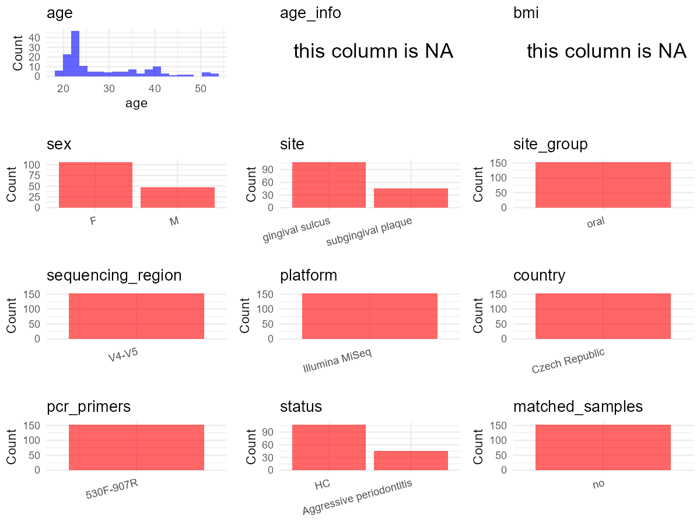

# Step 1: Obtain Initial Metadata from Each Project

This step sets the project directory, loads the raw SRA metadata, and optionally merges supplement tables.

```{r message=FALSE, warning=FALSE}
# Load libraries
library(dplyr)
library(ggplot2)
library(cowplot)

# (1) Setting working directory
project_id <- "PRJNA670573"

base_dir <- "D:/metadata_collect"
setwd(file.path(base_dir, project_id))

# (2) Loading raw SRA metadata file
sra_file <- "SraRunTable.csv"
initial_meta <- read.csv(sra_file, header = TRUE)

# (3) Merge supplemental supplemental_table_v2 with individual-level age and sex data
# supplemental_table_v2.xlsx has 3 sheets: "Healthy young (HY)", "Healthy  old (HO)", "Aggressive periodontits  (AP)"
# Each sheet has columns: Sample identification, Age, Sex
# From paper Methods: "Additional information ... listed in the Supplementary Table 1"
supp_hy <- readxl::read_excel("supplemental_table_v2.xlsx", sheet = "Healthy young (HY)", skip = 0, col_names = TRUE)
supp_ho <- readxl::read_excel("supplemental_table_v2.xlsx", sheet = "Healthy  old (HO)", skip = 0, col_names = TRUE)
supp_ap <- readxl::read_excel("supplemental_table_v2.xlsx", sheet = "Aggressive periodontits  (AP)", skip = 0, col_names = TRUE)

# Standardize column names across sheets
new_col_names <- c("subject_id", "age", "sex")
supp_hy <- supp_hy[, 1:3]
supp_ho <- supp_ho[, 1:3]
supp_ap <- supp_ap[, 1:3]
colnames(supp_hy) <- new_col_names
colnames(supp_ho) <- new_col_names
colnames(supp_ap) <- new_col_names

# Combine all supplemental data
supp_all <- bind_rows(supp_hy, supp_ho, supp_ap)
supp_all <- supp_all %>% select(subject_id, age, sex)

# Merge with initial_meta by subject_id (matches Sample.Name)
initial_meta$subject_id <- initial_meta$Sample.Name
initial_meta <- left_join(initial_meta, supp_all, by = "subject_id")
```

# Step 2: Data Overview

First, you need to get an overview of the data, which includes two steps: reading the article and reading the initial metadata. This step is very IMPORTANT!

```{r message=FALSE, warning=FALSE}
# (1) Read the article in the following order: abstract, the beginning of the results section, and the methods. Understand the sample size, experimental design, and disease group overview. Clarify the sampling sites; for oral and gut samples, specify the exact sites like supragingival plaque, tongue, etc.

# (2) IMPORTANT: MUST go through each column of initial_meta
# head(initial_meta, 10)

# IMPORTANT: Check the unique values in the column of interest or query column.
# table(initial_meta$env_local_scale)       # site: "gingival sulcus", "periodontal pocket"
# table(initial_meta$env_medium)             # "fluid from the gingival sulcus", "subgingival plaque"
# table(initial_meta$HOST)                   # all "Homo sapiens"
# table(initial_meta$Organism)               # all "human oral metagenome"
# table(initial_meta$platform..exp.)         # all "ILLUMINA"
# table(initial_meta$sequencing_meth..exp.)  # all "missing" (no info in metadata)
# table(initial_meta$BioProject)             # all "PRJNA670573"
# unique(initial_meta$geo_loc_name_country)  # all "Czech Republic"
# unique(initial_meta$Sample.Name)           # e.g., AP_1, HY_91, HO_14
# table(initial_meta$age)                     # from supplemental_table_v2.xlsx: individual ages (19-53)
# table(initial_meta$sex)                     # from supplemental_table_v2.xlsx: "man" / "woman"
```

# Step 3: Removing Control and Non-human Samples

First, we need to remove control samples(including both negative controls and positive controls) and non-human samples.

```{r}
# (1) Parameter setup
# From paper: all 153 samples are from human subjects (Homo sapiens)
# No control samples (negative/positive) mentioned in paper or metadata
control_column <- ""
control_keywords <- c()

# From initial_meta column HOST: all values are "Homo sapiens"
# Verified: unique(initial_meta$HOST) -> "Homo sapiens" only
species_column <- "HOST"
unique(initial_meta[[species_column]])
non_human_keywords <- c("NON-HUMAN")  # no non-human samples; placeholder that won't match

# (2) Remove controls and non-human samples. DO NOT need to modify code in this part, just run it.
n_samples <- nrow(initial_meta)
# Control evaluation
if (length(control_keywords) > 0) {
  if (is.null(control_column) || control_column == "") {
    stop("Error: control_keywords provided but control_column is missing.")
  }

  if (!(control_column %in% colnames(initial_meta))) {
    stop(sprintf("Error: Column '%s' not found in initial_meta.", control_column))
  }

  control_pattern <- paste(control_keywords, collapse = "|")
  control_text <- initial_meta[[control_column]]
  is_control <- grepl(control_pattern, control_text)

} else {
  is_control <- rep(FALSE, n_samples)
}

# Non-human evaluation
if (length(non_human_keywords) > 0) {
  if (is.null(species_column) || species_column == "") {
    stop("Error: non_human_keywords provided but species_column is missing.")
  }

  if (!(species_column %in% colnames(initial_meta))) {
    stop(sprintf("Error: Column '%s' not found in initial_meta.", species_column))
  }

  non_human_pattern <- paste(non_human_keywords, collapse = "|")
  species_text <- initial_meta[[species_column]]
  is_non_human <- grepl(non_human_pattern, species_text)
} else {
  is_non_human <- rep(FALSE, n_samples)
}

# Execute removal
samples_to_remove <- is_control | is_non_human
initial_meta <- initial_meta[!samples_to_remove, ]

cat("Initial samples counts:",n_samples,"\n")
cat("Removed control samples:", sum(is_control), "\n")
cat("Removed non-human samples:", sum(is_non_human), "\n")
cat("Total samples removed ", sum(samples_to_remove), "\n")
cat("Remaining samples after Step 2:", nrow(initial_meta), "\n")
```

# Step 4: Creating a Uniform Metadata Template

This step converts the raw SRA table into the standard metadata format used in our meta-analysis.
The uniform metadata should include the following columns:
1. **bioproject**: Project ID from SRA or other database
   e.g. `PRJNA1234`, `CNP1234`, 'OEP1234', 'qiita_1234'
2. **sample_id**: SRA sample/run ID. Unique id for each sample!
   e.g. `DRR1234567`, `ERR1234567` and `SRR1234567`. If no such column exists, can use column like sample_name.
3. **subject_id**: subject id for each person if available.
   e.g. `patient_01`, `Host_03_before`, `subject12`
4. **age**: Age of the subject if available.
   e.g. `35`, `42` | not `adult`, `chilren`
5. **age_info**: If the age is not explicitly stated but approximate age range information is available, mark it in this column.
   e.g., `18-55`, `children`, `infant`, `elder`
6. **bmi**: Body Mass Index if available.
   e.g. `22.5`, `18.9` | not `normal`, `overweight`
7. **sex**: Sex of the subject.
   Mandatory to write as M/F | not `female`, `woman`
8. **sequencing_region**: Targeted 16S rRNA region.
   e.g. `V3-V4`, `V4`
9. **platform**: Sequencing platform.
   e.g. `Illumina MiSeq`, `454 GS FLX Titanium`, `Ion Torrent`
10. **country**: Country of sample origin.
    e.g. `China`, `Japan` | not city name like `Beijing`
11. **site**: Sampling site. For oral and gut sites, specify the exact sites as detailed as possible. For example, if it is known to be supragingival plaque, do not record it as 'dental plaque', unless the original text provides only a vague description.
    e.g. `saliva`, `tongue coating` | not broad term like `oral`
12. **site_group**: only accepts one of following three values: 'oral', 'gut', or 'other'.
13. **public_time**: Data release date.
    e.g. `2021-06-22` | not `June 2021`
14. **pcr_primers**: PCR primers used.
    e.g. `515F-806R`, `27F-338R` | not primer sequences
15. **title**: Title of the associated publication.
16. **disease_study**: Whether the study involves disease samples. If it's not clear, can record as NA. Only three values accepted: 'yes', 'no' or NA
17. **status**: Disease status for each sample if available, else record as NA. Only accept following abbreviations, Write full names for all other diseases.
    HC: healthy control
    CD: Crohn's disease
    CRC: colorectal cancer
    COPD: chronic obstructive pulmonary disease
    HIV: human immunodeficiency virus
    ICU: intensive care unit
    OSCC: oral squamous cell carcinoma
    RA: rheumatoid arthritis
    UC: ulcerative colitis
18. **matched_samples**: Whether the subject has matched samples. Only accept 'yes' or 'no'.
19. **is_time_series**: Whether the study is a time series study. Only accept 'yes' or 'no'.

```{r}
# Source notes for all field mappings:
# - bioproject: initial_meta$BioProject (all "PRJNA670573")
# - sample_id: initial_meta$Run (SRR IDs)
# - subject_id: initial_meta$Sample.Name (e.g., AP_1, HY_91, HO_14); paper Methods: samples labeled by group prefix + number
# - age: From supplemental_table_v2.xlsx merged column 'age'; individual ages available (19-53)
# - age_info: NA now that individual age is available
# - bmi: NA; not reported in paper or metadata
# - sex: From supplemental_table_v2.xlsx merged column 'sex'; values "man"/"woman"; converted in Step 5
# - sequencing_region: paper Methods, "V4-V5 region of bacterial 16S rDNA"
# - platform: paper Methods, "Illumina MiSeq platform"
# - country: initial_meta$geo_loc_name_country (all "Czech Republic")
# - site: derived from initial_meta$env_local_scale; see Step 5 for conversion
# - site_group: derived from site values in Step 5
# - public_time: initial_meta$ReleaseDate
# - pcr_primers: paper Methods, "530f-907R"
# - title: paper title
# - disease_study: "yes"; paper compares periodontal health vs aggressive periodontitis
# - status: derived from Sample.Name prefix; HY/HO->"HC", AP->"Aggressive periodontitis"
# - matched_samples: "no"; one sample per subject (verified: all Sample.Name are unique)
# - is_time_series: "no"; single timepoint design, no repeated sampling

metadata <- data.frame(
  bioproject = initial_meta$BioProject,
  sample_id = initial_meta$Run,
  # From initial_meta column 'Sample.Name'; paper Methods: group labels AP, HO, HY + number
  subject_id = initial_meta$Sample.Name,
  # From supplemental_table_v2.xlsx merged column 'age'; individual ages (19-53)
  age = initial_meta$age,
  age_info = NA,
  bmi = NA,
  # raw_sex from supplemental_table_v2.xlsx merged column 'sex'; values "man"/"woman"; converted in Step 5
  raw_sex = initial_meta$sex,
  sex = "pending",
  # Paper Methods: "universal primers 530f and 907R were used to amplify the V4-V5 region"
  sequencing_region = "V4-V5",
  # Paper Methods: "sequenced by Illumina MiSeq platform (paired-end reads, 2x250 bp)"
  platform = "Illumina MiSeq",
  # From initial_meta column 'geo_loc_name_country'
  country = initial_meta$geo_loc_name_country,
  # raw_site from initial_meta column 'env_local_scale'
  raw_site = initial_meta$env_local_scale,
  site = "pending",
  site_group = "pending",
  # From initial_meta column 'ReleaseDate'
  public_time = initial_meta$ReleaseDate,
  # Paper Methods: primers 530f and 907R
  pcr_primers = "530F-907R",
  # Paper title
  title = "The Oral Microbiome in Periodontal Health",
  # Paper compares periodontal health vs aggressive periodontitis -> disease study
  disease_study = "yes",
  # Derived from Sample.Name prefix; converted in Step 5
  raw_status = ifelse(grepl("^HY_", initial_meta$Sample.Name), "HY",
               ifelse(grepl("^HO_", initial_meta$Sample.Name), "HO",
               ifelse(grepl("^AP_", initial_meta$Sample.Name), "AP", NA))),
  status = "pending",
  # All Sample.Name are unique; one sample per subject
  matched_samples = "no",
  # Single timepoint design; no repeated sampling of same individual
  is_time_series = "no",
  stringsAsFactors = FALSE
)
metadata$public_time <- as.Date(metadata$public_time)
```

# Step 5: Manually solving pending issues

This step involves two parts: (1) handle the columns with the `raw_` prefix, and next (2) handle the `site_group` and `matched_samples` columns.

```{r}
# (1) Handle the columns with the `raw_` prefix.

# sex: From supplemental_table_v2.xlsx merged column 'sex'; values are "man" / "woman"
# Verified: table(initial_meta$sex) -> "man" and "woman" only
metadata <- metadata %>%
  mutate(sex = case_when(
    raw_sex == "man" ~ "M",
    raw_sex == "woman" ~ "F",
    TRUE ~ NA_character_
  ))

# site: From initial_meta column 'env_local_scale':
#   "gingival sulcus" -> healthy samples (HY, HO)
#   "periodontal pocket" -> AP samples
# Paper Methods: healthy subjects sampled from "vestibular side of sulcus gingivalis"
# Paper Methods: AP samples taken from "deepest periodontal pocket"
metadata$site <- gsub("gingival sulcus", "gingival sulcus", metadata$raw_site)
metadata$site <- gsub("periodontal pocket", "subgingival plaque", metadata$site)

# status: Map group prefixes based on supplemental_table_v2.xlsx sheet labels:
#   HY (Healthy young) -> "HC" (healthy control, standard abbreviation)
#   HO (Healthy old) -> "HC" (healthy control, standard abbreviation)
#   AP (Aggressive periodontitis) -> "Aggressive periodontitis" (full disease name; not in standard abbreviations)
metadata <- metadata %>%
  mutate(status = case_when(
    raw_status %in% c("HY", "HO") ~ "HC",
    raw_status == "AP" ~ "Aggressive periodontitis",
    TRUE ~ NA_character_
  ))
```

```{r}
# (2) Filling the 'site_group' and 'matched_samples' columns
# editing site_group
unique(metadata$site)
# All sites are oral: gingival sulcus, subgingival plaque
Oral_site = c("gingival sulcus", "subgingival plaque")
Gut_site = c()
# just run
metadata <- metadata %>%
  mutate(site_group = case_when(
    site %in% Oral_site ~ "oral",
    site %in% Gut_site ~ "gut",
    TRUE ~ "other"
  ))

# editing matched_samples, just run.
metadata$matched_samples <- ifelse(
  ave(metadata$subject_id, metadata$subject_id, FUN = length) > 1,
  "yes",
  "no"
)
```

```{r}
# (3) check if there is pending value in metadata. If there is pending value, go on modify the metadata.
# Function to check if a column contains "pending"
has_pending <- function(col) {
  if (is.character(col) || is.factor(col)) {
    any(col == "pending", na.rm = TRUE)
  } else {
    FALSE
  }
}

# Check for any pending value
any_pending_value <- any(sapply(metadata, has_pending))

if (!any_pending_value) {
  message("Good! No cell contains the value 'pending'.")
} else {
  pending_cols <- names(metadata)[sapply(metadata, has_pending)]
  message("Columns containing 'pending': ", paste(pending_cols, collapse = ", "))
  message("Please continue to resolve these pending columns!")
}
```

# Step 6: Visualize the Metadata

This step makes a quick set of plots for checking the distribution of key metadata fields.

```{r}
# Select columns for visualization, just run
plot_data <- metadata %>%
  select(-bioproject, -sample_id, -subject_id, -title)

create_simple_plots <- function(data) {
  plots <- list()
  continuous_vars <- c("age", "bmi")

  for (col in colnames(data)) {
    if (all(is.na(data[[col]]))) {
      p <- ggplot() +
        annotate("text", x = 0.5, y = 0.5, label = "this column is NA", size = 6) +
        labs(title = col) +
        theme_void()
    } else if (col %in% continuous_vars && is.numeric(data[[col]])) {
      p <- ggplot(data, aes(x = .data[[col]])) +
        geom_histogram(fill = "blue", alpha = 0.6, bins = 20, na.rm = TRUE) +
        labs(title = col, x = col, y = "Count") +
        theme_minimal()
    } else {
      count_data <- as.data.frame(table(data[[col]], useNA = "ifany"))
      p <- ggplot(count_data, aes(x = reorder(Var1, -Freq), y = Freq)) +
        geom_col(fill = "red", alpha = 0.6) +
        labs(title = col, x = NULL, y = "Count") +
        theme_minimal() +
        theme(axis.text.x = element_text(angle = 15, hjust = 1))
    }
    plots[[col]] <- p
  }

  return(plots)
}

# Generate and arrange plots
plots <- create_simple_plots(plot_data)
p <- plot_grid(plots$age,
               plots$age_info,
               plots$bmi,
               plots$sex,
               plots$site,
               plots$site_group,
               plots$sequencing_region,
               plots$platform,
               plots$country,
               plots$pcr_primers,
               plots$status,
               plots$matched_samples,
               ncol = 3, align = "hv", axis = "lb")
ggsave("Metadata_Summary_v2.png", plot = p, width = 8, height = 6, dpi = 150)
```

```{r}
# Insert Metadata_Summary_v2.png into the current Rmd output

```

# Step 7: Sort and export the metadata

This step saves the cleaned metadata table as the final `metadata.csv` file.

```{r}
# Reorder the data frame
fixed_cols <- c("bioproject", "sample_id", "subject_id", "age", "age_info",
                "bmi", "sex", "platform", "sequencing_region", "pcr_primers",
                "country", "site", "site_group", "disease_study", "status",
                "title", "public_time", "matched_samples", "is_time_series")
metadata <- metadata %>%
  select(all_of(fixed_cols), everything())

# save metadata
# head(metadata)
write.csv(metadata, file = "metadata_v2.csv", quote = TRUE)
```
