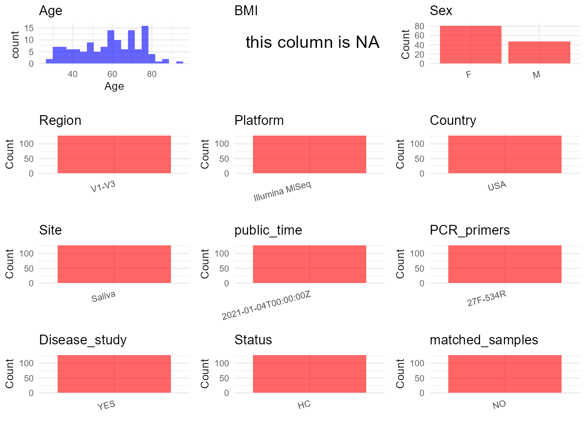

R Notebook: Metadata Processing Workflow
================

# Step 1: Obtain Initial Metadata from Each Project

To obtain the initial metadata: 1. Search for the BioProject ID (e.g.,
“PRJEBXXXX”) on the [NCBI SRA
website](https://www.ncbi.nlm.nih.gov/Traces/study/). 2. In the “Select”
table, click on “Metadata” and download the file. 3. The downloaded file
is typically named “SraRunTable.csv” and contains metadata for the
project.

``` r
# Load necessary libraries
library(dplyr)
library(ggplot2)
library(cowplot)

# Set working directory (update this path to your local directory)
setwd("D:/oral_project/PRJNA674379")

# Read the initial metadata files
initial_meta<-read.csv("SraRunTable.csv",header = T)

# Combine the two metadata files
#meta <- rbind(initial_meta, initial_meta1)

#Remove entries non-oral samples
#initial_meta <- subset(initial_meta,isolate %in% c("saliva","tongue coat"))

# Check the number of samples containing "HT" in Sample.Name (e.g., healthy controls)
#nrow(subset(meta, grepl("HT", Sample.Name)))

# Display the first few rows of the metadata
head(initial_meta)
```

    ##           Run Assay.Type AvgSpotLen    Bases  BioProject    BioSample
    ## 1 SRR13021985   AMPLICON        301 14909132 PRJNA674379 SAMN16655177
    ## 2 SRR13021986   AMPLICON        301 13822221 PRJNA674379 SAMN16655176
    ## 3 SRR13021987   AMPLICON        301 16626337 PRJNA674379 SAMN16655175
    ## 4 SRR13021988   AMPLICON        301 15430163 PRJNA674379 SAMN16655174
    ## 5 SRR13021989   AMPLICON        301 12004783 PRJNA674379 SAMN16655173
    ## 6 SRR13021990   AMPLICON        301 11878965 PRJNA674379 SAMN16655172
    ##                                BioSampleModel    Bytes
    ## 1 MIMARKS.survey,MIGS/MIMS/MIMARKS.human-oral 10141070
    ## 2 MIMARKS.survey,MIGS/MIMS/MIMARKS.human-oral  9597321
    ## 3 MIMARKS.survey,MIGS/MIMS/MIMARKS.human-oral 11552409
    ## 4 MIMARKS.survey,MIGS/MIMS/MIMARKS.human-oral 10631653
    ## 5 MIMARKS.survey,MIGS/MIMS/MIMARKS.human-oral  8323295
    ## 6 MIMARKS.survey,MIGS/MIMS/MIMARKS.human-oral  8403921
    ##                         Center.Name Collection_Date Consent DATASTORE.filetype
    ## 1 UNIVERSITY OF ILLINOIS AT CHICAGO      2019-02-13  public   fastq,run.zq,sra
    ## 2 UNIVERSITY OF ILLINOIS AT CHICAGO      2019-01-11  public   fastq,run.zq,sra
    ## 3 UNIVERSITY OF ILLINOIS AT CHICAGO      2018-01-11  public   fastq,run.zq,sra
    ## 4 UNIVERSITY OF ILLINOIS AT CHICAGO      2019-01-11  public   fastq,run.zq,sra
    ## 5 UNIVERSITY OF ILLINOIS AT CHICAGO      2018-12-21  public   fastq,run.zq,sra
    ## 6 UNIVERSITY OF ILLINOIS AT CHICAGO      2018-12-07  public   fastq,run.zq,sra
    ##   DATASTORE.provider                     DATASTORE.region edentulous
    ## 1         gs,ncbi,s3 gs.us-east1,ncbi.public,s3.us-east-1         No
    ## 2         gs,ncbi,s3 gs.us-east1,ncbi.public,s3.us-east-1         No
    ## 3         gs,ncbi,s3 gs.us-east1,ncbi.public,s3.us-east-1         No
    ## 4         gs,ncbi,s3 gs.us-east1,ncbi.public,s3.us-east-1         No
    ## 5         gs,ncbi,s3 gs.us-east1,ncbi.public,s3.us-east-1         No
    ## 6         gs,ncbi,s3 gs.us-east1,ncbi.public,s3.us-east-1         No
    ##      env_broad_scale env_local_scale env_medium Experiment geo_loc_name_country
    ## 1 microbiome in oral     oral cavity     saliva SRX9472346                  USA
    ## 2 microbiome in oral     oral cavity     saliva SRX9472345                  USA
    ## 3 microbiome in oral     oral cavity     saliva SRX9472344                  USA
    ## 4 microbiome in oral     oral cavity     saliva SRX9472343                  USA
    ## 5 microbiome in oral     oral cavity     saliva SRX9472342                  USA
    ## 6 microbiome in oral     oral cavity     saliva SRX9472341                  USA
    ##   geo_loc_name_country_continent       geo_loc_name host_age host_disease
    ## 1                  North America USA: Chicago\\, IL 61.99589          CON
    ## 2                  North America USA: Chicago\\, IL 37.17454          CON
    ## 3                  North America USA: Chicago\\, IL 36.79398          CON
    ## 4                  North America USA: Chicago\\, IL 52.16153          CON
    ## 5                  North America USA: Chicago\\, IL 59.74264         GERD
    ## 6                  North America USA: Chicago\\, IL 74.91581         GERD
    ##           HOST host_sex host_tissue_sampled     Instrument             lat_lon
    ## 1 Homo sapiens   female              Saliva Illumina MiSeq 41.8781 N 87.6298 W
    ## 2 Homo sapiens     male              Saliva Illumina MiSeq 41.8781 N 87.6298 W
    ## 3 Homo sapiens   female              Saliva Illumina MiSeq 41.8781 N 87.6298 W
    ## 4 Homo sapiens     male              Saliva Illumina MiSeq 41.8781 N 87.6298 W
    ## 5 Homo sapiens     male              Saliva Illumina MiSeq 41.8781 N 87.6298 W
    ## 6 Homo sapiens   female              Saliva Illumina MiSeq 41.8781 N 87.6298 W
    ##   Library.Name LibraryLayout LibrarySelection LibrarySource
    ## 1         NK77        SINGLE              PCR       GENOMIC
    ## 2         NK74        SINGLE              PCR       GENOMIC
    ## 3         NK73        SINGLE              PCR       GENOMIC
    ## 4         NK71        SINGLE              PCR       GENOMIC
    ## 5         NK69        SINGLE              PCR       GENOMIC
    ## 6         NK66        SINGLE              PCR       GENOMIC
    ##                Organism perturbation Platform proton_pump_inhbitor_drug_use
    ## 1 human oral metagenome         None ILLUMINA                            No
    ## 2 human oral metagenome         None ILLUMINA                            No
    ## 3 human oral metagenome         None ILLUMINA                            No
    ## 4 human oral metagenome         None ILLUMINA                            No
    ## 5 human oral metagenome         None ILLUMINA                           PPI
    ## 6 human oral metagenome         None ILLUMINA                            No
    ##            ReleaseDate          create_date version
    ## 1 2021-01-04T00:00:00Z 2020-11-10T23:53:00Z       1
    ## 2 2021-01-04T00:00:00Z 2020-11-10T23:53:00Z       1
    ## 3 2021-01-04T00:00:00Z 2020-11-10T23:53:00Z       1
    ## 4 2021-01-04T00:00:00Z 2020-11-10T23:53:00Z       1
    ## 5 2021-01-04T00:00:00Z 2020-11-10T23:53:00Z       1
    ## 6 2021-01-04T00:00:00Z 2020-11-10T23:53:00Z       1
    ##         Sample_Collection_Device  Sample.Name SRA.Study
    ## 1 Expectorated stimulated saliva Rahe210-NK77 SRP292128
    ## 2 Expectorated stimulated saliva Rahe207-NK74 SRP292128
    ## 3 Expectorated stimulated saliva Rahe206-NK73 SRP292128
    ## 4 Expectorated stimulated saliva Rahe204-NK71 SRP292128
    ## 5 Expectorated stimulated saliva Rahe202-NK69 SRP292128
    ## 6 Expectorated stimulated saliva Rahe199-NK66 SRP292128
    ##   tobacco_use_at_collection
    ## 1                        No
    ## 2                       Yes
    ## 3                        No
    ## 4                        No
    ## 5                        No
    ## 6                        No

# Step 2: Create a Uniform Metadata Template

The uniform metadata should include the following columns:

1.  **BioProject**: Project ID (e.g., “PRJNA339212”)
2.  **Run**: Sample ID (e.g., “ERRXXXXXX” or “SRRXXXXXX”)
3.  **sample_name**: Original sample name submitted by the authors (not
    the database-assigned ID)
4.  **Age**: Age of the subject (if available)
5.  **BMI**: Body Mass Index (if available)
6.  **Sex**: Sex of the subject (“F” or “M”)
7.  **Region**: Targeted 16S rRNA region (e.g., “V3-V4”)
8.  **Platform**: Sequencing platform (e.g., “Illumina MiSeq”)
9.  **Country**: Country of sample origin (e.g., “China”)
10. **Site**: Sample site (e.g., “saliva”, “dental plaque”)
11. **public_time**: Data release date (format: “YYYY-MM-DD”)
12. **PCR_primers**: PCR primers used (e.g., “515F-806R”)
13. **title**: Title of the associated publication
14. **Disease_study**: Whether the study involves a disease (“YES” or
    “NO”)
15. **Status**: Disease status (e.g., “T2DM”, “HC”). Note: If the study
    includes both disease and healthy samples, this must be specified
    per sample.
16. **matched_samples**: matched samples (“YES” or “NO”)

``` r
# Create a uniform metadata dataframe
metadata <- data.frame(
  BioProject = initial_meta$BioProject,
  Run = initial_meta$Run,
  sample_name = initial_meta$Sample.Name,
  Age = initial_meta$host_age,
  BMI = NA,
  Sex = initial_meta$host_sex,
  Region = "V1-V3",
  Platform = initial_meta$Instrument,
  Country = initial_meta$geo_loc_name_country,
  Site = initial_meta$host_tissue_sampled,
  public_time = initial_meta$ReleaseDate,
  stringsAsFactors = FALSE
)
```

``` r
metadata <- metadata %>%
  mutate(
    Sex = case_when(
      Sex == "female" ~ "F",
      Sex == "male" ~ "M",
    )
  )
```

# Step 3: Manually Add Information from the Publication

Some information (e.g. PCR primers, study title, disease status) must be
manually extracted from the publication and added to the metadata.

``` r
# Add information obtained from the publication
metadata$PCR_primers <- "27F-534R"
metadata$title <- "A Correlation Study of the Microbiota Between Oral Cavity and Tonsils in Children With Tonsillar Hypertrophy"
metadata$Disease_study <- "YES"
# Assign disease status based on sample_name patterns
metadata$Status<-"HC"

#get subjects id according to sample id
metadata$sample_name<-gsub("Guy|Rahe","",metadata$sample_name)
#get subjects id with Saliva available
keep_subjects<-subset(metadata,Site %in% "Saliva")
#remove subjects without Saliva samples
metadata<-subset(metadata,sample_name %in% keep_subjects$sample_name)
#get subjects sampling counts
sample_counts <- table(metadata$sample_name)
# Create matched_samples column, any subjects have >=2 samples will be label "YES", otherwise "NO"
metadata$matched_samples <- ifelse(metadata$sample_name %in% names(sample_counts[sample_counts >= 2]), "YES", "NO")
```

# Step 4: Summarize and Validate the Metadata

``` r
# Check the number of unique runs and sample names
print(paste("Number of unique runs:", length(unique(metadata$Run))))
```

    ## [1] "Number of unique runs: 128"

``` r
print(paste("Number of unique sample names:", length(unique(metadata$sample_name))))
```

    ## [1] "Number of unique sample names: 128"

# Step 5: Visualize the Metadata

``` r

```


# Step 6: Finalize and Export the Metadata

``` r
# Reorder columns to match the desired format
metadata <- metadata[, c(
  "BioProject", "Run", "sample_name", "Age", "BMI", "Sex", 
  "Region", "Platform", "Country", "Site", "public_time", 
  "PCR_primers", "title", "Disease_study", "Status","matched_samples"
)]

# Export the uniform metadata to a CSV file
write.csv(metadata, file = "metadata.csv", quote = TRUE)
head(metadata)
```

    ##    BioProject         Run sample_name      Age BMI Sex Region       Platform
    ## 1 PRJNA674379 SRR13021985    210-NK77 61.99589  NA   F  V1-V3 Illumina MiSeq
    ## 2 PRJNA674379 SRR13021986    207-NK74 37.17454  NA   M  V1-V3 Illumina MiSeq
    ## 3 PRJNA674379 SRR13021987    206-NK73 36.79398  NA   F  V1-V3 Illumina MiSeq
    ## 4 PRJNA674379 SRR13021988    204-NK71 52.16153  NA   M  V1-V3 Illumina MiSeq
    ## 5 PRJNA674379 SRR13021989    202-NK69 59.74264  NA   M  V1-V3 Illumina MiSeq
    ## 6 PRJNA674379 SRR13021990    199-NK66 74.91581  NA   F  V1-V3 Illumina MiSeq
    ##   Country   Site          public_time PCR_primers
    ## 1     USA Saliva 2021-01-04T00:00:00Z    27F-534R
    ## 2     USA Saliva 2021-01-04T00:00:00Z    27F-534R
    ## 3     USA Saliva 2021-01-04T00:00:00Z    27F-534R
    ## 4     USA Saliva 2021-01-04T00:00:00Z    27F-534R
    ## 5     USA Saliva 2021-01-04T00:00:00Z    27F-534R
    ## 6     USA Saliva 2021-01-04T00:00:00Z    27F-534R
    ##                                                                                                          title
    ## 1 A Correlation Study of the Microbiota Between Oral Cavity and Tonsils in Children With Tonsillar Hypertrophy
    ## 2 A Correlation Study of the Microbiota Between Oral Cavity and Tonsils in Children With Tonsillar Hypertrophy
    ## 3 A Correlation Study of the Microbiota Between Oral Cavity and Tonsils in Children With Tonsillar Hypertrophy
    ## 4 A Correlation Study of the Microbiota Between Oral Cavity and Tonsils in Children With Tonsillar Hypertrophy
    ## 5 A Correlation Study of the Microbiota Between Oral Cavity and Tonsils in Children With Tonsillar Hypertrophy
    ## 6 A Correlation Study of the Microbiota Between Oral Cavity and Tonsils in Children With Tonsillar Hypertrophy
    ##   Disease_study Status matched_samples
    ## 1           YES     HC              NO
    ## 2           YES     HC              NO
    ## 3           YES     HC              NO
    ## 4           YES     HC              NO
    ## 5           YES     HC              NO
    ## 6           YES     HC              NO

## Notes for Students:

1.  **Metadata Accuracy**: Always cross-check the metadata with the
    original publication to ensure accuracy.
2.  **Manual Entries**: Columns like `PCR_primers`, and `Status` often
    require manual entry based on the publication.
3.  **Disease Status**: Be careful when assigning `Status`—some studies
    include both disease and healthy samples.
4.  **Visualization**: The plots help quickly identify the distribution
    of values in each column, which is useful for quality control.
5.  **Reproducibility**: Update the working directory and file paths to
    match your local environment.
