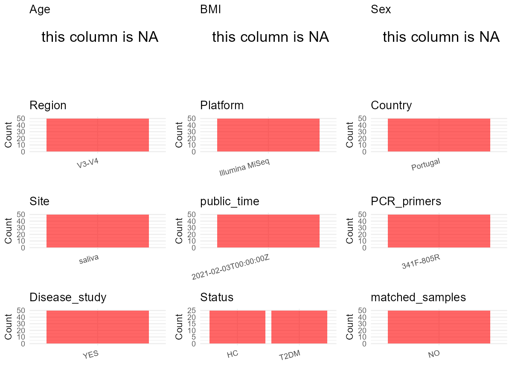

R Notebook: Metadata Processing Workflow
================

# Step 1: Obtain Initial Metadata from Each Project

To obtain the initial metadata: 1. Search for the BioProject ID (e.g.,
“PRJEBXXXX”) on the [NCBI SRA
website](https://www.ncbi.nlm.nih.gov/Traces/study/). 2. In the “Select”
table, click on “Metadata” and download the file. 3. The downloaded file
is typically named “SraRunTable.csv” and contains metadata for the
project.

``` r
# Load necessary libraries
library(dplyr)
library(ggplot2)
library(cowplot)

# Set working directory (update this path to your local directory)
setwd("D:/oral_project/PRJNA679485")

# Read the initial metadata files
initial_meta<-read.csv("SraRunTable.csv",header = T)

# Combine the two metadata files
#meta <- rbind(initial_meta, initial_meta1)

#Remove entries non-oral samples
#initial_meta <- subset(initial_meta,isolate %in% c("saliva","tongue coat"))

# Check the number of samples containing "HT" in Sample.Name (e.g., healthy controls)
#nrow(subset(meta, grepl("HT", Sample.Name)))

# Display the first few rows of the metadata
head(initial_meta)
```

    ##           Run Assay.Type AvgSpotLen     Bases  BioProject    BioSample
    ## 1 SRR13084906   AMPLICON        500 113810000 PRJNA679485 SAMN16836434
    ## 2 SRR13084907   AMPLICON        500 182619000 PRJNA679485 SAMN16836433
    ## 3 SRR13084908   AMPLICON        500 338507000 PRJNA679485 SAMN16836432
    ## 4 SRR13084909   AMPLICON        500 188500500 PRJNA679485 SAMN16836431
    ## 5 SRR13084910   AMPLICON        500 151396500 PRJNA679485 SAMN16836430
    ## 6 SRR13084911   AMPLICON        500  75939000 PRJNA679485 SAMN16836474
    ##                BioSampleModel     Bytes Center.Name Collection_Date Consent
    ## 1 Metagenome or environmental  39749768       CIBIO      2020-04-24  public
    ## 2 Metagenome or environmental  63702007       CIBIO      2020-04-23  public
    ## 3 Metagenome or environmental 118360551       CIBIO      2020-04-22  public
    ## 4 Metagenome or environmental  65494191       CIBIO      2020-04-05  public
    ## 5 Metagenome or environmental  61263132       CIBIO      2020-04-01  public
    ## 6 Metagenome or environmental  27000803       CIBIO      2020-04-06  public
    ##   DATASTORE.filetype DATASTORE.provider                     DATASTORE.region
    ## 1   fastq,run.zq,sra         gs,ncbi,s3 gs.us-east1,ncbi.public,s3.us-east-1
    ## 2   fastq,run.zq,sra         gs,ncbi,s3 gs.us-east1,ncbi.public,s3.us-east-1
    ## 3   fastq,run.zq,sra         gs,ncbi,s3 gs.us-east1,ncbi.public,s3.us-east-1
    ## 4   fastq,run.zq,sra         gs,ncbi,s3 gs.us-east1,ncbi.public,s3.us-east-1
    ## 5   fastq,run.zq,sra         gs,ncbi,s3 gs.us-east1,ncbi.public,s3.us-east-1
    ## 6   fastq,run.zq,sra         gs,ncbi,s3 gs.us-east1,ncbi.public,s3.us-east-1
    ##   Experiment geo_loc_name_country geo_loc_name_country_continent
    ## 1 SRX9531597             Portugal                         Europe
    ## 2 SRX9531596             Portugal                         Europe
    ## 3 SRX9531595             Portugal                         Europe
    ## 4 SRX9531594             Portugal                         Europe
    ## 5 SRX9531593             Portugal                         Europe
    ## 6 SRX9531592             Portugal                         Europe
    ##      geo_loc_name         HOST     Instrument isolation_source
    ## 1 Portugal: Porto Homo sapiens Illumina MiSeq           saliva
    ## 2 Portugal: Porto Homo sapiens Illumina MiSeq           saliva
    ## 3 Portugal: Porto Homo sapiens Illumina MiSeq           saliva
    ## 4 Portugal: Porto Homo sapiens Illumina MiSeq           saliva
    ## 5 Portugal: Porto Homo sapiens Illumina MiSeq           saliva
    ## 6  Portugal: GAIA Homo sapiens Illumina MiSeq           saliva
    ##                  lat_lon Library.Name LibraryLayout LibrarySelection
    ## 1 41.105065 N 8.591587 W          C21        PAIRED              PCR
    ## 2 41.105064 N 8.591587 W          C20        PAIRED              PCR
    ## 3 41.105066 N 8.591586 W          c12        PAIRED              PCR
    ## 4 41.105061 N 8.591587 W           c9        PAIRED              PCR
    ## 5 41.105060 N 8.591587 W           c8        PAIRED              PCR
    ## 6 41.105065 N 8.591587 W         DM36        PAIRED              PCR
    ##   LibrarySource   Organism Platform          ReleaseDate          create_date
    ## 1   METAGENOMIC metagenome ILLUMINA 2021-02-03T00:00:00Z 2020-11-19T10:30:00Z
    ## 2   METAGENOMIC metagenome ILLUMINA 2021-02-03T00:00:00Z 2020-11-19T10:30:00Z
    ## 3   METAGENOMIC metagenome ILLUMINA 2021-02-03T00:00:00Z 2020-11-19T10:30:00Z
    ## 4   METAGENOMIC metagenome ILLUMINA 2021-02-03T00:00:00Z 2020-11-19T10:30:00Z
    ## 5   METAGENOMIC metagenome ILLUMINA 2021-02-03T00:00:00Z 2020-11-19T10:31:00Z
    ## 6   METAGENOMIC metagenome ILLUMINA 2021-02-03T00:00:00Z 2020-11-19T10:30:00Z
    ##   version Sample.Name SRA.Study
    ## 1       1         C21 SRP293247
    ## 2       1         C20 SRP293247
    ## 3       1         c12 SRP293247
    ## 4       1          c9 SRP293247
    ## 5       1          c8 SRP293247
    ## 6       1        DM36 SRP293247

# Step 2: Create a Uniform Metadata Template

The uniform metadata should include the following columns:

1.  **BioProject**: Project ID (e.g., “PRJNA339212”)
2.  **Run**: Sample ID (e.g., “ERRXXXXXX” or “SRRXXXXXX”)
3.  **sample_name**: Original sample name submitted by the authors (not
    the database-assigned ID)
4.  **Age**: Age of the subject (if available)
5.  **BMI**: Body Mass Index (if available)
6.  **Sex**: Sex of the subject (“F” or “M”)
7.  **Region**: Targeted 16S rRNA region (e.g., “V3-V4”)
8.  **Platform**: Sequencing platform (e.g., “Illumina MiSeq”)
9.  **Country**: Country of sample origin (e.g., “China”)
10. **Site**: Sample site (e.g., “saliva”, “dental plaque”)
11. **public_time**: Data release date (format: “YYYY-MM-DD”)
12. **PCR_primers**: PCR primers used (e.g., “515F-806R”)
13. **title**: Title of the associated publication
14. **Disease_study**: Whether the study involves a disease (“YES” or
    “NO”)
15. **Status**: Disease status (e.g., “T2DM”, “HC”). Note: If the study
    includes both disease and healthy samples, this must be specified
    per sample.
16. **matched_samples**: matched samples (“YES” or “NO”)

``` r
# Create a uniform metadata dataframe
metadata <- data.frame(
  BioProject = initial_meta$BioProject,
  Run = initial_meta$Run,
  sample_name = initial_meta$Sample.Name,
  Age = NA,
  BMI = NA,
  Sex = NA,
  Region = "V3-V4",
  Platform = initial_meta$Instrument,
  Country = initial_meta$geo_loc_name_country,
  Site = initial_meta$isolation_source,
  public_time = initial_meta$ReleaseDate,
  stringsAsFactors = FALSE
)
```

# Step 3: Manually Add Information from the Publication

Some information (e.g. PCR primers, study title, disease status) must be
manually extracted from the publication and added to the metadata.

``` r
# Add information obtained from the publication
metadata$PCR_primers <- "341F-805R"
metadata$title <- "Characterization of the Oral Microbiome of Medicated Type-2 Diabetes Patients"
metadata$Disease_study <- "YES"
# Assign disease status based on sample_name patterns
metadata <- metadata %>%
  mutate(Status = case_when(
    grepl("C|c", sample_name) ~ "HC",
    grepl("DM|Dm", sample_name) ~ "T2DM"
  ))

#get subjects id according to sample id
metadata$sample_name<-gsub("C|c|DM|Dm","",metadata$sample_name)
#get subjects id with Saliva available
keep_subjects<-subset(metadata,Site %in% "saliva")
#remove subjects without Saliva samples
metadata<-subset(metadata,sample_name %in% keep_subjects$sample_name)
#get subjects sampling counts
sample_counts <- table(metadata$sample_name)
# Create matched_samples column, any subjects have >=2 samples will be label "YES", otherwise "NO"
metadata <- metadata %>%
  group_by(sample_name) %>%
  mutate(
    sample_count = n(),
    unique_sites = n_distinct(Site),
    matched_samples = ifelse(sample_count >= 2 & unique_sites >= 2, "YES", "NO")
  ) %>%
  select(-sample_count, -unique_sites)  # 移除临时列
```

# Step 4: Summarize and Validate the Metadata

``` r
# Check the number of unique runs and sample names
print(paste("Number of unique runs:", length(unique(metadata$Run))))
```

    ## [1] "Number of unique runs: 50"

``` r
print(paste("Number of unique sample names:", length(unique(metadata$sample_name))))
```

    ## [1] "Number of unique sample names: 34"

# Step 5: Visualize the Metadata

``` r

```


# Step 6: Finalize and Export the Metadata

``` r
# Reorder columns to match the desired format
metadata <- metadata[, c(
  "BioProject", "Run", "sample_name", "Age", "BMI", "Sex", 
  "Region", "Platform", "Country", "Site", "public_time", 
  "PCR_primers", "title", "Disease_study", "Status","matched_samples"
)]

# Export the uniform metadata to a CSV file
write.csv(metadata, file = "metadata.csv", quote = TRUE)
head(metadata)
```

    ## # A tibble: 6 × 16
    ## # Groups:   sample_name [6]
    ##   BioProject  Run    sample_name Age   BMI   Sex   Region Platform Country Site 
    ##   <chr>       <chr>  <chr>       <lgl> <lgl> <lgl> <chr>  <chr>    <chr>   <chr>
    ## 1 PRJNA679485 SRR13… 21          NA    NA    NA    V3-V4  Illumin… Portug… sali…
    ## 2 PRJNA679485 SRR13… 20          NA    NA    NA    V3-V4  Illumin… Portug… sali…
    ## 3 PRJNA679485 SRR13… 12          NA    NA    NA    V3-V4  Illumin… Portug… sali…
    ## 4 PRJNA679485 SRR13… 9           NA    NA    NA    V3-V4  Illumin… Portug… sali…
    ## 5 PRJNA679485 SRR13… 8           NA    NA    NA    V3-V4  Illumin… Portug… sali…
    ## 6 PRJNA679485 SRR13… 36          NA    NA    NA    V3-V4  Illumin… Portug… sali…
    ## # ℹ 6 more variables: public_time <chr>, PCR_primers <chr>, title <chr>,
    ## #   Disease_study <chr>, Status <chr>, matched_samples <chr>

## Notes for Students:

1.  **Metadata Accuracy**: Always cross-check the metadata with the
    original publication to ensure accuracy.
2.  **Manual Entries**: Columns like `PCR_primers`, and `Status` often
    require manual entry based on the publication.
3.  **Disease Status**: Be careful when assigning `Status`—some studies
    include both disease and healthy samples.
4.  **Visualization**: The plots help quickly identify the distribution
    of values in each column, which is useful for quality control.
5.  **Reproducibility**: Update the working directory and file paths to
    match your local environment.
