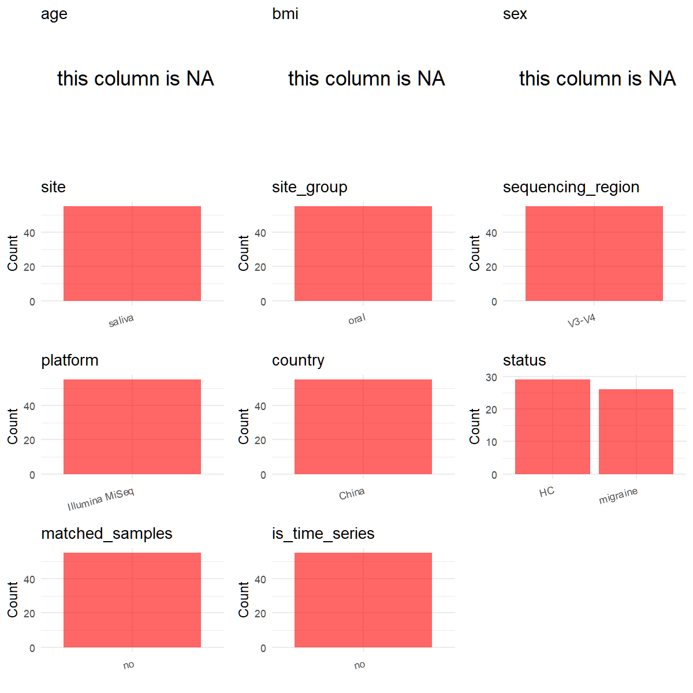

# Step 1: Obtain Initial Metadata from Each Project

This step sets the project directory and loads the raw SRA metadata.

```{r message=FALSE, warning=FALSE}
# Load libraries
library(dplyr)
library(ggplot2)
library(cowplot)

# (1) Setting working directory
project_id <- "PRJNA680860"

base_dir <- "E:/工作区/VSCode/RNAproject/collect_metadata_respon/project"
setwd(file.path(base_dir, project_id))

# (2) Loading raw SRA metadata file
sra_file <- "SraRunTable.csv"
initial_meta <- read.csv(sra_file, header = TRUE, stringsAsFactors = FALSE)
```

# Step 2: Data Overview

First, you need to get an overview of the data, which includes two steps: reading the article and reading the initial metadata. This step is very IMPORTANT!

```{r message=FALSE, warning=FALSE}
# (1) Read the article in the following order: abstract, the beginning of the results section, and the methods.
# Paper summary used for this project:
# - Title: A 16S rRNA gene sequencing based study of oral microbiota in migraine patients in China.
# - Study design: cross-sectional case-control study.
# - Main cohort: 55 individuals total, including 26 migraine patients and 29 healthy controls.
# - Demographic summary from Table 1 is group-level only: migraine age 39.5 +/- 10.6 years, control age 39.0 +/- 10.1 years; migraine BMI 21.4 +/- 3.2, control BMI 22.0 +/- 2.8; females were 22/26 in migraine and 24/29 in controls; participant age range was 25-58 years.
# - Sampling design: unstimulated saliva samples only.
# - Recruitment geography: Shanghai, China; controls were matched to cases by age and sex and lived in the same city.
# - Sequencing workflow: universal primers 341 F and 806 R targeting the 16S rRNA V3-V4 region, sequenced on an Illumina MiSeq platform.
# - Accessible paper text does not print exact nucleotide primer sequences.
# - Supplemental data exist for the article, but no sample-level age, BMI, sex, or subject manifest worth joining into initial_meta was identified during review.
# - Local SRA has 55 rows total, all oral metagenome saliva samples, with 55 unique runs and 55 unique Sample Name values.
# - Local sample names split into 26 MS-* migraine rows and 29 CS-* control rows.
# - Local SRA Instrument is Illumina HiSeq 2500, but platform follows the paper methods and is curated as Illumina MiSeq.

# (2) IMPORTANT: MUST go through each column of initial_meta
head(initial_meta, 10)
colnames(initial_meta)
table(initial_meta$BioProject)
table(initial_meta$env_medium)
table(initial_meta$geo_loc_name_country)
table(initial_meta$geo_loc_name)
table(initial_meta$Collection_Date)
table(initial_meta$ReleaseDate)
table(initial_meta$Organism)
table(sub("-.*$", "", initial_meta$Sample.Name))
unique(initial_meta$Instrument)
# The raw table directly provides run IDs, submitted sample labels, saliva site, China geography, release time, and case/control prefixes in Sample.Name, but not per-sample age, BMI, or sex.
```

## Field evidence map

Before building the standardized metadata table, record the evidence source for each target column.

- `bioproject`: from `SraRunTable.csv` column `BioProject`.
- `sample_id`: from `SraRunTable.csv` column `Run`.
- `subject_id`: from `SraRunTable.csv` column `Sample Name`; each retained label appears once and there is no repeated sampling.
- `age`: not available at sample level in SRA or paper, so keep `NA`.
- `age_info`: from paper Table 1 and clinical summary; only group-level age information is available.
- `bmi`: not available at sample level in SRA or paper, so keep `NA`.
- `sex`: not available at sample level in SRA or paper, so keep `NA`.
- `sequencing_region`: from paper methods; `V3-V4`.
- `platform`: from paper methods; `Illumina MiSeq`, overriding conflicting SRA `Instrument`.
- `country`: supported by paper recruitment location and `SraRunTable.csv` columns `geo_loc_name_country` / `geo_loc_name`.
- `site`: supported by paper sampling description and `SraRunTable.csv` column `env_medium`; all retained rows are `saliva`.
- `site_group`: derived from curated `site`; `saliva` maps to `oral`.
- `public_time`: from `SraRunTable.csv` column `ReleaseDate` after stripping the time suffix.
- `pcr_primers`: from paper methods; `341F-806R` as primer-pair names because exact nucleotide sequences were not printed.
- `title`: from the paper title page.
- `disease_study`: from the paper design; this is a migraine case-control disease study.
- `status`: derived from `SraRunTable.csv` column `Sample Name`; `MS-*` maps to `migraine`, `CS-*` maps to `HC`.
- `matched_samples`: derived from unique `subject_id`; all rows are single samples without repeated biological sampling.
- `is_time_series`: from the paper design; this is cross-sectional, not longitudinal.

# Step 3: Removing Control and Non-human Samples

First, we need to remove control samples(including both negative controls and positive controls) and non-human samples.

```{r}
# (1) Parameter setup
control_column <- ""
control_keywords <- c()

species_column <- "Organism"
unique(initial_meta[[species_column]])
non_human_keywords <- c()

# (2) Remove controls and non-human samples. DO NOT need to modify code in this part, just run it.
n_samples <- nrow(initial_meta)
# Control evaluation
if (length(control_keywords) > 0) {
  if (is.null(control_column) || control_column == "") {
    stop("Error: control_keywords provided but control_column is missing.")
  }

  if (!(control_column %in% colnames(initial_meta))) {
    stop(sprintf("Error: Column '%s' not found in initial_meta.", control_column))
  }

  control_pattern <- paste(control_keywords, collapse = "|")
  control_text <- initial_meta[[control_column]]
  is_control <- grepl(control_pattern, control_text)

} else {
  is_control <- rep(FALSE, n_samples)
}

# Non-human evaluation
if (length(non_human_keywords) > 0) {
  if (is.null(species_column) || species_column == "") {
    stop("Error: non_human_keywords provided but species_column is missing.")
  }

  if (!(species_column %in% colnames(initial_meta))) {
    stop(sprintf("Error: Column '%s' not found in initial_meta.", species_column))
  }

  non_human_pattern <- paste(non_human_keywords, collapse = "|")
  species_text <- initial_meta[[species_column]]
  is_non_human <- grepl(non_human_pattern, species_text)
} else {
  is_non_human <- rep(FALSE, n_samples)
}

# Execute removal
samples_to_remove <- is_control | is_non_human
initial_meta <- initial_meta[!samples_to_remove, ]

cat("Initial samples counts:", n_samples, "\n")
cat("Removed control samples:", sum(is_control), "\n")
cat("Removed non-human samples:", sum(is_non_human), "\n")
cat("Total samples removed ", sum(samples_to_remove), "\n")
cat("Remaining samples after Step 2:", nrow(initial_meta), "\n")
```

# Step 4: Creating a Uniform Metadata Template

This step converts the raw SRA table into the standard metadata format used in our meta-analysis.

```{r}
metadata <- data.frame(
  bioproject = initial_meta$BioProject,
  sample_id = initial_meta$Run,
  subject_id = initial_meta$Sample.Name,
  raw_group = initial_meta$Sample.Name,
  age = NA_real_,
  age_info = "25-58 years; migraine mean 39.5 (SD 10.6); control mean 39.0 (SD 10.1)",
  bmi = NA_real_,
  sex = NA_character_,
  sequencing_region = "V3-V4",
  platform = "Illumina MiSeq",
  country = "China",
  site = "saliva",
  site_group = "pending",
  public_time = sub("T.*$", "", initial_meta$ReleaseDate),
  pcr_primers = "341F-806R",
  title = "A 16S rRNA gene sequencing based study of oral microbiota in migraine patients in China",
  disease_study = "yes",
  status = "pending",
  matched_samples = "pending",
  is_time_series = "no",
  stringsAsFactors = FALSE
)

# Source notes for non-obvious fields:
# - subject_id uses Sample.Name because each retained row corresponds to one unique saliva sample label and there is no repeated sampling in the local SRA table.
# - age, bmi, and sex remain NA because the paper reports only group-level summaries rather than per-sample values.
# - platform follows the paper methods (Illumina MiSeq), not the SRA Instrument column (Illumina HiSeq 2500).
# - pcr_primers stores the paper-reported primer pair names because the accessible article text gives 341 F and 806 R but not the exact nucleotide sequences.
metadata$public_time <- as.Date(metadata$public_time)
```

# Step 5: Manually solving pending issues

This step involves two parts: (1) handle the columns with the `raw_` prefix, and next (2) handle the `site_group` and `matched_samples` columns.

```{r}
# (1) Handle the columns with the `raw_` prefix.
metadata <- metadata %>%
  mutate(
    status = case_when(
      grepl("^MS-", raw_group) ~ "migraine",
      grepl("^CS-", raw_group) ~ "HC",
      TRUE ~ NA_character_
    )
  )
# The submitted sample labels encode migraine cases (MS-*) versus controls (CS-*), matching the paper's case-control design.
```

```{r}
# (2) Filling the 'site_group' and 'matched_samples' columns
unique(metadata$site)
Oral_site = c("saliva")
Gut_site = c("feces")

metadata <- metadata %>%
  mutate(site_group = case_when(
    site %in% Oral_site ~ "oral",
    site %in% Gut_site ~ "gut",
    TRUE ~ "other"
  ))

metadata$matched_samples <- ifelse(
  ave(metadata$subject_id, metadata$subject_id, FUN = length) > 1,
  "yes",
  "no"
)
# Each subject_id appears once in this cross-sectional cohort, so there is no matched repeated sampling.
```

```{r}
# (3) check if there is pending value in metadata. If there is pending value, go on modify the metadata.
has_pending <- function(col) {
  if (is.character(col) || is.factor(col)) {
    any(col == "pending", na.rm = TRUE)
  } else {
    FALSE
  }
}

any_pending_value <- any(sapply(metadata, has_pending))

if (!any_pending_value) {
  message("Good! No cell contains the value 'pending'.")
} else {
  pending_cols <- names(metadata)[sapply(metadata, has_pending)]
  message("Columns containing 'pending': ", paste(pending_cols, collapse = ", "))
  message("Please continue to resolve these pending columns!")
}
```

# Step 6: Visualize the Metadata

This step makes a quick set of plots for checking the distribution of key metadata fields.

```{r}
plot_data <- metadata %>%
  select(-bioproject, -sample_id, -subject_id, -age_info, -pcr_primers,
         -title, -raw_group)

create_simple_plots <- function(data) {
  plots <- list()
  continuous_vars <- c("age", "bmi")

  for (col in colnames(data)) {
    if (all(is.na(data[[col]]))) {
      p <- ggplot() +
        annotate("text", x = 0.5, y = 0.5, label = "this column is NA", size = 6) +
        labs(title = col) +
        theme_void()
    } else if (col %in% continuous_vars && is.numeric(data[[col]])) {
      p <- ggplot(data, aes(x = .data[[col]])) +
        geom_histogram(fill = "blue", alpha = 0.6, bins = 20, na.rm = TRUE) +
        labs(title = col, x = col, y = "Count") +
        theme_minimal()
    } else {
      count_data <- as.data.frame(table(data[[col]], useNA = "ifany"))
      p <- ggplot(count_data, aes(x = reorder(Var1, -Freq), y = Freq)) +
        geom_col(fill = "red", alpha = 0.6) +
        labs(title = col, x = NULL, y = "Count") +
        theme_minimal() +
        theme(axis.text.x = element_text(angle = 15, hjust = 1))
    }
    plots[[col]] <- p
  }

  return(plots)
}

plots <- create_simple_plots(plot_data)
p <- plot_grid(plots$age,
               plots$bmi,
               plots$sex,
               plots$site,
               plots$site_group,
               plots$sequencing_region,
               plots$platform,
               plots$country,
               plots$status,
               plots$matched_samples,
               plots$is_time_series,
               ncol = 3, align = "hv", axis = "lb")
ggsave("Metadata_Summary.png", plot = p, width = 8, height = 8, dpi = 150)
```

```{r}

```

# Step 7: Sort and export the metadata

This step saves the cleaned metadata table as the final `metadata_v2.csv` file.

```{r}
fixed_cols <- c("bioproject", "sample_id", "subject_id", "age", "age_info",
                "bmi", "sex", "platform", "sequencing_region", "pcr_primers",
                "country", "site", "site_group", "disease_study", "status",
                "title", "public_time", "matched_samples", "is_time_series")
metadata <- metadata %>%
  select(all_of(fixed_cols), starts_with("raw_"))

write.csv(metadata, file = "metadata_v2.csv", quote = TRUE, row.names = FALSE)
```
