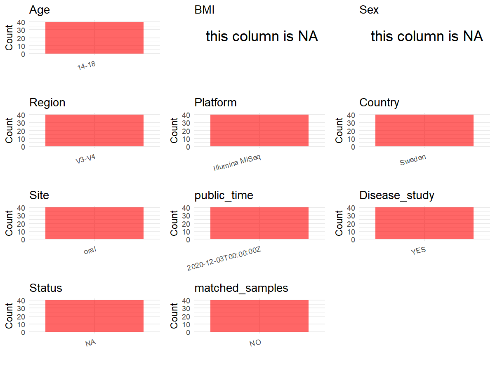

R Notebook: Metadata Processing Workflow
================

# Step 1: Obtain Initial Metadata from Each Project

To obtain the initial metadata: 1. Search for the BioProject ID (e.g.,
“PRJEBXXXX”) on the [NCBI SRA
website](https://www.ncbi.nlm.nih.gov/Traces/study/). 2. In the “Select”
table, click on “Metadata” and download the file. 3. The downloaded file
is typically named “SraRunTable.csv” and contains metadata for the
project.

``` r
library(dplyr)
```

    ## Warning: package 'dplyr' was built under R version 4.5.1

    ## 
    ## Attaching package: 'dplyr'

    ## The following objects are masked from 'package:stats':
    ## 
    ##     filter, lag

    ## The following objects are masked from 'package:base':
    ## 
    ##     intersect, setdiff, setequal, union

``` r
library(ggplot2)
```

    ## Warning: package 'ggplot2' was built under R version 4.5.1

``` r
library(cowplot)
```

    ## Warning: package 'cowplot' was built under R version 4.5.1

``` r
setwd("D:/PRJNA681486")
initial_meta<-read.csv("SraRunTable .csv",header = T)
head(initial_meta)
```

    ##           Run Assay.Type AvgSpotLen     Bases  BioProject    BioSample
    ## 1 SRR13194555   AMPLICON        598  35138546 PRJNA681486 SAMN16954691
    ## 2 SRR13194556   AMPLICON        598  52194781 PRJNA681486 SAMN16954740
    ## 3 SRR13194557   AMPLICON        597  57942994 PRJNA681486 SAMN16954740
    ## 4 SRR13194558   AMPLICON        598  33690852 PRJNA681486 SAMN16954691
    ## 5 SRR13194559   AMPLICON        598 125882358 PRJNA681486 SAMN16954691
    ## 6 SRR13194560   AMPLICON        597  27333249 PRJNA681486 SAMN16954740
    ##                BioSampleModel    Bytes Center.Name Collection_Date Consent
    ## 1 Metagenome or environmental 21916539     FISABIO      2020-01-01  public
    ## 2 Metagenome or environmental 32973757     FISABIO      2020-01-01  public
    ## 3 Metagenome or environmental 36060264     FISABIO      2020-01-01  public
    ## 4 Metagenome or environmental 21366333     FISABIO      2020-01-01  public
    ## 5 Metagenome or environmental 78648832     FISABIO      2020-01-01  public
    ## 6 Metagenome or environmental 17031694     FISABIO      2020-01-01  public
    ##   DATASTORE.filetype DATASTORE.provider                     DATASTORE.region
    ## 1   fastq,run.zq,sra         gs,ncbi,s3 gs.us-east1,ncbi.public,s3.us-east-1
    ## 2   fastq,run.zq,sra         gs,ncbi,s3 gs.us-east1,ncbi.public,s3.us-east-1
    ## 3   fastq,run.zq,sra         gs,ncbi,s3 gs.us-east1,ncbi.public,s3.us-east-1
    ## 4   fastq,run.zq,sra         gs,ncbi,s3 gs.us-east1,ncbi.public,s3.us-east-1
    ## 5   fastq,run.zq,sra         gs,ncbi,s3 gs.us-east1,ncbi.public,s3.us-east-1
    ## 6   fastq,run.zq,sra         gs,ncbi,s3 gs.us-east1,ncbi.public,s3.us-east-1
    ##   Experiment geo_loc_name_country geo_loc_name_country_continent geo_loc_name
    ## 1 SRX9628763               Sweden                         Europe       Sweden
    ## 2 SRX9628762               Sweden                         Europe       Sweden
    ## 3 SRX9628761               Sweden                         Europe       Sweden
    ## 4 SRX9628760               Sweden                         Europe       Sweden
    ## 5 SRX9628759               Sweden                         Europe       Sweden
    ## 6 SRX9628758               Sweden                         Europe       Sweden
    ##       Instrument isolation_source                 lat_lon   Library.Name
    ## 1 Illumina MiSeq    dental plaque 58.298584 N 12.961619 E 10_R1.fastq.gz
    ## 2 Illumina MiSeq    dental plaque 58.298584 N 12.961619 E  9_R1.fastq.gz
    ## 3 Illumina MiSeq    dental plaque 58.298584 N 12.961619 E  8_R1.fastq.gz
    ## 4 Illumina MiSeq    dental plaque 58.298584 N 12.961619 E  7_R1.fastq.gz
    ## 5 Illumina MiSeq    dental plaque 58.298584 N 12.961619 E  6_R1.fastq.gz
    ## 6 Illumina MiSeq    dental plaque 58.298584 N 12.961619 E  5_R1.fastq.gz
    ##   LibraryLayout LibrarySelection LibrarySource              Organism Platform
    ## 1        PAIRED              PCR   METAGENOMIC human oral metagenome ILLUMINA
    ## 2        PAIRED              PCR   METAGENOMIC human oral metagenome ILLUMINA
    ## 3        PAIRED              PCR   METAGENOMIC human oral metagenome ILLUMINA
    ## 4        PAIRED              PCR   METAGENOMIC human oral metagenome ILLUMINA
    ## 5        PAIRED              PCR   METAGENOMIC human oral metagenome ILLUMINA
    ## 6        PAIRED              PCR   METAGENOMIC human oral metagenome ILLUMINA
    ##            ReleaseDate          create_date version
    ## 1 2020-12-03T00:00:00Z 2020-12-03T16:56:00Z       1
    ## 2 2020-12-03T00:00:00Z 2020-12-03T16:56:00Z       1
    ## 3 2020-12-03T00:00:00Z 2020-12-03T16:56:00Z       1
    ## 4 2020-12-03T00:00:00Z 2020-12-03T16:56:00Z       1
    ## 5 2020-12-03T00:00:00Z 2020-12-03T16:57:00Z       1
    ## 6 2020-12-03T00:00:00Z 2020-12-03T16:56:00Z       1
    ##                                  Sample.Name SRA.Study
    ## 1      Dental plaque microbiota caries group SRP295713
    ## 2 Dental plaque microbiota caries-free group SRP295713
    ## 3 Dental plaque microbiota caries-free group SRP295713
    ## 4      Dental plaque microbiota caries group SRP295713
    ## 5      Dental plaque microbiota caries group SRP295713
    ## 6 Dental plaque microbiota caries-free group SRP295713

# Step 2: Create a Uniform Metadata Template

The uniform metadata should include the following columns:

1.  **BioProject**: Project ID (e.g., “PRJNA339212”)
2.  **Run**: Sample ID (e.g., “ERRXXXXXX” or “SRRXXXXXX”)
3.  **sample_name**: Original sample name submitted by the authors (not
    the database-assigned ID)
4.  **Age**: Age of the subject (if available)
5.  **BMI**: Body Mass Index (if available)
6.  **Sex**: Sex of the subject (“F” or “M”)
7.  **Region**: Targeted 16S rRNA region (e.g., “V3-V4”)
8.  **Platform**: Sequencing platform (e.g., “Illumina MiSeq”)
9.  **Country**: Country of sample origin (e.g., “China”)
10. **Site**: Sample site (e.g., “saliva”, “dental plaque”)
11. **public_time**: Data release date (format: “YYYY-MM-DD”)
12. **PCR_primers**: PCR primers used (e.g., “515F-806R”)
13. **title**: Title of the associated publication
14. **Disease_study**: Whether the study involves a disease (“YES” or
    “NO”)
15. **Status**: Disease status (e.g., “T2DM”, “HC”). Note: If the study
    includes both disease and healthy samples, this must be specified
    per sample.
16. **matched_samples**: matched samples (“YES” or “NO”)

``` r
metadata <- data.frame(
  BioProject = initial_meta$BioProject,
  Run = initial_meta$Run,
  sample_name = initial_meta$Library.Name,
  Platform = initial_meta$Instrument,
  Country = initial_meta$geo_loc_name_country,
  public_time =initial_meta$ReleaseDate,  
  stringsAsFactors = FALSE
)
```

# Step 3: Manually Add Information from the Publication

``` r
 metadata$Age <-"14-18"
 metadata$BMI <- NA_character_
 metadata$Sex <- NA
 metadata$PCR_primers <-"F:5'CCTACGGGNGGCWGCAG; R：5'GACTACHVGGGTATCTAATCC"
 metadata$Region <- "V3-V4"
 metadata$Site <- "oral"
 metadata$title <- "Bacterial Composition and Metabolomics of Dental Plaque From Adolescents"
 metadata$Disease_study <- "YES"
 metadata$Status <- "NA"
metadata$matched_samples <- "NO"
```

``` r
# Check initial data distribution
cat("Initial sample distribution:\n")
```

    ## Initial sample distribution:

``` r
table(metadata$sample_name)
```

    ## 
    ##  1_R1.fastq.gz 10_R1.fastq.gz 11_R1.fastq.gz 12_R1.fastq.gz 13_R1.fastq.gz 
    ##              1              1              1              1              1 
    ## 14_R1.fastq.gz 15_R1.fastq.gz 16_R1.fastq.gz 17_R1.fastq.gz 18_R1.fastq.gz 
    ##              1              1              1              1              1 
    ## 19_R1.fastq.gz  2_R1.fastq.gz 20_R1.fastq.gz 21_R1.fastq.gz 22_R1.fastq.gz 
    ##              1              1              1              1              1 
    ## 23_R1.fastq.gz 24_R1.fastq.gz 25_R1.fastq.gz 26_R1.fastq.gz 27_R1.fastq.gz 
    ##              1              1              1              1              1 
    ## 28_R1.fastq.gz 29_R1.fastq.gz  3_R1.fastq.gz 30_R1.fastq.gz 31_R1.fastq.gz 
    ##              1              1              1              1              1 
    ## 32_R1.fastq.gz 33_R1.fastq.gz 34_R1.fastq.gz 35_R1.fastq.gz 36_R1.fastq.gz 
    ##              1              1              1              1              1 
    ## 37_R1.fastq.gz 38_R1.fastq.gz 39_R1.fastq.gz  4_R1.fastq.gz 40_R1.fastq.gz 
    ##              1              1              1              1              1 
    ##  5_R1.fastq.gz  6_R1.fastq.gz  7_R1.fastq.gz  8_R1.fastq.gz  9_R1.fastq.gz 
    ##              1              1              1              1              1

``` r
table(metadata$Site)
```

    ## 
    ## oral 
    ##   40

``` r
# Calculate sampling frequency per subject
sample_counts <- table(metadata$sample_name)
cat("\nNumber of samples per subject:\n")
```

    ## 
    ## Number of samples per subject:

``` r
print(sample_counts)
```

    ## 
    ##  1_R1.fastq.gz 10_R1.fastq.gz 11_R1.fastq.gz 12_R1.fastq.gz 13_R1.fastq.gz 
    ##              1              1              1              1              1 
    ## 14_R1.fastq.gz 15_R1.fastq.gz 16_R1.fastq.gz 17_R1.fastq.gz 18_R1.fastq.gz 
    ##              1              1              1              1              1 
    ## 19_R1.fastq.gz  2_R1.fastq.gz 20_R1.fastq.gz 21_R1.fastq.gz 22_R1.fastq.gz 
    ##              1              1              1              1              1 
    ## 23_R1.fastq.gz 24_R1.fastq.gz 25_R1.fastq.gz 26_R1.fastq.gz 27_R1.fastq.gz 
    ##              1              1              1              1              1 
    ## 28_R1.fastq.gz 29_R1.fastq.gz  3_R1.fastq.gz 30_R1.fastq.gz 31_R1.fastq.gz 
    ##              1              1              1              1              1 
    ## 32_R1.fastq.gz 33_R1.fastq.gz 34_R1.fastq.gz 35_R1.fastq.gz 36_R1.fastq.gz 
    ##              1              1              1              1              1 
    ## 37_R1.fastq.gz 38_R1.fastq.gz 39_R1.fastq.gz  4_R1.fastq.gz 40_R1.fastq.gz 
    ##              1              1              1              1              1 
    ##  5_R1.fastq.gz  6_R1.fastq.gz  7_R1.fastq.gz  8_R1.fastq.gz  9_R1.fastq.gz 
    ##              1              1              1              1              1

# Step 4: Summarize and Validate the Metadata

``` r
# Check the number of unique runs and sample names
print(paste("Number of unique runs:", length(unique(metadata$Run))))
```

    ## [1] "Number of unique runs: 40"

``` r
print(paste("Number of unique sample names:", length(unique(metadata$sample_name))))
```

    ## [1] "Number of unique sample names: 40"

# Step 5: Visualize the Metadata

``` r

```

<!-- -->

# Step 6: Finalize and Export the Metadata

``` r
# Reorder columns to match the desired format
metadata <- metadata[, c(
  "BioProject", "Run", "sample_name", "Age", "BMI", "Sex", 
  "Region", "Platform", "Country", "Site", "public_time", 
  "PCR_primers", "title", "Disease_study", "Status","matched_samples"
)]

# Export the uniform metadata to a CSV file
write.csv(metadata, file = "metadata.csv", quote = FALSE)
head(metadata)
```

    ##    BioProject         Run    sample_name   Age  BMI Sex Region       Platform
    ## 1 PRJNA681486 SRR13194555 10_R1.fastq.gz 14-18 <NA>  NA  V3-V4 Illumina MiSeq
    ## 2 PRJNA681486 SRR13194556  9_R1.fastq.gz 14-18 <NA>  NA  V3-V4 Illumina MiSeq
    ## 3 PRJNA681486 SRR13194557  8_R1.fastq.gz 14-18 <NA>  NA  V3-V4 Illumina MiSeq
    ## 4 PRJNA681486 SRR13194558  7_R1.fastq.gz 14-18 <NA>  NA  V3-V4 Illumina MiSeq
    ## 5 PRJNA681486 SRR13194559  6_R1.fastq.gz 14-18 <NA>  NA  V3-V4 Illumina MiSeq
    ## 6 PRJNA681486 SRR13194560  5_R1.fastq.gz 14-18 <NA>  NA  V3-V4 Illumina MiSeq
    ##   Country Site          public_time
    ## 1  Sweden oral 2020-12-03T00:00:00Z
    ## 2  Sweden oral 2020-12-03T00:00:00Z
    ## 3  Sweden oral 2020-12-03T00:00:00Z
    ## 4  Sweden oral 2020-12-03T00:00:00Z
    ## 5  Sweden oral 2020-12-03T00:00:00Z
    ## 6  Sweden oral 2020-12-03T00:00:00Z
    ##                                         PCR_primers
    ## 1 F:5'CCTACGGGNGGCWGCAG; R：5'GACTACHVGGGTATCTAATCC
    ## 2 F:5'CCTACGGGNGGCWGCAG; R：5'GACTACHVGGGTATCTAATCC
    ## 3 F:5'CCTACGGGNGGCWGCAG; R：5'GACTACHVGGGTATCTAATCC
    ## 4 F:5'CCTACGGGNGGCWGCAG; R：5'GACTACHVGGGTATCTAATCC
    ## 5 F:5'CCTACGGGNGGCWGCAG; R：5'GACTACHVGGGTATCTAATCC
    ## 6 F:5'CCTACGGGNGGCWGCAG; R：5'GACTACHVGGGTATCTAATCC
    ##                                                                      title
    ## 1 Bacterial Composition and Metabolomics of Dental Plaque From Adolescents
    ## 2 Bacterial Composition and Metabolomics of Dental Plaque From Adolescents
    ## 3 Bacterial Composition and Metabolomics of Dental Plaque From Adolescents
    ## 4 Bacterial Composition and Metabolomics of Dental Plaque From Adolescents
    ## 5 Bacterial Composition and Metabolomics of Dental Plaque From Adolescents
    ## 6 Bacterial Composition and Metabolomics of Dental Plaque From Adolescents
    ##   Disease_study Status matched_samples
    ## 1           YES     NA              NO
    ## 2           YES     NA              NO
    ## 3           YES     NA              NO
    ## 4           YES     NA              NO
    ## 5           YES     NA              NO
    ## 6           YES     NA              NO
