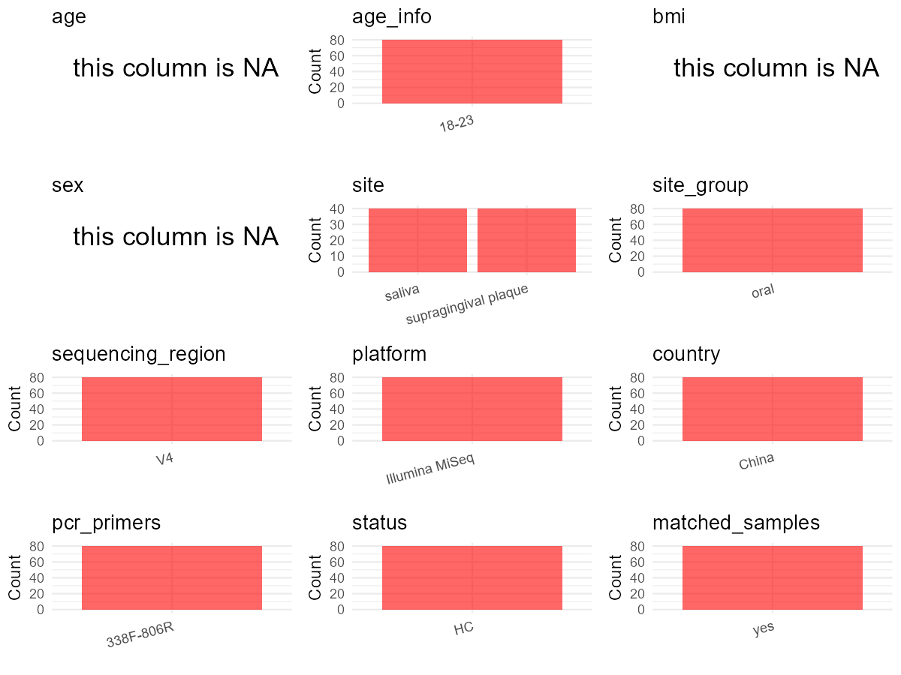

# Step 1: Obtain Initial Metadata from Each Project

This step sets the project directory, loads the raw SRA metadata, and optionally merges supplement tables.

```{r message=FALSE, warning=FALSE}
# =============================================================
# Curation Notes - PRJNA684772
# age        : NA — individual ages not recorded in metadata or supplemental data
# age_info   : "18-23" — paper Methods: "Twenty volunteers aged between 18 and 23"
# sex        : NA — only group aggregate known (5M+5F per group); no per-subject data in metadata
# subject_id : Derived from Library.Name pattern [S/P][C/E][num]; C/E=group, num encodes subject+timepoint
# platform   : Illumina MiSeq — paper Methods, "sequenced on an Illumina MiSeq platform"
# region     : V3-V4 — paper Methods, "V3-V4 region of the 16S rRNA gene was amplified"
# pcr_primers: 338F-806R — paper Methods, primers 338F and 806R
# site       : from env_medium column directly ("saliva" or "supragingival plaque")
# disease_study : "no" — healthy adults, toothpaste intervention study
# is_time_series: "no" — two timepoints only (baseline and week 4); same individual not repeated 3+ times
# controls   : none — no control samples in metadata
# non-human  : none — all Organism = "human oral metagenome", HOST = "Homo sapiens"
# =============================================================

# Load libraries
library(dplyr)
library(ggplot2)
library(cowplot)

# (1) Setting working directory
project_id <- "PRJNA684772"

base_dir <- "D:/YL2025/2026/global-oral-github-YL-v2/global-oral-microbiome/data/projects"
setwd(file.path(base_dir, project_id))

# (2) Loading raw SRA metadata file
sra_file <- "SraRunTable.csv"
initial_meta <- read.csv(sra_file, header = TRUE)

# (3) No supplemental tables available for this study
```

# Step 2: Data Overview

First, you need to get an overview of the data, which includes two steps: reading the article and reading the initial metadata. This step is very IMPORTANT!

```{r message=FALSE, warning=FALSE}
# (1) Paper summary:
# Title: "Tooth brushing using toothpaste containing theaflavins reduces the oral pathogenic bacteria in healthy adults"
# 20 healthy adults, randomly divided into control (no TF toothpaste) and experimental (TF toothpaste) groups
# 5 males and 5 females per group
# Samples collected at baseline (week 0) and post-4 weeks (week 4)
# Sites: saliva and supragingival plaque
# Platform: Illumina MiSeq; Region: V3-V4; Primers: 338F-806R
# Age range: 18-23 years (mean age 21); country: China (Hangzhou)
# 80 total samples: 20 subjects x 2 sites x 2 timepoints

# (2) Check key columns
lapply(initial_meta[c("env_medium", "env_broad_scale")], table)  # site
table(initial_meta$Organism)    # organism — all human oral metagenome, no non-human filtering needed
table(initial_meta$HOST)        # host — all Homo sapiens
table(initial_meta$Platform)    # platform column (ILLUMINA) — paper confirms Illumina MiSeq
# table(initial_meta$Library.Name)  # library names encode group/site/timepoint/subject
```

# Step 3: Removing Control and Non-human Samples

First, we need to remove control samples(including both negative controls and positive controls) and non-human samples.

```{r}
# (1) Parameter setup
control_column <- ""   # no control samples in this study
control_keywords <- c()

species_column <- ""          # all samples are human oral; no non-human filtering needed
non_human_keywords <- c()


# (2) Remove controls and non-human samples. DO NOT need to modify code in this part, just run it.
n_samples <- nrow(initial_meta)
# Control evaluation
if (length(control_keywords) > 0) {
  if (is.null(control_column) || control_column == "") {
    stop("Error: control_keywords provided but control_column is missing.")
  }

  if (!(control_column %in% colnames(initial_meta))) {
    stop(sprintf("Error: Column '%s' not found in initial_meta.", control_column))
  }

  control_pattern <- paste(control_keywords, collapse = "|")
  control_text <- initial_meta[[control_column]]
  is_control <- grepl(control_pattern, control_text)

} else {
  is_control <- rep(FALSE, n_samples)
}

# Non-human evaluation
if (length(non_human_keywords) > 0) {
  if (is.null(species_column) || species_column == "") {
    stop("Error: non_human_keywords provided but species_column is missing.")
  }

  if (!(species_column %in% colnames(initial_meta))) {
    stop(sprintf("Error: Column '%s' not found in initial_meta.", species_column))
  }

  non_human_pattern <- paste(non_human_keywords, collapse = "|")
  species_text <- initial_meta[[species_column]]
  is_non_human <- grepl(non_human_pattern, species_text)
} else {
  is_non_human <- rep(FALSE, n_samples)
}

# Execute removal
samples_to_remove <- is_control | is_non_human
initial_meta <- initial_meta[!samples_to_remove, ]

cat("Initial samples counts:",n_samples,"\n")
cat("Removed control samples:", sum(is_control), "\n")
cat("Removed non-human samples:", sum(is_non_human), "\n")
cat("Total samples removed ", sum(samples_to_remove), "\n")
cat("Remaining samples after Step 2:", nrow(initial_meta), "\n")
```

# Step 4: Creating a Uniform Metadata Template

This step converts the raw SRA table into the standard metadata format used in our meta-analysis.
The uniform metadata should include the following columns:
1. **bioproject**: Project ID from SRA or other database
   e.g. `PRJNA1234`, `CNP1234`, 'OEP1234', 'qiita_1234'
2. **sample_id**: SRA sample/run ID. Unique id for each sample!
   e.g. `DRR1234567`, `ERR1234567` and `SRR1234567`. If no such column exists, can use column like sample_name.
3. **subject_id**: subject id for each person if available.
   e.g. `patient_01`, `Host_03_before`, `subject12`
4. **age**: Age of the subject if available.
   e.g. `35`, `42` | not `adult`, `chilren`
5. **age_info**: If the age is not explicitly stated but approximate age range information is available, mark it in this column.
   e.g., `18-55`, `children`, `infant`, `elder`
6. **bmi**: Body Mass Index if available.
   e.g. `22.5`, `18.9` | not `normal`, `overweight`
7. **sex**: Sex of the subject.
   Mandatory to write as M/F | not `female`, `woman`
8. **sequencing_region**: Targeted 16S rRNA region.
   e.g. `V3-V4`, `V4`
9. **platform**: Sequencing platform.
   e.g. `Illumina MiSeq`, `454 GS FLX Titanium`, `Ion Torrent`
10. **country**: Country of sample origin.
   e.g. `China`, `Japan` | not city name like `Beijing`
11. **site**: Sampling site. For oral and gut sites, specify the exact sites as detailed as possible. For example, if it is known to be supragingival plaque, do not record it as 'dental plaque', unless the original text provides only a vague description.
    e.g. `saliva`, `tongue coating` | not broad term like `oral`
12. **site_group**: only accepts one of following three values: 'oral', 'gut', or 'other'.
13. **public_time**: Data release date.
    e.g. `2021-06-22` | not `June 2021`
14. **pcr_primers**: PCR primers used.
    e.g. `515F-806R`, `27F-338R` | not primer sequences
15. **title**: Title of the associated publication.
16. **disease_study**: Whether the study involves disease samples. If it's not clear, can record as NA. Only three values accepted: 'yes', 'no' or NA
17. **status**: Disease status for each sample if available, else record as NA. Only accept following abbreviations, Write full names for all other diseases.
    HC: healthy control
    CD: Crohn's disease
    CRC: colorectal cancer
    COPD: chronic obstructive pulmonary disease
    HIV: human immunodeficiency virus
    ICU: intensive care unit
    OSCC: oral squamous cell carcinoma
    RA: rheumatoid arthritis
    UC: ulcerative colitis
18. **matched_samples**: Whether the subject has matched samples. Only accept 'yes' or 'no'.
19. **is_time_series**: Whether the study is a time series study. Only accept 'yes' or 'no'.

```{r}
# Pre-compute subject_id from Library.Name
# Format: [S/P][C/E][number] where S=saliva, P=plaque, C=control, E=experiment
# Baseline samples: number = 01-010 (starts with "0")
# Week-4 samples:   number = 41-410 (starts with "4", strip leading "4" to get subject num)
lib_name <- initial_meta$Library.Name
group_letter <- substr(lib_name, 2, 2)  # "C" or "E"
num_str <- substr(lib_name, 3, nchar(lib_name))
subj_str <- ifelse(substr(num_str, 1, 1) == "4",
                   substr(num_str, 2, nchar(num_str)),
                   num_str)
derived_subject_id <- paste0(group_letter, sprintf("%02d", as.integer(subj_str)))

metadata <- data.frame(
  bioproject = initial_meta$BioProject,
  sample_id = initial_meta$Run,
  subject_id = derived_subject_id,  # e.g., C01-C10, E01-E10; derived from Library.Name
  age = NA,
  age_info = "18-23",  # From paper Methods: "Twenty volunteers aged between 18 and 23"
  bmi = NA,
  sex = NA,  # Paper: 5M+5F per group, but no per-subject sex mapping available in metadata
  sequencing_region = "V4",  # The sequencing region described in the article contradicts the general primers provided
  platform = "Illumina MiSeq",  # From paper Methods: "sequenced on an Illumina MiSeq platform"
  country = initial_meta$geo_loc_name_country,  # "China" for all samples
  site = initial_meta$env_medium,  # "saliva" or "supragingival plaque" — exact values, no transform needed
  site_group = "pending",
  public_time = initial_meta$ReleaseDate,
  pcr_primers = "338F-806R",  # From paper Methods: primers 338F and 806R
  title = "Tooth brushing using toothpaste containing theaflavins reduces the oral pathogenic bacteria in healthy adults",
  disease_study = "no",  # Healthy adults; toothpaste intervention study, no disease involved
  status = "HC",
  matched_samples = "pending",
  is_time_series = "no",  # Two timepoints only (baseline + week 4); rule: 3+ required for "yes"
  stringsAsFactors = FALSE
)
metadata$public_time <- as.Date(metadata$public_time)
```

# Step 5: Manually solving pending issues

This step involves two parts: (1) handle the columns with the `raw_` prefix, and next (2) handle the `site_group` and `matched_samples` columns.

```{r}
# (1) No raw_ columns to handle for this study — site is directly from env_medium
```

```{r}
# (2) Filling the 'site_group' and 'matched_samples' columns
# editing site_group
unique(metadata$site)
# Both sites are oral
Oral_site = c("saliva", "supragingival plaque")
Gut_site = c()
# just run
metadata <- metadata %>%
  mutate(site_group = case_when(
    site %in% Oral_site ~ "oral",
    site %in% Gut_site ~ "gut",
    TRUE ~ "other"
  ))

# editing matched_samples, just run.
metadata$matched_samples <- ifelse(
  ave(metadata$subject_id, metadata$subject_id, FUN = length) > 1,
  "yes",
  "no"
)
```

```{r}
# (3) check if there is pending value in metadata. If there is pending value, go on modify the metadata.
# Function to check if a column contains "pending"
has_pending <- function(col) {
  if (is.character(col) || is.factor(col)) {
    any(col == "pending", na.rm = TRUE)
  } else {
    FALSE
  }
}

# Check for any pending value
any_pending_value <- any(sapply(metadata, has_pending))

if (!any_pending_value) {
  message("Good! No cell contains the value 'pending'.")
} else {
  pending_cols <- names(metadata)[sapply(metadata, has_pending)]
  message("Columns containing 'pending': ", paste(pending_cols, collapse = ", "))
  message("Please continue to resolve these pending columns!")
}
```

# Step 6: Visualize the Metadata

This step makes a quick set of plots for checking the distribution of key metadata fields.

```{r}
# Select columns for visualization, just run
plot_data <- metadata %>%
  select(-bioproject, -sample_id, -subject_id, -title)

create_simple_plots <- function(data) {
  plots <- list()
  continuous_vars <- c("age", "bmi")

  for (col in colnames(data)) {
    if (all(is.na(data[[col]]))) {
      p <- ggplot() +
        annotate("text", x = 0.5, y = 0.5, label = "this column is NA", size = 6) +
        labs(title = col) +
        theme_void()
    } else if (col %in% continuous_vars && is.numeric(data[[col]])) {
      p <- ggplot(data, aes(x = .data[[col]])) +
        geom_histogram(fill = "blue", alpha = 0.6, bins = 20, na.rm = TRUE) +
        labs(title = col, x = col, y = "Count") +
        theme_minimal()
    } else {
      count_data <- as.data.frame(table(data[[col]], useNA = "ifany"))
      p <- ggplot(count_data, aes(x = reorder(Var1, -Freq), y = Freq)) +
        geom_col(fill = "red", alpha = 0.6) +
        labs(title = col, x = NULL, y = "Count") +
        theme_minimal() +
        theme(axis.text.x = element_text(angle = 15, hjust = 1))
    }
    plots[[col]] <- p
  }

  return(plots)
}

# Generate and arrange plots
plots <- create_simple_plots(plot_data)
p <- plot_grid(plots$age,
               plots$age_info,
               plots$bmi,
               plots$sex,
               plots$site,
               plots$site_group,
               plots$sequencing_region,
               plots$platform,
               plots$country,
               plots$pcr_primers,
               plots$status,
               plots$matched_samples,
               ncol = 3, align = "hv", axis = "lb")
ggsave("Metadata_Summary_v2.png", plot = p, width = 8, height = 6, dpi = 150)
```

```{r}
# Insert Metadata_Summary.png into the current Rmd output

```

# Step 7: Sort and export the metadata

This step saves the cleaned metadata table as the final `metadata.csv` file.

```{r}
# Reorder the data frame
fixed_cols <- c("bioproject", "sample_id", "subject_id", "age", "age_info",
                "bmi", "sex", "platform", "sequencing_region", "pcr_primers",
                "country", "site", "site_group", "disease_study", "status",
                "title", "public_time", "matched_samples", "is_time_series")
metadata <- metadata %>%
  select(all_of(fixed_cols), everything())

# save metadata
# head(metadata)
write.csv(metadata, file = "metadata_v2.csv", quote = TRUE)
```
