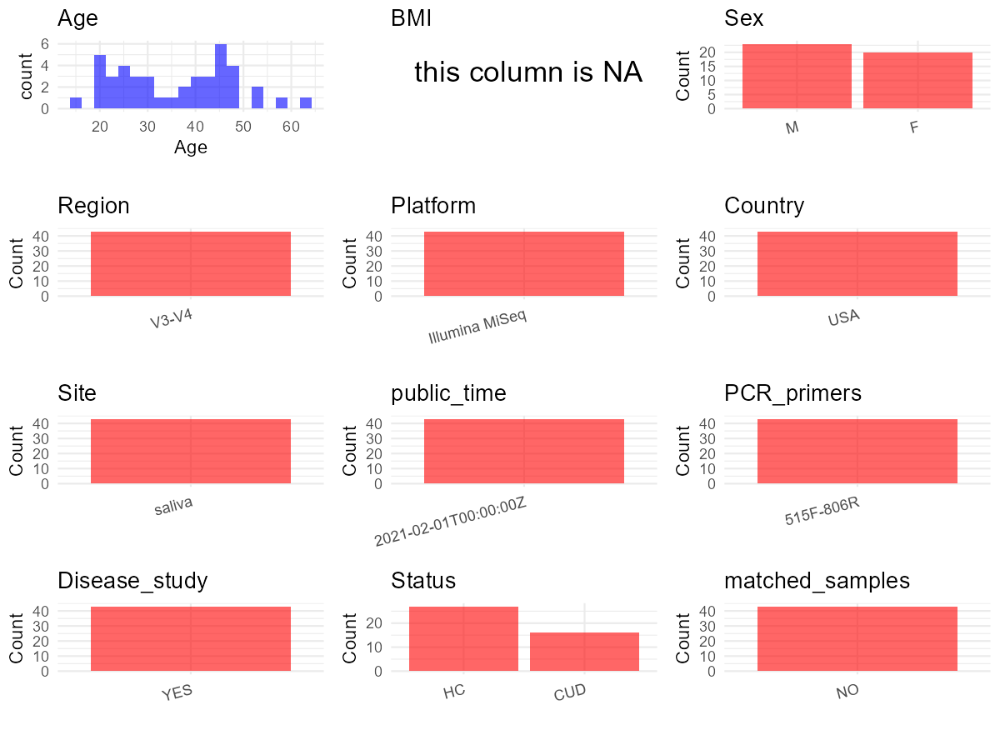

R Notebook: Metadata Processing Workflow
================

# Step 1: Obtain Initial Metadata from Each Project

To obtain the initial metadata: 1. Search for the BioProject ID (e.g.,
“PRJEBXXXX”) on the [NCBI SRA
website](https://www.ncbi.nlm.nih.gov/Traces/study/). 2. In the “Select”
table, click on “Metadata” and download the file. 3. The downloaded file
is typically named “SraRunTable.csv” and contains metadata for the
project.

``` r
# Load necessary libraries
library(dplyr)
library(ggplot2)
library(cowplot)

# Set working directory (update this path to your local directory)
setwd("E:/bioproject_YSD/PRJNA685840")

# Read the initial metadata files
initial_meta <- read.csv("SraRunTable.csv", header = T) 

# Display the first few rows of the metadata
head(initial_meta)
```

    ##           Run AGE Assay.Type AvgSpotLen    Bases
    ## 1 SRR13283034  58      OTHER        502 32460324
    ## 2 SRR13283035  46      OTHER        502 43907430
    ## 3 SRR13283039  44      OTHER        502 26543250
    ## 4 SRR13283050  23      OTHER        502 38963232
    ## 5 SRR13283061  33      OTHER        502 24413766
    ## 6 SRR13283072  47      OTHER        502 31575298
    ##                   BIOMATERIAL_PROVIDER  BioProject    BioSample
    ## 1 Medical University of South Carolina PRJNA685840 SAMN17098154
    ## 2 Medical University of South Carolina PRJNA685840 SAMN17098153
    ## 3 Medical University of South Carolina PRJNA685840 SAMN17098152
    ## 4 Medical University of South Carolina PRJNA685840 SAMN17098151
    ## 5 Medical University of South Carolina PRJNA685840 SAMN17098150
    ## 6 Medical University of South Carolina PRJNA685840 SAMN17098149
    ##                BioSampleModel    Bytes Center.Name Collection_Date Consent
    ## 1 Metagenome or environmental 21887830        MUSC         missing  public
    ## 2 Metagenome or environmental 29096895        MUSC         missing  public
    ## 3 Metagenome or environmental 17751221        MUSC         missing  public
    ## 4 Metagenome or environmental 25879807        MUSC         missing  public
    ## 5 Metagenome or environmental 16434016        MUSC         missing  public
    ## 6 Metagenome or environmental 21178026        MUSC         missing  public
    ##   DATASTORE.filetype DATASTORE.provider                     DATASTORE.region
    ## 1   fastq,run.zq,sra         gs,ncbi,s3 gs.us-east1,ncbi.public,s3.us-east-1
    ## 2   fastq,run.zq,sra         gs,ncbi,s3 gs.us-east1,ncbi.public,s3.us-east-1
    ## 3   fastq,run.zq,sra         gs,ncbi,s3 gs.us-east1,ncbi.public,s3.us-east-1
    ## 4   fastq,run.zq,sra         gs,ncbi,s3 gs.us-east1,ncbi.public,s3.us-east-1
    ## 5   fastq,run.zq,sra         gs,ncbi,s3 gs.us-east1,ncbi.public,s3.us-east-1
    ## 6   fastq,run.zq,sra         gs,ncbi,s3 gs.us-east1,ncbi.public,s3.us-east-1
    ##   Experiment geo_loc_name_country geo_loc_name_country_continent geo_loc_name
    ## 1 SRX9712455         uncalculated                   uncalculated      missing
    ## 2 SRX9712454         uncalculated                   uncalculated      missing
    ## 3 SRX9712450         uncalculated                   uncalculated      missing
    ## 4 SRX9712439         uncalculated                   uncalculated      missing
    ## 5 SRX9712428         uncalculated                   uncalculated      missing
    ## 6 SRX9712417         uncalculated                   uncalculated      missing
    ##           HOST host_sex     Instrument   isolate isolation_source lat_lon
    ## 1 Homo sapiens     male Illumina MiSeq Healthy_7           saliva missing
    ## 2 Homo sapiens   female Illumina MiSeq Healthy_6           saliva missing
    ## 3 Homo sapiens   female Illumina MiSeq Healthy_5           saliva missing
    ## 4 Homo sapiens     male Illumina MiSeq Healthy_4           saliva missing
    ## 5 Homo sapiens   female Illumina MiSeq Healthy_3           saliva missing
    ## 6 Homo sapiens     male Illumina MiSeq Healthy_2           saliva missing
    ##   Library.Name LibraryLayout LibrarySelection LibrarySource
    ## 1         Sa39        PAIRED              PCR         OTHER
    ## 2         Sa38        PAIRED              PCR         OTHER
    ## 3         Sa37        PAIRED              PCR         OTHER
    ## 4         Sa36        PAIRED              PCR         OTHER
    ## 5         Sa34        PAIRED              PCR         OTHER
    ## 6         Sa32        PAIRED              PCR         OTHER
    ##                Organism Platform          ReleaseDate          create_date
    ## 1 human oral metagenome ILLUMINA 2021-02-01T00:00:00Z 2020-12-22T09:05:00Z
    ## 2 human oral metagenome ILLUMINA 2021-02-01T00:00:00Z 2020-12-22T09:07:00Z
    ## 3 human oral metagenome ILLUMINA 2021-02-01T00:00:00Z 2020-12-22T09:06:00Z
    ## 4 human oral metagenome ILLUMINA 2021-02-01T00:00:00Z 2020-12-22T09:07:00Z
    ## 5 human oral metagenome ILLUMINA 2021-02-01T00:00:00Z 2020-12-22T09:07:00Z
    ## 6 human oral metagenome ILLUMINA 2021-02-01T00:00:00Z 2020-12-22T09:07:00Z
    ##   version Sample.Name SRA.Study
    ## 1       1        Sa39 SRP298785
    ## 2       1        Sa38 SRP298785
    ## 3       1        Sa37 SRP298785
    ## 4       1        Sa36 SRP298785
    ## 5       1        Sa34 SRP298785
    ## 6       1        Sa32 SRP298785

# Step 2: Create a Uniform Metadata Template

The uniform metadata should include the following columns:

1.  **BioProject**: Project ID (e.g., “PRJNA339212”)
2.  **Run**: Sample ID (e.g., “ERRXXXXXX” or “SRRXXXXXX”)
3.  **sample_name**: Original sample name submitted by the authors (not
    the database-assigned ID)
4.  **Age**: Age of the subject (if available)
5.  **BMI**: Body Mass Index (if available)
6.  **Sex**: Sex of the subject (“F” or “M”)
7.  **Region**: Targeted 16S rRNA region (e.g., “V3-V4”)
8.  **Platform**: Sequencing platform (e.g., “Illumina MiSeq”)
9.  **Country**: Country of sample origin (e.g., “China”)
10. **Site**: Sample site (e.g., “saliva”, “dental plaque”)
11. **public_time**: Data release date (format: “YYYY-MM-DD”)
12. **PCR_primers**: PCR primers used (e.g., “515F-806R”)
13. **title**: Title of the associated publication
14. **Disease_study**: Whether the study involves a disease (“YES” or
    “NO”)
15. **Status**: Disease status (e.g., “T2DM”, “HC”). Note: If the study
    includes both disease and healthy samples, this must be specified
    per sample.
16. **matched_samples**: matched samples (“YES” or “NO”)

``` r
# Create a uniform metadata dataframe
metadata <- data.frame(
  BioProject = initial_meta$BioProject,
  Run = initial_meta$Run,
  sample_name = initial_meta$Sample.Name,
  Age = initial_meta$AGE,
  BMI = NA,
  Sex = initial_meta$host_sex,
  Region = "V3-V4",
  Platform = initial_meta$Instrument,
  Country = "USA",
  Site = initial_meta$isolation_source,
  public_time = initial_meta$ReleaseDate,
  Status = initial_meta$isolate,
  stringsAsFactors = FALSE
)

# Assign Sex based on host_sex patterns
metadata <- metadata %>%
  mutate(Sex = recode(Sex, "male" = "M", "female" = "F"))
```

# Step 3: Manually Add Information from the Publication

Some information (e.g. PCR primers, study title, disease status) must be
manually extracted from the publication and added to the metadata.

``` r
# Add information obtained from the publication
metadata$PCR_primers <- "515F-806R"
metadata$title <- "Chronic cannabis smoking-enriched oral pathobiont drives behavioral changes macrophage infiltration and increases β-amyloid protein production in the brain"
metadata$Disease_study <- "YES"
# Assign disease status based on sample_name patterns
metadata <- metadata %>%
  mutate(Status = ifelse(grepl("Healthy", Status),"HC",
                         ifelse(grepl("marijuana", Status), "CUD", NA)))

# Check initial data distribution
cat("Initial sample distribution:\n")
```

    ## Initial sample distribution:

``` r
table(metadata$sample_name)
```

    ## 
    ## Sa31 Sa32 Sa34 Sa36 Sa37 Sa38 Sa39 Sa40 Sa41 Sa42 Sa44 Sa45 Sa46 Sa47 Sa49 Sa54 
    ##    1    1    1    1    1    1    1    1    1    1    1    1    1    1    1    1 
    ## Sa55 Sa56 Sa58 Sa59 Sa60 Sa61 Sa64 Sa66 Sa67 Sa70 Sa71 Sa72 Sa73 Sa74 Sa76 Sa82 
    ##    1    1    1    1    1    1    1    1    1    1    1    1    1    1    1    1 
    ## Sa83 Sa85 Sa86 Sa87 Sa88 Sa89 Sa90 Sa91 Sa92 Sa93 Sa94 
    ##    1    1    1    1    1    1    1    1    1    1    1

``` r
table(metadata$Site)
```

    ## 
    ## saliva 
    ##     43

``` r
# Calculate sampling frequency per subject
sample_counts <- table(metadata$sample_name)
cat("\nNumber of samples per subject:\n")
```

    ## 
    ## Number of samples per subject:

``` r
print(sample_counts)
```

    ## 
    ## Sa31 Sa32 Sa34 Sa36 Sa37 Sa38 Sa39 Sa40 Sa41 Sa42 Sa44 Sa45 Sa46 Sa47 Sa49 Sa54 
    ##    1    1    1    1    1    1    1    1    1    1    1    1    1    1    1    1 
    ## Sa55 Sa56 Sa58 Sa59 Sa60 Sa61 Sa64 Sa66 Sa67 Sa70 Sa71 Sa72 Sa73 Sa74 Sa76 Sa82 
    ##    1    1    1    1    1    1    1    1    1    1    1    1    1    1    1    1 
    ## Sa83 Sa85 Sa86 Sa87 Sa88 Sa89 Sa90 Sa91 Sa92 Sa93 Sa94 
    ##    1    1    1    1    1    1    1    1    1    1    1

``` r
# Create matched_samples column
metadata$matched_samples <- ifelse(metadata$sample_name %in% names(sample_counts[sample_counts >= 2]), "YES", "NO")

cat("\nMatched samples distribution:\n")
```

    ## 
    ## Matched samples distribution:

``` r
table(metadata$matched_samples)
```

    ## 
    ## NO 
    ## 43

``` r
# Identify samples for removal: single samples excluding saliva
single_samples <- names(sample_counts[sample_counts == 1])
samples_to_remove <- metadata$sample_name %in% single_samples & 
                     !(metadata$Site %in% c("saliva"))

cat("\nNumber of samples to be removed:", sum(samples_to_remove), "\n")
```

    ## 
    ## Number of samples to be removed: 0

``` r
# Remove identified samples
metadata_clean <- metadata[!samples_to_remove, ]

cat("\nFinal sample distribution after cleaning:\n")
```

    ## 
    ## Final sample distribution after cleaning:

``` r
table(metadata_clean$sample_name)
```

    ## 
    ## Sa31 Sa32 Sa34 Sa36 Sa37 Sa38 Sa39 Sa40 Sa41 Sa42 Sa44 Sa45 Sa46 Sa47 Sa49 Sa54 
    ##    1    1    1    1    1    1    1    1    1    1    1    1    1    1    1    1 
    ## Sa55 Sa56 Sa58 Sa59 Sa60 Sa61 Sa64 Sa66 Sa67 Sa70 Sa71 Sa72 Sa73 Sa74 Sa76 Sa82 
    ##    1    1    1    1    1    1    1    1    1    1    1    1    1    1    1    1 
    ## Sa83 Sa85 Sa86 Sa87 Sa88 Sa89 Sa90 Sa91 Sa92 Sa93 Sa94 
    ##    1    1    1    1    1    1    1    1    1    1    1

``` r
table(metadata_clean$Site)
```

    ## 
    ## saliva 
    ##     43

``` r
table(metadata_clean$matched_samples)
```

    ## 
    ## NO 
    ## 43

``` r
# Use cleaned dataset for subsequent analysis
metadata <- metadata_clean
```

# Step 4: Summarize and Validate the Metadata

``` r
# Check the number of unique runs and sample names
print(paste("Number of unique runs:", length(unique(metadata$Run))))
```

    ## [1] "Number of unique runs: 43"

``` r
print(paste("Number of unique sample names:", length(unique(metadata$sample_name))))
```

    ## [1] "Number of unique sample names: 43"

# Step 5: Visualize the Metadata

``` r

```


# Step 6: Finalize and Export the Metadata

``` r
# Reorder columns to match the desired format
metadata <- metadata[, c(
  "BioProject", "Run", "sample_name", "Age", "BMI", "Sex", 
  "Region", "Platform", "Country", "Site", "public_time", 
  "PCR_primers", "title", "Disease_study", "Status", "matched_samples"
)]

# Export the uniform metadata to a CSV file
write.csv(metadata, file = "metadata.csv", quote = TRUE)
head(metadata)
```

    ##    BioProject         Run sample_name Age BMI Sex Region       Platform Country
    ## 1 PRJNA685840 SRR13283034        Sa39  58  NA   M  V3-V4 Illumina MiSeq     USA
    ## 2 PRJNA685840 SRR13283035        Sa38  46  NA   F  V3-V4 Illumina MiSeq     USA
    ## 3 PRJNA685840 SRR13283039        Sa37  44  NA   F  V3-V4 Illumina MiSeq     USA
    ## 4 PRJNA685840 SRR13283050        Sa36  23  NA   M  V3-V4 Illumina MiSeq     USA
    ## 5 PRJNA685840 SRR13283061        Sa34  33  NA   F  V3-V4 Illumina MiSeq     USA
    ## 6 PRJNA685840 SRR13283072        Sa32  47  NA   M  V3-V4 Illumina MiSeq     USA
    ##     Site          public_time PCR_primers
    ## 1 saliva 2021-02-01T00:00:00Z   515F-806R
    ## 2 saliva 2021-02-01T00:00:00Z   515F-806R
    ## 3 saliva 2021-02-01T00:00:00Z   515F-806R
    ## 4 saliva 2021-02-01T00:00:00Z   515F-806R
    ## 5 saliva 2021-02-01T00:00:00Z   515F-806R
    ## 6 saliva 2021-02-01T00:00:00Z   515F-806R
    ##                                                                                                                                                         title
    ## 1 Chronic cannabis smoking-enriched oral pathobiont drives behavioral changes macrophage infiltration and increases β-amyloid protein production in the brain
    ## 2 Chronic cannabis smoking-enriched oral pathobiont drives behavioral changes macrophage infiltration and increases β-amyloid protein production in the brain
    ## 3 Chronic cannabis smoking-enriched oral pathobiont drives behavioral changes macrophage infiltration and increases β-amyloid protein production in the brain
    ## 4 Chronic cannabis smoking-enriched oral pathobiont drives behavioral changes macrophage infiltration and increases β-amyloid protein production in the brain
    ## 5 Chronic cannabis smoking-enriched oral pathobiont drives behavioral changes macrophage infiltration and increases β-amyloid protein production in the brain
    ## 6 Chronic cannabis smoking-enriched oral pathobiont drives behavioral changes macrophage infiltration and increases β-amyloid protein production in the brain
    ##   Disease_study Status matched_samples
    ## 1           YES     HC              NO
    ## 2           YES     HC              NO
    ## 3           YES     HC              NO
    ## 4           YES     HC              NO
    ## 5           YES     HC              NO
    ## 6           YES     HC              NO

## Notes for Students:

1.  **Metadata Accuracy**: Always cross-check the metadata with the
    original publication to ensure accuracy.
2.  **Manual Entries**: Columns like `PCR_primers`, and `Status` often
    require manual entry based on the publication.
3.  **Disease Status**: Be careful when assigning `Status`—some studies
    include both disease and healthy samples.
4.  **Visualization**: The plots help quickly identify the distribution
    of values in each column, which is useful for quality control.
5.  **Reproducibility**: Update the working directory and file paths to
    match your local environment.
