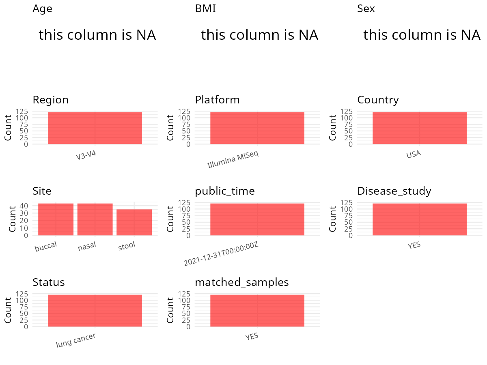

R Notebook: Metadata Processing Workflow
================

# Step 1: Obtain Initial Metadata from Each Project

To obtain the initial metadata: 1. Search for the BioProject ID (e.g.,
“PRJEBXXXX”) on the [NCBI SRA
website](https://www.ncbi.nlm.nih.gov/Traces/study/). 2. In the “Select”
table, click on “Metadata” and download the file. 3. The downloaded file
is typically named “SraRunTable.csv” and contains metadata for the
project.

``` r
# Load necessary libraries
library(dplyr)
library(ggplot2)
library(cowplot)
library(stringr)

# Set working directory (update this path to your local directory)
setwd("/home/hby/oral_project/PRJNA687361")

# Read the initial metadata files
initial_meta <- read.csv("SraRunTable.csv", header = T)

# Combine the two metadata files
# meta <- rbind(initial_meta, initial_meta1)

# Remove entries non-oral samples
# initial_meta <- subset(initial_meta,isolate %in% c("saliva","tongue coat"))

# Check the number of samples containing "HT" in Sample.Name (e.g., healthy controls)
# nrow(subset(meta, grepl("HT", Sample.Name)))

# Display the first few rows of the metadata
head(initial_meta)
```

    ##           Run Assay.Type AvgSpotLen     Bases  BioProject    BioSample              BioSampleModel    Bytes                         Center.Name Collection_Date Consent
    ## 1 SRR13350251   AMPLICON        598  84846494 PRJNA687361 SAMN17141711 Metagenome or environmental 45309806 UNIVERSITY OF KANSAS MEDICAL CENTER       2019/1/31  public
    ## 2 SRR13350252   AMPLICON        602  59584756 PRJNA687361 SAMN17141710 Metagenome or environmental 36037336 UNIVERSITY OF KANSAS MEDICAL CENTER       2019/1/15  public
    ## 3 SRR13350253   AMPLICON        602  59483620 PRJNA687361 SAMN17141709 Metagenome or environmental 32866685 UNIVERSITY OF KANSAS MEDICAL CENTER       2019/1/15  public
    ## 4 SRR13350254   AMPLICON        600 108758403 PRJNA687361 SAMN17141655 Metagenome or environmental 59313279 UNIVERSITY OF KANSAS MEDICAL CENTER      2018/10/24  public
    ## 5 SRR13350255   AMPLICON        599  65402074 PRJNA687361 SAMN17141708 Metagenome or environmental 34977663 UNIVERSITY OF KANSAS MEDICAL CENTER       2019/1/22  public
    ## 6 SRR13350256   AMPLICON        602  48567554 PRJNA687361 SAMN17141707 Metagenome or environmental 28909111 UNIVERSITY OF KANSAS MEDICAL CENTER       2019/1/11  public
    ##   DATASTORE.filetype DATASTORE.provider                     DATASTORE.region Experiment geo_loc_name_country geo_loc_name_country_continent   geo_loc_name         HOST
    ## 1   fastq,run.zq,sra         gs,ncbi,s3 gs.us-east1,ncbi.public,s3.us-east-1 SRX9776327                  USA                  North America USA: Iowa City Homo sapiens
    ## 2   fastq,run.zq,sra         gs,ncbi,s3 gs.us-east1,ncbi.public,s3.us-east-1 SRX9776326                  USA                  North America USA: Iowa City Homo sapiens
    ## 3   fastq,run.zq,sra         gs,ncbi,s3 gs.us-east1,ncbi.public,s3.us-east-1 SRX9776325                  USA                  North America USA: Iowa City Homo sapiens
    ## 4   fastq,run.zq,sra         gs,ncbi,s3 gs.us-east1,ncbi.public,s3.us-east-1 SRX9776324                  USA                  North America USA: Iowa City Homo sapiens
    ## 5   fastq,run.zq,sra         gs,ncbi,s3 gs.us-east1,ncbi.public,s3.us-east-1 SRX9776323                  USA                  North America USA: Iowa City Homo sapiens
    ## 6   fastq,run.zq,sra         gs,ncbi,s3 gs.us-east1,ncbi.public,s3.us-east-1 SRX9776322                  USA                  North America USA: Iowa City Homo sapiens
    ##   Immunotherapy.mediated_toxicities_grade     Instrument isolation_source               lat_lon     Library.Name LibraryLayout LibrarySelection LibrarySource
    ## 1                                       3 Illumina MiSeq            stool 41.65966 N 91.54766 W  JZLC_19_01stool        PAIRED              PCR   METAGENOMIC
    ## 2                                       0 Illumina MiSeq            nasal 41.65966 N 91.54766 W  JZLC_18_01nasal        PAIRED              PCR   METAGENOMIC
    ## 3                                       0 Illumina MiSeq           buccal 41.65966 N 91.54766 W JZLC_18_01buccal        PAIRED              PCR   METAGENOMIC
    ## 4                                       0 Illumina MiSeq            stool 41.65966 N 91.54766 W  JZLC_04_01stool        PAIRED              PCR   METAGENOMIC
    ## 5                                       0 Illumina MiSeq            stool 41.65966 N 91.54766 W  JZLC_18_01stool        PAIRED              PCR   METAGENOMIC
    ## 6                                       2 Illumina MiSeq            nasal 41.65966 N 91.54766 W  JZLC_17_01nasal        PAIRED              PCR   METAGENOMIC
    ##                          Organism patient Platform          ReleaseDate Response_to_Immunotherapy_._chemotherapy          create_date version Sample_Name SRA.Study visit
    ## 1            human gut metagenome JZLC-19 ILLUMINA 2021-12-31T00:00:00Z                            Not appliable 2021-01-04T17:32:00Z       1      LC.P63 SRP300260     1
    ## 2 human nasopharyngeal metagenome JZLC-18 ILLUMINA 2021-12-31T00:00:00Z                                        N 2021-01-04T17:33:00Z       1      LC.P62 SRP300260     1
    ## 3           human oral metagenome JZLC-18 ILLUMINA 2021-12-31T00:00:00Z                                        N 2021-01-04T17:33:00Z       1      LC.P61 SRP300260     1
    ## 4            human gut metagenome JZLC-04 ILLUMINA 2021-12-31T00:00:00Z                            Not appliable 2021-01-04T17:33:00Z       1      LC.P07 SRP300260     1
    ## 5            human gut metagenome JZLC-18 ILLUMINA 2021-12-31T00:00:00Z                                        N 2021-01-04T17:33:00Z       1      LC.P60 SRP300260     1
    ## 6 human nasopharyngeal metagenome JZLC-17 ILLUMINA 2021-12-31T00:00:00Z                                        Y 2021-01-04T17:32:00Z       1      LC.P59 SRP300260     1

# Step 2: Create a Uniform Metadata Template

The uniform metadata should include the following columns:

1.  **BioProject**: Project ID (e.g., “PRJNA339212”)
2.  **Run**: Sample ID (e.g., “ERRXXXXXX” or “SRRXXXXXX”)
3.  **sample_name**: Original sample name submitted by the authors (not
    the database-assigned ID)
4.  **Age**: Age of the subject (if available)
5.  **BMI**: Body Mass Index (if available)
6.  **Sex**: Sex of the subject (“F” or “M”)
7.  **Region**: Targeted 16S rRNA region (e.g., “V3-V4”)
8.  **Platform**: Sequencing platform (e.g., “Illumina MiSeq”)
9.  **Country**: Country of sample origin (e.g., “China”)
10. **Site**: Sample site (e.g., “saliva”, “dental plaque”)
11. **public_time**: Data release date (format: “YYYY-MM-DD”)
12. **PCR_primers**: PCR primers used (e.g., “515F-806R”)
13. **title**: Title of the associated publication
14. **Disease_study**: Whether the study involves a disease (“YES” or
    “NO”)
15. **Status**: Disease status (e.g., “T2DM”, “HC”). Note: If the study
    includes both disease and healthy samples, this must be specified
    per sample.
16. **matched_samples**: matched samples (“YES” or “NO”)

``` r
# Create a uniform metadata dataframe
metadata <- data.frame(
  BioProject = initial_meta$BioProject,
  Run = initial_meta$Run,
  sample_name = initial_meta$patient,
  Platform = initial_meta$Instrument,
  Country = initial_meta$geo_loc_name_country,
  Site = initial_meta$isolation_source,
  public_time = initial_meta$ReleaseDate,
  matched_samples = initial_meta$isolation_source,
  stringsAsFactors = FALSE,
  Sex = NA,
  Age = NA,
  BMI = NA
)
```

# Step 3: Manually Add Information from the Publication

Some information (e.g. PCR primers, study title, disease status) must be
manually extracted from the publication and added to the metadata.

``` r
# Add information obtained from the publication
metadata$Status <- "lung cancer"
metadata$Region <- "V3-V4"
metadata$PCR_primers <- "FWD:TCGTCGGCAGCGTCA; REV:GTCTCGTGGGCTCGGAGATGTGTTA"
metadata$title <- "Prospective correlation between the patient microbiome with response to and development of immune-mediated adverse effects to immunotherapy in lung cancer"
metadata$Disease_study <- "YES"


# extract subject id by remove prefix of sample_name
metadata$subject_id <- metadata$sample_name

all_oral_sites <- c("saliva", "tongue coat", "buccal mucosa", "lower jaw mucosa", "lower labial mucosa", "upper jaw mucosa", "tongue", "buccal")
# Check initial data distribution
cat("Initial sample distribution:\n")
```

    ## Initial sample distribution:

``` r
table(metadata$subject_id)
```

    ## 
    ## JZLC-01 JZLC-02 JZLC-04 JZLC-05 JZLC-06 JZLC-07 JZLC-08 JZLC-09 JZLC-10 JZLC-11 JZLC-12 JZLC-14 JZLC-15 JZLC-16 JZLC-17 JZLC-18 JZLC-19 JZLC-20 JZLC-21 JZLC-22 JZLC-23 JZLC-24 JZLC-25 
    ##       3       3       3       3       6       3       3       3       9       9       3       3       3       3       2       3       3       3       3       9       3       9       3 
    ## JZLC-27 JZLC-28 JZLC-29 JZLC-30 JZLC-31 JZLC-32 JZLC-33 JZLC-34 JZLC-36 JZLC-37 
    ##       3       2       3       3       3       3       2       4       1       3

``` r
table(metadata$Site)
```

    ## 
    ## buccal  nasal  stool 
    ##     43     43     36

``` r
subjects_with_oral_samples <- metadata %>%
  filter(Site %in% all_oral_sites) %>%
  distinct(subject_id) %>%
  pull(subject_id)

metadata_clean <- metadata %>%
  filter(subject_id %in% subjects_with_oral_samples)


sample_counts <- metadata_clean %>%
  group_by(subject_id) %>%
  summarise(n_samples = n(), .groups = "drop")

metadata_clean <- merge(metadata_clean, sample_counts, by = "subject_id")

# Create matched_samples column
metadata_clean$matched_samples <- ifelse(metadata_clean$n_samples >= 2, "YES", "NO")

cat("\nFinal sample distribution after cleaning:\n")
```

    ## 
    ## Final sample distribution after cleaning:

``` r
print(table(metadata_clean$Site))
```

    ## 
    ## buccal  nasal  stool 
    ##     43     43     35

``` r
cat("\nFinal sample distribution after cleaning:\n")
```

    ## 
    ## Final sample distribution after cleaning:

``` r
print(table(metadata_clean$matched_samples))
```

    ## 
    ## YES 
    ## 121

``` r
metadata_clean$subject_id <- NULL
metadata_clean$n_samples <- NULL

# Use cleaned dataset for subsequent analysis
metadata <- metadata_clean
```

# Step 4: Summarize and Validate the Metadata

``` r
# Check the number of unique runs and sample names
print(paste("Number of unique runs:", length(unique(metadata$Run))))
```

    ## [1] "Number of unique runs: 121"

``` r
print(paste("Number of unique sample names:", length(unique(metadata$sample_name))))
```

    ## [1] "Number of unique sample names: 32"

# Step 5: Visualize the Metadata

``` r

```


# Step 6: Finalize and Export the Metadata

``` r
# Reorder columns to match the desired format
metadata <- metadata[, c(
  "BioProject", "Run", "sample_name", "Age", "BMI", "Sex",
  "Region", "Platform", "Country", "Site", "public_time",
  "PCR_primers", "title", "Disease_study", "Status", "matched_samples"
)]

# Export the uniform metadata to a CSV file
write.csv(metadata, file = "metadata.csv", quote = FALSE)
head(metadata)
```

    ##    BioProject         Run sample_name Age BMI Sex Region       Platform Country   Site          public_time                                        PCR_primers
    ## 1 PRJNA687361 SRR13350332     JZLC-01  NA  NA  NA  V3-V4 Illumina MiSeq     USA  stool 2021-12-31T00:00:00Z FWD:TCGTCGGCAGCGTCA; REV:GTCTCGTGGGCTCGGAGATGTGTTA
    ## 2 PRJNA687361 SRR13350298     JZLC-01  NA  NA  NA  V3-V4 Illumina MiSeq     USA  nasal 2021-12-31T00:00:00Z FWD:TCGTCGGCAGCGTCA; REV:GTCTCGTGGGCTCGGAGATGTGTTA
    ## 3 PRJNA687361 SRR13350331     JZLC-01  NA  NA  NA  V3-V4 Illumina MiSeq     USA buccal 2021-12-31T00:00:00Z FWD:TCGTCGGCAGCGTCA; REV:GTCTCGTGGGCTCGGAGATGTGTTA
    ## 4 PRJNA687361 SRR13350276     JZLC-02  NA  NA  NA  V3-V4 Illumina MiSeq     USA buccal 2021-12-31T00:00:00Z FWD:TCGTCGGCAGCGTCA; REV:GTCTCGTGGGCTCGGAGATGTGTTA
    ## 5 PRJNA687361 SRR13350287     JZLC-02  NA  NA  NA  V3-V4 Illumina MiSeq     USA  stool 2021-12-31T00:00:00Z FWD:TCGTCGGCAGCGTCA; REV:GTCTCGTGGGCTCGGAGATGTGTTA
    ## 6 PRJNA687361 SRR13350265     JZLC-02  NA  NA  NA  V3-V4 Illumina MiSeq     USA  nasal 2021-12-31T00:00:00Z FWD:TCGTCGGCAGCGTCA; REV:GTCTCGTGGGCTCGGAGATGTGTTA
    ##                                                                                                                                                        title Disease_study      Status
    ## 1 Prospective correlation between the patient microbiome with response to and development of immune-mediated adverse effects to immunotherapy in lung cancer           YES lung cancer
    ## 2 Prospective correlation between the patient microbiome with response to and development of immune-mediated adverse effects to immunotherapy in lung cancer           YES lung cancer
    ## 3 Prospective correlation between the patient microbiome with response to and development of immune-mediated adverse effects to immunotherapy in lung cancer           YES lung cancer
    ## 4 Prospective correlation between the patient microbiome with response to and development of immune-mediated adverse effects to immunotherapy in lung cancer           YES lung cancer
    ## 5 Prospective correlation between the patient microbiome with response to and development of immune-mediated adverse effects to immunotherapy in lung cancer           YES lung cancer
    ## 6 Prospective correlation between the patient microbiome with response to and development of immune-mediated adverse effects to immunotherapy in lung cancer           YES lung cancer
    ##   matched_samples
    ## 1             YES
    ## 2             YES
    ## 3             YES
    ## 4             YES
    ## 5             YES
    ## 6             YES

## Notes for Students:

1.  **Metadata Accuracy**: Always cross-check the metadata with the
    original publication to ensure accuracy.
2.  **Manual Entries**: Columns like `PCR_primers`, and `Status` often
    require manual entry based on the publication.
3.  **Disease Status**: Be careful when assigning `Status`—some studies
    include both disease and healthy samples.
4.  **Visualization**: The plots help quickly identify the distribution
    of values in each column, which is useful for quality control.
5.  **Reproducibility**: Update the working directory and file paths to
    match your local environment.
