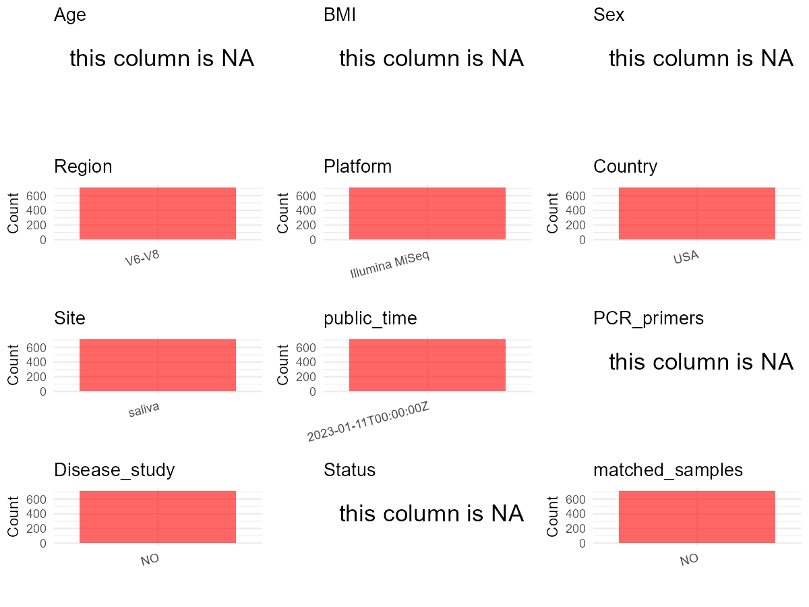

R Notebook: Metadata Processing Workflow
================

# Step 1: Obtain Initial Metadata from Each Project

To obtain the initial metadata: 1. Search for the BioProject ID (e.g.,
“PRJEBXXXX”) on the [NCBI SRA
website](https://www.ncbi.nlm.nih.gov/Traces/study/). 2. In the “Select”
table, click on “Metadata” and download the file. 3. The downloaded file
is typically named “SraRunTable.csv” and contains metadata for the
project.

``` r
# Load necessary libraries
library(dplyr)
library(ggplot2)
library(cowplot)

# Set working directory (update this path to your local directory)
setwd("D:/studylearning/董彪师兄项目/任务/张辰飞/PRJNA689848")

# Read the initial metadata files
initial_meta<-read.csv("SraRunTable.csv",header = T)

# Combine the two metadata files
#meta <- rbind(initial_meta, initial_meta1)

#Remove entries non-oral samples
#initial_meta <- subset(initial_meta,isolate %in% c("saliva","tongue coat"))

# Check the number of samples containing "HT" in Sample.Name (e.g., healthy controls)
#nrow(subset(meta, grepl("HT", Sample.Name)))

# Display the first few rows of the metadata
head(initial_meta)
```

    ##           Run Assay.Type AvgSpotLen    Bases  BioProject    BioSample
    ## 1 SRR13371685   AMPLICON        601 62989879 PRJNA689848 SAMN17219536
    ## 2 SRR13371686   AMPLICON        601 42385854 PRJNA689848 SAMN17219122
    ## 3 SRR13371687   AMPLICON        601 70699215 PRJNA689848 SAMN17219535
    ## 4 SRR13371688   AMPLICON        601 59748960 PRJNA689848 SAMN17219534
    ## 5 SRR13371689   AMPLICON        601 43339918 PRJNA689848 SAMN17219533
    ## 6 SRR13371690   AMPLICON        601 60800086 PRJNA689848 SAMN17219532
    ##                                BioSampleModel    Bytes
    ## 1 MIMARKS.survey,MIGS/MIMS/MIMARKS.human-oral 41651794
    ## 2 MIMARKS.survey,MIGS/MIMS/MIMARKS.human-oral 25698065
    ## 3 MIMARKS.survey,MIGS/MIMS/MIMARKS.human-oral 46842487
    ## 4 MIMARKS.survey,MIGS/MIMS/MIMARKS.human-oral 40706597
    ## 5 MIMARKS.survey,MIGS/MIMS/MIMARKS.human-oral 29334411
    ## 6 MIMARKS.survey,MIGS/MIMS/MIMARKS.human-oral 41151135
    ##                          Center.Name Collection_Date Consent DATASTORE.filetype
    ## 1 UNIVERSITY OF CALIFORNIA RIVERSIDE   not collected  public   fastq,run.zq,sra
    ## 2 UNIVERSITY OF CALIFORNIA RIVERSIDE   not collected  public   fastq,run.zq,sra
    ## 3 UNIVERSITY OF CALIFORNIA RIVERSIDE   not collected  public   fastq,run.zq,sra
    ## 4 UNIVERSITY OF CALIFORNIA RIVERSIDE   not collected  public   fastq,run.zq,sra
    ## 5 UNIVERSITY OF CALIFORNIA RIVERSIDE   not collected  public   fastq,run.zq,sra
    ## 6 UNIVERSITY OF CALIFORNIA RIVERSIDE   not collected  public   fastq,run.zq,sra
    ##   DATASTORE.provider                     DATASTORE.region env_broad_scale
    ## 1         gs,ncbi,s3 gs.us-east1,ncbi.public,s3.us-east-1   not collected
    ## 2         gs,ncbi,s3 gs.us-east1,ncbi.public,s3.us-east-1   not collected
    ## 3         gs,ncbi,s3 gs.us-east1,ncbi.public,s3.us-east-1   not collected
    ## 4         gs,ncbi,s3 gs.us-east1,ncbi.public,s3.us-east-1   not collected
    ## 5         gs,ncbi,s3 gs.us-east1,ncbi.public,s3.us-east-1   not collected
    ## 6         gs,ncbi,s3 gs.us-east1,ncbi.public,s3.us-east-1   not collected
    ##     env_local_scale env_medium Experiment geo_loc_name_country
    ## 1 Human oral cavity     Saliva SRX9795980                  USA
    ## 2 Human oral cavity     Saliva SRX9795979                  USA
    ## 3 Human oral cavity     Saliva SRX9795978                  USA
    ## 4 Human oral cavity     Saliva SRX9795977                  USA
    ## 5 Human oral cavity     Saliva SRX9795976                  USA
    ## 6 Human oral cavity     Saliva SRX9795975                  USA
    ##   geo_loc_name_country_continent geo_loc_name         HOST     Instrument
    ## 1                  North America          USA Homo sapiens Illumina MiSeq
    ## 2                  North America          USA Homo sapiens Illumina MiSeq
    ## 3                  North America          USA Homo sapiens Illumina MiSeq
    ## 4                  North America          USA Homo sapiens Illumina MiSeq
    ## 5                  North America          USA Homo sapiens Illumina MiSeq
    ## 6                  North America          USA Homo sapiens Illumina MiSeq
    ##         lat_lon Library.Name LibraryLayout LibrarySelection LibrarySource
    ## 1 not collected        10016        PAIRED              PCR   METAGENOMIC
    ## 2 not collected        10136        PAIRED              PCR   METAGENOMIC
    ## 3 not collected        10874        PAIRED              PCR   METAGENOMIC
    ## 4 not collected        10007        PAIRED              PCR   METAGENOMIC
    ## 5 not collected        10076        PAIRED              PCR   METAGENOMIC
    ## 6 not collected        10080        PAIRED              PCR   METAGENOMIC
    ##                Organism Platform          ReleaseDate          create_date
    ## 1 human oral metagenome ILLUMINA 2023-01-11T00:00:00Z 2021-01-06T17:18:00Z
    ## 2 human oral metagenome ILLUMINA 2023-01-11T00:00:00Z 2021-01-06T17:18:00Z
    ## 3 human oral metagenome ILLUMINA 2023-01-11T00:00:00Z 2021-01-06T17:18:00Z
    ## 4 human oral metagenome ILLUMINA 2023-01-11T00:00:00Z 2021-01-06T17:18:00Z
    ## 5 human oral metagenome ILLUMINA 2023-01-11T00:00:00Z 2021-01-06T17:18:00Z
    ## 6 human oral metagenome ILLUMINA 2023-01-11T00:00:00Z 2021-01-06T17:18:00Z
    ##   version Sample.Name Sample_Number SRA.Study
    ## 1       1       10016           461 SRP300673
    ## 2       1       10136            47 SRP300673
    ## 3       1       10874           460 SRP300673
    ## 4       1       10007           459 SRP300673
    ## 5       1       10076           458 SRP300673
    ## 6       1       10080           457 SRP300673

# Step 2: Create a Uniform Metadata Template

The uniform metadata should include the following columns:

1.  **BioProject**: Project ID (e.g., “PRJNA339212”)
2.  **Run**: Sample ID (e.g., “ERRXXXXXX” or “SRRXXXXXX”)
3.  **sample_name**: Original sample name submitted by the authors (not
    the database-assigned ID)
4.  **Age**: Age of the subject (if available)
5.  **BMI**: Body Mass Index (if available)
6.  **Sex**: Sex of the subject (“F” or “M”)
7.  **Region**: Targeted 16S rRNA region (e.g., “V3-V4”)
8.  **Platform**: Sequencing platform (e.g., “Illumina MiSeq”)
9.  **Country**: Country of sample origin (e.g., “China”)
10. **Site**: Sample site (e.g., “saliva”, “dental plaque”)
11. **public_time**: Data release date (format: “YYYY-MM-DD”)
12. **PCR_primers**: PCR primers used (e.g., “515F-806R”)
13. **title**: Title of the associated publication
14. **Disease_study**: Whether the study involves a disease (“YES” or
    “NO”)
15. **Status**: Disease status (e.g., “T2DM”, “HC”). Note: If the study
    includes both disease and healthy samples, this must be specified
    per sample.
16. **matched_samples**: matched samples (“YES” or “NO”)

``` r
# Create a uniform metadata dataframe
metadata <- data.frame(
  BioProject = initial_meta$BioProject,
  Run = initial_meta$Run,
  sample_name = initial_meta$Sample.Name,
  Age = NA,
  BMI = NA,
  Sex= NA,
  Region = "V6-V8",
  Platform = initial_meta$Instrument,
  Country = "USA",
  Site = initial_meta$env_medium,
  public_time = initial_meta$ReleaseDate,
  stringsAsFactors = FALSE
)
```

# Step 3: Manually Add Information from the Publication

Some information (e.g. PCR primers, study title, disease status) must be
manually extracted from the publication and added to the metadata.

``` r
# Add information obtained from the publication
metadata$PCR_primers <- NA_character_
metadata$title <- "Oral microbial communities in children, caregivers, and associations with salivary biomeasures and environmental tobacco smoke exposure"
metadata$Disease_study <- "NO"
# Assign disease status based on sample_name patterns
metadata$Status <- NA_character_
metadata$Site <- "saliva"
#extract subject id by remove prefix of sample_name
#metadata$sample_name <- gsub("T|CR|CS|C|N|S", "", metadata$sample_name)

# Check initial data distribution
cat("Initial sample distribution:\n")
```

    ## Initial sample distribution:

``` r
table(metadata$sample_name)
```

    ## 
    ## 10001 10002 10003 10004 10007 10008 10010 10011 10012 10013 10014 10015 10016 
    ##     1     1     1     1     1     1     1     1     1     1     1     1     1 
    ## 10017 10018 10021 10023 10024 10025 10026 10027 10028 10029 10030 10031 10032 
    ##     1     1     1     1     1     1     1     1     1     1     1     1     1 
    ## 10033 10035 10036 10038 10039 10041 10042 10043 10044 10045 10046 10047 10050 
    ##     1     1     1     1     1     1     1     1     1     1     1     1     1 
    ## 10051 10052 10056 10057 10060 10061 10062 10064 10066 10068 10069 10070 10071 
    ##     1     1     1     1     1     1     1     1     1     1     1     1     1 
    ## 10072 10074 10076 10077 10078 10079 10080 10081 10083 10085 10086 10087 10088 
    ##     1     1     1     1     1     1     1     1     1     1     1     1     1 
    ## 10089 10090 10091 10092 10094 10096 10098 10099 10100 10102 10103 10104 10107 
    ##     1     1     1     1     1     1     1     1     1     1     1     1     1 
    ## 10108 10110 10111 10112 10113 10114 10115 10116 10117 10118 10119 10120 10121 
    ##     1     1     1     1     1     1     1     1     1     1     1     1     1 
    ## 10122 10126 10127 10128 10129 10130 10132 10133 10134 10136 10137 10138 10141 
    ##     1     1     1     1     1     1     1     1     1     1     1     1     1 
    ## 10142 10143 10144 10145 10146 10147 10148 10149 10150 10151 10153 10154 10155 
    ##     1     1     1     1     1     1     1     1     1     1     1     1     1 
    ## 10156 10158 10159 10161 10162 10163 10164 10165 10168 10169 10170 10171 10172 
    ##     1     1     1     1     1     1     1     1     1     1     1     1     1 
    ## 10174 10176 10177 10178 10180 10181 10184 10185 10186 10187 10189 10192 10193 
    ##     1     1     1     1     1     1     1     1     1     1     1     1     1 
    ## 10194 10195 10196 10197 10198 10199 10200 10201 10204 10205 10207 10209 10210 
    ##     1     1     1     1     1     1     1     1     1     1     1     1     1 
    ## 10211 10214 10215 10217 10218 10219 10220 10221 10222 10224 10226 10227 10228 
    ##     1     1     1     1     1     1     1     1     1     1     1     1     1 
    ## 10229 10231 10232 10233 10235 10237 10238 10239 10240 10242 10243 10244 10246 
    ##     1     1     1     1     1     1     1     1     1     1     1     1     1 
    ## 10248 10249 10253 10255 10256 10259 10260 10261 10262 10263 10264 10266 10268 
    ##     1     1     1     1     1     1     1     1     1     1     1     1     1 
    ## 10269 10271 10272 10273 10274 10275 10276 10277 10278 10279 10280 10282 10283 
    ##     1     1     1     1     1     1     1     1     1     1     1     1     1 
    ## 10285 10287 10289 10290 10292 10295 10298 10299 10300 10301 10302 10303 10305 
    ##     1     1     1     1     1     1     1     1     1     1     1     1     1 
    ## 10306 10308 10309 10310 10311 10312 10313 10314 10315 10317 10319 10321 10322 
    ##     1     1     1     1     1     1     1     1     1     1     1     1     1 
    ## 10323 10324 10325 10327 10328 10329 10330 10331 10333 10334 10336 10337 10338 
    ##     1     1     1     1     1     1     1     1     1     1     1     1     1 
    ## 10339 10341 10342 10343 10344 10346 10347 10349 10350 10353 10354 10355 10356 
    ##     1     1     1     1     1     1     1     1     1     1     1     1     1 
    ## 10357 10358 10359 10360 10361 10362 10363 10364 10365 10367 10369 10370 10372 
    ##     1     1     1     1     1     1     1     1     1     1     1     1     1 
    ## 10374 10375 10376 10377 10378 10382 10383 10385 10386 10387 10389 10392 10393 
    ##     1     1     1     1     1     1     1     1     1     1     1     1     1 
    ## 10394 10396 10397 10398 10401 10402 10403 10404 10405 10406 10407 10408 10409 
    ##     1     1     1     1     1     1     1     1     1     1     1     1     1 
    ## 10411 10413 10415 10417 10420 10421 10422 10424 10425 10426 10428 10431 10432 
    ##     1     1     1     1     1     1     1     1     1     1     1     1     1 
    ## 10433 10434 10435 10438 10439 10442 10443 10447 10449 10451 10452 10453 10455 
    ##     1     1     1     1     1     1     1     1     1     1     1     1     1 
    ## 10456 10461 10462 10464 10467 10468 10469 10470 10472 10473 10474 10475 10479 
    ##     1     1     1     1     1     1     1     1     1     1     1     1     1 
    ## 10480 10481 10482 10483 10486 10487 10488 10489 10490 10492 10493 10495 10496 
    ##     1     1     1     1     1     1     1     1     1     1     1     1     1 
    ## 10497 10498 10499 10500 10504 10506 10508 10509 10510 10512 10514 10516 10518 
    ##     1     1     1     1     1     1     1     1     1     1     1     1     1 
    ## 10519 10520 10522 10523 10524 10526 10527 10529 10530 10532 10533 10534 10535 
    ##     1     1     1     1     1     1     1     1     1     1     1     1     1 
    ## 10536 10537 10538 10539 10540 10541 10542 10543 10544 10545 10547 10549 10550 
    ##     1     1     1     1     1     1     1     1     1     1     1     1     1 
    ## 10554 10555 10556 10557 10558 10561 10562 10563 10564 10565 10566 10568 10570 
    ##     1     1     1     1     1     1     1     1     1     1     1     1     1 
    ## 10571 10572 10573 10574 10575 10577 10578 10581 10582 10583 10584 10586 10590 
    ##     1     1     1     1     1     1     1     1     1     1     1     1     1 
    ## 10592 10593 10594 10595 10596 10599 10600 10601 10602 10604 10605 10606 10607 
    ##     1     1     1     1     1     1     1     1     1     1     1     1     1 
    ## 10610 10611 10612 10614 10615 10620 10621 10622 10623 10624 10625 10626 10627 
    ##     1     1     1     1     1     1     1     1     1     1     1     1     1 
    ## 10628 10629 10630 10632 10633 10634 10636 10638 10639 10640 10641 10643 10644 
    ##     1     1     1     1     1     1     1     1     1     1     1     1     1 
    ## 10646 10647 10648 10649 10650 10652 10654 10655 10656 10657 10658 10659 10660 
    ##     1     1     1     1     1     1     1     1     1     1     1     1     1 
    ## 10661 10662 10663 10664 10665 10666 10667 10668 10669 10670 10673 10674 10675 
    ##     1     1     1     1     1     1     1     1     1     1     1     1     1 
    ## 10676 10678 10679 10680 10681 10682 10683 10684 10685 10686 10688 10689 10692 
    ##     1     1     1     1     1     1     1     1     1     1     1     1     1 
    ## 10693 10694 10698 10700 10701 10702 10703 10704 10705 10706 10707 10708 10709 
    ##     1     1     1     1     1     1     1     1     1     1     1     1     1 
    ## 10710 10712 10713 10714 10715 10718 10721 10722 10723 10724 10725 10726 10727 
    ##     1     1     1     1     1     1     1     1     1     1     1     1     1 
    ## 10729 10731 10732 10734 10736 10737 10738 10739 10740 10741 10742 10744 10745 
    ##     1     1     1     1     1     1     1     1     1     1     1     1     1 
    ## 10746 10748 10752 10753 10754 10756 10757 10758 10759 10760 10762 10763 10764 
    ##     1     1     1     1     1     1     1     1     1     1     1     1     1 
    ## 10766 10767 10768 10770 10772 10776 10777 10779 10781 10782 10783 10784 10786 
    ##     1     1     1     1     1     1     1     1     1     1     1     1     1 
    ## 10787 10788 10789 10792 10793 10796 10797 10798 10800 10801 10802 10803 10804 
    ##     1     1     1     1     1     1     1     1     1     1     1     1     1 
    ## 10805 10806 10807 10808 10809 10810 10811 10812 10813 10814 10815 10816 10818 
    ##     1     1     1     1     1     1     1     1     1     1     1     1     1 
    ## 10819 10820 10821 10825 10826 10827 10828 10829 10830 10831 10833 10834 10835 
    ##     1     1     1     1     1     1     1     1     1     1     1     1     1 
    ## 10836 10837 10838 10839 10840 10841 10842 10843 10845 10846 10847 10848 10850 
    ##     1     1     1     1     1     1     1     1     1     1     1     1     1 
    ## 10851 10854 10855 10856 10857 10859 10860 10861 10863 10864 10865 10868 10869 
    ##     1     1     1     1     1     1     1     1     1     1     1     1     1 
    ## 10870 10871 10872 10874 10876 10877 10880 10881 10882 10883 10884 10886 10887 
    ##     1     1     1     1     1     1     1     1     1     1     1     1     1 
    ## 10889 10890 10892 10894 10895 10896 10898 10900 10902 10904 10906 10907 10909 
    ##     1     1     1     1     1     1     1     1     1     1     1     1     1 
    ## 10911 10914 10916 10917 10918 10919 10921 10922 10923 10924 10925 10926 10928 
    ##     1     1     1     1     1     1     1     1     1     1     1     1     1 
    ## 10930 10931 10932 10933 10934 10935 10936 10937 10938 10940 10941 10942 10944 
    ##     1     1     1     1     1     1     1     1     1     1     1     1     1 
    ## 10947 10948 10950 10951 10953 10955 10958 10960 10961 10962 10963 10964 10965 
    ##     1     1     1     1     1     1     1     1     1     1     1     1     1 
    ## 10967 10968 10969 10970 10971 10972 10974 10975 10976 10977 10978 10980 10983 
    ##     1     1     1     1     1     1     1     1     1     1     1     1     1 
    ## 10984 10986 10988 10989 10990 10991 10992 10993 10994 10996 10998 11000 
    ##     1     1     1     1     1     1     1     1     1     1     1     1

``` r
table(metadata$Site)
```

    ## 
    ## saliva 
    ##    714

``` r
# Calculate sampling frequency per subject
sample_counts <- table(metadata$sample_name)
cat("\nNumber of samples per subject:\n")
```

    ## 
    ## Number of samples per subject:

``` r
print(sample_counts)
```

    ## 
    ## 10001 10002 10003 10004 10007 10008 10010 10011 10012 10013 10014 10015 10016 
    ##     1     1     1     1     1     1     1     1     1     1     1     1     1 
    ## 10017 10018 10021 10023 10024 10025 10026 10027 10028 10029 10030 10031 10032 
    ##     1     1     1     1     1     1     1     1     1     1     1     1     1 
    ## 10033 10035 10036 10038 10039 10041 10042 10043 10044 10045 10046 10047 10050 
    ##     1     1     1     1     1     1     1     1     1     1     1     1     1 
    ## 10051 10052 10056 10057 10060 10061 10062 10064 10066 10068 10069 10070 10071 
    ##     1     1     1     1     1     1     1     1     1     1     1     1     1 
    ## 10072 10074 10076 10077 10078 10079 10080 10081 10083 10085 10086 10087 10088 
    ##     1     1     1     1     1     1     1     1     1     1     1     1     1 
    ## 10089 10090 10091 10092 10094 10096 10098 10099 10100 10102 10103 10104 10107 
    ##     1     1     1     1     1     1     1     1     1     1     1     1     1 
    ## 10108 10110 10111 10112 10113 10114 10115 10116 10117 10118 10119 10120 10121 
    ##     1     1     1     1     1     1     1     1     1     1     1     1     1 
    ## 10122 10126 10127 10128 10129 10130 10132 10133 10134 10136 10137 10138 10141 
    ##     1     1     1     1     1     1     1     1     1     1     1     1     1 
    ## 10142 10143 10144 10145 10146 10147 10148 10149 10150 10151 10153 10154 10155 
    ##     1     1     1     1     1     1     1     1     1     1     1     1     1 
    ## 10156 10158 10159 10161 10162 10163 10164 10165 10168 10169 10170 10171 10172 
    ##     1     1     1     1     1     1     1     1     1     1     1     1     1 
    ## 10174 10176 10177 10178 10180 10181 10184 10185 10186 10187 10189 10192 10193 
    ##     1     1     1     1     1     1     1     1     1     1     1     1     1 
    ## 10194 10195 10196 10197 10198 10199 10200 10201 10204 10205 10207 10209 10210 
    ##     1     1     1     1     1     1     1     1     1     1     1     1     1 
    ## 10211 10214 10215 10217 10218 10219 10220 10221 10222 10224 10226 10227 10228 
    ##     1     1     1     1     1     1     1     1     1     1     1     1     1 
    ## 10229 10231 10232 10233 10235 10237 10238 10239 10240 10242 10243 10244 10246 
    ##     1     1     1     1     1     1     1     1     1     1     1     1     1 
    ## 10248 10249 10253 10255 10256 10259 10260 10261 10262 10263 10264 10266 10268 
    ##     1     1     1     1     1     1     1     1     1     1     1     1     1 
    ## 10269 10271 10272 10273 10274 10275 10276 10277 10278 10279 10280 10282 10283 
    ##     1     1     1     1     1     1     1     1     1     1     1     1     1 
    ## 10285 10287 10289 10290 10292 10295 10298 10299 10300 10301 10302 10303 10305 
    ##     1     1     1     1     1     1     1     1     1     1     1     1     1 
    ## 10306 10308 10309 10310 10311 10312 10313 10314 10315 10317 10319 10321 10322 
    ##     1     1     1     1     1     1     1     1     1     1     1     1     1 
    ## 10323 10324 10325 10327 10328 10329 10330 10331 10333 10334 10336 10337 10338 
    ##     1     1     1     1     1     1     1     1     1     1     1     1     1 
    ## 10339 10341 10342 10343 10344 10346 10347 10349 10350 10353 10354 10355 10356 
    ##     1     1     1     1     1     1     1     1     1     1     1     1     1 
    ## 10357 10358 10359 10360 10361 10362 10363 10364 10365 10367 10369 10370 10372 
    ##     1     1     1     1     1     1     1     1     1     1     1     1     1 
    ## 10374 10375 10376 10377 10378 10382 10383 10385 10386 10387 10389 10392 10393 
    ##     1     1     1     1     1     1     1     1     1     1     1     1     1 
    ## 10394 10396 10397 10398 10401 10402 10403 10404 10405 10406 10407 10408 10409 
    ##     1     1     1     1     1     1     1     1     1     1     1     1     1 
    ## 10411 10413 10415 10417 10420 10421 10422 10424 10425 10426 10428 10431 10432 
    ##     1     1     1     1     1     1     1     1     1     1     1     1     1 
    ## 10433 10434 10435 10438 10439 10442 10443 10447 10449 10451 10452 10453 10455 
    ##     1     1     1     1     1     1     1     1     1     1     1     1     1 
    ## 10456 10461 10462 10464 10467 10468 10469 10470 10472 10473 10474 10475 10479 
    ##     1     1     1     1     1     1     1     1     1     1     1     1     1 
    ## 10480 10481 10482 10483 10486 10487 10488 10489 10490 10492 10493 10495 10496 
    ##     1     1     1     1     1     1     1     1     1     1     1     1     1 
    ## 10497 10498 10499 10500 10504 10506 10508 10509 10510 10512 10514 10516 10518 
    ##     1     1     1     1     1     1     1     1     1     1     1     1     1 
    ## 10519 10520 10522 10523 10524 10526 10527 10529 10530 10532 10533 10534 10535 
    ##     1     1     1     1     1     1     1     1     1     1     1     1     1 
    ## 10536 10537 10538 10539 10540 10541 10542 10543 10544 10545 10547 10549 10550 
    ##     1     1     1     1     1     1     1     1     1     1     1     1     1 
    ## 10554 10555 10556 10557 10558 10561 10562 10563 10564 10565 10566 10568 10570 
    ##     1     1     1     1     1     1     1     1     1     1     1     1     1 
    ## 10571 10572 10573 10574 10575 10577 10578 10581 10582 10583 10584 10586 10590 
    ##     1     1     1     1     1     1     1     1     1     1     1     1     1 
    ## 10592 10593 10594 10595 10596 10599 10600 10601 10602 10604 10605 10606 10607 
    ##     1     1     1     1     1     1     1     1     1     1     1     1     1 
    ## 10610 10611 10612 10614 10615 10620 10621 10622 10623 10624 10625 10626 10627 
    ##     1     1     1     1     1     1     1     1     1     1     1     1     1 
    ## 10628 10629 10630 10632 10633 10634 10636 10638 10639 10640 10641 10643 10644 
    ##     1     1     1     1     1     1     1     1     1     1     1     1     1 
    ## 10646 10647 10648 10649 10650 10652 10654 10655 10656 10657 10658 10659 10660 
    ##     1     1     1     1     1     1     1     1     1     1     1     1     1 
    ## 10661 10662 10663 10664 10665 10666 10667 10668 10669 10670 10673 10674 10675 
    ##     1     1     1     1     1     1     1     1     1     1     1     1     1 
    ## 10676 10678 10679 10680 10681 10682 10683 10684 10685 10686 10688 10689 10692 
    ##     1     1     1     1     1     1     1     1     1     1     1     1     1 
    ## 10693 10694 10698 10700 10701 10702 10703 10704 10705 10706 10707 10708 10709 
    ##     1     1     1     1     1     1     1     1     1     1     1     1     1 
    ## 10710 10712 10713 10714 10715 10718 10721 10722 10723 10724 10725 10726 10727 
    ##     1     1     1     1     1     1     1     1     1     1     1     1     1 
    ## 10729 10731 10732 10734 10736 10737 10738 10739 10740 10741 10742 10744 10745 
    ##     1     1     1     1     1     1     1     1     1     1     1     1     1 
    ## 10746 10748 10752 10753 10754 10756 10757 10758 10759 10760 10762 10763 10764 
    ##     1     1     1     1     1     1     1     1     1     1     1     1     1 
    ## 10766 10767 10768 10770 10772 10776 10777 10779 10781 10782 10783 10784 10786 
    ##     1     1     1     1     1     1     1     1     1     1     1     1     1 
    ## 10787 10788 10789 10792 10793 10796 10797 10798 10800 10801 10802 10803 10804 
    ##     1     1     1     1     1     1     1     1     1     1     1     1     1 
    ## 10805 10806 10807 10808 10809 10810 10811 10812 10813 10814 10815 10816 10818 
    ##     1     1     1     1     1     1     1     1     1     1     1     1     1 
    ## 10819 10820 10821 10825 10826 10827 10828 10829 10830 10831 10833 10834 10835 
    ##     1     1     1     1     1     1     1     1     1     1     1     1     1 
    ## 10836 10837 10838 10839 10840 10841 10842 10843 10845 10846 10847 10848 10850 
    ##     1     1     1     1     1     1     1     1     1     1     1     1     1 
    ## 10851 10854 10855 10856 10857 10859 10860 10861 10863 10864 10865 10868 10869 
    ##     1     1     1     1     1     1     1     1     1     1     1     1     1 
    ## 10870 10871 10872 10874 10876 10877 10880 10881 10882 10883 10884 10886 10887 
    ##     1     1     1     1     1     1     1     1     1     1     1     1     1 
    ## 10889 10890 10892 10894 10895 10896 10898 10900 10902 10904 10906 10907 10909 
    ##     1     1     1     1     1     1     1     1     1     1     1     1     1 
    ## 10911 10914 10916 10917 10918 10919 10921 10922 10923 10924 10925 10926 10928 
    ##     1     1     1     1     1     1     1     1     1     1     1     1     1 
    ## 10930 10931 10932 10933 10934 10935 10936 10937 10938 10940 10941 10942 10944 
    ##     1     1     1     1     1     1     1     1     1     1     1     1     1 
    ## 10947 10948 10950 10951 10953 10955 10958 10960 10961 10962 10963 10964 10965 
    ##     1     1     1     1     1     1     1     1     1     1     1     1     1 
    ## 10967 10968 10969 10970 10971 10972 10974 10975 10976 10977 10978 10980 10983 
    ##     1     1     1     1     1     1     1     1     1     1     1     1     1 
    ## 10984 10986 10988 10989 10990 10991 10992 10993 10994 10996 10998 11000 
    ##     1     1     1     1     1     1     1     1     1     1     1     1

``` r
# Create matched_samples column
metadata$matched_samples <- ifelse(metadata$sample_name %in% names(sample_counts[sample_counts >= 2]), "YES", "NO")

cat("\nMatched samples distribution:\n")
```

    ## 
    ## Matched samples distribution:

``` r
table(metadata$matched_samples)
```

    ## 
    ##  NO 
    ## 714

``` r
# Identify samples for removal: single samples excluding saliva
single_samples <- names(sample_counts[sample_counts == 1])
samples_to_remove <- metadata$sample_name %in% single_samples & !(metadata$Site %in% c("saliva"))

cat("\nNumber of samples to be removed:", sum(samples_to_remove), "\n")
```

    ## 
    ## Number of samples to be removed: 0

``` r
# Remove identified samples
metadata_clean <- metadata[!samples_to_remove, ]

cat("\nFinal sample distribution after cleaning:\n")
```

    ## 
    ## Final sample distribution after cleaning:

``` r
table(metadata_clean$sample_name)
```

    ## 
    ## 10001 10002 10003 10004 10007 10008 10010 10011 10012 10013 10014 10015 10016 
    ##     1     1     1     1     1     1     1     1     1     1     1     1     1 
    ## 10017 10018 10021 10023 10024 10025 10026 10027 10028 10029 10030 10031 10032 
    ##     1     1     1     1     1     1     1     1     1     1     1     1     1 
    ## 10033 10035 10036 10038 10039 10041 10042 10043 10044 10045 10046 10047 10050 
    ##     1     1     1     1     1     1     1     1     1     1     1     1     1 
    ## 10051 10052 10056 10057 10060 10061 10062 10064 10066 10068 10069 10070 10071 
    ##     1     1     1     1     1     1     1     1     1     1     1     1     1 
    ## 10072 10074 10076 10077 10078 10079 10080 10081 10083 10085 10086 10087 10088 
    ##     1     1     1     1     1     1     1     1     1     1     1     1     1 
    ## 10089 10090 10091 10092 10094 10096 10098 10099 10100 10102 10103 10104 10107 
    ##     1     1     1     1     1     1     1     1     1     1     1     1     1 
    ## 10108 10110 10111 10112 10113 10114 10115 10116 10117 10118 10119 10120 10121 
    ##     1     1     1     1     1     1     1     1     1     1     1     1     1 
    ## 10122 10126 10127 10128 10129 10130 10132 10133 10134 10136 10137 10138 10141 
    ##     1     1     1     1     1     1     1     1     1     1     1     1     1 
    ## 10142 10143 10144 10145 10146 10147 10148 10149 10150 10151 10153 10154 10155 
    ##     1     1     1     1     1     1     1     1     1     1     1     1     1 
    ## 10156 10158 10159 10161 10162 10163 10164 10165 10168 10169 10170 10171 10172 
    ##     1     1     1     1     1     1     1     1     1     1     1     1     1 
    ## 10174 10176 10177 10178 10180 10181 10184 10185 10186 10187 10189 10192 10193 
    ##     1     1     1     1     1     1     1     1     1     1     1     1     1 
    ## 10194 10195 10196 10197 10198 10199 10200 10201 10204 10205 10207 10209 10210 
    ##     1     1     1     1     1     1     1     1     1     1     1     1     1 
    ## 10211 10214 10215 10217 10218 10219 10220 10221 10222 10224 10226 10227 10228 
    ##     1     1     1     1     1     1     1     1     1     1     1     1     1 
    ## 10229 10231 10232 10233 10235 10237 10238 10239 10240 10242 10243 10244 10246 
    ##     1     1     1     1     1     1     1     1     1     1     1     1     1 
    ## 10248 10249 10253 10255 10256 10259 10260 10261 10262 10263 10264 10266 10268 
    ##     1     1     1     1     1     1     1     1     1     1     1     1     1 
    ## 10269 10271 10272 10273 10274 10275 10276 10277 10278 10279 10280 10282 10283 
    ##     1     1     1     1     1     1     1     1     1     1     1     1     1 
    ## 10285 10287 10289 10290 10292 10295 10298 10299 10300 10301 10302 10303 10305 
    ##     1     1     1     1     1     1     1     1     1     1     1     1     1 
    ## 10306 10308 10309 10310 10311 10312 10313 10314 10315 10317 10319 10321 10322 
    ##     1     1     1     1     1     1     1     1     1     1     1     1     1 
    ## 10323 10324 10325 10327 10328 10329 10330 10331 10333 10334 10336 10337 10338 
    ##     1     1     1     1     1     1     1     1     1     1     1     1     1 
    ## 10339 10341 10342 10343 10344 10346 10347 10349 10350 10353 10354 10355 10356 
    ##     1     1     1     1     1     1     1     1     1     1     1     1     1 
    ## 10357 10358 10359 10360 10361 10362 10363 10364 10365 10367 10369 10370 10372 
    ##     1     1     1     1     1     1     1     1     1     1     1     1     1 
    ## 10374 10375 10376 10377 10378 10382 10383 10385 10386 10387 10389 10392 10393 
    ##     1     1     1     1     1     1     1     1     1     1     1     1     1 
    ## 10394 10396 10397 10398 10401 10402 10403 10404 10405 10406 10407 10408 10409 
    ##     1     1     1     1     1     1     1     1     1     1     1     1     1 
    ## 10411 10413 10415 10417 10420 10421 10422 10424 10425 10426 10428 10431 10432 
    ##     1     1     1     1     1     1     1     1     1     1     1     1     1 
    ## 10433 10434 10435 10438 10439 10442 10443 10447 10449 10451 10452 10453 10455 
    ##     1     1     1     1     1     1     1     1     1     1     1     1     1 
    ## 10456 10461 10462 10464 10467 10468 10469 10470 10472 10473 10474 10475 10479 
    ##     1     1     1     1     1     1     1     1     1     1     1     1     1 
    ## 10480 10481 10482 10483 10486 10487 10488 10489 10490 10492 10493 10495 10496 
    ##     1     1     1     1     1     1     1     1     1     1     1     1     1 
    ## 10497 10498 10499 10500 10504 10506 10508 10509 10510 10512 10514 10516 10518 
    ##     1     1     1     1     1     1     1     1     1     1     1     1     1 
    ## 10519 10520 10522 10523 10524 10526 10527 10529 10530 10532 10533 10534 10535 
    ##     1     1     1     1     1     1     1     1     1     1     1     1     1 
    ## 10536 10537 10538 10539 10540 10541 10542 10543 10544 10545 10547 10549 10550 
    ##     1     1     1     1     1     1     1     1     1     1     1     1     1 
    ## 10554 10555 10556 10557 10558 10561 10562 10563 10564 10565 10566 10568 10570 
    ##     1     1     1     1     1     1     1     1     1     1     1     1     1 
    ## 10571 10572 10573 10574 10575 10577 10578 10581 10582 10583 10584 10586 10590 
    ##     1     1     1     1     1     1     1     1     1     1     1     1     1 
    ## 10592 10593 10594 10595 10596 10599 10600 10601 10602 10604 10605 10606 10607 
    ##     1     1     1     1     1     1     1     1     1     1     1     1     1 
    ## 10610 10611 10612 10614 10615 10620 10621 10622 10623 10624 10625 10626 10627 
    ##     1     1     1     1     1     1     1     1     1     1     1     1     1 
    ## 10628 10629 10630 10632 10633 10634 10636 10638 10639 10640 10641 10643 10644 
    ##     1     1     1     1     1     1     1     1     1     1     1     1     1 
    ## 10646 10647 10648 10649 10650 10652 10654 10655 10656 10657 10658 10659 10660 
    ##     1     1     1     1     1     1     1     1     1     1     1     1     1 
    ## 10661 10662 10663 10664 10665 10666 10667 10668 10669 10670 10673 10674 10675 
    ##     1     1     1     1     1     1     1     1     1     1     1     1     1 
    ## 10676 10678 10679 10680 10681 10682 10683 10684 10685 10686 10688 10689 10692 
    ##     1     1     1     1     1     1     1     1     1     1     1     1     1 
    ## 10693 10694 10698 10700 10701 10702 10703 10704 10705 10706 10707 10708 10709 
    ##     1     1     1     1     1     1     1     1     1     1     1     1     1 
    ## 10710 10712 10713 10714 10715 10718 10721 10722 10723 10724 10725 10726 10727 
    ##     1     1     1     1     1     1     1     1     1     1     1     1     1 
    ## 10729 10731 10732 10734 10736 10737 10738 10739 10740 10741 10742 10744 10745 
    ##     1     1     1     1     1     1     1     1     1     1     1     1     1 
    ## 10746 10748 10752 10753 10754 10756 10757 10758 10759 10760 10762 10763 10764 
    ##     1     1     1     1     1     1     1     1     1     1     1     1     1 
    ## 10766 10767 10768 10770 10772 10776 10777 10779 10781 10782 10783 10784 10786 
    ##     1     1     1     1     1     1     1     1     1     1     1     1     1 
    ## 10787 10788 10789 10792 10793 10796 10797 10798 10800 10801 10802 10803 10804 
    ##     1     1     1     1     1     1     1     1     1     1     1     1     1 
    ## 10805 10806 10807 10808 10809 10810 10811 10812 10813 10814 10815 10816 10818 
    ##     1     1     1     1     1     1     1     1     1     1     1     1     1 
    ## 10819 10820 10821 10825 10826 10827 10828 10829 10830 10831 10833 10834 10835 
    ##     1     1     1     1     1     1     1     1     1     1     1     1     1 
    ## 10836 10837 10838 10839 10840 10841 10842 10843 10845 10846 10847 10848 10850 
    ##     1     1     1     1     1     1     1     1     1     1     1     1     1 
    ## 10851 10854 10855 10856 10857 10859 10860 10861 10863 10864 10865 10868 10869 
    ##     1     1     1     1     1     1     1     1     1     1     1     1     1 
    ## 10870 10871 10872 10874 10876 10877 10880 10881 10882 10883 10884 10886 10887 
    ##     1     1     1     1     1     1     1     1     1     1     1     1     1 
    ## 10889 10890 10892 10894 10895 10896 10898 10900 10902 10904 10906 10907 10909 
    ##     1     1     1     1     1     1     1     1     1     1     1     1     1 
    ## 10911 10914 10916 10917 10918 10919 10921 10922 10923 10924 10925 10926 10928 
    ##     1     1     1     1     1     1     1     1     1     1     1     1     1 
    ## 10930 10931 10932 10933 10934 10935 10936 10937 10938 10940 10941 10942 10944 
    ##     1     1     1     1     1     1     1     1     1     1     1     1     1 
    ## 10947 10948 10950 10951 10953 10955 10958 10960 10961 10962 10963 10964 10965 
    ##     1     1     1     1     1     1     1     1     1     1     1     1     1 
    ## 10967 10968 10969 10970 10971 10972 10974 10975 10976 10977 10978 10980 10983 
    ##     1     1     1     1     1     1     1     1     1     1     1     1     1 
    ## 10984 10986 10988 10989 10990 10991 10992 10993 10994 10996 10998 11000 
    ##     1     1     1     1     1     1     1     1     1     1     1     1

``` r
table(metadata_clean$Site)
```

    ## 
    ## saliva 
    ##    714

``` r
table(metadata_clean$matched_samples)
```

    ## 
    ##  NO 
    ## 714

``` r
# Use cleaned dataset for subsequent analysis
metadata <- metadata_clean
```

# Step 4: Summarize and Validate the Metadata

``` r
# Check the number of unique runs and sample names
print(paste("Number of unique runs:", length(unique(metadata$Run))))
```

    ## [1] "Number of unique runs: 714"

``` r
print(paste("Number of unique sample names:", length(unique(metadata$sample_name))))
```

    ## [1] "Number of unique sample names: 714"

# Step 5: Visualize the Metadata

``` r

```


# Step 6: Finalize and Export the Metadata

``` r
# Reorder columns to match the desired format
metadata <- metadata[, c(
  "BioProject", "Run", "sample_name", "Age", "BMI", "Sex", 
  "Region", "Platform", "Country", "Site", "public_time", 
  "PCR_primers", "title", "Disease_study", "Status","matched_samples"
)]

# Export the uniform metadata to a CSV file
write.csv(metadata, file = "metadata.csv", quote = FALSE)
head(metadata)
```

    ##    BioProject         Run sample_name Age BMI Sex Region       Platform Country
    ## 1 PRJNA689848 SRR13371685       10016  NA  NA  NA  V6-V8 Illumina MiSeq     USA
    ## 2 PRJNA689848 SRR13371686       10136  NA  NA  NA  V6-V8 Illumina MiSeq     USA
    ## 3 PRJNA689848 SRR13371687       10874  NA  NA  NA  V6-V8 Illumina MiSeq     USA
    ## 4 PRJNA689848 SRR13371688       10007  NA  NA  NA  V6-V8 Illumina MiSeq     USA
    ## 5 PRJNA689848 SRR13371689       10076  NA  NA  NA  V6-V8 Illumina MiSeq     USA
    ## 6 PRJNA689848 SRR13371690       10080  NA  NA  NA  V6-V8 Illumina MiSeq     USA
    ##     Site          public_time PCR_primers
    ## 1 saliva 2023-01-11T00:00:00Z        <NA>
    ## 2 saliva 2023-01-11T00:00:00Z        <NA>
    ## 3 saliva 2023-01-11T00:00:00Z        <NA>
    ## 4 saliva 2023-01-11T00:00:00Z        <NA>
    ## 5 saliva 2023-01-11T00:00:00Z        <NA>
    ## 6 saliva 2023-01-11T00:00:00Z        <NA>
    ##                                                                                                                                     title
    ## 1 Oral microbial communities in children, caregivers, and associations with salivary biomeasures and environmental tobacco smoke exposure
    ## 2 Oral microbial communities in children, caregivers, and associations with salivary biomeasures and environmental tobacco smoke exposure
    ## 3 Oral microbial communities in children, caregivers, and associations with salivary biomeasures and environmental tobacco smoke exposure
    ## 4 Oral microbial communities in children, caregivers, and associations with salivary biomeasures and environmental tobacco smoke exposure
    ## 5 Oral microbial communities in children, caregivers, and associations with salivary biomeasures and environmental tobacco smoke exposure
    ## 6 Oral microbial communities in children, caregivers, and associations with salivary biomeasures and environmental tobacco smoke exposure
    ##   Disease_study Status matched_samples
    ## 1            NO   <NA>              NO
    ## 2            NO   <NA>              NO
    ## 3            NO   <NA>              NO
    ## 4            NO   <NA>              NO
    ## 5            NO   <NA>              NO
    ## 6            NO   <NA>              NO

## Notes for Students:

1.  **Metadata Accuracy**: Always cross-check the metadata with the
    original publication to ensure accuracy.
2.  **Manual Entries**: Columns like `PCR_primers`, and `Status` often
    require manual entry based on the publication.
3.  **Disease Status**: Be careful when assigning `Status`—some studies
    include both disease and healthy samples.
4.  **Visualization**: The plots help quickly identify the distribution
    of values in each column, which is useful for quality control.
5.  **Reproducibility**: Update the working directory and file paths to
    match your local environment.
