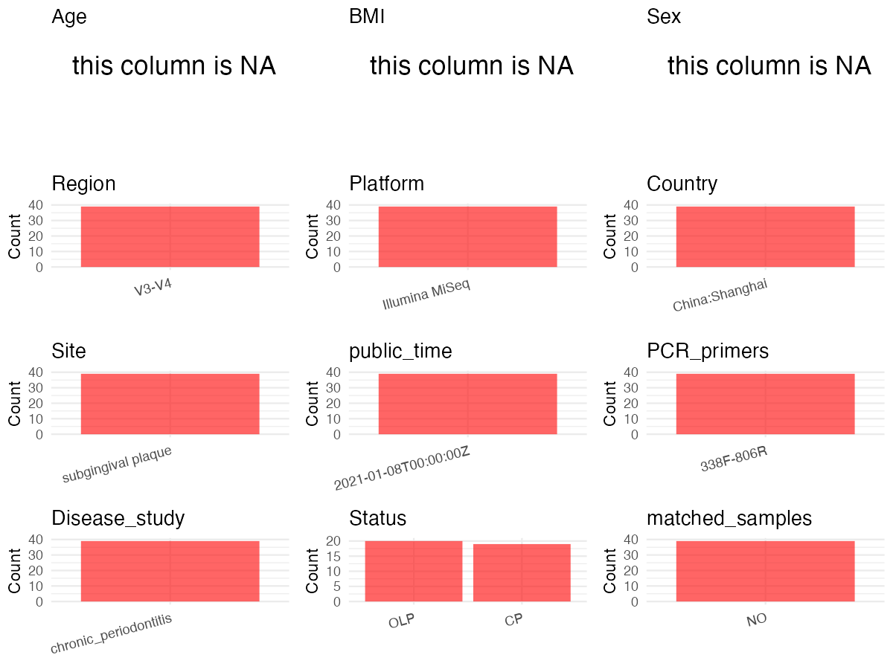

R Notebook: Metadata Processing Workflow
================

# Step 1: Obtain Initial Metadata from Each Project

To obtain the initial metadata: 1. Search for the BioProject ID (e.g.,
“PRJEBXXXX”) on the [NCBI SRA
website](https://www.ncbi.nlm.nih.gov/Traces/study/). 2. In the “Select”
table, click on “Metadata” and download the file. 3. The downloaded file
is typically named “SraRunTable.csv” and contains metadata for the
project.

``` r
# Load necessary libraries
library(dplyr)
library(ggplot2)
library(cowplot)
library(stringr)
# Set working directory (update this path to your local directory)
setwd("/Users/dongbiao/Documents/oral/PRJNA690677/")

# Read the initial metadata files
initial_meta <- read.csv("SraRunTable.csv",header = T)

head(initial_meta)
```

    ##           Run Assay.Type AvgSpotLen    Bases  BioProject    BioSample
    ## 1 SRR13386757   AMPLICON        492 45179376 PRJNA690677 SAMN17257439
    ## 2 SRR13386758   AMPLICON        493 46180789 PRJNA690677 SAMN17257438
    ## 3 SRR13386759   AMPLICON        494 59975058 PRJNA690677 SAMN17257429
    ## 4 SRR13386760   AMPLICON        495 56990835 PRJNA690677 SAMN17257428
    ## 5 SRR13386761   AMPLICON        493 52212151 PRJNA690677 SAMN17257434
    ## 6 SRR13386762   AMPLICON        494 53246284 PRJNA690677 SAMN17257433
    ##                      BioSampleModel    Bytes
    ## 1 Microbe\\, viral or environmental 15417545
    ## 2 Microbe\\, viral or environmental 15634859
    ## 3 Microbe\\, viral or environmental 20534830
    ## 4 Microbe\\, viral or environmental 19870063
    ## 5 Microbe\\, viral or environmental 17844563
    ## 6 Microbe\\, viral or environmental 17797093
    ##                                                                       Center.Name
    ## 1 SHANGHAI NINTH PEOPLE HOSPITAL SHANGHAI JIAO TONG UNIVERSITY SCHOOL OF MEDICINE
    ## 2 SHANGHAI NINTH PEOPLE HOSPITAL SHANGHAI JIAO TONG UNIVERSITY SCHOOL OF MEDICINE
    ## 3 SHANGHAI NINTH PEOPLE HOSPITAL SHANGHAI JIAO TONG UNIVERSITY SCHOOL OF MEDICINE
    ## 4 SHANGHAI NINTH PEOPLE HOSPITAL SHANGHAI JIAO TONG UNIVERSITY SCHOOL OF MEDICINE
    ## 5 SHANGHAI NINTH PEOPLE HOSPITAL SHANGHAI JIAO TONG UNIVERSITY SCHOOL OF MEDICINE
    ## 6 SHANGHAI NINTH PEOPLE HOSPITAL SHANGHAI JIAO TONG UNIVERSITY SCHOOL OF MEDICINE
    ##   Collection_Date Consent DATASTORE.filetype DATASTORE.provider
    ## 1      2018-10-05  public   fastq,run.zq,sra         gs,ncbi,s3
    ## 2      2018-09-22  public   fastq,run.zq,sra         gs,ncbi,s3
    ## 3      2018-05-19  public   fastq,run.zq,sra         gs,ncbi,s3
    ## 4      2018-05-11  public   fastq,run.zq,sra         gs,ncbi,s3
    ## 5      2018-08-13  public   fastq,run.zq,sra         gs,ncbi,s3
    ## 6      2018-07-25  public   fastq,run.zq,sra         gs,ncbi,s3
    ##                       DATASTORE.region Experiment geo_loc_name_country
    ## 1 gs.us-east1,ncbi.public,s3.us-east-1 SRX9806082                China
    ## 2 gs.us-east1,ncbi.public,s3.us-east-1 SRX9806081                China
    ## 3 gs.us-east1,ncbi.public,s3.us-east-1 SRX9806080                China
    ## 4 gs.us-east1,ncbi.public,s3.us-east-1 SRX9806079                China
    ## 5 gs.us-east1,ncbi.public,s3.us-east-1 SRX9806078                China
    ## 6 gs.us-east1,ncbi.public,s3.us-east-1 SRX9806077                China
    ##   geo_loc_name_country_continent   geo_loc_name          Host     Instrument
    ## 1                           Asia China:Shanghai not collected Illumina MiSeq
    ## 2                           Asia China:Shanghai not collected Illumina MiSeq
    ## 3                           Asia China:Shanghai not collected Illumina MiSeq
    ## 4                           Asia China:Shanghai not collected Illumina MiSeq
    ## 5                           Asia China:Shanghai not collected Illumina MiSeq
    ## 6                           Asia China:Shanghai not collected Illumina MiSeq
    ##   Library.Name LibraryLayout LibrarySelection LibrarySource      Organism
    ## 1          E12        PAIRED              PCR       GENOMIC Porphyromonas
    ## 2          E11        PAIRED              PCR       GENOMIC   Pseudomonas
    ## 3          E02        PAIRED              PCR       GENOMIC Porphyromonas
    ## 4          E01        PAIRED              PCR       GENOMIC Porphyromonas
    ## 5          E07        PAIRED              PCR       GENOMIC   Pseudomonas
    ## 6          E06        PAIRED              PCR       GENOMIC Porphyromonas
    ##   Platform          ReleaseDate          create_date version Sample.Name
    ## 1 ILLUMINA 2021-01-08T00:00:00Z 2021-01-08T09:20:00Z       1       OLP12
    ## 2 ILLUMINA 2021-01-08T00:00:00Z 2021-01-08T09:20:00Z       1       OLP11
    ## 3 ILLUMINA 2021-01-08T00:00:00Z 2021-01-08T09:20:00Z       1       OLP02
    ## 4 ILLUMINA 2021-01-08T00:00:00Z 2021-01-08T09:20:00Z       1       OLP01
    ## 5 ILLUMINA 2021-01-08T00:00:00Z 2021-01-08T09:20:00Z       1       OLP07
    ## 6 ILLUMINA 2021-01-08T00:00:00Z 2021-01-08T09:20:00Z       1       OLP06
    ##             sample_type SRA.Study        strain
    ## 1 plaque biofilm sample SRP300879 not collected
    ## 2 plaque biofilm sample SRP300879 not collected
    ## 3 plaque biofilm sample SRP300879 not collected
    ## 4 plaque biofilm sample SRP300879 not collected
    ## 5 plaque biofilm sample SRP300879 not collected
    ## 6 plaque biofilm sample SRP300879 not collected

# Step 2: Create a Uniform Metadata Template

The uniform metadata should include the following columns:

1.  **BioProject**: Project ID (e.g., “PRJNA339212”)
2.  **Run**: Sample ID (e.g., “ERRXXXXXX” or “SRRXXXXXX”)
3.  **sample_name**: Original sample name submitted by the authors (not
    the database-assigned ID)
4.  **Age**: Age of the subject (if available)
5.  **BMI**: Body Mass Index (if available)
6.  **Sex**: Sex of the subject (“F” or “M”)
7.  **Region**: Targeted 16S rRNA region (e.g., “V3-V4”)
8.  **Platform**: Sequencing platform (e.g., “Illumina MiSeq”)
9.  **Country**: Country of sample origin (e.g., “China”)
10. **Site**: Sample site (e.g., “saliva”, “dental plaque”)
11. **public_time**: Data release date (format: “YYYY-MM-DD”)
12. **PCR_primers**: PCR primers used (e.g., “515F-806R”)
13. **title**: Title of the associated publication
14. **Disease_study**: Whether the study involves a disease (“YES” or
    “NO”)
15. **Status**: Disease status (e.g., “T2DM”, “HC”). Note: If the study
    includes both disease and healthy samples, this must be specified
    per sample.
16. **matched_samples** : matched samples (“YES” or “NO”)

``` r
# Create a uniform metadata dataframe
sites <- str_extract(initial_meta$sample_type, "saliva|Plaque")
sites[sites == "Plaque"] <- "dental plaque"
metadata <- data.frame(
  BioProject = initial_meta$BioProject,
  Run = initial_meta$Run,
  sample_name = initial_meta$`Sample.Name`,
  Age = NA,
  BMI = NA,
  Sex=NA,
  Region = "V3-V4",
  Platform = initial_meta$Instrument,
  Country = initial_meta$geo_loc_name,
  Site = "subgingival plaque",
  public_time = initial_meta$ReleaseDate,
  stringsAsFactors = FALSE
)
```

# Step 3: Manually Add Information from the Publication

Some information (e.g. PCR primers, study title, disease status) must be
manually extracted from the publication and added to the metadata.

``` r
# Add information obtained from the publication
metadata$PCR_primers <- "338F-806R"
metadata$title <- "Comparative Analyses of the Subgingival Microbiome in Chronic Periodontitis Patients with and without Gingival Erosive Oral Lichen Planus Based on 16S rRNA Gene Sequencing"
metadata$Disease_study <- "chronic_periodontitis"

# Assign disease status based on sample_name patterns
metadata$Status <- gsub("[0-9]", "", initial_meta$Sample.Name)

# Create matched_samples column
metadata$matched_samples <- "NO"

# Check initial data distribution
cat("Initial sample distribution:\n")
```

    ## Initial sample distribution:

``` r
table(metadata$sample_name)
```

    ## 
    ##  CP01  CP02  CP03  CP04  CP05  CP06  CP07  CP08  CP09  CP10  CP11  CP12  CP13 
    ##     1     1     1     1     1     1     1     1     1     1     1     1     1 
    ##  CP14  CP15  CP16  CP17  CP18  CP19 OLP01 OLP02 OLP03 OLP04 OLP05 OLP06 OLP07 
    ##     1     1     1     1     1     1     1     1     1     1     1     1     1 
    ## OLP08 OLP09 OLP10 OLP11 OLP12 OLP13 OLP14 OLP15 OLP16 OLP17 OLP18 OLP19 OLP20 
    ##     1     1     1     1     1     1     1     1     1     1     1     1     1

``` r
table(metadata$Site)
```

    ## 
    ## subgingival plaque 
    ##                 39

# Step 4: Summarize and Validate the Metadata

``` r
# Check the number of unique runs and sample names
print(paste("Number of unique runs:", length(unique(metadata$Run))))
```

    ## [1] "Number of unique runs: 39"

``` r
print(paste("Number of unique sample names:", length(unique(metadata$sample_name))))
```

    ## [1] "Number of unique sample names: 39"

# Step 5: Visualize the Metadata

``` r
# Select columns for visualization
plot_data <- metadata %>%
  select(-BioProject, -Run, -sample_name, -title)

# Function to create simple plots for each column
create_simple_plots <- function(data) {
  plots <- list()
  
  for (col in colnames(data)) {
    # Check if the column is all NA
    if (all(is.na(data[[col]]))) {
      # Create an empty plot with text indicating all NA
      p <- ggplot() +
        annotate("text", x = 0.5, y = 0.5, label = "this column is NA", size = 6) +
        labs(title = col) +
        theme_void()
    } else if (is.numeric(data[[col]])) {
      # Numeric variable: histogram
      p <- ggplot(data, aes(x = .data[[col]])) +
        geom_histogram(fill = "blue", alpha = 0.6, bins = 20, na.rm = TRUE) +
        labs(title = col) +
        theme_minimal()
    } else {
      # Categorical variable: bar plot (remove NA values)
      count_data <- as.data.frame(table(data[[col]], useNA = "ifany"))
      p <- ggplot(count_data, aes(x = reorder(Var1, -Freq), y = Freq)) +
        geom_col(fill = "red", alpha = 0.6) +
        labs(title = col, x = NULL, y = "Count") +
        theme_minimal() +
        theme(axis.text.x = element_text(angle = 15, hjust = 1))
    }
    plots[[col]] <- p
  }
  
  return(plots)
}

# Generate and arrange plots
plots <- create_simple_plots(plot_data)
p<-plot_grid(plots$Age, 
          plots$BMI, 
          plots$Sex, 
          plots$Region, 
          plots$Platform, 
          plots$Country, 
          plots$Site,
          plots$public_time, 
          plots$PCR_primers,
          plots$Disease_study,
          plots$Status,
          plots$matched_samples,# add 
          ncol = 3, align = "hv", axis = "lb")
ggsave("Metadata_Summary.png", plot = p, width = 8, height = 6, dpi = 150)
```

``` r

```


# Step 6: Finalize and Export the Metadata

``` r
# Reorder columns to match the desired format
metadata <- metadata[, c(
  "BioProject", "Run", "sample_name", "Age", "BMI", "Sex", 
  "Region", "Platform", "Country", "Site", "public_time", 
  "PCR_primers", "title", "Disease_study", "Status","matched_samples"
)]

# Export the uniform metadata to a CSV file
write.csv(metadata, file = "metadata.csv", quote = FALSE)
head(metadata)
```

    ##    BioProject         Run sample_name Age BMI Sex Region       Platform
    ## 1 PRJNA690677 SRR13386757       OLP12  NA  NA  NA  V3-V4 Illumina MiSeq
    ## 2 PRJNA690677 SRR13386758       OLP11  NA  NA  NA  V3-V4 Illumina MiSeq
    ## 3 PRJNA690677 SRR13386759       OLP02  NA  NA  NA  V3-V4 Illumina MiSeq
    ## 4 PRJNA690677 SRR13386760       OLP01  NA  NA  NA  V3-V4 Illumina MiSeq
    ## 5 PRJNA690677 SRR13386761       OLP07  NA  NA  NA  V3-V4 Illumina MiSeq
    ## 6 PRJNA690677 SRR13386762       OLP06  NA  NA  NA  V3-V4 Illumina MiSeq
    ##          Country               Site          public_time PCR_primers
    ## 1 China:Shanghai subgingival plaque 2021-01-08T00:00:00Z   338F-806R
    ## 2 China:Shanghai subgingival plaque 2021-01-08T00:00:00Z   338F-806R
    ## 3 China:Shanghai subgingival plaque 2021-01-08T00:00:00Z   338F-806R
    ## 4 China:Shanghai subgingival plaque 2021-01-08T00:00:00Z   338F-806R
    ## 5 China:Shanghai subgingival plaque 2021-01-08T00:00:00Z   338F-806R
    ## 6 China:Shanghai subgingival plaque 2021-01-08T00:00:00Z   338F-806R
    ##                                                                                                                                                                         title
    ## 1 Comparative Analyses of the Subgingival Microbiome in Chronic Periodontitis Patients with and without Gingival Erosive Oral Lichen Planus Based on 16S rRNA Gene Sequencing
    ## 2 Comparative Analyses of the Subgingival Microbiome in Chronic Periodontitis Patients with and without Gingival Erosive Oral Lichen Planus Based on 16S rRNA Gene Sequencing
    ## 3 Comparative Analyses of the Subgingival Microbiome in Chronic Periodontitis Patients with and without Gingival Erosive Oral Lichen Planus Based on 16S rRNA Gene Sequencing
    ## 4 Comparative Analyses of the Subgingival Microbiome in Chronic Periodontitis Patients with and without Gingival Erosive Oral Lichen Planus Based on 16S rRNA Gene Sequencing
    ## 5 Comparative Analyses of the Subgingival Microbiome in Chronic Periodontitis Patients with and without Gingival Erosive Oral Lichen Planus Based on 16S rRNA Gene Sequencing
    ## 6 Comparative Analyses of the Subgingival Microbiome in Chronic Periodontitis Patients with and without Gingival Erosive Oral Lichen Planus Based on 16S rRNA Gene Sequencing
    ##           Disease_study Status matched_samples
    ## 1 chronic_periodontitis    OLP              NO
    ## 2 chronic_periodontitis    OLP              NO
    ## 3 chronic_periodontitis    OLP              NO
    ## 4 chronic_periodontitis    OLP              NO
    ## 5 chronic_periodontitis    OLP              NO
    ## 6 chronic_periodontitis    OLP              NO

## Notes for Students:

1.  **Metadata Accuracy**: Always cross-check the metadata with the
    original publication to ensure accuracy.
2.  **Manual Entries**: Columns like `PCR_primers`, and `Status` often
    require manual entry based on the publication.
3.  **Disease Status**: Be careful when assigning `Status`—some studies
    include both disease and healthy samples.
4.  **Visualization**: The plots help quickly identify the distribution
    of values in each column, which is useful for quality control.
5.  **Reproducibility**: Update the working directory and file paths to
    match your local environment.
