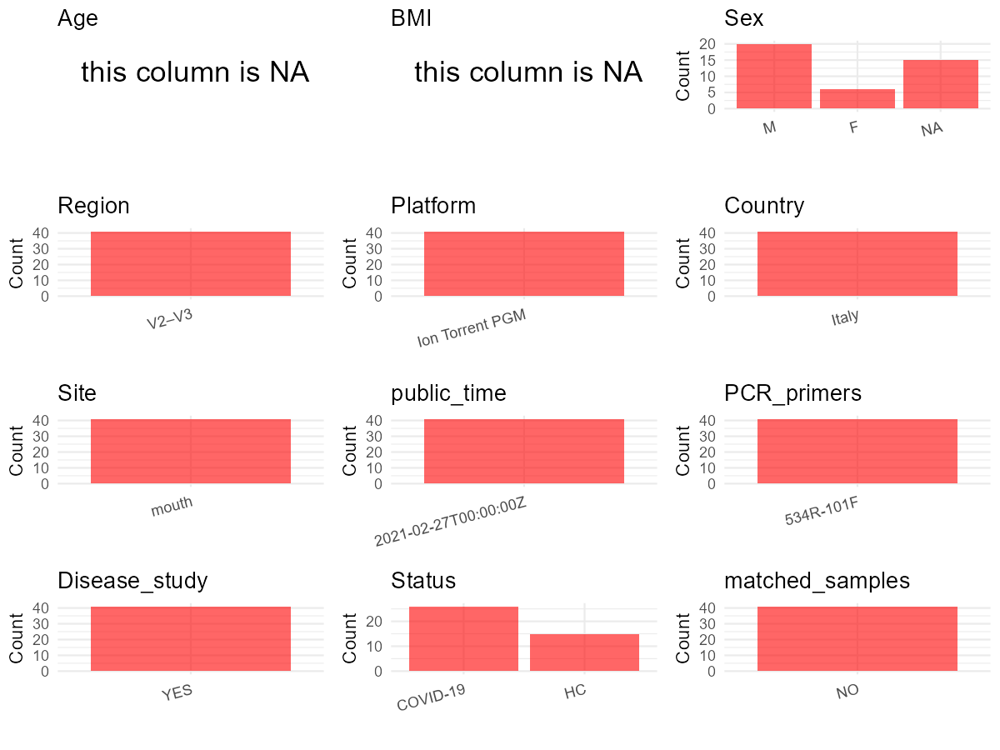

R Notebook: Metadata Processing Workflow
================

# Step 1: Obtain Initial Metadata from Each Project

To obtain the initial metadata: 1. Search for the BioProject ID (e.g.,
“PRJEBXXXX”) on the [NCBI SRA
website](https://www.ncbi.nlm.nih.gov/Traces/study/). 2. In the “Select”
table, click on “Metadata” and download the file. 3. The downloaded file
is typically named “SraRunTable.csv” and contains metadata for the
project.

``` r
# Load necessary libraries
library(dplyr)
library(ggplot2)
library(cowplot)

# Set working directory (update this path to your local directory)
setwd("D:/oral_project/PRJNA692359")

# Read the initial metadata files
initial_meta<-read.csv("SraRunTable.csv",header = T)

# Combine the two metadata files
#meta <- rbind(initial_meta, initial_meta1)

#Remove entries non-oral samples
#initial_meta <- subset(initial_meta,isolate %in% c("saliva","tongue coat"))

# Check the number of samples containing "HT" in Sample.Name (e.g., healthy controls)
#nrow(subset(meta, grepl("HT", Sample.Name)))

# Display the first few rows of the metadata
head(initial_meta)
```

    ##           Run Assay.Type AvgSpotLen    Bases  BioProject    BioSample
    ## 1 SRR13442657   AMPLICON        177 16257297 PRJNA692359 SAMN17320906
    ## 2 SRR13442658   AMPLICON        160  8098743 PRJNA692359 SAMN17320905
    ## 3 SRR13442659   AMPLICON        149 15968428 PRJNA692359 SAMN17320904
    ## 4 SRR13442660   AMPLICON        175 15300174 PRJNA692359 SAMN17320903
    ## 5 SRR13442661   AMPLICON        181  3648948 PRJNA692359 SAMN17320902
    ## 6 SRR13442662   AMPLICON        171  7012582 PRJNA692359 SAMN17320937
    ##                                        BioSampleModel    Bytes
    ## 1 MIMARKS.specimen,MIGS/MIMS/MIMARKS.human-associated 12927761
    ## 2 MIMARKS.specimen,MIGS/MIMS/MIMARKS.human-associated  6549959
    ## 3 MIMARKS.specimen,MIGS/MIMS/MIMARKS.human-associated 12803110
    ## 4 MIMARKS.specimen,MIGS/MIMS/MIMARKS.human-associated 12322697
    ## 5 MIMARKS.specimen,MIGS/MIMS/MIMARKS.human-associated  2987322
    ## 6 MIMARKS.specimen,MIGS/MIMS/MIMARKS.human-associated  5082405
    ##             Center.Name Collection_Date Consent       Cultivar
    ## 1 UNIVERSITY OF TRIESTE            2020  public not applicable
    ## 2 UNIVERSITY OF TRIESTE            2020  public not applicable
    ## 3 UNIVERSITY OF TRIESTE            2020  public not applicable
    ## 4 UNIVERSITY OF TRIESTE            2020  public not applicable
    ## 5 UNIVERSITY OF TRIESTE            2020  public not applicable
    ## 6 UNIVERSITY OF TRIESTE            2020  public not applicable
    ##   DATASTORE.filetype DATASTORE.provider                     DATASTORE.region
    ## 1   fastq,run.zq,sra         gs,ncbi,s3 gs.us-east1,ncbi.public,s3.us-east-1
    ## 2   fastq,run.zq,sra         gs,ncbi,s3 gs.us-east1,ncbi.public,s3.us-east-1
    ## 3   fastq,run.zq,sra         gs,ncbi,s3 gs.us-east1,ncbi.public,s3.us-east-1
    ## 4   fastq,run.zq,sra         gs,ncbi,s3 gs.us-east1,ncbi.public,s3.us-east-1
    ## 5   fastq,run.zq,sra         gs,ncbi,s3 gs.us-east1,ncbi.public,s3.us-east-1
    ## 6   fastq,run.zq,sra         gs,ncbi,s3 gs.us-east1,ncbi.public,s3.us-east-1
    ##          Ecotype      env_biome    env_feature env_material Experiment
    ## 1 not applicable not applicable not applicable        mouth SRX9856112
    ## 2 not applicable not applicable not applicable        mouth SRX9856111
    ## 3 not applicable not applicable not applicable        mouth SRX9856110
    ## 4 not applicable not applicable not applicable        mouth SRX9856109
    ## 5 not applicable not applicable not applicable        mouth SRX9856108
    ## 6 not applicable not applicable not applicable        mouth SRX9856107
    ##   geo_loc_name_country geo_loc_name_country_continent   geo_loc_name
    ## 1                Italy                         Europe Italy: Trieste
    ## 2                Italy                         Europe Italy: Trieste
    ## 3                Italy                         Europe Italy: Trieste
    ## 4                Italy                         Europe Italy: Trieste
    ## 5                Italy                         Europe Italy: Trieste
    ## 6                Italy                         Europe Italy: Trieste
    ##   Host_disease         HOST host_subject_id      Instrument isol_growth_condt
    ## 1     COVID-19 Homo sapiens          17ator Ion Torrent PGM    not applicable
    ## 2     COVID-19 Homo sapiens          16ator Ion Torrent PGM    not applicable
    ## 3     COVID-19 Homo sapiens          15ator Ion Torrent PGM    not applicable
    ## 4     COVID-19 Homo sapiens          14ator Ion Torrent PGM    not applicable
    ## 5     COVID-19 Homo sapiens          13ator Ion Torrent PGM    not applicable
    ## 6      Control Homo sapiens              VW Ion Torrent PGM    not applicable
    ##          isolate         lat_lon Library.Name LibraryLayout LibrarySelection
    ## 1 not applicable 45.65 N 13.77 E       17ator        SINGLE              PCR
    ## 2 not applicable 45.65 N 13.77 E       16ator        SINGLE              PCR
    ## 3 not applicable 45.65 N 13.77 E       15ator        SINGLE              PCR
    ## 4 not applicable 45.65 N 13.77 E       14ator        SINGLE              PCR
    ## 5 not applicable 45.65 N 13.77 E       13ator        SINGLE              PCR
    ## 6 not applicable 45.65 N 13.77 E           VW        SINGLE              PCR
    ##   LibrarySource         Organism    Platform          ReleaseDate
    ## 1   METAGENOMIC human metagenome ION_TORRENT 2021-02-27T00:00:00Z
    ## 2   METAGENOMIC human metagenome ION_TORRENT 2021-02-27T00:00:00Z
    ## 3   METAGENOMIC human metagenome ION_TORRENT 2021-02-27T00:00:00Z
    ## 4   METAGENOMIC human metagenome ION_TORRENT 2021-02-27T00:00:00Z
    ## 5   METAGENOMIC human metagenome ION_TORRENT 2021-02-27T00:00:00Z
    ## 6   METAGENOMIC human metagenome ION_TORRENT 2021-02-27T00:00:00Z
    ##            create_date version Sample_id Sample.Name SRA.Study         strain
    ## 1 2021-01-15T07:31:00Z       1    17ator      17ator SRP301894 not applicable
    ## 2 2021-01-15T07:31:00Z       1    16ator      16ator SRP301894 not applicable
    ## 3 2021-01-15T07:31:00Z       1    15ator      15ator SRP301894 not applicable
    ## 4 2021-01-15T07:31:00Z       1    14ator      14ator SRP301894 not applicable
    ## 5 2021-01-15T07:31:00Z       1    13ator      13ator SRP301894 not applicable
    ## 6 2021-01-15T07:31:00Z       1        VW          VW SRP301894 not applicable

# Step 2: Create a Uniform Metadata Template

The uniform metadata should include the following columns:

1.  **BioProject**: Project ID (e.g., “PRJNA339212”)
2.  **Run**: Sample ID (e.g., “ERRXXXXXX” or “SRRXXXXXX”)
3.  **sample_name**: Original sample name submitted by the authors (not
    the database-assigned ID)
4.  **Age**: Age of the subject (if available)
5.  **BMI**: Body Mass Index (if available)
6.  **Sex**: Sex of the subject (“F” or “M”)
7.  **Region**: Targeted 16S rRNA region (e.g., “V3-V4”)
8.  **Platform**: Sequencing platform (e.g., “Illumina MiSeq”)
9.  **Country**: Country of sample origin (e.g., “China”)
10. **Site**: Sample site (e.g., “saliva”, “dental plaque”)
11. **public_time**: Data release date (format: “YYYY-MM-DD”)
12. **PCR_primers**: PCR primers used (e.g., “515F-806R”)
13. **title**: Title of the associated publication
14. **Disease_study**: Whether the study involves a disease (“YES” or
    “NO”)
15. **Status**: Disease status (e.g., “T2DM”, “HC”). Note: If the study
    includes both disease and healthy samples, this must be specified
    per sample.
16. **matched_samples**: matched samples (“YES” or “NO”)

``` r
# Create a uniform metadata dataframe
metadata <- data.frame(
  BioProject = initial_meta$BioProject,
  Run = initial_meta$Run,
  sample_name = initial_meta$Sample.Name,
  Age = NA,
  BMI = NA,
  #Sex = NA,
  Region = "V2–V3",
  Platform = initial_meta$Instrument,
  Country = initial_meta$geo_loc_name_country,
  Site = initial_meta$env_material,
  public_time = initial_meta$ReleaseDate,
  stringsAsFactors = FALSE
)
```

``` r
metadata <- metadata %>%
  mutate(
    Sex = case_when(
      grepl("A", sample_name) ~ "F",  # 如果样本名称包含"A"，则性别为"F"（女性）
      grepl("ator|btor", sample_name) ~ "M",  # 如果样本名称包含"ator"，则性别为"M"（男性）
      sample_name %in% c("sal", "VW", "PF", "ON", "DG", "", NA) ~ NA_character_,  # 如果样本名称是这些未提供或未指定的值，则性别设为NA
      TRUE ~ NA_character_  # 其他所有情况，性别也设为NA
    )
  )
```

# Step 3: Manually Add Information from the Publication

Some information (e.g. PCR primers, study title, disease status) must be
manually extracted from the publication and added to the metadata.

``` r
# Add information obtained from the publication
metadata$PCR_primers <- "534R-101F"
metadata$title <- "Profiling of Oral Microbiota and Cytokines in COVID-19 Patients"
metadata$Disease_study <- "YES"
# Assign disease status based on sample_name patterns
metadata <- metadata %>%
  mutate(Status = case_when(
    grepl("VW|PF|ON|DG|sal", sample_name) ~ "HC",
    grepl("ator|A|btor", sample_name) ~ "COVID-19"
  ))

#get subjects id according to sample id
metadata$sample_name<-gsub("","",metadata$sample_name)
#get subjects id with Saliva available
keep_subjects<-subset(metadata,Site %in% "mouth")
#remove subjects without Saliva samples
metadata<-subset(metadata,sample_name %in% keep_subjects$sample_name)
#get subjects sampling counts
sample_counts <- table(metadata$sample_name)
# Create matched_samples column, any subjects have >=2 samples will be label "YES", otherwise "NO"
metadata$matched_samples <- ifelse(metadata$sample_name %in% names(sample_counts[sample_counts >= 2]), "YES", "NO")
```

# Step 4: Summarize and Validate the Metadata

``` r
# Check the number of unique runs and sample names
print(paste("Number of unique runs:", length(unique(metadata$Run))))
```

    ## [1] "Number of unique runs: 41"

``` r
print(paste("Number of unique sample names:", length(unique(metadata$sample_name))))
```

    ## [1] "Number of unique sample names: 41"

# Step 5: Visualize the Metadata

``` r

```


# Step 6: Finalize and Export the Metadata

``` r
# Reorder columns to match the desired format
metadata <- metadata[, c(
  "BioProject", "Run", "sample_name", "Age", "BMI", "Sex", 
  "Region", "Platform", "Country", "Site", "public_time", 
  "PCR_primers", "title", "Disease_study", "Status","matched_samples"
)]

# Export the uniform metadata to a CSV file
write.csv(metadata, file = "metadata.csv", quote = TRUE)
head(metadata)
```

    ##    BioProject         Run sample_name Age BMI  Sex Region        Platform
    ## 1 PRJNA692359 SRR13442657      17ator  NA  NA    M  V2–V3 Ion Torrent PGM
    ## 2 PRJNA692359 SRR13442658      16ator  NA  NA    M  V2–V3 Ion Torrent PGM
    ## 3 PRJNA692359 SRR13442659      15ator  NA  NA    M  V2–V3 Ion Torrent PGM
    ## 4 PRJNA692359 SRR13442660      14ator  NA  NA    M  V2–V3 Ion Torrent PGM
    ## 5 PRJNA692359 SRR13442661      13ator  NA  NA    M  V2–V3 Ion Torrent PGM
    ## 6 PRJNA692359 SRR13442662          VW  NA  NA <NA>  V2–V3 Ion Torrent PGM
    ##   Country  Site          public_time PCR_primers
    ## 1   Italy mouth 2021-02-27T00:00:00Z   534R-101F
    ## 2   Italy mouth 2021-02-27T00:00:00Z   534R-101F
    ## 3   Italy mouth 2021-02-27T00:00:00Z   534R-101F
    ## 4   Italy mouth 2021-02-27T00:00:00Z   534R-101F
    ## 5   Italy mouth 2021-02-27T00:00:00Z   534R-101F
    ## 6   Italy mouth 2021-02-27T00:00:00Z   534R-101F
    ##                                                             title Disease_study
    ## 1 Profiling of Oral Microbiota and Cytokines in COVID-19 Patients           YES
    ## 2 Profiling of Oral Microbiota and Cytokines in COVID-19 Patients           YES
    ## 3 Profiling of Oral Microbiota and Cytokines in COVID-19 Patients           YES
    ## 4 Profiling of Oral Microbiota and Cytokines in COVID-19 Patients           YES
    ## 5 Profiling of Oral Microbiota and Cytokines in COVID-19 Patients           YES
    ## 6 Profiling of Oral Microbiota and Cytokines in COVID-19 Patients           YES
    ##     Status matched_samples
    ## 1 COVID-19              NO
    ## 2 COVID-19              NO
    ## 3 COVID-19              NO
    ## 4 COVID-19              NO
    ## 5 COVID-19              NO
    ## 6       HC              NO

## Notes for Students:

1.  **Metadata Accuracy**: Always cross-check the metadata with the
    original publication to ensure accuracy.
2.  **Manual Entries**: Columns like `PCR_primers`, and `Status` often
    require manual entry based on the publication.
3.  **Disease Status**: Be careful when assigning `Status`—some studies
    include both disease and healthy samples.
4.  **Visualization**: The plots help quickly identify the distribution
    of values in each column, which is useful for quality control.
5.  **Reproducibility**: Update the working directory and file paths to
    match your local environment.
