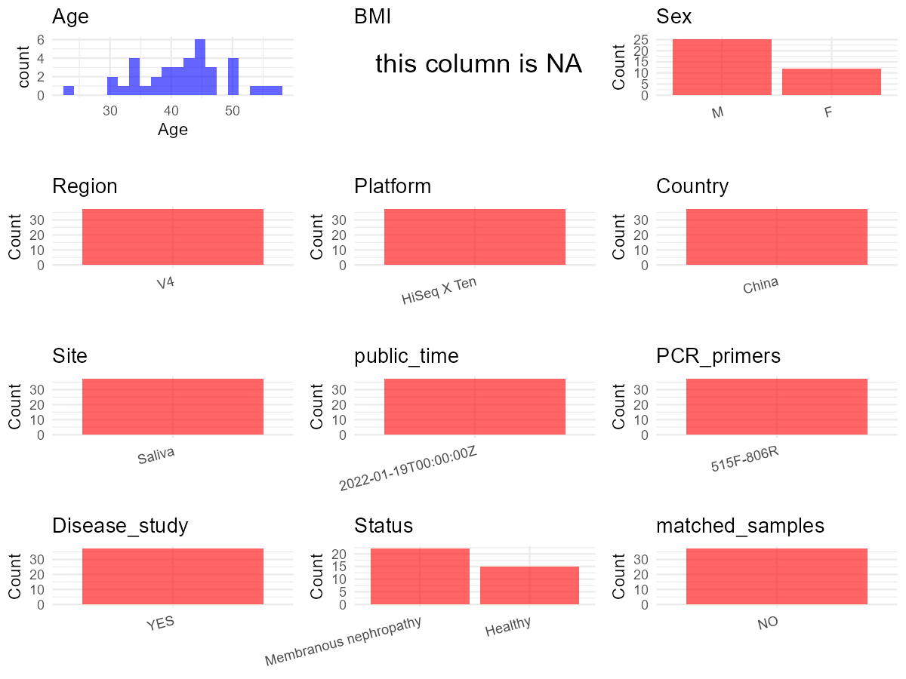

R Notebook: Metadata Processing Workflow
================

# Step 1: Obtain Initial Metadata from Each Project

To obtain the initial metadata: 1. Search for the BioProject ID (e.g.,
“PRJEBXXXX”) on the [NCBI SRA
website](https://www.ncbi.nlm.nih.gov/Traces/study/). 2. In the “Select”
table, click on “Metadata” and download the file. 3. The downloaded file
is typically named “SraRunTable.csv” and contains metadata for the
project.

``` r
# Load necessary libraries
library(dplyr)
library(ggplot2)
library(cowplot)

# Set working directory (update this path to your local directory)
setwd("D:/oral_project/PRJNA698736")

# Read the initial metadata files
initial_meta<-read.csv("SraRunTable.csv",header = T)

# Combine the two metadata files
#meta <- rbind(initial_meta, initial_meta1)

#Remove entries where Organism is "gut metagenome" (non-oral samples)
#initial_meta <- subset(initial_meta,isolation_source!= "feces")

# Check the number of samples containing "HT" in Sample.Name (e.g., healthy controls)
#nrow(subset(meta, grepl("HT", Sample.Name)))

# Display the first few rows of the metadata
head(initial_meta)
```

    ##           Run Assay.Type AvgSpotLen    Bases  BioProject    BioSample
    ## 1 SRR17629864   AMPLICON        496 33978306 PRJNA698736 SAMN25014552
    ## 2 SRR17629865   AMPLICON        496 30812863 PRJNA698736 SAMN25014551
    ## 3 SRR17629866   AMPLICON        495 29495225 PRJNA698736 SAMN25014550
    ## 4 SRR17629867   AMPLICON        496 27483717 PRJNA698736 SAMN25014549
    ## 5 SRR17629868   AMPLICON        496 33798374 PRJNA698736 SAMN25014548
    ## 6 SRR17629869   AMPLICON        496 34672296 PRJNA698736 SAMN25014547
    ##                BioSampleModel    Bytes
    ## 1 Metagenome or environmental 20464543
    ## 2 Metagenome or environmental 18533505
    ## 3 Metagenome or environmental 18099037
    ## 4 Metagenome or environmental 16642477
    ## 5 Metagenome or environmental 20518404
    ## 6 Metagenome or environmental 21017380
    ##                                                                 Center.Name
    ## 1 GUANGDONG MEDICAL UNIVERSITY AFFILIATED LONGHUA DISTRICT CENTRAL HOSPITAL
    ## 2 GUANGDONG MEDICAL UNIVERSITY AFFILIATED LONGHUA DISTRICT CENTRAL HOSPITAL
    ## 3 GUANGDONG MEDICAL UNIVERSITY AFFILIATED LONGHUA DISTRICT CENTRAL HOSPITAL
    ## 4 GUANGDONG MEDICAL UNIVERSITY AFFILIATED LONGHUA DISTRICT CENTRAL HOSPITAL
    ## 5 GUANGDONG MEDICAL UNIVERSITY AFFILIATED LONGHUA DISTRICT CENTRAL HOSPITAL
    ## 6 GUANGDONG MEDICAL UNIVERSITY AFFILIATED LONGHUA DISTRICT CENTRAL HOSPITAL
    ##   Collection_Date Consent DATASTORE.filetype DATASTORE.provider
    ## 1        2017/4/2  public   fastq,run.zq,sra         gs,ncbi,s3
    ## 2        2017/3/2  public   fastq,run.zq,sra         gs,ncbi,s3
    ## 3        2017/2/1  public   fastq,run.zq,sra         gs,ncbi,s3
    ## 4        2017/1/3  public   fastq,run.zq,sra         gs,ncbi,s3
    ## 5        2017/1/2  public   fastq,run.zq,sra         gs,ncbi,s3
    ## 6       2016/10/7  public   fastq,run.zq,sra         gs,ncbi,s3
    ##                       DATASTORE.region  Experiment geo_loc_name_country
    ## 1 gs.us-east1,ncbi.public,s3.us-east-1 SRX13798296                China
    ## 2 gs.us-east1,ncbi.public,s3.us-east-1 SRX13798295                China
    ## 3 gs.us-east1,ncbi.public,s3.us-east-1 SRX13798294                China
    ## 4 gs.us-east1,ncbi.public,s3.us-east-1 SRX13798293                China
    ## 5 gs.us-east1,ncbi.public,s3.us-east-1 SRX13798292                China
    ## 6 gs.us-east1,ncbi.public,s3.us-east-1 SRX13798291                China
    ##   geo_loc_name_country_continent   geo_loc_name         HOST  Instrument
    ## 1                           Asia China:Shenzhen Homo sapiens HiSeq X Ten
    ## 2                           Asia China:Shenzhen Homo sapiens HiSeq X Ten
    ## 3                           Asia China:Shenzhen Homo sapiens HiSeq X Ten
    ## 4                           Asia China:Shenzhen Homo sapiens HiSeq X Ten
    ## 5                           Asia China:Shenzhen Homo sapiens HiSeq X Ten
    ## 6                           Asia China:Shenzhen Homo sapiens HiSeq X Ten
    ##   isolation_source                lat_lon Library.Name LibraryLayout
    ## 1      oral cavity 22.718857 N 114.0535 E      D170402        PAIRED
    ## 2      oral cavity 22.718857 N 114.0534 E      D170302        PAIRED
    ## 3      oral cavity 22.718857 N 114.0533 E      D170201        PAIRED
    ## 4      oral cavity 22.718857 N 114.0532 E      D170103        PAIRED
    ## 5      oral cavity 22.718857 N 114.0531 E      D170102        PAIRED
    ## 6      oral cavity 22.718857 N 114.0530 E      D161007        PAIRED
    ##   LibrarySelection LibrarySource        Organism Platform          ReleaseDate
    ## 1              PCR   METAGENOMIC oral metagenome ILLUMINA 2022-01-19T00:00:00Z
    ## 2              PCR   METAGENOMIC oral metagenome ILLUMINA 2022-01-19T00:00:00Z
    ## 3              PCR   METAGENOMIC oral metagenome ILLUMINA 2022-01-19T00:00:00Z
    ## 4              PCR   METAGENOMIC oral metagenome ILLUMINA 2022-01-19T00:00:00Z
    ## 5              PCR   METAGENOMIC oral metagenome ILLUMINA 2022-01-19T00:00:00Z
    ## 6              PCR   METAGENOMIC oral metagenome ILLUMINA 2022-01-19T00:00:00Z
    ##            create_date version Sample.Name SRA.Study Sex Age
    ## 1 2022-01-15T22:01:00Z       1     D170402 SRP355184   M  50
    ## 2 2022-01-15T22:01:00Z       1     D170302 SRP355184   F  45
    ## 3 2022-01-15T22:01:00Z       1     D170201 SRP355184   M  42
    ## 4 2022-01-15T22:01:00Z       1     D170103 SRP355184   M  53
    ## 5 2022-01-15T22:01:00Z       1     D170102 SRP355184   F  39
    ## 6 2022-01-15T22:01:00Z       1     D161007 SRP355184   F  44
    ##                   Status
    ## 1 Membranous nephropathy
    ## 2 Membranous nephropathy
    ## 3 Membranous nephropathy
    ## 4 Membranous nephropathy
    ## 5 Membranous nephropathy
    ## 6 Membranous nephropathy

# Step 2: Create a Uniform Metadata Template

The uniform metadata should include the following columns:

1.  **BioProject**: Project ID (e.g., “PRJNA339212”)
2.  **Run**: Sample ID (e.g., “ERRXXXXXX” or “SRRXXXXXX”)
3.  **sample_name**: Original sample name submitted by the authors (not
    the database-assigned ID)
4.  **Age**: Age of the subject (if available)
5.  **BMI**: Body Mass Index (if available)
6.  **Sex**: Sex of the subject (“F” or “M”)
7.  **Region**: Targeted 16S rRNA region (e.g., “V3-V4”)
8.  **Platform**: Sequencing platform (e.g., “Illumina MiSeq”)
9.  **Country**: Country of sample origin (e.g., “China”)
10. **Site**: Sample site (e.g., “saliva”, “dental plaque”)
11. **public_time**: Data release date (format: “YYYY-MM-DD”)
12. **PCR_primers**: PCR primers used (e.g., “515F-806R”)
13. **title**: Title of the associated publication
14. **Disease_study**: Whether the study involves a disease (“YES” or
    “NO”)
15. **Status**: Disease status (e.g., “T2DM”, “HC”). Note: If the study
    includes both disease and healthy samples, this must be specified
    per sample.

``` r
# Create a uniform metadata dataframe
metadata <- data.frame(
  BioProject = initial_meta$BioProject,
  Run = initial_meta$Run,
  sample_name = initial_meta$Sample.Name,
  Age = initial_meta$Age,
  BMI = NA,
  Sex=initial_meta$Sex,
  Region = "V4",
  Platform = initial_meta$Instrument,
  Country = initial_meta$geo_loc_name_country,
  Site ="Saliva",
  public_time = initial_meta$ReleaseDate,
  stringsAsFactors = FALSE
)
```

# Step 3: Manually Add Information from the Publication

Some information (e.g. PCR primers, study title, disease status) must be
manually extracted from the publication and added to the metadata.

``` r
# Add information obtained from the publication
metadata$PCR_primers <- "515F-806R"
metadata$title <- "Salivary microbiota analysis of patients with membranous nephropathy"
#metadata<-subset(uniform_meta,Site!="feces")
metadata$Disease_study <- "YES"
# Assign disease status based on sample_name patterns
metadata$Status <- initial_meta$Status
#extract subject id by remove prefix of sample_name
#metadata$sample_name <- gsub("[FSP].*", "", metadata$sample_name)
#get subjects id with Saliva available
#keep_subjects<-subset(metadata,Site %in% c("saliva"))
#remove subjects without Saliva samples
#metadata<-subset(metadata,sample_name %in% keep_subjects$sample_name)
#get subjects sampling counts
#sample_counts <- table(metadata$sample_name)
# Create matched_samples column, any subjects have >=2 samples will be label "YES", otherwise "NO"
#metadata$matched_samples <- ifelse(metadata$sample_name %in% names(sample_counts[sample_counts >= 2]), "YES", "NO")
#metadata$BMI<-gsub("not provided",NA,metadata$BMI)
#metadata$BMI<-as.numeric(metadata$BMI)
metadata$matched_samples<-"NO"
```

# Step 4: Summarize and Validate the Metadata

``` r
# Check the number of unique runs and sample names
print(paste("Number of unique runs:", length(unique(metadata$Run))))
```

    ## [1] "Number of unique runs: 37"

``` r
print(paste("Number of unique sample names:", length(unique(metadata$sample_name))))
```

    ## [1] "Number of unique sample names: 37"

# Step 5: Visualize the Metadata

``` r

```


# Step 6: Finalize and Export the Metadata

``` r
# Reorder columns to match the desired format
metadata <- metadata[, c(
  "BioProject", "Run", "sample_name", "Age", "BMI", "Sex", 
  "Region", "Platform", "Country", "Site", "public_time", 
  "PCR_primers", "title", "Disease_study", "Status","matched_samples"
)]

# Export the uniform metadata to a CSV file
write.csv(metadata, file = "metadata.csv", quote = FALSE)
head(metadata)
```

    ##    BioProject         Run sample_name Age BMI Sex Region    Platform Country
    ## 1 PRJNA698736 SRR17629864     D170402  50  NA   M     V4 HiSeq X Ten   China
    ## 2 PRJNA698736 SRR17629865     D170302  45  NA   F     V4 HiSeq X Ten   China
    ## 3 PRJNA698736 SRR17629866     D170201  42  NA   M     V4 HiSeq X Ten   China
    ## 4 PRJNA698736 SRR17629867     D170103  53  NA   M     V4 HiSeq X Ten   China
    ## 5 PRJNA698736 SRR17629868     D170102  39  NA   F     V4 HiSeq X Ten   China
    ## 6 PRJNA698736 SRR17629869     D161007  44  NA   F     V4 HiSeq X Ten   China
    ##     Site          public_time PCR_primers
    ## 1 Saliva 2022-01-19T00:00:00Z   515F-806R
    ## 2 Saliva 2022-01-19T00:00:00Z   515F-806R
    ## 3 Saliva 2022-01-19T00:00:00Z   515F-806R
    ## 4 Saliva 2022-01-19T00:00:00Z   515F-806R
    ## 5 Saliva 2022-01-19T00:00:00Z   515F-806R
    ## 6 Saliva 2022-01-19T00:00:00Z   515F-806R
    ##                                                                  title
    ## 1 Salivary microbiota analysis of patients with membranous nephropathy
    ## 2 Salivary microbiota analysis of patients with membranous nephropathy
    ## 3 Salivary microbiota analysis of patients with membranous nephropathy
    ## 4 Salivary microbiota analysis of patients with membranous nephropathy
    ## 5 Salivary microbiota analysis of patients with membranous nephropathy
    ## 6 Salivary microbiota analysis of patients with membranous nephropathy
    ##   Disease_study                 Status matched_samples
    ## 1           YES Membranous nephropathy              NO
    ## 2           YES Membranous nephropathy              NO
    ## 3           YES Membranous nephropathy              NO
    ## 4           YES Membranous nephropathy              NO
    ## 5           YES Membranous nephropathy              NO
    ## 6           YES Membranous nephropathy              NO

## Notes for Students:

1.  **Metadata Accuracy**: Always cross-check the metadata with the
    original publication to ensure accuracy.
2.  **Manual Entries**: Columns like `PCR_primers`, and `Status` often
    require manual entry based on the publication.
3.  **Disease Status**: Be careful when assigning `Status`—some studies
    include both disease and healthy samples.
4.  **Visualization**: The plots help quickly identify the distribution
    of values in each column, which is useful for quality control.
5.  **Reproducibility**: Update the working directory and file paths to
    match your local environment.
