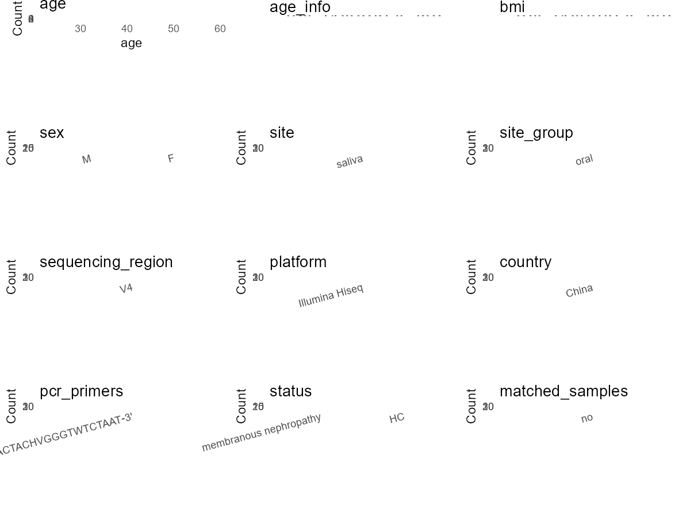

R Notebook: Metadata Processing Workflow
================

# Step 1: Obtain Initial Metadata from Each Project

This step sets the project directory, loads the raw SRA metadata, and
optionally merges supplement tables.

``` r
# Load libraries
library(dplyr)
library(ggplot2)
library(cowplot)

# (1) Setting working directory
# EDIT HERE: change project_id for each study
project_id <- "PRJNA698736" 

base_dir <- "E:/oral/26/metadata-2604/Oral-Metadata-YL-02"
setwd(file.path(base_dir, project_id))

# (2) Loading raw SRA metadata file
sra_file <- "SraRunTable.csv"
initial_meta <- read.csv(sra_file, header = TRUE)

# (3) OPTIONAL: If extra metadata (e.g., Table.x or supplemental materials) are available from the article, you may need to merge the file with initial_meta manually. Below is example code for merging. Depending on the specific case of each study, you can customize the code as needed.
# supp_table <- read.csv("supplemental_table.csv", header = TRUE)
# initial_meta <- left_join(initial_meta, supp_table, by = merge_col_name)
```

# Step 2: Data Overview

First, you need to get an overview of the data, which includes two
steps: reading the article and reading the initial metadata. This step
is very IMPORTANT!

``` r
# (1) Read the article in the following order: abstract, the beginning of the results section, and the methods. Understand the sample size, experimental design, and disease group overview. Clarify the sampling sites; for oral and gut samples, specify the exact sites like supragingival plaque, tongue, etc.

# (2) IMPORTANT: MUST go through each column of initial_meta
head(initial_meta, 10)
```

    ##            Run Assay.Type AvgSpotLen     Bases  BioProject    BioSample
    ## 1  SRR17629864   AMPLICON        496  33978306 PRJNA698736 SAMN25014552
    ## 2  SRR17629865   AMPLICON        496  30812863 PRJNA698736 SAMN25014551
    ## 3  SRR17629866   AMPLICON        495  29495225 PRJNA698736 SAMN25014550
    ## 4  SRR17629867   AMPLICON        496  27483717 PRJNA698736 SAMN25014549
    ## 5  SRR17629868   AMPLICON        496  33798374 PRJNA698736 SAMN25014548
    ## 6  SRR17629869   AMPLICON        496  34672296 PRJNA698736 SAMN25014547
    ## 7  SRR17629870   AMPLICON        486 111315950 PRJNA698736 SAMN25014579
    ## 8  SRR17629871   AMPLICON        487 102696542 PRJNA698736 SAMN25014578
    ## 9  SRR17629872   AMPLICON        485 109682267 PRJNA698736 SAMN25014577
    ## 10 SRR17629873   AMPLICON        486 111425335 PRJNA698736 SAMN25014576
    ##                 BioSampleModel    Bytes
    ## 1  Metagenome or environmental 20464543
    ## 2  Metagenome or environmental 18533505
    ## 3  Metagenome or environmental 18099037
    ## 4  Metagenome or environmental 16642477
    ## 5  Metagenome or environmental 20518404
    ## 6  Metagenome or environmental 21017380
    ## 7  Metagenome or environmental 35384797
    ## 8  Metagenome or environmental 32723242
    ## 9  Metagenome or environmental 34900156
    ## 10 Metagenome or environmental 35220251
    ##                                                                  Center.Name
    ## 1  GUANGDONG MEDICAL UNIVERSITY AFFILIATED LONGHUA DISTRICT CENTRAL HOSPITAL
    ## 2  GUANGDONG MEDICAL UNIVERSITY AFFILIATED LONGHUA DISTRICT CENTRAL HOSPITAL
    ## 3  GUANGDONG MEDICAL UNIVERSITY AFFILIATED LONGHUA DISTRICT CENTRAL HOSPITAL
    ## 4  GUANGDONG MEDICAL UNIVERSITY AFFILIATED LONGHUA DISTRICT CENTRAL HOSPITAL
    ## 5  GUANGDONG MEDICAL UNIVERSITY AFFILIATED LONGHUA DISTRICT CENTRAL HOSPITAL
    ## 6  GUANGDONG MEDICAL UNIVERSITY AFFILIATED LONGHUA DISTRICT CENTRAL HOSPITAL
    ## 7  GUANGDONG MEDICAL UNIVERSITY AFFILIATED LONGHUA DISTRICT CENTRAL HOSPITAL
    ## 8  GUANGDONG MEDICAL UNIVERSITY AFFILIATED LONGHUA DISTRICT CENTRAL HOSPITAL
    ## 9  GUANGDONG MEDICAL UNIVERSITY AFFILIATED LONGHUA DISTRICT CENTRAL HOSPITAL
    ## 10 GUANGDONG MEDICAL UNIVERSITY AFFILIATED LONGHUA DISTRICT CENTRAL HOSPITAL
    ##    Collection_Date Consent DATASTORE.filetype DATASTORE.provider
    ## 1         2017/4/2  public   fastq,run.zq,sra         gs,ncbi,s3
    ## 2         2017/3/2  public   fastq,run.zq,sra         gs,ncbi,s3
    ## 3         2017/2/1  public   fastq,run.zq,sra         gs,ncbi,s3
    ## 4         2017/1/3  public   fastq,run.zq,sra         gs,ncbi,s3
    ## 5         2017/1/2  public   fastq,run.zq,sra         gs,ncbi,s3
    ## 6        2016/10/7  public   fastq,run.zq,sra         gs,ncbi,s3
    ## 7        2018/10/3  public   fastq,run.zq,sra         gs,ncbi,s3
    ## 8        2018/10/3  public   fastq,run.zq,sra         gs,ncbi,s3
    ## 9        2018/10/3  public   fastq,run.zq,sra         gs,ncbi,s3
    ## 10       2018/10/3  public   fastq,run.zq,sra         gs,ncbi,s3
    ##                        DATASTORE.region  Experiment geo_loc_name_country
    ## 1  gs.us-east1,ncbi.public,s3.us-east-1 SRX13798296                China
    ## 2  gs.us-east1,ncbi.public,s3.us-east-1 SRX13798295                China
    ## 3  gs.us-east1,ncbi.public,s3.us-east-1 SRX13798294                China
    ## 4  gs.us-east1,ncbi.public,s3.us-east-1 SRX13798293                China
    ## 5  gs.us-east1,ncbi.public,s3.us-east-1 SRX13798292                China
    ## 6  gs.us-east1,ncbi.public,s3.us-east-1 SRX13798291                China
    ## 7  gs.us-east1,ncbi.public,s3.us-east-1 SRX13798290                China
    ## 8  gs.us-east1,ncbi.public,s3.us-east-1 SRX13798289                China
    ## 9  gs.us-east1,ncbi.public,s3.us-east-1 SRX13798288                China
    ## 10 gs.us-east1,ncbi.public,s3.us-east-1 SRX13798287                China
    ##    geo_loc_name_country_continent   geo_loc_name         HOST  Instrument
    ## 1                            Asia China:Shenzhen Homo sapiens HiSeq X Ten
    ## 2                            Asia China:Shenzhen Homo sapiens HiSeq X Ten
    ## 3                            Asia China:Shenzhen Homo sapiens HiSeq X Ten
    ## 4                            Asia China:Shenzhen Homo sapiens HiSeq X Ten
    ## 5                            Asia China:Shenzhen Homo sapiens HiSeq X Ten
    ## 6                            Asia China:Shenzhen Homo sapiens HiSeq X Ten
    ## 7                            Asia China:Shenzhen Homo sapiens HiSeq X Ten
    ## 8                            Asia China:Shenzhen Homo sapiens HiSeq X Ten
    ## 9                            Asia China:Shenzhen Homo sapiens HiSeq X Ten
    ## 10                           Asia China:Shenzhen Homo sapiens HiSeq X Ten
    ##    isolation_source                lat_lon Library.Name LibraryLayout
    ## 1       oral cavity 22.718857 N 114.0535 E      D170402        PAIRED
    ## 2       oral cavity 22.718857 N 114.0534 E      D170302        PAIRED
    ## 3       oral cavity 22.718857 N 114.0533 E      D170201        PAIRED
    ## 4       oral cavity 22.718857 N 114.0532 E      D170103        PAIRED
    ## 5       oral cavity 22.718857 N 114.0531 E      D170102        PAIRED
    ## 6       oral cavity 22.718857 N 114.0530 E      D161007        PAIRED
    ## 7       oral cavity 22.718857 N 114.0562 E          HE9        PAIRED
    ## 8       oral cavity 22.718857 N 114.0561 E          HE8        PAIRED
    ## 9       oral cavity 22.718857 N 114.0560 E          HE7        PAIRED
    ## 10      oral cavity 22.718857 N 114.0559 E          HE6        PAIRED
    ##    LibrarySelection LibrarySource        Organism Platform          ReleaseDate
    ## 1               PCR   METAGENOMIC oral metagenome ILLUMINA 2022-01-19T00:00:00Z
    ## 2               PCR   METAGENOMIC oral metagenome ILLUMINA 2022-01-19T00:00:00Z
    ## 3               PCR   METAGENOMIC oral metagenome ILLUMINA 2022-01-19T00:00:00Z
    ## 4               PCR   METAGENOMIC oral metagenome ILLUMINA 2022-01-19T00:00:00Z
    ## 5               PCR   METAGENOMIC oral metagenome ILLUMINA 2022-01-19T00:00:00Z
    ## 6               PCR   METAGENOMIC oral metagenome ILLUMINA 2022-01-19T00:00:00Z
    ## 7               PCR   METAGENOMIC oral metagenome ILLUMINA 2022-01-19T00:00:00Z
    ## 8               PCR   METAGENOMIC oral metagenome ILLUMINA 2022-01-19T00:00:00Z
    ## 9               PCR   METAGENOMIC oral metagenome ILLUMINA 2022-01-19T00:00:00Z
    ## 10              PCR   METAGENOMIC oral metagenome ILLUMINA 2022-01-19T00:00:00Z
    ##             create_date version Sample.Name SRA.Study Sex Age
    ## 1  2022-01-15T22:01:00Z       1     D170402 SRP355184   M  50
    ## 2  2022-01-15T22:01:00Z       1     D170302 SRP355184   F  45
    ## 3  2022-01-15T22:01:00Z       1     D170201 SRP355184   M  42
    ## 4  2022-01-15T22:01:00Z       1     D170103 SRP355184   M  53
    ## 5  2022-01-15T22:01:00Z       1     D170102 SRP355184   F  39
    ## 6  2022-01-15T22:01:00Z       1     D161007 SRP355184   F  44
    ## 7  2022-01-15T22:02:00Z       1         HE9 SRP355184   M  50
    ## 8  2022-01-15T22:02:00Z       1         HE8 SRP355184   M  45
    ## 9  2022-01-15T22:02:00Z       1         HE7 SRP355184   M  40
    ## 10 2022-01-15T22:02:00Z       1         HE6 SRP355184   M  34
    ##                    Status
    ## 1  Membranous nephropathy
    ## 2  Membranous nephropathy
    ## 3  Membranous nephropathy
    ## 4  Membranous nephropathy
    ## 5  Membranous nephropathy
    ## 6  Membranous nephropathy
    ## 7                 Healthy
    ## 8                 Healthy
    ## 9                 Healthy
    ## 10                Healthy

``` r
# IMPORTANT: Check the unique values in the column of interest or query column.
lapply(initial_meta[c('isolation_source')], table) # site
```

    ## $isolation_source
    ## 
    ## oral cavity 
    ##          37

``` r
lapply(initial_meta[c('HOST', 'Organism')], table) # organism
```

    ## $HOST
    ## 
    ## Homo sapiens 
    ##           37 
    ## 
    ## $Organism
    ## 
    ## oral metagenome 
    ##              37

``` r
table(initial_meta$Sample.Name) # subject id
```

    ## 
    ## D160801 D160901 D161004 D161005 D161007 D170102 D170103 D170201 D170302 D170402 
    ##       1       1       1       1       1       1       1       1       1       1 
    ## D170403 D170407 D170502 D170903 D180102 D180304 D180305 D180602 D180702 D180801 
    ##       1       1       1       1       1       1       1       1       1       1 
    ## D180902 D181003     HE1    HE10    HE11    HE12    HE13    HE14    HE15     HE2 
    ##       1       1       1       1       1       1       1       1       1       1 
    ##     HE3     HE4     HE5     HE6     HE7     HE8     HE9 
    ##       1       1       1       1       1       1       1

``` r
#table(initial_meta$sequencing_meth..exp.) # output is Sequencing by synthesis
table(initial_meta$Platform) # output is Illumina. according to the methods,  Illumina is correct.
```

    ## 
    ## ILLUMINA 
    ##       37

``` r
#table(initial_meta$target_subfragment..exp.)
```

# Step 3: Removing Control and Non-human Samples

First, we need to remove control samples(including both negative
controls and positive controls) and non-human samples.

``` r
# (1) EDIT HERE: Parameter setup
control_column <- "" # column name in initial_meta
# unique(initial_meta[[control_column]])
control_keywords <- c() # Enter exact keywords

species_column <- "" # column name in initial_meta
unique(initial_meta[[species_column]])
```

    ## NULL

``` r
non_human_keywords <- c() # Enter exact keywords

# (2) Remove controls and non-human samples. DO NOT need to modify code in this part, just run it.
n_samples <- nrow(initial_meta)
# Control evaluation
if (length(control_keywords) > 0) {
  if (is.null(control_column) || control_column == "") {
    stop("Error: control_keywords provided but control_column is missing.")
  }
  
  if (!(control_column %in% colnames(initial_meta))) {
    stop(sprintf("Error: Column '%s' not found in initial_meta.", control_column))
  }
  
  control_pattern <- paste(control_keywords, collapse = "|")
  control_text <- initial_meta[[control_column]]
  is_control <- grepl(control_pattern, control_text)
  
} else {
  is_control <- rep(FALSE, n_samples)
}

# Non-human evaluation
if (length(non_human_keywords) > 0) {
  if (is.null(species_column) || species_column == "") {
    stop("Error: non_human_keywords provided but species_column is missing.")
  }
  
  if (!(species_column %in% colnames(initial_meta))) {
    stop(sprintf("Error: Column '%s' not found in initial_meta.", species_column))
  }
  
  non_human_pattern <- paste(non_human_keywords, collapse = "|")
  species_text <- initial_meta[[species_column]]
  is_non_human <- grepl(non_human_pattern, species_text)
} else {
  is_non_human <- rep(FALSE, n_samples)
}

# Execute removal
samples_to_remove <- is_control | is_non_human
initial_meta <- initial_meta[!samples_to_remove, ]

cat("Initial samples counts:",n_samples,"\n")
```

    ## Initial samples counts: 37

``` r
cat("Removed control samples:", sum(is_control), "\n")
```

    ## Removed control samples: 0

``` r
cat("Removed non-human samples:", sum(is_non_human), "\n")
```

    ## Removed non-human samples: 0

``` r
cat("Total samples removed ", sum(samples_to_remove), "\n")
```

    ## Total samples removed  0

``` r
cat("Remaining samples after Step 2:", nrow(initial_meta), "\n")
```

    ## Remaining samples after Step 2: 37

# Step 4: Creating a Uniform Metadata Template

This step converts the raw SRA table into the standard metadata format
used in our meta-analysis. The uniform metadata should include the
following columns: 1. **bioproject**: Project ID from SRA or other
database e.g. `PRJNA1234`, `CNP1234`, ‘OEP1234’, ‘qiita_1234’ 2.
**sample_id**: SRA sample/run ID. Unique id for each sample!
e.g. `DRR1234567`, `ERR1234567` and `SRR1234567`. If no such column
exists, can use column like sample_name. 3. **subject_id**: subject id
for each person if available. e.g. `patient_01`, `Host_03_before`,
`subject12` 4. **age**: Age of the subject if available. e.g. `35`, `42`
\| not `adult`, `chilren` 5. **age_info**: If the age is not explicitly
stated but approximate age range information is available, mark it in
this column. e.g., `18-55`, `children`, `infant`, `elder` 6. **bmi**:
Body Mass Index if available. e.g. `22.5`, `18.9` \| not `normal`,
`overweight` 7. **sex**: Sex of the subject. Mandatory to write as M/F
\| not `female`, `woman` 8. **sequencing_region**: Targeted 16S rRNA
region. e.g. `V3-V4`, `V4` 9. **platform**: Sequencing platform.
e.g. `Illumina MiSeq`, `454 GS FLX Titanium`, `Ion Torrent` 10.
**country**: Country of sample origin. e.g. `China`, `Japan` \| not city
name like `Beijing` 11. **site**: Sampling site. For oral and gut sites,
specify the exact sites as detailed as possible. For example, if it is
known to be supragingival plaque, do not record it as ‘dental plaque’,
unless the original text provides only a vague description.
e.g. `saliva`, `tongue coating` \| not broad term like `oral` 12.
**site_group**: only accepts one of following three values: ‘oral’,
‘gut’, or ‘other’. 13. **public_time**: Data release date.
e.g. `2021-06-22` \| not `June 2021` 14. **pcr_primers**: PCR primers
used. e.g. `515F-806R`, `27F-338R` \| not primer sequences 15.
**title**: Title of the associated publication. 16. **disease_study**:
Whether the study involves disease samples. If it’s not clear, can
record as NA. Only three values accepted: ‘yes’, ‘no’ or NA 17.
**status**: Disease status for each sample if available, else record as
NA. Only accept following abbreviations, Write full names for all other
diseases. HC: healthy control CD: Crohn’s disease CRC: colorectal cancer
COPD: chronic obstructive pulmonary disease HIV: human immunodeficiency
virus ICU: intensive care unit OSCC: oral squamous cell carcinoma RA:
rheumatoid arthritis UC: ulcerative colitis 18. **matched_samples**:
Whether the subject has matched samples. Only accept ‘yes’ or ‘no’. 19.
**is_time_series**: Whether the study is a time series study. Only
accept ‘yes’ or ‘no’.

``` r
# Extract columns from initial_meta as follows: (1) No modification needed → extract directly. (2) Modification needed → create a new column with the prefix raw_ and mark the original column as “pending”. (3) Need to find or determine based on the article.
metadata <- data.frame(
  bioproject = initial_meta$BioProject,
  sample_id = initial_meta$Run,
  subject_id = initial_meta$Sample.Name,
  age = initial_meta$Age,
  age_info = NA, 
  bmi = NA,
  sex = initial_meta$Sex,
  sequencing_region = "V4", # extract from methods section
  platform = "Illumina Hiseq", # extract from methods section, NOT initial_meta
  country = initial_meta$geo_loc_name_country,
  site = "saliva", 
  site_group = "pending", # modify later
  public_time = initial_meta$ReleaseDate,
  pcr_primers = "F:5'‐GTGCCAGCMGCCGCGGTAA‐3';R:5'‐GGACTACHVGGGTWTCTAAT‐3'", # Format: xxF-xxR
  title = "Salivary microbiota analysis of patients with membranous nephropathy", # extract from article
  disease_study = "yes", # determine according to the article
  raw_status = initial_meta$Status,
  status = "pending", # modify later 
  matched_samples = "pending", # modify later
  is_time_series = "no", 
  stringsAsFactors = FALSE
)
metadata$public_time <- as.Date(metadata$public_time)
```

# Step 5: Manually solving pending issues

This step involves two parts: (1) handle the columns with the `raw_`
prefix, and next (2) handle the `site_group` and `matched_samples`
columns.

``` r
# (1) Handle the columns with the `raw_` prefix.
# In this part, you need to customize the code based on the situation of the raw_ columns to obtain the content of the target columns. IMPORTANT: Add comments if the modification is not straightforward!!
metadata <- metadata %>%
  mutate(status = case_when(
    grepl("Membranous nephropathy", raw_status) ~ "membranous nephropathy",
    grepl("Healthy", raw_status) ~ "HC",
    TRUE ~ NA_character_
  )) # according to the 'Status' column of initial_meta
```

``` r
# (2) Filling the 'site_group' and 'matched_samples' columns
# editing site_group
unique(metadata$site)
```

    ## [1] "saliva"

``` r
# EDIT HERE: add oral sites
Oral_site = unique(metadata$site)
# EDIT HERE: add gut sites
Gut_site = c()
# just run
metadata <- metadata %>%
  mutate(site_group = case_when(
    site %in% Oral_site ~ "oral",
    site %in% Gut_site ~ "gut",
    TRUE ~ "other" 
  ))

# editing matched_samples, just run.
metadata$matched_samples <- ifelse(
  ave(metadata$subject_id, metadata$subject_id, FUN = length) > 1, 
  "yes", 
  "no"
)
```

``` r
# (3) check if there is pending value in metadata. If there is pending value, go on modify the metadata.
# Function to check if a column contains "pending"
has_pending <- function(col) {
  if (is.character(col) || is.factor(col)) {
    any(col == "pending", na.rm = TRUE)
  } else {
    FALSE
  }
}

# Check for any pending value
any_pending_value <- any(sapply(metadata, has_pending))

if (!any_pending_value) {
  message("Good! No cell contains the value 'pending'.")
} else {
  pending_cols <- names(metadata)[sapply(metadata, has_pending)]
  message("Columns containing 'pending': ", paste(pending_cols, collapse = ", "))
  message("Please continue to resolve these pending columns!")
}
```

    ## Good! No cell contains the value 'pending'.

# Step 6: Visualize the Metadata

This step makes a quick set of plots for checking the distribution of
key metadata fields.

``` r
# Select columns for visualization, just run
plot_data <- metadata %>%
  select(-bioproject, -sample_id, -subject_id, -title)

create_simple_plots <- function(data) {
  plots <- list()
  continuous_vars <- c("age", "bmi")

  for (col in colnames(data)) {
    if (all(is.na(data[[col]]))) {
      p <- ggplot() +
        annotate("text", x = 0.5, y = 0.5, label = "this column is NA", size = 6) +
        labs(title = col) +
        theme_void()
    } else if (col %in% continuous_vars && is.numeric(data[[col]])) {
      p <- ggplot(data, aes(x = .data[[col]])) +
        geom_histogram(fill = "blue", alpha = 0.6, bins = 20, na.rm = TRUE) +
        labs(title = col, x = col, y = "Count") +
        theme_minimal()
    } else {
      count_data <- as.data.frame(table(data[[col]], useNA = "ifany"))
      p <- ggplot(count_data, aes(x = reorder(Var1, -Freq), y = Freq)) +
        geom_col(fill = "red", alpha = 0.6) +
        labs(title = col, x = NULL, y = "Count") +
        theme_minimal() +
        theme(axis.text.x = element_text(angle = 15, hjust = 1))
    }
    plots[[col]] <- p
  }

  return(plots)
}

# Generate and arrange plots
plots <- create_simple_plots(plot_data)
p <- plot_grid(plots$age,
               plots$age_info,
               plots$bmi,
               plots$sex,
               plots$site,
               plots$site_group,
               plots$sequencing_region,
               plots$platform,
               plots$country,
               plots$pcr_primers,
               plots$status,
               plots$matched_samples,
               ncol = 3, align = "hv", axis = "lb")
ggsave("Metadata_Summary_v2.png", plot = p, width = 8, height = 6, dpi = 150)
```

``` r
# Insert Metadata_Summary.png into the current Rmd output

```


# Step 7: Sort and export the metadata

This step saves the cleaned metadata table as the final `metadata.csv`
file.

``` r
# Reorder the data frame
fixed_cols <- c("bioproject", "sample_id", "subject_id", "age", "age_info",
                "bmi", "sex", "platform", "sequencing_region", "pcr_primers", 
                "country", "site", "site_group", "disease_study", "status", 
                "title", "public_time", "matched_samples", "is_time_series")  
metadata <- metadata %>%
  select(all_of(fixed_cols), everything())

# save metadata 
# head(metadata)
write.csv(metadata, file = "metadata_v2.csv", quote = TRUE)
```
