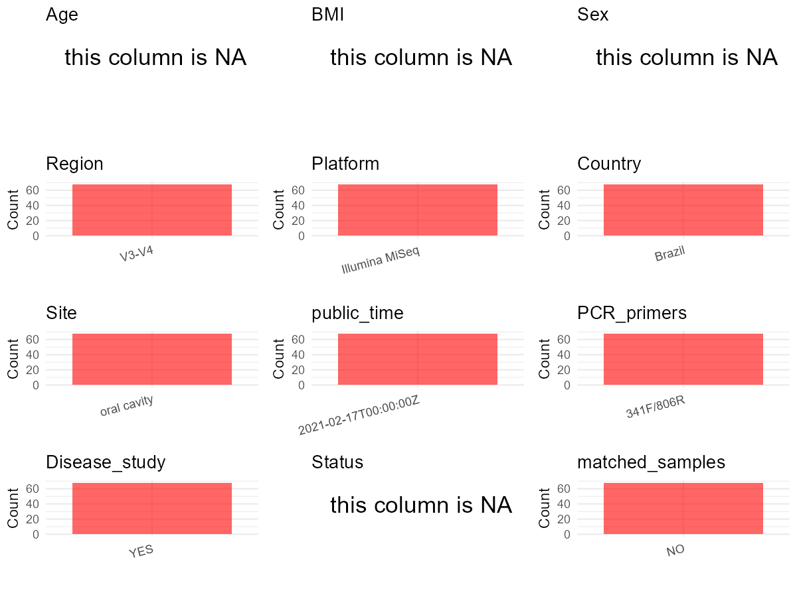

R Notebook: Metadata Processing Workflow
================

# Step 1: Obtain Initial Metadata from Each Project

To obtain the initial metadata: 1. Search for the BioProject ID (e.g.,
“PRJEBXXXX”) on the [NCBI SRA
website](https://www.ncbi.nlm.nih.gov/Traces/study/). 2. In the “Select”
table, click on “Metadata” and download the file. 3. The downloaded file
is typically named “SraRunTable.csv” and contains metadata for the
project.

``` r
# Load necessary libraries
library(dplyr)
library(ggplot2)
library(cowplot)

# Set working directory (update this path to your local directory)
setwd("D:/studylearning/董彪师兄项目/任务/张辰飞/PRJNA700849")

# Read the initial metadata files
initial_meta<-read.csv("SraRunTable.csv",header = T)

# Combine the two metadata files
#meta <- rbind(initial_meta, initial_meta1)

#Remove entries non-oral samples
#initial_meta <- subset(initial_meta,isolate %in% c("saliva","tongue coat"))

# Check the number of samples containing "HT" in Sample.Name (e.g., healthy controls)
#nrow(subset(meta, grepl("HT", Sample.Name)))

# Display the first few rows of the metadata
head(initial_meta)
```

    ##           Run Assay.Type AvgSpotLen     Bases  BioProject    BioSample
    ## 1 SRR13725614   AMPLICON        593 139836626 PRJNA700849 SAMN17926481
    ## 2 SRR13725615   AMPLICON        596 146579719 PRJNA700849 SAMN17926480
    ## 3 SRR13725616   AMPLICON        596 150508947 PRJNA700849 SAMN17926479
    ## 4 SRR13725617   AMPLICON        592 167987880 PRJNA700849 SAMN17926539
    ## 5 SRR13725618   AMPLICON        590 167087621 PRJNA700849 SAMN17926538
    ## 6 SRR13725619   AMPLICON        597 185270562 PRJNA700849 SAMN17926537
    ##                                BioSampleModel     Bytes Center.Name
    ## 1 MIMARKS.survey,MIGS/MIMS/MIMARKS.human-oral 104522122 CNPEM/LNBIO
    ## 2 MIMARKS.survey,MIGS/MIMS/MIMARKS.human-oral 106399500 CNPEM/LNBIO
    ## 3 MIMARKS.survey,MIGS/MIMS/MIMARKS.human-oral 111650075 CNPEM/LNBIO
    ## 4 MIMARKS.survey,MIGS/MIMS/MIMARKS.human-oral 123260192 CNPEM/LNBIO
    ## 5 MIMARKS.survey,MIGS/MIMS/MIMARKS.human-oral 122602882 CNPEM/LNBIO
    ## 6 MIMARKS.survey,MIGS/MIMS/MIMARKS.human-oral 134591889 CNPEM/LNBIO
    ##   Collection_Date Consent DATASTORE.filetype DATASTORE.provider
    ## 1      2015-05-28  public   fastq,run.zq,sra         gs,ncbi,s3
    ## 2      2016-10-07  public   fastq,run.zq,sra         gs,ncbi,s3
    ## 3      2016-10-07  public   fastq,run.zq,sra         gs,ncbi,s3
    ## 4      2016-10-07  public   fastq,run.zq,sra         gs,ncbi,s3
    ## 5      2016-10-07  public   fastq,run.zq,sra         gs,ncbi,s3
    ## 6      2016-10-07  public   fastq,run.zq,sra         gs,ncbi,s3
    ##                       DATASTORE.region env_broad_scale  env_local_scale
    ## 1 gs.us-east1,ncbi.public,s3.us-east-1            oral S112 Replicate 1
    ## 2 gs.us-east1,ncbi.public,s3.us-east-1            oral   C2 Replicate 3
    ## 3 gs.us-east1,ncbi.public,s3.us-east-1            oral   C2 Replicate 2
    ## 4 gs.us-east1,ncbi.public,s3.us-east-1            oral  C14 Replicate 3
    ## 5 gs.us-east1,ncbi.public,s3.us-east-1            oral  C14 Replicate 2
    ## 6 gs.us-east1,ncbi.public,s3.us-east-1            oral  C11 Replicate 3
    ##       env_medium  Experiment geo_loc_name_country
    ## 1 Not applicable SRX10113691               Brazil
    ## 2 Not applicable SRX10113690               Brazil
    ## 3 Not applicable SRX10113689               Brazil
    ## 4 Not applicable SRX10113688               Brazil
    ## 5 Not applicable SRX10113687               Brazil
    ## 6 Not applicable SRX10113686               Brazil
    ##   geo_loc_name_country_continent geo_loc_name         HOST host_tissue_sampled
    ## 1                  South America       Brazil Homo sapiens         oral cavity
    ## 2                  South America       Brazil Homo sapiens         oral cavity
    ## 3                  South America       Brazil Homo sapiens         oral cavity
    ## 4                  South America       Brazil Homo sapiens         oral cavity
    ## 5                  South America       Brazil Homo sapiens         oral cavity
    ## 6                  South America       Brazil Homo sapiens         oral cavity
    ##       Instrument         lat_lon                Library.Name LibraryLayout
    ## 1 Illumina MiSeq 23.37 S 46.38 W S112_1_000000000-AK3VB_L001        PAIRED
    ## 2 Illumina MiSeq 23.37 S 46.38 W   C2_3_000000000-AK3VB_L001        PAIRED
    ## 3 Illumina MiSeq 23.37 S 46.38 W   C2_2_000000000-AK3VB_L001        PAIRED
    ## 4 Illumina MiSeq 23.37 S 46.38 W  C14_3_000000000-AK3VB_L001        PAIRED
    ## 5 Illumina MiSeq 23.37 S 46.38 W  C14_2_000000000-AK3VB_L001        PAIRED
    ## 6 Illumina MiSeq 23.37 S 46.38 W  C11_3_000000000-AK3VB_L001        PAIRED
    ##   LibrarySelection LibrarySource              Organism Platform
    ## 1              PCR   METAGENOMIC human oral metagenome ILLUMINA
    ## 2              PCR   METAGENOMIC human oral metagenome ILLUMINA
    ## 3              PCR   METAGENOMIC human oral metagenome ILLUMINA
    ## 4              PCR   METAGENOMIC human oral metagenome ILLUMINA
    ## 5              PCR   METAGENOMIC human oral metagenome ILLUMINA
    ## 6              PCR   METAGENOMIC human oral metagenome ILLUMINA
    ##            ReleaseDate          create_date version      Sample.Name SRA.Study
    ## 1 2021-02-17T00:00:00Z 2021-02-16T20:36:00Z       1 S112 Replicate 1 SRP306762
    ## 2 2021-02-17T00:00:00Z 2021-02-16T20:36:00Z       1   C2 Replicate 3 SRP306762
    ## 3 2021-02-17T00:00:00Z 2021-02-16T20:36:00Z       1   C2 Replicate 2 SRP306762
    ## 4 2021-02-17T00:00:00Z 2021-02-16T20:36:00Z       1  C14 Replicate 3 SRP306762
    ## 5 2021-02-17T00:00:00Z 2021-02-16T20:36:00Z       1  C14 Replicate 2 SRP306762
    ## 6 2021-02-17T00:00:00Z 2021-02-16T20:37:00Z       1  C11 Replicate 3 SRP306762
    ##   isolate Cultivar         strain
    ## 1 missing                        
    ## 2 missing                        
    ## 3 missing                        
    ## 4                         missing
    ## 5                         missing
    ## 6 missing          Not applicable

# Step 2: Create a Uniform Metadata Template

The uniform metadata should include the following columns:

1.  **BioProject**: Project ID (e.g., “PRJNA339212”)
2.  **Run**: Sample ID (e.g., “ERRXXXXXX” or “SRRXXXXXX”)
3.  **sample_name**: Original sample name submitted by the authors (not
    the database-assigned ID)
4.  **Age**: Age of the subject (if available)
5.  **BMI**: Body Mass Index (if available)
6.  **Sex**: Sex of the subject (“F” or “M”)
7.  **Region**: Targeted 16S rRNA region (e.g., “V3-V4”)
8.  **Platform**: Sequencing platform (e.g., “Illumina MiSeq”)
9.  **Country**: Country of sample origin (e.g., “China”)
10. **Site**: Sample site (e.g., “saliva”, “dental plaque”)
11. **public_time**: Data release date (format: “YYYY-MM-DD”)
12. **PCR_primers**: PCR primers used (e.g., “515F-806R”)
13. **title**: Title of the associated publication
14. **Disease_study**: Whether the study involves a disease (“YES” or
    “NO”)
15. **Status**: Disease status (e.g., “T2DM”, “HC”). Note: If the study
    includes both disease and healthy samples, this must be specified
    per sample.
16. **matched_samples**: matched samples (“YES” or “NO”)

``` r
# Create a uniform metadata dataframe
metadata <- data.frame(
  BioProject = initial_meta$BioProject,
  Run = initial_meta$Run,
  sample_name = initial_meta$Sample.Name,
  Age = NA,
  BMI = NA,
  Sex= NA,
  Region = "V3-V4",
  Platform = initial_meta$Instrument,
  Country = initial_meta$geo_loc_name_country,
  Site = initial_meta$host_tissue_sampled,
  public_time = initial_meta$ReleaseDate,
  stringsAsFactors = FALSE
)
```

# Step 3: Manually Add Information from the Publication

Some information (e.g. PCR primers, study title, disease status) must be
manually extracted from the publication and added to the metadata.

``` r
# Add information obtained from the publication
metadata$PCR_primers <- "341F/806R"
metadata$title <- "Taxonomic and Functional Dysregulation in Salivary Microbiomes During Oral Carcinogenesis"
metadata$Disease_study <- "YES"
# Assign disease status based on sample_name patterns
metadata$Status <- NA_character_

#extract subject id by remove prefix of sample_name
#metadata$sample_name <- gsub("T|CR|CS|C|N|S", "", metadata$sample_name)

# Check initial data distribution
cat("Initial sample distribution:\n")
```

    ## Initial sample distribution:

``` r
table(metadata$sample_name)
```

    ## 
    ##     C11 Replicate 1     C11 Replicate 2     C11 Replicate 3     C13 Replicate 1 
    ##                   1                   1                   1                   1 
    ##     C13 Replicate 2     C13 Replicate 3     C14 Replicate 2     C14 Replicate 3 
    ##                   1                   1                   1                   1 
    ##      C2 Replicate 1      C2 Replicate 2      C2 Replicate 3      C4 Replicate 1 
    ##                   1                   1                   1                   1 
    ##      C4 Replicate 2      C4 Replicate 3      C5 Replicate 1      C5 Replicate 2 
    ##                   1                   1                   1                   1 
    ##      C5 Replicate 3      C6 Replicate 1      C6 Replicate 2      C6 Replicate 3 
    ##                   1                   1                   1                   1 
    ## MiSeqC9 Replicate 1 MiSeqC9 Replicate 2 MiSeqC9 Replicate 3    S100 Replicate 1 
    ##                   1                   1                   1                   1 
    ##    S100 Replicate 2    S100 Replicate 3    S102 Replicate 1    S102 Replicate 2 
    ##                   1                   1                   1                   1 
    ##    S102 Replicate 3    S103 Replicate 1    S103 Replicate 2    S103 Replicate 3 
    ##                   1                   1                   1                   1 
    ##    S106 Replicate 1    S106 Replicate 2    S106 Replicate 3    S108 Replicate 1 
    ##                   1                   1                   1                   1 
    ##    S108 Replicate 2    S108 Replicate 3    S110 Replicate 1    S110 Replicate 2 
    ##                   1                   1                   1                   1 
    ##    S110 Replicate 3    S112 Replicate 1    S112 Replicate 2    S112 Replicate 3 
    ##                   1                   1                   1                   1 
    ##    S113 Replicate 1    S113 Replicate 2    S113 Replicate 3     S40 Replicate 1 
    ##                   1                   1                   1                   1 
    ##     S40 Replicate 2     S40 Replicate 3     S45 Replicate 1     S45 Replicate 2 
    ##                   1                   1                   1                   1 
    ##     S45 Replicate 3     S55 Replicate 1     S55 Replicate 2     S55 Replicate 3 
    ##                   1                   1                   1                   1 
    ##     S64 Replicate 1     S64 Replicate 2     S64 Replicate 3     S65 Replicate 1 
    ##                   1                   1                   1                   1 
    ##     S65 Replicate 2     S65 Replicate 3     S66 Replicate 1     S66 Replicate 2 
    ##                   1                   1                   1                   1 
    ##     S66 Replicate 3     S98 Replicate 1     S98 Replicate 2     S98 Replicate 3 
    ##                   1                   1                   1                   1

``` r
table(metadata$Site)
```

    ## 
    ## oral cavity 
    ##          68

``` r
# Calculate sampling frequency per subject
sample_counts <- table(metadata$sample_name)
cat("\nNumber of samples per subject:\n")
```

    ## 
    ## Number of samples per subject:

``` r
print(sample_counts)
```

    ## 
    ##     C11 Replicate 1     C11 Replicate 2     C11 Replicate 3     C13 Replicate 1 
    ##                   1                   1                   1                   1 
    ##     C13 Replicate 2     C13 Replicate 3     C14 Replicate 2     C14 Replicate 3 
    ##                   1                   1                   1                   1 
    ##      C2 Replicate 1      C2 Replicate 2      C2 Replicate 3      C4 Replicate 1 
    ##                   1                   1                   1                   1 
    ##      C4 Replicate 2      C4 Replicate 3      C5 Replicate 1      C5 Replicate 2 
    ##                   1                   1                   1                   1 
    ##      C5 Replicate 3      C6 Replicate 1      C6 Replicate 2      C6 Replicate 3 
    ##                   1                   1                   1                   1 
    ## MiSeqC9 Replicate 1 MiSeqC9 Replicate 2 MiSeqC9 Replicate 3    S100 Replicate 1 
    ##                   1                   1                   1                   1 
    ##    S100 Replicate 2    S100 Replicate 3    S102 Replicate 1    S102 Replicate 2 
    ##                   1                   1                   1                   1 
    ##    S102 Replicate 3    S103 Replicate 1    S103 Replicate 2    S103 Replicate 3 
    ##                   1                   1                   1                   1 
    ##    S106 Replicate 1    S106 Replicate 2    S106 Replicate 3    S108 Replicate 1 
    ##                   1                   1                   1                   1 
    ##    S108 Replicate 2    S108 Replicate 3    S110 Replicate 1    S110 Replicate 2 
    ##                   1                   1                   1                   1 
    ##    S110 Replicate 3    S112 Replicate 1    S112 Replicate 2    S112 Replicate 3 
    ##                   1                   1                   1                   1 
    ##    S113 Replicate 1    S113 Replicate 2    S113 Replicate 3     S40 Replicate 1 
    ##                   1                   1                   1                   1 
    ##     S40 Replicate 2     S40 Replicate 3     S45 Replicate 1     S45 Replicate 2 
    ##                   1                   1                   1                   1 
    ##     S45 Replicate 3     S55 Replicate 1     S55 Replicate 2     S55 Replicate 3 
    ##                   1                   1                   1                   1 
    ##     S64 Replicate 1     S64 Replicate 2     S64 Replicate 3     S65 Replicate 1 
    ##                   1                   1                   1                   1 
    ##     S65 Replicate 2     S65 Replicate 3     S66 Replicate 1     S66 Replicate 2 
    ##                   1                   1                   1                   1 
    ##     S66 Replicate 3     S98 Replicate 1     S98 Replicate 2     S98 Replicate 3 
    ##                   1                   1                   1                   1

``` r
# Create matched_samples column
metadata$matched_samples <- ifelse(metadata$sample_name %in% names(sample_counts[sample_counts >= 2]), "YES", "NO")

cat("\nMatched samples distribution:\n")
```

    ## 
    ## Matched samples distribution:

``` r
table(metadata$matched_samples)
```

    ## 
    ## NO 
    ## 68

``` r
# Identify samples for removal: single samples excluding oral cavity
single_samples <- names(sample_counts[sample_counts == 1])
samples_to_remove <- metadata$sample_name %in% single_samples & !(metadata$Site %in% c("oral cavity"))

cat("\nNumber of samples to be removed:", sum(samples_to_remove), "\n")
```

    ## 
    ## Number of samples to be removed: 0

``` r
# Remove identified samples
metadata_clean <- metadata[!samples_to_remove, ]

cat("\nFinal sample distribution after cleaning:\n")
```

    ## 
    ## Final sample distribution after cleaning:

``` r
table(metadata_clean$sample_name)
```

    ## 
    ##     C11 Replicate 1     C11 Replicate 2     C11 Replicate 3     C13 Replicate 1 
    ##                   1                   1                   1                   1 
    ##     C13 Replicate 2     C13 Replicate 3     C14 Replicate 2     C14 Replicate 3 
    ##                   1                   1                   1                   1 
    ##      C2 Replicate 1      C2 Replicate 2      C2 Replicate 3      C4 Replicate 1 
    ##                   1                   1                   1                   1 
    ##      C4 Replicate 2      C4 Replicate 3      C5 Replicate 1      C5 Replicate 2 
    ##                   1                   1                   1                   1 
    ##      C5 Replicate 3      C6 Replicate 1      C6 Replicate 2      C6 Replicate 3 
    ##                   1                   1                   1                   1 
    ## MiSeqC9 Replicate 1 MiSeqC9 Replicate 2 MiSeqC9 Replicate 3    S100 Replicate 1 
    ##                   1                   1                   1                   1 
    ##    S100 Replicate 2    S100 Replicate 3    S102 Replicate 1    S102 Replicate 2 
    ##                   1                   1                   1                   1 
    ##    S102 Replicate 3    S103 Replicate 1    S103 Replicate 2    S103 Replicate 3 
    ##                   1                   1                   1                   1 
    ##    S106 Replicate 1    S106 Replicate 2    S106 Replicate 3    S108 Replicate 1 
    ##                   1                   1                   1                   1 
    ##    S108 Replicate 2    S108 Replicate 3    S110 Replicate 1    S110 Replicate 2 
    ##                   1                   1                   1                   1 
    ##    S110 Replicate 3    S112 Replicate 1    S112 Replicate 2    S112 Replicate 3 
    ##                   1                   1                   1                   1 
    ##    S113 Replicate 1    S113 Replicate 2    S113 Replicate 3     S40 Replicate 1 
    ##                   1                   1                   1                   1 
    ##     S40 Replicate 2     S40 Replicate 3     S45 Replicate 1     S45 Replicate 2 
    ##                   1                   1                   1                   1 
    ##     S45 Replicate 3     S55 Replicate 1     S55 Replicate 2     S55 Replicate 3 
    ##                   1                   1                   1                   1 
    ##     S64 Replicate 1     S64 Replicate 2     S64 Replicate 3     S65 Replicate 1 
    ##                   1                   1                   1                   1 
    ##     S65 Replicate 2     S65 Replicate 3     S66 Replicate 1     S66 Replicate 2 
    ##                   1                   1                   1                   1 
    ##     S66 Replicate 3     S98 Replicate 1     S98 Replicate 2     S98 Replicate 3 
    ##                   1                   1                   1                   1

``` r
table(metadata_clean$Site)
```

    ## 
    ## oral cavity 
    ##          68

``` r
table(metadata_clean$matched_samples)
```

    ## 
    ## NO 
    ## 68

``` r
# Use cleaned dataset for subsequent analysis
metadata <- metadata_clean
```

# Step 4: Summarize and Validate the Metadata

``` r
# Check the number of unique runs and sample names
print(paste("Number of unique runs:", length(unique(metadata$Run))))
```

    ## [1] "Number of unique runs: 68"

``` r
print(paste("Number of unique sample names:", length(unique(metadata$sample_name))))
```

    ## [1] "Number of unique sample names: 68"

# Step 5: Visualize the Metadata

``` r

```


# Step 6: Finalize and Export the Metadata

``` r
# Reorder columns to match the desired format
metadata <- metadata[, c(
  "BioProject", "Run", "sample_name", "Age", "BMI", "Sex", 
  "Region", "Platform", "Country", "Site", "public_time", 
  "PCR_primers", "title", "Disease_study", "Status","matched_samples"
)]

# Export the uniform metadata to a CSV file
write.csv(metadata, file = "metadata.csv", quote = FALSE)
head(metadata)
```

    ##    BioProject         Run      sample_name Age BMI Sex Region       Platform
    ## 1 PRJNA700849 SRR13725614 S112 Replicate 1  NA  NA  NA  V3-V4 Illumina MiSeq
    ## 2 PRJNA700849 SRR13725615   C2 Replicate 3  NA  NA  NA  V3-V4 Illumina MiSeq
    ## 3 PRJNA700849 SRR13725616   C2 Replicate 2  NA  NA  NA  V3-V4 Illumina MiSeq
    ## 4 PRJNA700849 SRR13725617  C14 Replicate 3  NA  NA  NA  V3-V4 Illumina MiSeq
    ## 5 PRJNA700849 SRR13725618  C14 Replicate 2  NA  NA  NA  V3-V4 Illumina MiSeq
    ## 6 PRJNA700849 SRR13725619  C11 Replicate 3  NA  NA  NA  V3-V4 Illumina MiSeq
    ##   Country        Site          public_time PCR_primers
    ## 1  Brazil oral cavity 2021-02-17T00:00:00Z   341F/806R
    ## 2  Brazil oral cavity 2021-02-17T00:00:00Z   341F/806R
    ## 3  Brazil oral cavity 2021-02-17T00:00:00Z   341F/806R
    ## 4  Brazil oral cavity 2021-02-17T00:00:00Z   341F/806R
    ## 5  Brazil oral cavity 2021-02-17T00:00:00Z   341F/806R
    ## 6  Brazil oral cavity 2021-02-17T00:00:00Z   341F/806R
    ##                                                                                       title
    ## 1 Taxonomic and Functional Dysregulation in Salivary Microbiomes During Oral Carcinogenesis
    ## 2 Taxonomic and Functional Dysregulation in Salivary Microbiomes During Oral Carcinogenesis
    ## 3 Taxonomic and Functional Dysregulation in Salivary Microbiomes During Oral Carcinogenesis
    ## 4 Taxonomic and Functional Dysregulation in Salivary Microbiomes During Oral Carcinogenesis
    ## 5 Taxonomic and Functional Dysregulation in Salivary Microbiomes During Oral Carcinogenesis
    ## 6 Taxonomic and Functional Dysregulation in Salivary Microbiomes During Oral Carcinogenesis
    ##   Disease_study Status matched_samples
    ## 1           YES   <NA>              NO
    ## 2           YES   <NA>              NO
    ## 3           YES   <NA>              NO
    ## 4           YES   <NA>              NO
    ## 5           YES   <NA>              NO
    ## 6           YES   <NA>              NO

## Notes for Students:

1.  **Metadata Accuracy**: Always cross-check the metadata with the
    original publication to ensure accuracy.
2.  **Manual Entries**: Columns like `PCR_primers`, and `Status` often
    require manual entry based on the publication.
3.  **Disease Status**: Be careful when assigning `Status`—some studies
    include both disease and healthy samples.
4.  **Visualization**: The plots help quickly identify the distribution
    of values in each column, which is useful for quality control.
5.  **Reproducibility**: Update the working directory and file paths to
    match your local environment.
