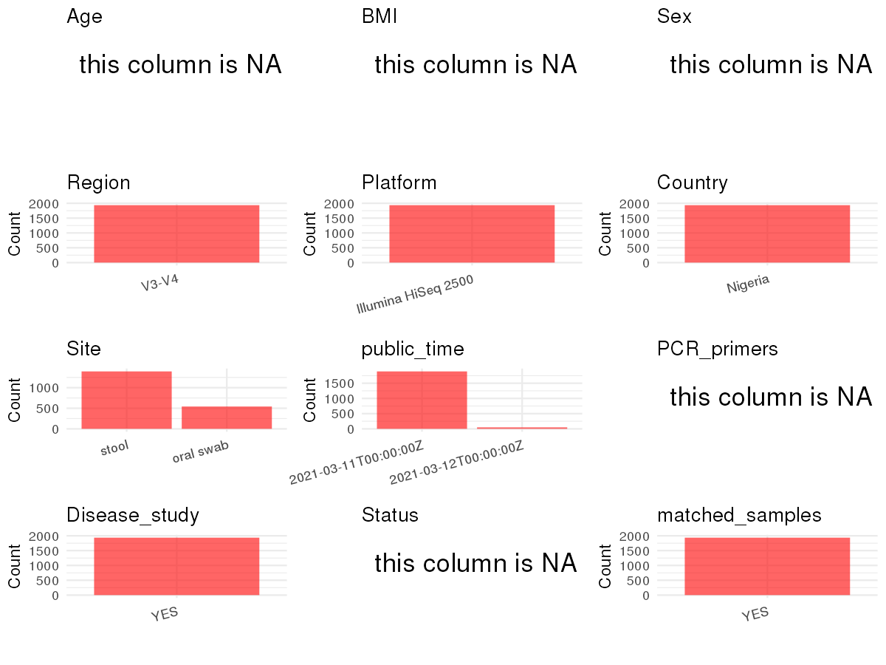

R Notebook: Metadata Processing Workflow
================

# Step 1: Obtain Initial Metadata from Each Project

To obtain the initial metadata: 1. Search for the BioProject ID (e.g.,
“PRJEBXXXX”) on the [NCBI SRA
website](https://www.ncbi.nlm.nih.gov/Traces/study/). 2. In the “Select”
table, click on “Metadata” and download the file. 3. The downloaded file
is typically named “SraRunTable.csv” and contains metadata for the
project.

``` r
# Load necessary libraries
library(dplyr)
library(stringr)
library(ggplot2)
library(cowplot)

# Set working directory (update this path to your local directory)
setwd("/home/dongbiao/word_embedding_microbiome/all_data/oral/global-oral-microbiome/data/projects/PRJNA706727")

# Read the initial metadata files
initial_meta <- read.csv("SraRunTable.csv", header = T)

# Display the first few rows of the metadata
head(initial_meta)
```

    ##           Run Assay.Type AvgSpotLen    Bases  BioProject    BioSample
    ## 1 SRR13884991   AMPLICON        301 10723727 PRJNA706727 SAMN18142270
    ## 2 SRR13885018   AMPLICON        301 26882611 PRJNA706727 SAMN18141743
    ## 3 SRR13885028   AMPLICON        301 17876390 PRJNA706727 SAMN18141742
    ## 4 SRR13885061   AMPLICON        301  6728855 PRJNA706727 SAMN18141775
    ## 5 SRR13885063   AMPLICON        301 11057536 PRJNA706727 SAMN18141773
    ## 6 SRR13885065   AMPLICON        301  9774373 PRJNA706727 SAMN18141776
    ##                BioSampleModel    Bytes                       Center.Name
    ## 1 Metagenome or environmental  5538743 UNIVERSITY OF MARYLAND, BALTIMORE
    ## 2 Metagenome or environmental 14076150 UNIVERSITY OF MARYLAND, BALTIMORE
    ## 3 Metagenome or environmental  9209565 UNIVERSITY OF MARYLAND, BALTIMORE
    ## 4 Metagenome or environmental  3516186 UNIVERSITY OF MARYLAND, BALTIMORE
    ## 5 Metagenome or environmental  5757109 UNIVERSITY OF MARYLAND, BALTIMORE
    ## 6 Metagenome or environmental  5076644 UNIVERSITY OF MARYLAND, BALTIMORE
    ##   Collection_Date Consent DATASTORE.filetype DATASTORE.provider
    ## 1       2015/2018  public   fastq,run.zq,sra         gs,ncbi,s3
    ## 2       2015/2018  public   fastq,run.zq,sra         gs,ncbi,s3
    ## 3       2015/2018  public   fastq,run.zq,sra         gs,ncbi,s3
    ## 4       2015/2018  public   fastq,run.zq,sra         gs,ncbi,s3
    ## 5       2015/2018  public   fastq,run.zq,sra         gs,ncbi,s3
    ## 6       2015/2018  public   fastq,run.zq,sra         gs,ncbi,s3
    ##                       DATASTORE.region  Experiment geo_loc_name_country
    ## 1 gs.us-east1,ncbi.public,s3.us-east-1 SRX10265850              Nigeria
    ## 2 gs.us-east1,ncbi.public,s3.us-east-1 SRX10265337              Nigeria
    ## 3 gs.us-east1,ncbi.public,s3.us-east-1 SRX10265941              Nigeria
    ## 4 gs.us-east1,ncbi.public,s3.us-east-1 SRX10265299              Nigeria
    ## 5 gs.us-east1,ncbi.public,s3.us-east-1 SRX10265296              Nigeria
    ## 6 gs.us-east1,ncbi.public,s3.us-east-1 SRX10265300              Nigeria
    ##   geo_loc_name_country_continent        geo_loc_name         HOST
    ## 1                         Africa Nigeria: Benin City Homo sapiens
    ## 2                         Africa Nigeria: Benin City Homo sapiens
    ## 3                         Africa Nigeria: Benin City Homo sapiens
    ## 4                         Africa Nigeria: Benin City Homo sapiens
    ## 5                         Africa Nigeria: Benin City Homo sapiens
    ## 6                         Africa Nigeria: Benin City Homo sapiens
    ##            Instrument isolation_source               lat_lon Library.Name
    ## 1 Illumina HiSeq 2500             oral 6.333333 N 5.622222 E MG6413B1V2OS
    ## 2 Illumina HiSeq 2500             oral 6.333333 N 5.622222 E MG6101B1V4OS
    ## 3 Illumina HiSeq 2500             oral 6.333333 N 5.622222 E MG6100B1V4OS
    ## 4 Illumina HiSeq 2500             oral 6.333333 N 5.622222 E MG6121B1V4OS
    ## 5 Illumina HiSeq 2500             oral 6.333333 N 5.622222 E MG6120B1V4OS
    ## 6 Illumina HiSeq 2500             oral 6.333333 N 5.622222 E MG6122B1V4OS
    ##   LibraryLayout LibrarySelection LibrarySource              Organism Platform
    ## 1        SINGLE              PCR   METAGENOMIC human oral metagenome ILLUMINA
    ## 2        SINGLE              PCR   METAGENOMIC human oral metagenome ILLUMINA
    ## 3        SINGLE              PCR   METAGENOMIC human oral metagenome ILLUMINA
    ## 4        SINGLE              PCR   METAGENOMIC human oral metagenome ILLUMINA
    ## 5        SINGLE              PCR   METAGENOMIC human oral metagenome ILLUMINA
    ## 6        SINGLE              PCR   METAGENOMIC human oral metagenome ILLUMINA
    ##            ReleaseDate          create_date version  Sample.Name SRA.Study
    ## 1 2021-03-11T00:00:00Z 2021-03-08T19:25:00Z       1 MG6413B1V2OS SRP309713
    ## 2 2021-03-11T00:00:00Z 2021-03-08T19:26:00Z       1 MG6101B1V4OS SRP309713
    ## 3 2021-03-11T00:00:00Z 2021-03-08T19:27:00Z       1 MG6100B1V4OS SRP309713
    ## 4 2021-03-11T00:00:00Z 2021-03-08T19:28:00Z       1 MG6121B1V4OS SRP309713
    ## 5 2021-03-11T00:00:00Z 2021-03-08T19:28:00Z       1 MG6120B1V4OS SRP309713
    ## 6 2021-03-11T00:00:00Z 2021-03-08T19:28:00Z       1 MG6122B1V4OS SRP309713

# Step 2: Create a Uniform Metadata Template

The uniform metadata should include the following columns:

1.  **BioProject**: Project ID (e.g., “PRJNA339212”)
2.  **Run**: Sample ID (e.g., “ERRXXXXXX” or “SRRXXXXXX”)
3.  **sample_name**: Original sample name submitted by the authors (not
    the database-assigned ID)
4.  **Age**: Age of the subject (if available)
5.  **BMI**: Body Mass Index (if available)
6.  **Sex**: Sex of the subject (“F” or “M”)
7.  **Region**: Targeted 16S rRNA region (e.g., “V3-V4”)
8.  **Platform**: Sequencing platform (e.g., “Illumina MiSeq”)
9.  **Country**: Country of sample origin (e.g., “China”)
10. **Site**: Sample site (e.g., “saliva”, “dental plaque”)
11. **public_time**: Data release date (format: “YYYY-MM-DD”)
12. **PCR_primers**: PCR primers used (e.g., “515F-806R”)
13. **title**: Title of the associated publication
14. **Disease_study**: Whether the study involves a disease (“YES” or
    “NO”)
15. **Status**: Disease status (e.g., “T2DM”, “HC”). Note: If the study
    includes both disease and healthy samples, this must be specified
    per sample.
16. **matched_samples**: matched samples (“YES” or “NO”)

``` r
# Create a uniform metadata dataframe
metadata <- data.frame(
  BioProject = initial_meta$BioProject,
  Run = initial_meta$Run,
  sample_name = substr(initial_meta$Sample.Name, 1, nchar(initial_meta$Sample.Name) - 4),
  Age = NA,
  Sex = NA,
  BMI = NA,  
  Region = "V3-V4",
  Platform = initial_meta$Instrument,
  Country = initial_meta$geo_loc_name_country,
  Site = initial_meta$isolation_source,
  public_time = initial_meta$ReleaseDate,
  stringsAsFactors = FALSE
)

metadata <- metadata %>% mutate(across(where(is.character), ~ ifelse(. == "oral", "oral swab", .)))
```

# Step 3: Manually Add Information from the Publication

Some information (e.g. PCR primers, study title, disease status) must be
manually extracted from the publication and added to the metadata.

``` r
# Add information obtained from the publication
metadata$PCR_primers <- NA
metadata$title <- "Oral microbiota and periodontitis severity among Hispanic adults"
metadata$Disease_study <- "YES"

metadata$Status <- NA

# Check initial data distribution
cat("Initial sample distribution:\n")
```

    ## Initial sample distribution:

``` r
table(metadata$sample_name)
```

    ## 
    ## MG6100B1  MG6100W MG6101B1  MG6101W MG6102B1  MG6102W MG6103B1  MG6103W 
    ##        7        1        7        1        7        2        7        1 
    ##  MG6104W MG6105B1  MG6105W MG6106B1  MG6106W MG6107B1  MG6107W MG6108B1 
    ##        1        6        1        7        1        7        1        7 
    ##  MG6108W MG6109B1 MG6109B2  MG6109W  MG6110W  MG6111W MG6112B1  MG6112W 
    ##        1        7        7        1        1        1        7        1 
    ##  MG6113W MG6114B1  MG6114W MG6115B1  MG6115W MG6116B1 MG6116B2  MG6116W 
    ##        1        7        1        7        1        1        1        1 
    ## MG6117B1  MG6117W MG6118B1  MG6118W MG6119B1  MG6119W MG6120B1  MG6120W 
    ##        7        2        7        1        7        1        7        1 
    ## MG6121B1  MG6121W MG6122B1  MG6122W MG6123B1  MG6123W  MG6124W MG6125B1 
    ##        7        1        7        1        7        1        1        4 
    ##  MG6125W MG6126B1  MG6126W MG6127B1  MG6127W MG6128B1  MG6128W MG6131B1 
    ##        1        7        2        7        1        1        1        7 
    ##  MG6131W MG6132B1  MG6132W MG6133B1  MG6133W MG6134B1  MG6134W MG6135B1 
    ##        1        7        1        7        1        7        2        2 
    ##  MG6135W MG6136B1  MG6136W MG6137B1  MG6137W MG6138B1  MG6138W MG6139B1 
    ##        1        2        2        8        2        7        1        8 
    ##  MG6139W  MG6140W MG6141B1  MG6141W MG6143B1  MG6143W MG6145B1  MG6145W 
    ##        1        1        7        1        7        2        7        1 
    ## MG6146B1  MG6146W MG6147B1  MG6147W MG6148B1  MG6148W MG6149B1 MG6149B2 
    ##        1        1        5        3        8        1        6        7 
    ##  MG6149W MG6150B1  MG6150W MG6151B1  MG6151W MG6152B1  MG6152W MG6153B1 
    ##        1        7        1        7        1        8        1        1 
    ##  MG6153W MG6154B1  MG6154W MG6155B1  MG6155W MG6156B1  MG6156W MG6158B1 
    ##        2        6        1        6        1        5        1        7 
    ##  MG6158W MG6159B1  MG6159W MG6160B1  MG6160W  MG6161W  MG6162W MG6163B1 
    ##        1        6        1        5        2        1        1        5 
    ##  MG6163W  MG6164W MG6165B1  MG6165W MG6166B1  MG6166W MG6167B1  MG6167W 
    ##        1        1        6        1        6        2        5        1 
    ##  MG6168W MG6169B1  MG6169W MG6170B1  MG6170W MG6171B1  MG6171W MG6172B1 
    ##        1        2        1        3        1        6        2        6 
    ##  MG6172W MG6173B1  MG6173W  MG6174W MG6175B1  MG6175W MG6176B1  MG6176W 
    ##        1        6        1        1        3        1        7        2 
    ## MG6177B1  MG6177W  MG6178W MG6180B1  MG6180W MG6181B1  MG6181W MG6182B1 
    ##        2        1        1        6        2        5        1        5 
    ##  MG6182W MG6183B1  MG6183W MG6184B1  MG6184W MG6185B1  MG6185W MG6186B1 
    ##        1        7        1        6        2        5        1        5 
    ##  MG6186W MG6187B1  MG6187W MG6188B1  MG6188W MG6189B1  MG6189W MG6191B1 
    ##        1        7        1        6        2        5        1        5 
    ##  MG6191W MG6192B1  MG6192W MG6193B1  MG6193W MG6194B1 MG6194B2  MG6194W 
    ##        1        5        1        7        1        6        1        1 
    ## MG6195B1  MG6195W MG6196B1  MG6196W MG6197B1  MG6197W MG6198B1  MG6198W 
    ##        3        1        1        1        5        2        6        2 
    ##  MG6199W MG6200B1  MG6200W MG6202B1  MG6202W MG6203B1  MG6203W MG6204B1 
    ##        1        6        1        2        1        5        2        5 
    ##  MG6204W MG6206B1  MG6206W MG6207B1  MG6207W MG6208B1  MG6208W  MG6210W 
    ##        1        6        1        5        2        5        1        1 
    ##  MG6211W MG6212B1  MG6212W MG6213B1  MG6213W MG6215B1 MG6215B2  MG6215W 
    ##        2        5        1        7        1        6        1        1 
    ## MG6216B1  MG6216W MG6217B1  MG6217W MG6218B1  MG6218W MG6220B1  MG6220W 
    ##        5        1        5        1        3        1        7        2 
    ## MG6221B1  MG6221W  MG6222W MG6223B1  MG6223W  MG6224W MG6225B1  MG6225W 
    ##        5        2        1        8        1        1        5        1 
    ## MG6226B1  MG6226W MG6227B1  MG6227W MG6228B1  MG6228W MG6229B1  MG6229W 
    ##        6        1        6        1        2        1        5        1 
    ## MG6230B1  MG6230W MG6231B1  MG6231W MG6233B1  MG6233W MG6235B1  MG6235W 
    ##        7        2        8        1        7        2        1        1 
    ## MG6236B1  MG6236W MG6237B1  MG6237W MG6238B1  MG6238W MG6239B1  MG6239W 
    ##        6        1        6        1        6        1        7        1 
    ##  MG6240W MG6241B1  MG6241W  MG6242W MG6243B1  MG6243W MG6244B1  MG6244W 
    ##        1        1        1        1        8        1        6        1 
    ## MG6245B1  MG6245W  MG6246W  MG6247W  MG6248W MG6249B1  MG6249W MG6250B1 
    ##        7        2        1        1        1        6        2        5 
    ##  MG6250W MG6252B1  MG6252W MG6253B1  MG6253W MG6255B1  MG6255W MG6256B1 
    ##        1        7        1        8        1        7        1        6 
    ##  MG6256W  MG6257W MG6258B1  MG6258W MG6260B1  MG6260W MG6261B1  MG6261W 
    ##        1        1        7        1        8        1        6        1 
    ## MG6262B1  MG6262W MG6263B1  MG6263W MG6264B1  MG6264W  MG6265W MG6266B1 
    ##        6        1        2        1        7        1        1        1 
    ##  MG6266W MG6268B1  MG6268W MG6269B1  MG6269W MG6270B1  MG6270W MG6272B1 
    ##        1        1        1        8        2        7        2        8 
    ##  MG6272W MG6273B1  MG6273W MG6274B1  MG6274W  MG6275W  MG6276W MG6277B1 
    ##        1        6        1        7        1        1        1        7 
    ## MG6277B2  MG6277W MG6278B1  MG6278W MG6279B1  MG6279W MG6280B1  MG6280W 
    ##        5        1        7        1        7        1        8        1 
    ## MG6281B1  MG6281W MG6282B1  MG6282W MG6283B1  MG6283W MG6284B1  MG6284W 
    ##        1        1        2        1        5        1        7        1 
    ## MG6285B1  MG6285W MG6286B1  MG6286W  MG6287W MG6288B1  MG6288W MG6289B1 
    ##        6        1        6        1        1        7        1        8 
    ##  MG6289W MG6290B1  MG6290W MG6291B1  MG6291W MG6292B1  MG6292W MG6293B1 
    ##        1        7        1        7        1        7        2        6 
    ##  MG6293W MG6294B1  MG6294W MG6295B1  MG6295W MG6296B1  MG6296W MG6297B1 
    ##        1        7        1        8        1        8        1        8 
    ##  MG6297W  MG6298W MG6299B1  MG6299W MG6300B1  MG6300W MG6301B1  MG6301W 
    ##        1        1        6        1        7        1        6        1 
    ## MG6302B1  MG6302W MG6303B1  MG6303W MG6304B1  MG6304W MG6305B1  MG6305W 
    ##        8        1        8        1        7        1        7        1 
    ## MG6306B1  MG6306W MG6307B1  MG6307W MG6308B1  MG6308W  MG6309W MG6310B1 
    ##        7        1        6        1        6        1        1        6 
    ##  MG6310W MG6311B1  MG6311W MG6314B1  MG6314W MG6315B1  MG6315W MG6316B1 
    ##        1        6        1        2        1        7        1        7 
    ##  MG6316W MG6317B1  MG6317W MG6318B1  MG6318W MG6319B1  MG6319W MG6320B1 
    ##        1        5        2        4        1        5        1        7 
    ##  MG6320W MG6321B1  MG6321W MG6322B1 MG6323B1  MG6323W MG6324B1  MG6324W 
    ##        1        6        1        1        6        1        7        1 
    ##  MG6325W MG6327B1  MG6327W MG6328B1  MG6328W MG6330B1  MG6330W MG6332B1 
    ##        1        7        2        6        1        6        1        6 
    ##  MG6332W MG6334B1  MG6334W  MG6336W MG6337B1  MG6337W MG6338B1  MG6338W 
    ##        2        5        1        1        8        1        5        1 
    ## MG6339B1  MG6339W MG6340B1  MG6340W MG6341B1 MG6341B2  MG6341W MG6342B1 
    ##        8        1        6        1        7        6        1        8 
    ##  MG6342W MG6343B1  MG6343W MG6344B1  MG6344W MG6345B1  MG6345W MG6346B1 
    ##        1        6        1        7        2        7        2        7 
    ##  MG6346W MG6348B1  MG6348W MG6349B1  MG6349W MG6350B1  MG6350W  MG6351W 
    ##        2        1        1        7        1        6        1        1 
    ## MG6352B1  MG6352W MG6353B1  MG6353W MG6354B1  MG6354W  MG6355W  MG6356W 
    ##        7        1        6        1        7        1        1        1 
    ## MG6357B1  MG6357W MG6358B1  MG6358W MG6359B1  MG6359W MG6360B1 MG6360B2 
    ##        6        1        7        1        6        1        6        6 
    ##  MG6360W MG6361B1  MG6361W MG6362B1  MG6362W MG6363B1  MG6363W MG6364B1 
    ##        1        6        1        6        1        6        1        6 
    ##  MG6364W MG6365B1  MG6365W MG6366B1  MG6366W MG6367B1  MG6367W MG6368B1 
    ##        1        6        1        5        1        7        1        8 
    ##  MG6368W MG6369B1  MG6369W MG6370B1  MG6370W MG6371B1  MG6371W MG6372B1 
    ##        1        8        1        2        1        6        1        6 
    ##  MG6372W MG6373B1  MG6373W MG6375B1  MG6375W MG6376B1  MG6376W MG6377B1 
    ##        1        5        1        7        1        6        1        6 
    ##  MG6377W MG6378B1  MG6378W MG6379B1  MG6379W MG6380B1  MG6380W MG6381B1 
    ##        1        6        1        7        1        6        1        7 
    ##  MG6381W MG6382B1  MG6382W  MG6383W MG6384B1  MG6384W MG6385B1  MG6385W 
    ##        1        7        1        1        6        1        6        1 
    ## MG6386B1  MG6386W  MG6387W MG6388B1  MG6388W MG6390B1  MG6390W MG6391B1 
    ##        7        1        1        7        1        5        1        8 
    ## MG6391B2  MG6391W MG6392B1  MG6392W MG6393B1  MG6393W MG6394B1 MG6394B2 
    ##        1        1        7        1        7        1        7        5 
    ##  MG6394W MG6395B1  MG6395W MG6396B1  MG6396W MG6397B1  MG6397W MG6398B1 
    ##        1        7        2        5        2        7        1        8 
    ##  MG6398W MG6399B1  MG6399W MG6401B1  MG6401W MG6402B1  MG6402W MG6403B1 
    ##        1        7        1        7        1        7        1        3 
    ##  MG6403W MG6404B1  MG6404W MG6405B1  MG6405W MG6406B1  MG6406W MG6407B1 
    ##        1        5        2        3        1        7        1        6 
    ##  MG6407W MG6408B1  MG6408W MG6409B1  MG6409W MG6410B1  MG6410W MG6411B1 
    ##        1        7        1        4        2        6        2        6 
    ##  MG6411W MG6412B1  MG6412W MG6413B1  MG6413W MG6414B1  MG6414W MG6415B1 
    ##        2        7        1        7        1        5        1        7 
    ##  MG6415W MG6416B1  MG6416W MG6417B1  MG6417W MG6418B1  MG6418W MG6419B1 
    ##        1        7        1        7        1        7        1        6 
    ##  MG6419W MG6420B1  MG6420W MG6421B1  MG6421W MG6422B1  MG6422W MG6423B1 
    ##        1        7        1        6        1        8        1        7 
    ##  MG6423W MG6424B1  MG6424W MG6427B1  MG6427W MG6429B1  MG6429W  MG6430W 
    ##        1        4        1        7        1        7        1        1

``` r
table(metadata$Site)
```

    ## 
    ## oral swab     stool 
    ##       542      1395

``` r
# Calculate sampling frequency per subject
sample_counts <- table(metadata$sample_name)
cat("\nNumber of samples per subject:\n")
```

    ## 
    ## Number of samples per subject:

``` r
print(sample_counts)
```

    ## 
    ## MG6100B1  MG6100W MG6101B1  MG6101W MG6102B1  MG6102W MG6103B1  MG6103W 
    ##        7        1        7        1        7        2        7        1 
    ##  MG6104W MG6105B1  MG6105W MG6106B1  MG6106W MG6107B1  MG6107W MG6108B1 
    ##        1        6        1        7        1        7        1        7 
    ##  MG6108W MG6109B1 MG6109B2  MG6109W  MG6110W  MG6111W MG6112B1  MG6112W 
    ##        1        7        7        1        1        1        7        1 
    ##  MG6113W MG6114B1  MG6114W MG6115B1  MG6115W MG6116B1 MG6116B2  MG6116W 
    ##        1        7        1        7        1        1        1        1 
    ## MG6117B1  MG6117W MG6118B1  MG6118W MG6119B1  MG6119W MG6120B1  MG6120W 
    ##        7        2        7        1        7        1        7        1 
    ## MG6121B1  MG6121W MG6122B1  MG6122W MG6123B1  MG6123W  MG6124W MG6125B1 
    ##        7        1        7        1        7        1        1        4 
    ##  MG6125W MG6126B1  MG6126W MG6127B1  MG6127W MG6128B1  MG6128W MG6131B1 
    ##        1        7        2        7        1        1        1        7 
    ##  MG6131W MG6132B1  MG6132W MG6133B1  MG6133W MG6134B1  MG6134W MG6135B1 
    ##        1        7        1        7        1        7        2        2 
    ##  MG6135W MG6136B1  MG6136W MG6137B1  MG6137W MG6138B1  MG6138W MG6139B1 
    ##        1        2        2        8        2        7        1        8 
    ##  MG6139W  MG6140W MG6141B1  MG6141W MG6143B1  MG6143W MG6145B1  MG6145W 
    ##        1        1        7        1        7        2        7        1 
    ## MG6146B1  MG6146W MG6147B1  MG6147W MG6148B1  MG6148W MG6149B1 MG6149B2 
    ##        1        1        5        3        8        1        6        7 
    ##  MG6149W MG6150B1  MG6150W MG6151B1  MG6151W MG6152B1  MG6152W MG6153B1 
    ##        1        7        1        7        1        8        1        1 
    ##  MG6153W MG6154B1  MG6154W MG6155B1  MG6155W MG6156B1  MG6156W MG6158B1 
    ##        2        6        1        6        1        5        1        7 
    ##  MG6158W MG6159B1  MG6159W MG6160B1  MG6160W  MG6161W  MG6162W MG6163B1 
    ##        1        6        1        5        2        1        1        5 
    ##  MG6163W  MG6164W MG6165B1  MG6165W MG6166B1  MG6166W MG6167B1  MG6167W 
    ##        1        1        6        1        6        2        5        1 
    ##  MG6168W MG6169B1  MG6169W MG6170B1  MG6170W MG6171B1  MG6171W MG6172B1 
    ##        1        2        1        3        1        6        2        6 
    ##  MG6172W MG6173B1  MG6173W  MG6174W MG6175B1  MG6175W MG6176B1  MG6176W 
    ##        1        6        1        1        3        1        7        2 
    ## MG6177B1  MG6177W  MG6178W MG6180B1  MG6180W MG6181B1  MG6181W MG6182B1 
    ##        2        1        1        6        2        5        1        5 
    ##  MG6182W MG6183B1  MG6183W MG6184B1  MG6184W MG6185B1  MG6185W MG6186B1 
    ##        1        7        1        6        2        5        1        5 
    ##  MG6186W MG6187B1  MG6187W MG6188B1  MG6188W MG6189B1  MG6189W MG6191B1 
    ##        1        7        1        6        2        5        1        5 
    ##  MG6191W MG6192B1  MG6192W MG6193B1  MG6193W MG6194B1 MG6194B2  MG6194W 
    ##        1        5        1        7        1        6        1        1 
    ## MG6195B1  MG6195W MG6196B1  MG6196W MG6197B1  MG6197W MG6198B1  MG6198W 
    ##        3        1        1        1        5        2        6        2 
    ##  MG6199W MG6200B1  MG6200W MG6202B1  MG6202W MG6203B1  MG6203W MG6204B1 
    ##        1        6        1        2        1        5        2        5 
    ##  MG6204W MG6206B1  MG6206W MG6207B1  MG6207W MG6208B1  MG6208W  MG6210W 
    ##        1        6        1        5        2        5        1        1 
    ##  MG6211W MG6212B1  MG6212W MG6213B1  MG6213W MG6215B1 MG6215B2  MG6215W 
    ##        2        5        1        7        1        6        1        1 
    ## MG6216B1  MG6216W MG6217B1  MG6217W MG6218B1  MG6218W MG6220B1  MG6220W 
    ##        5        1        5        1        3        1        7        2 
    ## MG6221B1  MG6221W  MG6222W MG6223B1  MG6223W  MG6224W MG6225B1  MG6225W 
    ##        5        2        1        8        1        1        5        1 
    ## MG6226B1  MG6226W MG6227B1  MG6227W MG6228B1  MG6228W MG6229B1  MG6229W 
    ##        6        1        6        1        2        1        5        1 
    ## MG6230B1  MG6230W MG6231B1  MG6231W MG6233B1  MG6233W MG6235B1  MG6235W 
    ##        7        2        8        1        7        2        1        1 
    ## MG6236B1  MG6236W MG6237B1  MG6237W MG6238B1  MG6238W MG6239B1  MG6239W 
    ##        6        1        6        1        6        1        7        1 
    ##  MG6240W MG6241B1  MG6241W  MG6242W MG6243B1  MG6243W MG6244B1  MG6244W 
    ##        1        1        1        1        8        1        6        1 
    ## MG6245B1  MG6245W  MG6246W  MG6247W  MG6248W MG6249B1  MG6249W MG6250B1 
    ##        7        2        1        1        1        6        2        5 
    ##  MG6250W MG6252B1  MG6252W MG6253B1  MG6253W MG6255B1  MG6255W MG6256B1 
    ##        1        7        1        8        1        7        1        6 
    ##  MG6256W  MG6257W MG6258B1  MG6258W MG6260B1  MG6260W MG6261B1  MG6261W 
    ##        1        1        7        1        8        1        6        1 
    ## MG6262B1  MG6262W MG6263B1  MG6263W MG6264B1  MG6264W  MG6265W MG6266B1 
    ##        6        1        2        1        7        1        1        1 
    ##  MG6266W MG6268B1  MG6268W MG6269B1  MG6269W MG6270B1  MG6270W MG6272B1 
    ##        1        1        1        8        2        7        2        8 
    ##  MG6272W MG6273B1  MG6273W MG6274B1  MG6274W  MG6275W  MG6276W MG6277B1 
    ##        1        6        1        7        1        1        1        7 
    ## MG6277B2  MG6277W MG6278B1  MG6278W MG6279B1  MG6279W MG6280B1  MG6280W 
    ##        5        1        7        1        7        1        8        1 
    ## MG6281B1  MG6281W MG6282B1  MG6282W MG6283B1  MG6283W MG6284B1  MG6284W 
    ##        1        1        2        1        5        1        7        1 
    ## MG6285B1  MG6285W MG6286B1  MG6286W  MG6287W MG6288B1  MG6288W MG6289B1 
    ##        6        1        6        1        1        7        1        8 
    ##  MG6289W MG6290B1  MG6290W MG6291B1  MG6291W MG6292B1  MG6292W MG6293B1 
    ##        1        7        1        7        1        7        2        6 
    ##  MG6293W MG6294B1  MG6294W MG6295B1  MG6295W MG6296B1  MG6296W MG6297B1 
    ##        1        7        1        8        1        8        1        8 
    ##  MG6297W  MG6298W MG6299B1  MG6299W MG6300B1  MG6300W MG6301B1  MG6301W 
    ##        1        1        6        1        7        1        6        1 
    ## MG6302B1  MG6302W MG6303B1  MG6303W MG6304B1  MG6304W MG6305B1  MG6305W 
    ##        8        1        8        1        7        1        7        1 
    ## MG6306B1  MG6306W MG6307B1  MG6307W MG6308B1  MG6308W  MG6309W MG6310B1 
    ##        7        1        6        1        6        1        1        6 
    ##  MG6310W MG6311B1  MG6311W MG6314B1  MG6314W MG6315B1  MG6315W MG6316B1 
    ##        1        6        1        2        1        7        1        7 
    ##  MG6316W MG6317B1  MG6317W MG6318B1  MG6318W MG6319B1  MG6319W MG6320B1 
    ##        1        5        2        4        1        5        1        7 
    ##  MG6320W MG6321B1  MG6321W MG6322B1 MG6323B1  MG6323W MG6324B1  MG6324W 
    ##        1        6        1        1        6        1        7        1 
    ##  MG6325W MG6327B1  MG6327W MG6328B1  MG6328W MG6330B1  MG6330W MG6332B1 
    ##        1        7        2        6        1        6        1        6 
    ##  MG6332W MG6334B1  MG6334W  MG6336W MG6337B1  MG6337W MG6338B1  MG6338W 
    ##        2        5        1        1        8        1        5        1 
    ## MG6339B1  MG6339W MG6340B1  MG6340W MG6341B1 MG6341B2  MG6341W MG6342B1 
    ##        8        1        6        1        7        6        1        8 
    ##  MG6342W MG6343B1  MG6343W MG6344B1  MG6344W MG6345B1  MG6345W MG6346B1 
    ##        1        6        1        7        2        7        2        7 
    ##  MG6346W MG6348B1  MG6348W MG6349B1  MG6349W MG6350B1  MG6350W  MG6351W 
    ##        2        1        1        7        1        6        1        1 
    ## MG6352B1  MG6352W MG6353B1  MG6353W MG6354B1  MG6354W  MG6355W  MG6356W 
    ##        7        1        6        1        7        1        1        1 
    ## MG6357B1  MG6357W MG6358B1  MG6358W MG6359B1  MG6359W MG6360B1 MG6360B2 
    ##        6        1        7        1        6        1        6        6 
    ##  MG6360W MG6361B1  MG6361W MG6362B1  MG6362W MG6363B1  MG6363W MG6364B1 
    ##        1        6        1        6        1        6        1        6 
    ##  MG6364W MG6365B1  MG6365W MG6366B1  MG6366W MG6367B1  MG6367W MG6368B1 
    ##        1        6        1        5        1        7        1        8 
    ##  MG6368W MG6369B1  MG6369W MG6370B1  MG6370W MG6371B1  MG6371W MG6372B1 
    ##        1        8        1        2        1        6        1        6 
    ##  MG6372W MG6373B1  MG6373W MG6375B1  MG6375W MG6376B1  MG6376W MG6377B1 
    ##        1        5        1        7        1        6        1        6 
    ##  MG6377W MG6378B1  MG6378W MG6379B1  MG6379W MG6380B1  MG6380W MG6381B1 
    ##        1        6        1        7        1        6        1        7 
    ##  MG6381W MG6382B1  MG6382W  MG6383W MG6384B1  MG6384W MG6385B1  MG6385W 
    ##        1        7        1        1        6        1        6        1 
    ## MG6386B1  MG6386W  MG6387W MG6388B1  MG6388W MG6390B1  MG6390W MG6391B1 
    ##        7        1        1        7        1        5        1        8 
    ## MG6391B2  MG6391W MG6392B1  MG6392W MG6393B1  MG6393W MG6394B1 MG6394B2 
    ##        1        1        7        1        7        1        7        5 
    ##  MG6394W MG6395B1  MG6395W MG6396B1  MG6396W MG6397B1  MG6397W MG6398B1 
    ##        1        7        2        5        2        7        1        8 
    ##  MG6398W MG6399B1  MG6399W MG6401B1  MG6401W MG6402B1  MG6402W MG6403B1 
    ##        1        7        1        7        1        7        1        3 
    ##  MG6403W MG6404B1  MG6404W MG6405B1  MG6405W MG6406B1  MG6406W MG6407B1 
    ##        1        5        2        3        1        7        1        6 
    ##  MG6407W MG6408B1  MG6408W MG6409B1  MG6409W MG6410B1  MG6410W MG6411B1 
    ##        1        7        1        4        2        6        2        6 
    ##  MG6411W MG6412B1  MG6412W MG6413B1  MG6413W MG6414B1  MG6414W MG6415B1 
    ##        2        7        1        7        1        5        1        7 
    ##  MG6415W MG6416B1  MG6416W MG6417B1  MG6417W MG6418B1  MG6418W MG6419B1 
    ##        1        7        1        7        1        7        1        6 
    ##  MG6419W MG6420B1  MG6420W MG6421B1  MG6421W MG6422B1  MG6422W MG6423B1 
    ##        1        7        1        6        1        8        1        7 
    ##  MG6423W MG6424B1  MG6424W MG6427B1  MG6427W MG6429B1  MG6429W  MG6430W 
    ##        1        4        1        7        1        7        1        1

``` r
# Create matched_samples column
metadata$matched_samples <- "YES"
```

# Step 4: Summarize and Validate the Metadata

``` r
# Check the number of unique runs and sample names
print(paste("Number of unique runs:", length(unique(metadata$Run))))
```

    ## [1] "Number of unique runs: 1937"

``` r
print(paste("Number of unique sample names:", length(unique(metadata$sample_name))))
```

    ## [1] "Number of unique sample names: 568"

# Step 5: Visualize the Metadata

``` r

```


# Step 6: Finalize and Export the Metadata

``` r
# Reorder columns to match the desired format
metadata <- metadata[, c(
  "BioProject", "Run", "sample_name", "Age", "BMI", "Sex", 
  "Region", "Platform", "Country", "Site", "public_time", 
  "PCR_primers", "title", "Disease_study", "Status", "matched_samples"
)]

# Export the uniform metadata to a CSV file
write.csv(metadata, file = "metadata.csv", quote = TRUE)
head(metadata)
```

    ##    BioProject         Run sample_name Age BMI Sex Region            Platform
    ## 1 PRJNA706727 SRR13884991    MG6413B1  NA  NA  NA  V3-V4 Illumina HiSeq 2500
    ## 2 PRJNA706727 SRR13885018    MG6101B1  NA  NA  NA  V3-V4 Illumina HiSeq 2500
    ## 3 PRJNA706727 SRR13885028    MG6100B1  NA  NA  NA  V3-V4 Illumina HiSeq 2500
    ## 4 PRJNA706727 SRR13885061    MG6121B1  NA  NA  NA  V3-V4 Illumina HiSeq 2500
    ## 5 PRJNA706727 SRR13885063    MG6120B1  NA  NA  NA  V3-V4 Illumina HiSeq 2500
    ## 6 PRJNA706727 SRR13885065    MG6122B1  NA  NA  NA  V3-V4 Illumina HiSeq 2500
    ##   Country      Site          public_time PCR_primers
    ## 1 Nigeria oral swab 2021-03-11T00:00:00Z          NA
    ## 2 Nigeria oral swab 2021-03-11T00:00:00Z          NA
    ## 3 Nigeria oral swab 2021-03-11T00:00:00Z          NA
    ## 4 Nigeria oral swab 2021-03-11T00:00:00Z          NA
    ## 5 Nigeria oral swab 2021-03-11T00:00:00Z          NA
    ## 6 Nigeria oral swab 2021-03-11T00:00:00Z          NA
    ##                                                              title
    ## 1 Oral microbiota and periodontitis severity among Hispanic adults
    ## 2 Oral microbiota and periodontitis severity among Hispanic adults
    ## 3 Oral microbiota and periodontitis severity among Hispanic adults
    ## 4 Oral microbiota and periodontitis severity among Hispanic adults
    ## 5 Oral microbiota and periodontitis severity among Hispanic adults
    ## 6 Oral microbiota and periodontitis severity among Hispanic adults
    ##   Disease_study Status matched_samples
    ## 1           YES     NA             YES
    ## 2           YES     NA             YES
    ## 3           YES     NA             YES
    ## 4           YES     NA             YES
    ## 5           YES     NA             YES
    ## 6           YES     NA             YES

## Notes for Students:

1.  **Metadata Accuracy**: Always cross-check the metadata with the
    original publication to ensure accuracy.
2.  **Manual Entries**: Columns like `PCR_primers`, and `Status` often
    require manual entry based on the publication.
3.  **Disease Status**: Be careful when assigning `Status`—some studies
    include both disease and healthy samples.
4.  **Visualization**: The plots help quickly identify the distribution
    of values in each column, which is useful for quality control.
5.  **Reproducibility**: Update the working directory and file paths to
    match your local environment.
