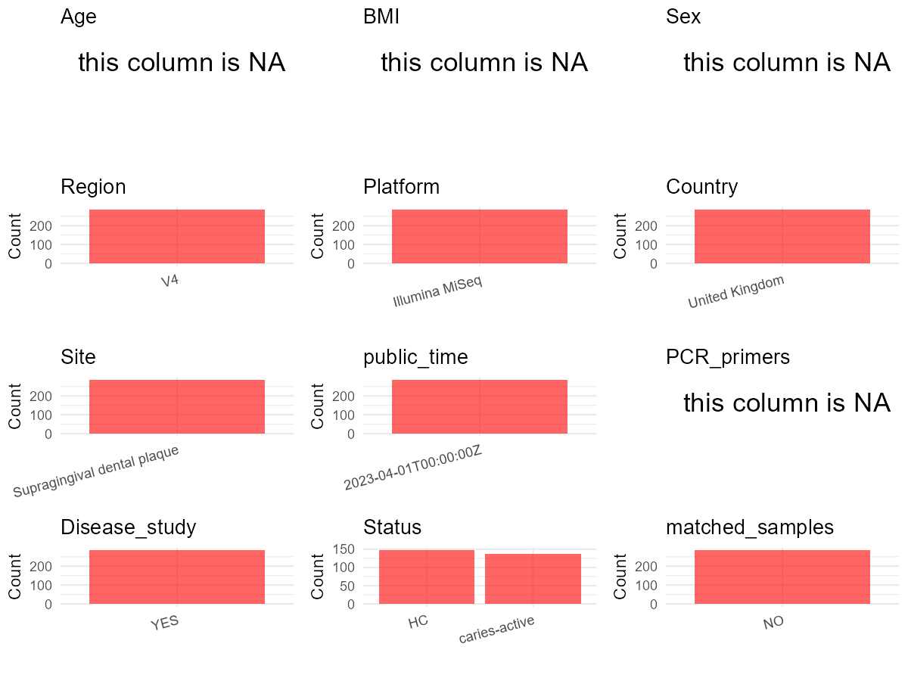

# Step 1: Obtain Initial Metadata from Each Project

To obtain the initial metadata: 1. Search for the BioProject ID (e.g.,
“PRJEBXXXX”) on the [NCBI SRA
website](https://www.ncbi.nlm.nih.gov/Traces/study/). 2. In the “Select”
table, click on “Metadata” and download the file. 3. The downloaded file
is typically named “SraRunTable.csv” and contains metadata for the
project.

    library(tidyverse)
    library(ggplot2)
    library(cowplot)

    setwd("C:/Users/zyc/Desktop/oral_project/data/projects/PRJNA712952")
    initial_meta <- read.csv("SraRunTable.csv", header = TRUE) 
    head(initial_meta)

    ##           Run Assay.Type AvgSpotLen     Bases  BioProject    BioSample              BioSampleModel    Bytes Center.Name
    ## 1 SRR14127869   AMPLICON        600  97339800 PRJNA712952 SAMN18237987 Metagenome or environmental 62625858     FISABIO
    ## 2 SRR14127870   AMPLICON        600  62203800 PRJNA712952 SAMN18237980 Metagenome or environmental 39804594     FISABIO
    ## 3 SRR14127871   AMPLICON        600  44541000 PRJNA712952 SAMN18237949 Metagenome or environmental 28542931     FISABIO
    ## 4 SRR14127872   AMPLICON        600  36082800 PRJNA712952 SAMN18237801 Metagenome or environmental 23552379     FISABIO
    ## 5 SRR14127873   AMPLICON        600  70813800 PRJNA712952 SAMN18237988 Metagenome or environmental 46537233     FISABIO
    ## 6 SRR14127874   AMPLICON        600 101398800 PRJNA712952 SAMN18237982 Metagenome or environmental 64560528     FISABIO
    ##         Collection_Date Consent DATASTORE.filetype DATASTORE.provider                     DATASTORE.region  Experiment geo_loc_name_country
    ## 1 2018-08-01/2018-10-01  public   fastq,run.zq,sra         gs,ncbi,s3 gs.us-east1,ncbi.public,s3.us-east-1 SRX10498132       United Kingdom
    ## 2 2018-03-01/2018-05-01  public   fastq,run.zq,sra         gs,ncbi,s3 gs.us-east1,ncbi.public,s3.us-east-1 SRX10498131       United Kingdom
    ## 3 2017-12-01/2018-02-01  public   fastq,run.zq,sra         gs,ncbi,s3 gs.us-east1,ncbi.public,s3.us-east-1 SRX10498130       United Kingdom
    ## 4            2017-12-01  public   fastq,run.zq,sra         gs,ncbi,s3 gs.us-east1,ncbi.public,s3.us-east-1 SRX10498129       United Kingdom
    ## 5 2018-08-01/2018-10-01  public   fastq,run.zq,sra         gs,ncbi,s3 gs.us-east1,ncbi.public,s3.us-east-1 SRX10498128       United Kingdom
    ## 6 2018-03-01/2018-05-01  public   fastq,run.zq,sra         gs,ncbi,s3 gs.us-east1,ncbi.public,s3.us-east-1 SRX10498127       United Kingdom
    ##   geo_loc_name_country_continent           geo_loc_name         HOST     Instrument                lat_lon
    ## 1                         Europe United Kingdom: London Homo sapiens Illumina MiSeq 51.509865 N 0.118092 W
    ## 2                         Europe United Kingdom: London Homo sapiens Illumina MiSeq 51.509865 N 0.118092 W
    ## 3                         Europe United Kingdom: London Homo sapiens Illumina MiSeq 51.509865 N 0.118092 W
    ## 4                         Europe United Kingdom: London Homo sapiens Illumina MiSeq 51.509865 N 0.118092 W
    ## 5                         Europe United Kingdom: London Homo sapiens Illumina MiSeq 51.509865 N 0.118092 W
    ## 6                         Europe United Kingdom: London Homo sapiens Illumina MiSeq 51.509865 N 0.118092 W
    ##                                  Library.Name LibraryLayout LibrarySelection LibrarySource              Organism Platform
    ## 1 16S-52HBCF-e-MS643_S93_L001_R1_001.fastq.gz        PAIRED              PCR   METAGENOMIC human oral metagenome ILLUMINA
    ## 2 16S-52HBCF-d-MS643_S38_L001_R1_001.fastq.gz        PAIRED              PCR   METAGENOMIC human oral metagenome ILLUMINA
    ## 3 16S-12LDCA-b-MS643_S10_L001_R1_001.fastq.gz        PAIRED              PCR   METAGENOMIC human oral metagenome ILLUMINA
    ## 4  16S-52HBCF-b-MS643_S8_L001_R1_001.fastq.gz        PAIRED              PCR   METAGENOMIC human oral metagenome ILLUMINA
    ## 5 16S-51DWCA-e-MS643_S92_L001_R1_001.fastq.gz        PAIRED              PCR   METAGENOMIC human oral metagenome ILLUMINA
    ## 6 16S-51DWCA-d-MS643_S55_L001_R1_001.fastq.gz        PAIRED              PCR   METAGENOMIC human oral metagenome ILLUMINA
    ##            ReleaseDate          create_date version
    ## 1 2023-04-01T00:00:00Z 2021-04-01T11:16:00Z       1
    ## 2 2023-04-01T00:00:00Z 2021-04-01T11:16:00Z       1
    ## 3 2023-04-01T00:00:00Z 2021-04-01T11:14:00Z       1
    ## 4 2023-04-01T00:00:00Z 2021-04-01T11:14:00Z       1
    ## 5 2023-04-01T00:00:00Z 2021-04-01T11:16:00Z       1
    ## 6 2023-04-01T00:00:00Z 2021-04-01T11:16:00Z       1
    ##                                                                                  Sample.Name SRA.Study
    ## 1   Supragingival dental plaque from caries-free group after Fluoride and Arginine treatment SRP313080
    ## 2                Supragingival dental plaque from caries-free group after Fluoride treatment SRP313080
    ## 3                           Supragingival dental plaque from caries-active group at Baseline SRP313080
    ## 4                             Supragingival dental plaque from caries-free group at Baseline SRP313080
    ## 5 Supragingival dental plaque from caries-active group after Fluoride and Arginine treatment SRP313080
    ## 6              Supragingival dental plaque from caries-active group after Fluoride treatment SRP313080

# Step 2: Create a Uniform Metadata Template

The uniform metadata should include the following columns:

1.  **BioProject**: Project ID (e.g., “PRJNA339212”)
2.  **Run**: Sample ID (e.g., “ERRXXXXXX” or “SRRXXXXXX”)
3.  **sample\_name**: Original sample name submitted by the authors (not
    the database-assigned ID)
4.  **Age**: Age of the subject (if available)
5.  **BMI**: Body Mass Index (if available)
6.  **Sex**: Sex of the subject (“F” or “M”)
7.  **Region**: Targeted 16S rRNA region (e.g., “V3-V4”)
8.  **Platform**: Sequencing platform (e.g., “Illumina MiSeq”)
9.  **Country**: Country of sample origin (e.g., “China”)
10. **Site**: Sample site (e.g., “saliva”, “dental plaque”)
11. **public\_time**: Data release date (format: “YYYY-MM-DD”)
12. **PCR\_primers**: PCR primers used (e.g., “515F-806R”)
13. **title**: Title of the associated publication
14. **Disease\_study**: Whether the study involves a disease (“YES” or
    “NO”)
15. **Status**: Disease status (e.g., “T2DM”, “HC”). Note: If the study
    includes both disease and healthy samples, this must be specified
    per sample.
16. **matched\_samples**: matched samples (“YES” or “NO”)

<!-- -->

    metadata <- data.frame(
      BioProject = initial_meta$BioProject,
      Run = initial_meta$Run,
      sample_name = initial_meta$Library.Name,
      Age = NA, 
      BMI = NA,  
      Sex = NA,
      Platform = initial_meta$Instrument,
      Country = initial_meta$geo_loc_name_country,
      Site = initial_meta$Sample.Name,
      public_time = initial_meta$ReleaseDate,
      Status = initial_meta$Sample.Name,
      stringsAsFactors = FALSE
    )

# Step 3: Manually Add Information from the Publication

Some information (e.g. PCR primers, study title, disease status) must be
manually extracted from the publication and added to the metadata.

    metadata <- metadata %>% mutate(Site = case_when(
      grepl("Supragingival dental plaque",Site) ~ "Supragingival dental plaque",
      TRUE ~ Site
    ))
    metadata <- metadata %>% mutate(Status = case_when(
      grepl("caries-active",Status) ~ "caries-active",
      grepl("caries-free",Status) ~ "HC",
      TRUE ~ Status
    ))
    # metadata <- metadata %>%mutate(Status = case_when(
    #   Status == "Oral Neoplasm (Healthy Control)" ~ "HC",
    #   Status == "Oral Neoplasm (OSCC)" ~ "OSCC",
    #   TRUE ~ "Precancer"
    # ))
    # metadata <- metadata %>%
    #   mutate(Sex = recode(Sex, "female" = "F", "male" = "M"))
    # metadata <-metadata%>%
    #   mutate(Country = case_when(Country == "Taiwan" ~ "China"))

    metadata$matched_samples <- "NO"
    metadata$Region <- "V4"
    metadata$title <- "Functional changes in the oral microbiome after use of fluoride and arginine containing dentifrices: a metagenomic and metatranscriptomic study"
    metadata$Disease_study <- "YES"
    metadata$PCR_primers <- NA

    head(metadata)

    ##    BioProject         Run                                 sample_name Age BMI Sex       Platform        Country                        Site
    ## 1 PRJNA712952 SRR14127869 16S-52HBCF-e-MS643_S93_L001_R1_001.fastq.gz  NA  NA  NA Illumina MiSeq United Kingdom Supragingival dental plaque
    ## 2 PRJNA712952 SRR14127870 16S-52HBCF-d-MS643_S38_L001_R1_001.fastq.gz  NA  NA  NA Illumina MiSeq United Kingdom Supragingival dental plaque
    ## 3 PRJNA712952 SRR14127871 16S-12LDCA-b-MS643_S10_L001_R1_001.fastq.gz  NA  NA  NA Illumina MiSeq United Kingdom Supragingival dental plaque
    ## 4 PRJNA712952 SRR14127872  16S-52HBCF-b-MS643_S8_L001_R1_001.fastq.gz  NA  NA  NA Illumina MiSeq United Kingdom Supragingival dental plaque
    ## 5 PRJNA712952 SRR14127873 16S-51DWCA-e-MS643_S92_L001_R1_001.fastq.gz  NA  NA  NA Illumina MiSeq United Kingdom Supragingival dental plaque
    ## 6 PRJNA712952 SRR14127874 16S-51DWCA-d-MS643_S55_L001_R1_001.fastq.gz  NA  NA  NA Illumina MiSeq United Kingdom Supragingival dental plaque
    ##            public_time        Status matched_samples Region
    ## 1 2023-04-01T00:00:00Z            HC              NO     V4
    ## 2 2023-04-01T00:00:00Z            HC              NO     V4
    ## 3 2023-04-01T00:00:00Z caries-active              NO     V4
    ## 4 2023-04-01T00:00:00Z            HC              NO     V4
    ## 5 2023-04-01T00:00:00Z caries-active              NO     V4
    ## 6 2023-04-01T00:00:00Z caries-active              NO     V4
    ##                                                                                                                                             title
    ## 1 Functional changes in the oral microbiome after use of fluoride and arginine containing dentifrices: a metagenomic and metatranscriptomic study
    ## 2 Functional changes in the oral microbiome after use of fluoride and arginine containing dentifrices: a metagenomic and metatranscriptomic study
    ## 3 Functional changes in the oral microbiome after use of fluoride and arginine containing dentifrices: a metagenomic and metatranscriptomic study
    ## 4 Functional changes in the oral microbiome after use of fluoride and arginine containing dentifrices: a metagenomic and metatranscriptomic study
    ## 5 Functional changes in the oral microbiome after use of fluoride and arginine containing dentifrices: a metagenomic and metatranscriptomic study
    ## 6 Functional changes in the oral microbiome after use of fluoride and arginine containing dentifrices: a metagenomic and metatranscriptomic study
    ##   Disease_study PCR_primers
    ## 1           YES          NA
    ## 2           YES          NA
    ## 3           YES          NA
    ## 4           YES          NA
    ## 5           YES          NA
    ## 6           YES          NA

# Step 4: Summarize and Validate the Metadata

    print(paste("Number of unique runs:", length(unique(metadata$Run))))

    ## [1] "Number of unique runs: 284"

    print(paste("Number of unique sample names:", length(unique(metadata$sample_name))))

    ## [1] "Number of unique sample names: 284"

# Step 5: Visualize the Metadata

    plot_data <- metadata %>%
      select(-BioProject, -Run, -sample_name, -title)

    # Function to create simple plots for each column
    create_simple_plots <- function(data) {
      plots <- list()
      
      for (col in colnames(data)) {
        # Check if the column is all NA
        if (all(is.na(data[[col]]))) {
          # Create an empty plot with text indicating all NA
          p <- ggplot() +
            annotate("text", x = 0.5, y = 0.5, label = "this column is NA", size = 6) +
            labs(title = col) +
            theme_void()
        } else if (is.numeric(data[[col]])) {
          # Numeric variable: histogram
          p <- ggplot(data, aes(x = .data[[col]])) +
            geom_histogram(fill = "blue", alpha = 0.6, bins = 20, na.rm = TRUE) +
            labs(title = col) +
            theme_minimal()
        } else {
          # Categorical variable: bar plot (remove NA values)
          count_data <- as.data.frame(table(data[[col]], useNA = "ifany"))
          p <- ggplot(count_data, aes(x = reorder(Var1, -Freq), y = Freq)) +
            geom_col(fill = "red", alpha = 0.6) +
            labs(title = col, x = NULL, y = "Count") +
            theme_minimal() +
            theme(axis.text.x = element_text(angle = 15, hjust = 1))
        }
        plots[[col]] <- p
      }
      
      return(plots)
    }

    plots <- create_simple_plots(plot_data)
    p<-plot_grid(plots$Age, 
              plots$BMI, 
              plots$Sex, 
              plots$Region, 
              plots$Platform, 
              plots$Country, 
              plots$Site,
              plots$public_time, 
              plots$PCR_primers,
              plots$Disease_study,
              plots$Status,
              plots$matched_samples,# add 
              ncol = 3, align = "hv", axis = "lb")
    ggsave("Metadata_Summary.png", plot = p, width = 8, height = 6, dpi = 150)

    

 \# Step 6: Finalize and Export the Metadata

    metadata <- metadata[, c(
      "BioProject", "Run", "sample_name", "Age", "BMI", "Sex", 
      "Region", "Platform", "Country", "Site", "public_time", 
      "PCR_primers", "title", "Disease_study", "Status","matched_samples"
    )]

    write.csv(metadata, file = "metadata.csv", quote = FALSE)
