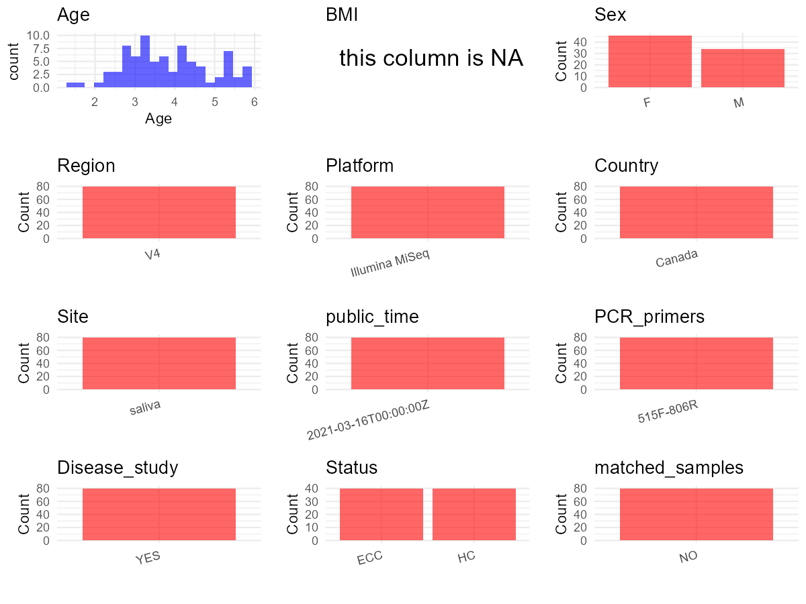

R Notebook: Metadata Processing Workflow
================

# Step 1: Obtain Initial Metadata from Each Project

To obtain the initial metadata: 1. Search for the BioProject ID (e.g.,
“PRJEBXXXX”) on the [NCBI SRA
website](https://www.ncbi.nlm.nih.gov/Traces/study/). 2. In the “Select”
table, click on “Metadata” and download the file. 3. The downloaded file
is typically named “SraRunTable.csv” and contains metadata for the
project.

``` r
# Load necessary libraries
library(dplyr)
library(ggplot2)
library(cowplot)

# Set working directory (update this path to your local directory)
setwd("D:/studylearning/董彪师兄项目/任务/张辰飞/PRJNA714139")

# Read the initial metadata files
initial_meta<-read.csv("SraRunTable.csv",header = T)

# Combine the two metadata files
#meta <- rbind(initial_meta, initial_meta1)

#Remove entries non-oral samples
#initial_meta <- subset(initial_meta,isolate %in% c("saliva","tongue coat"))

# Check the number of samples containing "HT" in Sample.Name (e.g., healthy controls)
#nrow(subset(meta, grepl("HT", Sample.Name)))

# Display the first few rows of the metadata
head(initial_meta)
```

    ##           Run Assay.Type AvgSpotLen     Bases  BioProject    BioSample
    ## 1 SRR13964430   AMPLICON        500 127206000 PRJNA714139 SAMN18290700
    ## 2 SRR13964431   AMPLICON        500 120534000 PRJNA714139 SAMN18290699
    ## 3 SRR13964432   AMPLICON        500 121112000 PRJNA714139 SAMN18290770
    ## 4 SRR13964433   AMPLICON        500 136951000 PRJNA714139 SAMN18290769
    ## 5 SRR13964434   AMPLICON        500 145208500 PRJNA714139 SAMN18290768
    ## 6 SRR13964435   AMPLICON        500 106234000 PRJNA714139 SAMN18290767
    ##                                BioSampleModel    Bytes            Center.Name
    ## 1 MIMARKS.survey,MIGS/MIMS/MIMARKS.human-oral 85578999 UNIVERSITY OF MANITOBA
    ## 2 MIMARKS.survey,MIGS/MIMS/MIMARKS.human-oral 78055890 UNIVERSITY OF MANITOBA
    ## 3 MIMARKS.survey,MIGS/MIMS/MIMARKS.human-oral 79941846 UNIVERSITY OF MANITOBA
    ## 4 MIMARKS.survey,MIGS/MIMS/MIMARKS.human-oral 87591392 UNIVERSITY OF MANITOBA
    ## 5 MIMARKS.survey,MIGS/MIMS/MIMARKS.human-oral 95413506 UNIVERSITY OF MANITOBA
    ## 6 MIMARKS.survey,MIGS/MIMS/MIMARKS.human-oral 67416666 UNIVERSITY OF MANITOBA
    ##         Collection_Date Consent DATASTORE.filetype DATASTORE.provider
    ## 1 2017-12-13/2018-08-14  public   fastq,run.zq,sra         gs,ncbi,s3
    ## 2 2017-12-13/2018-08-14  public   fastq,run.zq,sra         gs,ncbi,s3
    ## 3 2017-12-13/2018-08-14  public   fastq,run.zq,sra         gs,ncbi,s3
    ## 4 2017-12-13/2018-08-14  public   fastq,run.zq,sra         gs,ncbi,s3
    ## 5 2017-12-13/2018-08-14  public   fastq,run.zq,sra         gs,ncbi,s3
    ## 6 2017-12-13/2018-08-14  public   fastq,run.zq,sra         gs,ncbi,s3
    ##                       DATASTORE.region        env_broad_scale
    ## 1 gs.us-east1,ncbi.public,s3.us-east-1 mouth [UBERON:0000165]
    ## 2 gs.us-east1,ncbi.public,s3.us-east-1 mouth [UBERON:0000165]
    ## 3 gs.us-east1,ncbi.public,s3.us-east-1 mouth [UBERON:0000165]
    ## 4 gs.us-east1,ncbi.public,s3.us-east-1 mouth [UBERON:0000165]
    ## 5 gs.us-east1,ncbi.public,s3.us-east-1 mouth [UBERON:0000165]
    ## 6 gs.us-east1,ncbi.public,s3.us-east-1 mouth [UBERON:0000165]
    ##              env_local_scale             env_medium  Experiment
    ## 1 carious teeth [MP:0030101] Saliva [ENVO:02000036] SRX10342501
    ## 2 carious teeth [MP:0030101] Saliva [ENVO:02000036] SRX10342500
    ## 3 carious teeth [MP:0030101] Saliva [ENVO:02000036] SRX10342499
    ## 4 carious teeth [MP:0030101] Saliva [ENVO:02000036] SRX10342498
    ## 5 carious teeth [MP:0030101] Saliva [ENVO:02000036] SRX10342497
    ## 6 carious teeth [MP:0030101] Saliva [ENVO:02000036] SRX10342496
    ##   geo_loc_name_country geo_loc_name_country_continent     geo_loc_name Host_Age
    ## 1               Canada                  North America Canada: Winnipeg 2.583333
    ## 2               Canada                  North America Canada: Winnipeg 3.083333
    ## 3               Canada                  North America Canada: Winnipeg 3.500000
    ## 4               Canada                  North America Canada: Winnipeg 4.166667
    ## 5               Canada                  North America Canada: Winnipeg 5.833333
    ## 6               Canada                  North America Canada: Winnipeg 3.333333
    ##   Host_disease         HOST host_sex host_subject_id     Instrument
    ## 1        S-ECC Homo sapiens   female             S18 Illumina MiSeq
    ## 2        S-ECC Homo sapiens     male             S17 Illumina MiSeq
    ## 3  Caries-free Homo sapiens   female              S9 Illumina MiSeq
    ## 4  Caries-free Homo sapiens     male             S80 Illumina MiSeq
    ## 5        S-ECC Homo sapiens     male              S8 Illumina MiSeq
    ## 6  Caries-free Homo sapiens     male             S79 Illumina MiSeq
    ##   isolation_source         lat_lon Library.Name LibraryLayout LibrarySelection
    ## 1       Oral swabs 49.89 N 97.14 W          S18        PAIRED              PCR
    ## 2       Oral swabs 49.89 N 97.14 W          S17        PAIRED              PCR
    ## 3       Oral swabs 49.89 N 97.14 W           S9        PAIRED              PCR
    ## 4       Oral swabs 49.89 N 97.14 W          S80        PAIRED              PCR
    ## 5       Oral swabs 49.89 N 97.14 W           S8        PAIRED              PCR
    ## 6       Oral swabs 49.89 N 97.14 W          S79        PAIRED              PCR
    ##   LibrarySource              Organism Platform          ReleaseDate
    ## 1   METAGENOMIC human oral metagenome ILLUMINA 2021-03-16T00:00:00Z
    ## 2   METAGENOMIC human oral metagenome ILLUMINA 2021-03-16T00:00:00Z
    ## 3   METAGENOMIC human oral metagenome ILLUMINA 2021-03-16T00:00:00Z
    ## 4   METAGENOMIC human oral metagenome ILLUMINA 2021-03-16T00:00:00Z
    ## 5   METAGENOMIC human oral metagenome ILLUMINA 2021-03-16T00:00:00Z
    ## 6   METAGENOMIC human oral metagenome ILLUMINA 2021-03-16T00:00:00Z
    ##            create_date version samp_collect_device Sample.Name SRA.Study
    ## 1 2021-03-15T15:47:00Z       1           Oral swab         S18 SRP310674
    ## 2 2021-03-15T15:47:00Z       1           Oral swab         S17 SRP310674
    ## 3 2021-03-15T15:47:00Z       1           Oral swab          S9 SRP310674
    ## 4 2021-03-15T15:47:00Z       1           Oral swab         S80 SRP310674
    ## 5 2021-03-15T15:47:00Z       1           Oral swab          S8 SRP310674
    ## 6 2021-03-15T15:47:00Z       1           Oral swab         S79 SRP310674

# Step 2: Create a Uniform Metadata Template

The uniform metadata should include the following columns:

1.  **BioProject**: Project ID (e.g., “PRJNA339212”)
2.  **Run**: Sample ID (e.g., “ERRXXXXXX” or “SRRXXXXXX”)
3.  **sample_name**: Original sample name submitted by the authors (not
    the database-assigned ID)
4.  **Age**: Age of the subject (if available)
5.  **BMI**: Body Mass Index (if available)
6.  **Sex**: Sex of the subject (“F” or “M”)
7.  **Region**: Targeted 16S rRNA region (e.g., “V3-V4”)
8.  **Platform**: Sequencing platform (e.g., “Illumina MiSeq”)
9.  **Country**: Country of sample origin (e.g., “China”)
10. **Site**: Sample site (e.g., “saliva”, “dental plaque”)
11. **public_time**: Data release date (format: “YYYY-MM-DD”)
12. **PCR_primers**: PCR primers used (e.g., “515F-806R”)
13. **title**: Title of the associated publication
14. **Disease_study**: Whether the study involves a disease (“YES” or
    “NO”)
15. **Status**: Disease status (e.g., “T2DM”, “HC”). Note: If the study
    includes both disease and healthy samples, this must be specified
    per sample.
16. **matched_samples**: matched samples (“YES” or “NO”)

``` r
# Create a uniform metadata dataframe
metadata <- data.frame(
  BioProject = initial_meta$BioProject,
  Run = initial_meta$Run,
  sample_name = initial_meta$Sample.Name,
  Age = initial_meta$Host_Age,
  BMI = NA,
  Sex= initial_meta$host_sex,
  Region = "V4",
  Platform = initial_meta$Instrument,
  Country = initial_meta$geo_loc_name_country,
  Site = initial_meta$env_medium,
  public_time = initial_meta$ReleaseDate,
  stringsAsFactors = FALSE
)
```

# Step 3: Manually Add Information from the Publication

Some information (e.g. PCR primers, study title, disease status) must be
manually extracted from the publication and added to the metadata.

``` r
# Add information obtained from the publication
metadata$PCR_primers <- "515F-806R"
metadata$title <- "Characterization of Supragingival Plaque and Oral Swab Microbiomes in Children With Severe Early Childhood Caries"
metadata$Disease_study <- "YES"
metadata$Site <- "saliva"
# Assign disease status based on sample_name patterns
metadata$Status <- initial_meta$Host_disease
metadata <- metadata %>% 
  mutate(Status = case_when(
    grepl("free",Status) ~ "HC",
    TRUE ~ "ECC"
  ))
metadata <- metadata %>% 
  mutate(Sex = case_when(
    grepl("f",Sex) ~ "F",
    grepl("m",Sex) ~ "M"
  ))


#extract subject id by remove prefix of sample_name
#metadata$sample_name <- gsub("T|CR|CS|C|N|S", "", metadata$sample_name)

# Check initial data distribution
cat("Initial sample distribution:\n")
```

    ## Initial sample distribution:

``` r
table(metadata$sample_name)
```

    ## 
    ##  S1 S10 S11 S12 S13 S14 S15 S16 S17 S18 S19  S2 S20 S21 S22 S23 S24 S25 S26 S27 
    ##   1   1   1   1   1   1   1   1   1   1   1   1   1   1   1   1   1   1   1   1 
    ## S28 S29  S3 S30 S31 S32 S33 S34 S35 S36 S37 S38 S39  S4 S40 S41 S42 S43 S44 S45 
    ##   1   1   1   1   1   1   1   1   1   1   1   1   1   1   1   1   1   1   1   1 
    ## S46 S47 S48 S49  S5 S50 S51 S52 S53 S54 S55 S56 S57 S58 S59  S6 S60 S61 S62 S63 
    ##   1   1   1   1   1   1   1   1   1   1   1   1   1   1   1   1   1   1   1   1 
    ## S64 S65 S66 S67 S68 S69  S7 S70 S71 S72 S73 S74 S75 S76 S77 S78 S79  S8 S80  S9 
    ##   1   1   1   1   1   1   1   1   1   1   1   1   1   1   1   1   1   1   1   1

``` r
table(metadata$Site)
```

    ## 
    ## saliva 
    ##     80

``` r
# Calculate sampling frequency per subject
sample_counts <- table(metadata$sample_name)
cat("\nNumber of samples per subject:\n")
```

    ## 
    ## Number of samples per subject:

``` r
print(sample_counts)
```

    ## 
    ##  S1 S10 S11 S12 S13 S14 S15 S16 S17 S18 S19  S2 S20 S21 S22 S23 S24 S25 S26 S27 
    ##   1   1   1   1   1   1   1   1   1   1   1   1   1   1   1   1   1   1   1   1 
    ## S28 S29  S3 S30 S31 S32 S33 S34 S35 S36 S37 S38 S39  S4 S40 S41 S42 S43 S44 S45 
    ##   1   1   1   1   1   1   1   1   1   1   1   1   1   1   1   1   1   1   1   1 
    ## S46 S47 S48 S49  S5 S50 S51 S52 S53 S54 S55 S56 S57 S58 S59  S6 S60 S61 S62 S63 
    ##   1   1   1   1   1   1   1   1   1   1   1   1   1   1   1   1   1   1   1   1 
    ## S64 S65 S66 S67 S68 S69  S7 S70 S71 S72 S73 S74 S75 S76 S77 S78 S79  S8 S80  S9 
    ##   1   1   1   1   1   1   1   1   1   1   1   1   1   1   1   1   1   1   1   1

``` r
# Create matched_samples column
metadata$matched_samples <- ifelse(metadata$sample_name %in% names(sample_counts[sample_counts >= 2]), "YES", "NO")

cat("\nMatched samples distribution:\n")
```

    ## 
    ## Matched samples distribution:

``` r
table(metadata$matched_samples)
```

    ## 
    ## NO 
    ## 80

``` r
# Identify samples for removal: single samples excluding saliva
single_samples <- names(sample_counts[sample_counts == 1])
samples_to_remove <- metadata$sample_name %in% single_samples & !(metadata$Site %in% c("saliva"))

cat("\nNumber of samples to be removed:", sum(samples_to_remove), "\n")
```

    ## 
    ## Number of samples to be removed: 0

``` r
# Remove identified samples
metadata_clean <- metadata[!samples_to_remove, ]

cat("\nFinal sample distribution after cleaning:\n")
```

    ## 
    ## Final sample distribution after cleaning:

``` r
table(metadata_clean$sample_name)
```

    ## 
    ##  S1 S10 S11 S12 S13 S14 S15 S16 S17 S18 S19  S2 S20 S21 S22 S23 S24 S25 S26 S27 
    ##   1   1   1   1   1   1   1   1   1   1   1   1   1   1   1   1   1   1   1   1 
    ## S28 S29  S3 S30 S31 S32 S33 S34 S35 S36 S37 S38 S39  S4 S40 S41 S42 S43 S44 S45 
    ##   1   1   1   1   1   1   1   1   1   1   1   1   1   1   1   1   1   1   1   1 
    ## S46 S47 S48 S49  S5 S50 S51 S52 S53 S54 S55 S56 S57 S58 S59  S6 S60 S61 S62 S63 
    ##   1   1   1   1   1   1   1   1   1   1   1   1   1   1   1   1   1   1   1   1 
    ## S64 S65 S66 S67 S68 S69  S7 S70 S71 S72 S73 S74 S75 S76 S77 S78 S79  S8 S80  S9 
    ##   1   1   1   1   1   1   1   1   1   1   1   1   1   1   1   1   1   1   1   1

``` r
table(metadata_clean$Site)
```

    ## 
    ## saliva 
    ##     80

``` r
table(metadata_clean$matched_samples)
```

    ## 
    ## NO 
    ## 80

``` r
# Use cleaned dataset for subsequent analysis
metadata <- metadata_clean
```

# Step 4: Summarize and Validate the Metadata

``` r
# Check the number of unique runs and sample names
print(paste("Number of unique runs:", length(unique(metadata$Run))))
```

    ## [1] "Number of unique runs: 80"

``` r
print(paste("Number of unique sample names:", length(unique(metadata$sample_name))))
```

    ## [1] "Number of unique sample names: 80"

# Step 5: Visualize the Metadata

``` r

```


# Step 6: Finalize and Export the Metadata

``` r
# Reorder columns to match the desired format
metadata <- metadata[, c(
  "BioProject", "Run", "sample_name", "Age", "BMI", "Sex", 
  "Region", "Platform", "Country", "Site", "public_time", 
  "PCR_primers", "title", "Disease_study", "Status","matched_samples"
)]

# Export the uniform metadata to a CSV file
write.csv(metadata, file = "metadata.csv", quote = FALSE)
head(metadata)
```

    ##    BioProject         Run sample_name      Age BMI Sex Region       Platform
    ## 1 PRJNA714139 SRR13964430         S18 2.583333  NA   F     V4 Illumina MiSeq
    ## 2 PRJNA714139 SRR13964431         S17 3.083333  NA   M     V4 Illumina MiSeq
    ## 3 PRJNA714139 SRR13964432          S9 3.500000  NA   F     V4 Illumina MiSeq
    ## 4 PRJNA714139 SRR13964433         S80 4.166667  NA   M     V4 Illumina MiSeq
    ## 5 PRJNA714139 SRR13964434          S8 5.833333  NA   M     V4 Illumina MiSeq
    ## 6 PRJNA714139 SRR13964435         S79 3.333333  NA   M     V4 Illumina MiSeq
    ##   Country   Site          public_time PCR_primers
    ## 1  Canada saliva 2021-03-16T00:00:00Z   515F-806R
    ## 2  Canada saliva 2021-03-16T00:00:00Z   515F-806R
    ## 3  Canada saliva 2021-03-16T00:00:00Z   515F-806R
    ## 4  Canada saliva 2021-03-16T00:00:00Z   515F-806R
    ## 5  Canada saliva 2021-03-16T00:00:00Z   515F-806R
    ## 6  Canada saliva 2021-03-16T00:00:00Z   515F-806R
    ##                                                                                                               title
    ## 1 Characterization of Supragingival Plaque and Oral Swab Microbiomes in Children With Severe Early Childhood Caries
    ## 2 Characterization of Supragingival Plaque and Oral Swab Microbiomes in Children With Severe Early Childhood Caries
    ## 3 Characterization of Supragingival Plaque and Oral Swab Microbiomes in Children With Severe Early Childhood Caries
    ## 4 Characterization of Supragingival Plaque and Oral Swab Microbiomes in Children With Severe Early Childhood Caries
    ## 5 Characterization of Supragingival Plaque and Oral Swab Microbiomes in Children With Severe Early Childhood Caries
    ## 6 Characterization of Supragingival Plaque and Oral Swab Microbiomes in Children With Severe Early Childhood Caries
    ##   Disease_study Status matched_samples
    ## 1           YES    ECC              NO
    ## 2           YES    ECC              NO
    ## 3           YES     HC              NO
    ## 4           YES     HC              NO
    ## 5           YES    ECC              NO
    ## 6           YES     HC              NO

## Notes for Students:

1.  **Metadata Accuracy**: Always cross-check the metadata with the
    original publication to ensure accuracy.
2.  **Manual Entries**: Columns like `PCR_primers`, and `Status` often
    require manual entry based on the publication.
3.  **Disease Status**: Be careful when assigning `Status`—some studies
    include both disease and healthy samples.
4.  **Visualization**: The plots help quickly identify the distribution
    of values in each column, which is useful for quality control.
5.  **Reproducibility**: Update the working directory and file paths to
    match your local environment.
