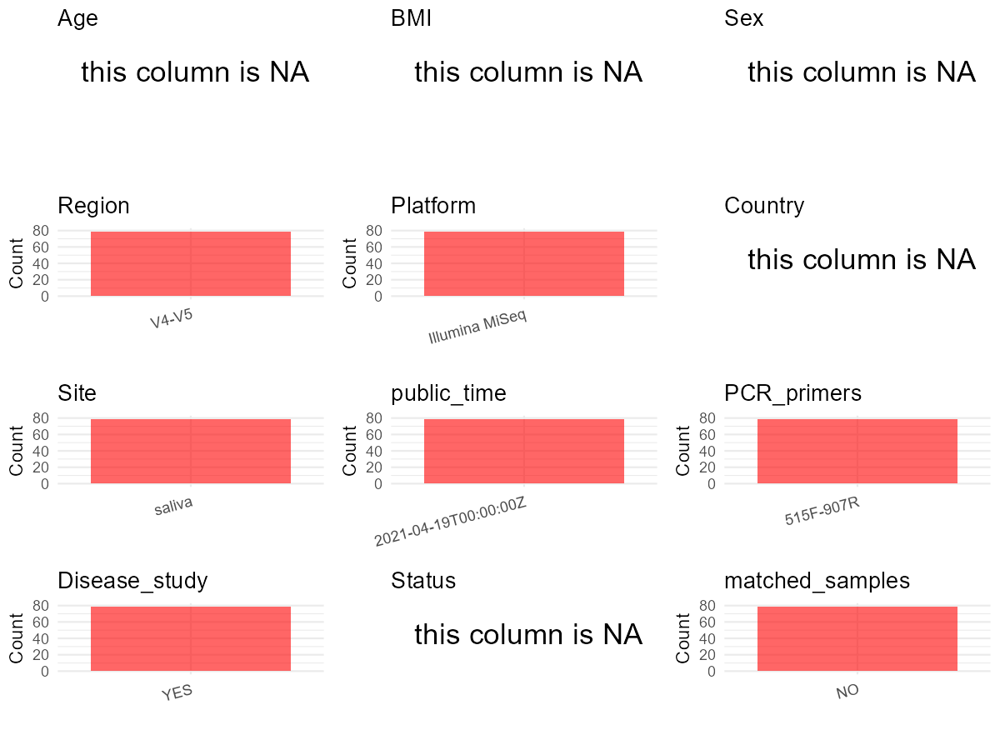

R Notebook: Metadata Processing Workflow
================

# Step 1: Obtain Initial Metadata from Each Project

To obtain the initial metadata: 1. Search for the BioProject ID (e.g.,
“PRJEBXXXX”) on the [NCBI SRA
website](https://www.ncbi.nlm.nih.gov/Traces/study/). 2. In the “Select”
table, click on “Metadata” and download the file. 3. The downloaded file
is typically named “SraRunTable.csv” and contains metadata for the
project.

``` r
# Load necessary libraries
library(dplyr)
library(ggplot2)
library(cowplot)

# Set working directory (update this path to your local directory)
setwd("D:/studylearning/董彪师兄项目/任务4_20251009/PRJNA722880")

# Read the initial metadata files
initial_meta<-read.csv("SraRunTable.csv",header = T)
initial_meta <- subset(initial_meta,isolation_source=="saliva")
# Display the first few rows of the metadata
head(initial_meta)
```

    ##            Run Assay.Type AvgSpotLen    Bases  BioProject    BioSample
    ## 8  SRR14271742   AMPLICON        602 24810226 PRJNA722880 SAMN18795451
    ## 19 SRR14271753   AMPLICON        602 24889690 PRJNA722880 SAMN18795450
    ## 30 SRR14271764   AMPLICON        602 29525692 PRJNA722880 SAMN18795449
    ## 31 SRR14271765   AMPLICON        602 24432772 PRJNA722880 SAMN18795440
    ## 32 SRR14271766   AMPLICON        602 25421858 PRJNA722880 SAMN18795439
    ## 43 SRR14271777   AMPLICON        602 25335170 PRJNA722880 SAMN18795448
    ##                 BioSampleModel    Bytes        Center.Name Collection_Date
    ## 8  Metagenome or environmental 14917541 SICHUAN UNIVERSITY      2019-09-10
    ## 19 Metagenome or environmental 15138782 SICHUAN UNIVERSITY      2019-09-10
    ## 30 Metagenome or environmental 17713647 SICHUAN UNIVERSITY      2019-09-10
    ## 31 Metagenome or environmental 14792840 SICHUAN UNIVERSITY      2019-09-10
    ## 32 Metagenome or environmental 15307771 SICHUAN UNIVERSITY      2019-09-10
    ## 43 Metagenome or environmental 15114389 SICHUAN UNIVERSITY      2019-09-10
    ##    Consent DATASTORE.filetype DATASTORE.provider
    ## 8   public   fastq,run.zq,sra         gs,ncbi,s3
    ## 19  public   fastq,run.zq,sra         gs,ncbi,s3
    ## 30  public   fastq,run.zq,sra         gs,ncbi,s3
    ## 31  public   fastq,run.zq,sra         gs,ncbi,s3
    ## 32  public   fastq,run.zq,sra         gs,ncbi,s3
    ## 43  public   fastq,run.zq,sra         gs,ncbi,s3
    ##                        DATASTORE.region  Experiment geo_loc_name_country
    ## 8  gs.us-east1,ncbi.public,s3.us-east-1 SRX10633488         uncalculated
    ## 19 gs.us-east1,ncbi.public,s3.us-east-1 SRX10633477         uncalculated
    ## 30 gs.us-east1,ncbi.public,s3.us-east-1 SRX10633466         uncalculated
    ## 31 gs.us-east1,ncbi.public,s3.us-east-1 SRX10633465         uncalculated
    ## 32 gs.us-east1,ncbi.public,s3.us-east-1 SRX10633464         uncalculated
    ## 43 gs.us-east1,ncbi.public,s3.us-east-1 SRX10633453         uncalculated
    ##    geo_loc_name_country_continent geo_loc_name         HOST     Instrument
    ## 8                    uncalculated      missing Homo sapiens Illumina MiSeq
    ## 19                   uncalculated      missing Homo sapiens Illumina MiSeq
    ## 30                   uncalculated      missing Homo sapiens Illumina MiSeq
    ## 31                   uncalculated      missing Homo sapiens Illumina MiSeq
    ## 32                   uncalculated      missing Homo sapiens Illumina MiSeq
    ## 43                   uncalculated      missing Homo sapiens Illumina MiSeq
    ##    isolation_source       lat_lon Library.Name LibraryLayout LibrarySelection
    ## 8            saliva not collected        KQ_27        PAIRED              PCR
    ## 19           saliva not collected        KQ_25        PAIRED              PCR
    ## 30           saliva not collected        KQ_19        PAIRED              PCR
    ## 31           saliva not collected        KQ_03        PAIRED              PCR
    ## 32           saliva not collected        KQ_01        PAIRED              PCR
    ## 43           saliva not collected        KQ_18        PAIRED              PCR
    ##    LibrarySource   Organism Platform          ReleaseDate replicate
    ## 8          OTHER metagenome ILLUMINA 2021-04-19T00:00:00Z        13
    ## 19         OTHER metagenome ILLUMINA 2021-04-19T00:00:00Z        12
    ## 30         OTHER metagenome ILLUMINA 2021-04-19T00:00:00Z        11
    ## 31         OTHER metagenome ILLUMINA 2021-04-19T00:00:00Z         2
    ## 32         OTHER metagenome ILLUMINA 2021-04-19T00:00:00Z         1
    ## 43         OTHER metagenome ILLUMINA 2021-04-19T00:00:00Z        10
    ##             create_date version Sample.Name SRA.Study
    ## 8  2021-04-19T10:54:00Z       1       KQ_27 SRP315314
    ## 19 2021-04-19T10:55:00Z       1       KQ_25 SRP315314
    ## 30 2021-04-19T10:56:00Z       1       KQ_19 SRP315314
    ## 31 2021-04-19T10:56:00Z       1       KQ_03 SRP315314
    ## 32 2021-04-19T10:56:00Z       1       KQ_01 SRP315314
    ## 43 2021-04-19T10:56:00Z       1       KQ_18 SRP315314

# Step 2: Create a Uniform Metadata Template

The uniform metadata should include the following columns:

1.  **BioProject**: Project ID (e.g., “PRJNA339212”)
2.  **Run**: Sample ID (e.g., “ERRXXXXXX” or “SRRXXXXXX”)
3.  **sample_name**: Original sample name submitted by the authors (not
    the database-assigned ID)
4.  **Age**: Age of the subject (if available)
5.  **BMI**: Body Mass Index (if available)
6.  **Sex**: Sex of the subject (“F” or “M”)
7.  **Region**: Targeted 16S rRNA region (e.g., “V3-V4”)
8.  **Platform**: Sequencing platform (e.g., “Illumina MiSeq”)
9.  **Country**: Country of sample origin (e.g., “China”)
10. **Site**: Sample site (e.g., “saliva”, “dental plaque”)
11. **public_time**: Data release date (format: “YYYY-MM-DD”)
12. **PCR_primers**: PCR primers used (e.g., “515F-806R”)
13. **title**: Title of the associated publication
14. **Disease_study**: Whether the study involves a disease (“YES” or
    “NO”)
15. **Status**: Disease status (e.g., “T2DM”, “HC”). Note: If the study
    includes both disease and healthy samples, this must be specified
    per sample.

``` r
# Create a uniform metadata dataframe
metadata <- data.frame(
  BioProject = initial_meta$BioProject,
  Run = initial_meta$Run,
  sample_name = initial_meta$Sample.Name,
  Age = NA,
  BMI = NA,
  Sex= NA,
  Region = "V4-V5",
  Platform = initial_meta$Instrument,
  Country = NA,
  Site = initial_meta$isolation_source,
  public_time = initial_meta$ReleaseDate,
  stringsAsFactors = FALSE
)
```

# Step 3: Manually Add Information from the Publication

Some information (e.g. PCR primers, study title, disease status) must be
manually extracted from the publication and added to the metadata.

``` r
# Add information obtained from the publication
metadata$PCR_primers <-  "515F-907R"  # Update based on the publication
metadata$title <- "The human oral - nasopharynx microbiome as a risk screening tool for nasopharyngeal carcinoma"
metadata$Disease_study <- "YES"
metadata$Status <- NA_character_

#extract subject id by remove prefix of sample_name
#metadata$sample_name <- gsub("_st|_sal", "", metadata$sample_name)

# Check initial data distribution
cat("Initial sample distribution:\n")
```

    ## Initial sample distribution:

``` r
table(metadata$sample_name)
```

    ## 
    ##      CYY   DonorA       HN    KQ_01    KQ_03    KQ_04    KQ_06    KQ_07 
    ##        1        1        1        1        1        1        1        1 
    ##    KQ_12    KQ_14    KQ_16    KQ_17    KQ_18    KQ_19    KQ_25    KQ_27 
    ##        1        1        1        1        1        1        1        1 
    ##    KQ_29    KQ_30    KQ_33    KQ_35    KQ_36    KQ_41    KQ_43    KQ_45 
    ##        1        1        1        1        1        1        1        1 
    ##    KQ_47    KQ_48    KQ_52    KQ_55    KQ_56    KQ_57    KQ_59    KQ_60 
    ##        1        1        1        1        1        1        1        1 
    ##    KQ_62    KQ_63    KQ_64    KQ_65    KQ_66    KQ_67    KQ_68    KQ_69 
    ##        1        1        1        1        1        1        1        1 
    ##    KQ_70    KQ_71    KQ_72    KQ_73       QY  S_KQ_01  S_KQ_02  S_KQ_04 
    ##        1        1        1        1        1        1        1        1 
    ##  S_KQ_05  S_KQ_06  S_KQ_08  S_KQ_09  S_KQ_10  S_KQ_11 SH_KQ_01 SH_KQ_02 
    ##        1        1        1        1        1        1        1        1 
    ## SH_KQ_03 SH_KQ_04 SH_KQ_05 SH_KQ_06 SH_KQ_07 SH_KQ_08 SH_KQ_09 SH_KQ_10 
    ##        1        1        1        1        1        1        1        1 
    ## SH_KQ_11 SH_KQ_12 SH_KQ_13 SH_KQ_14 SH_KQ_15 SH_KQ_16 SH_KQ_17 SH_KQ_18 
    ##        1        1        1        1        1        1        1        1 
    ## SH_KQ_19 SH_KQ_20     WHLT     WHYT       WZ      YJZ      ZCG 
    ##        1        1        1        1        1        1        1

``` r
table(metadata$Site)
```

    ## 
    ## saliva 
    ##     79

``` r
# Calculate sampling frequency per subject
sample_counts <- table(metadata$sample_name)
cat("\nNumber of samples per subject:\n")
```

    ## 
    ## Number of samples per subject:

``` r
print(sample_counts)
```

    ## 
    ##      CYY   DonorA       HN    KQ_01    KQ_03    KQ_04    KQ_06    KQ_07 
    ##        1        1        1        1        1        1        1        1 
    ##    KQ_12    KQ_14    KQ_16    KQ_17    KQ_18    KQ_19    KQ_25    KQ_27 
    ##        1        1        1        1        1        1        1        1 
    ##    KQ_29    KQ_30    KQ_33    KQ_35    KQ_36    KQ_41    KQ_43    KQ_45 
    ##        1        1        1        1        1        1        1        1 
    ##    KQ_47    KQ_48    KQ_52    KQ_55    KQ_56    KQ_57    KQ_59    KQ_60 
    ##        1        1        1        1        1        1        1        1 
    ##    KQ_62    KQ_63    KQ_64    KQ_65    KQ_66    KQ_67    KQ_68    KQ_69 
    ##        1        1        1        1        1        1        1        1 
    ##    KQ_70    KQ_71    KQ_72    KQ_73       QY  S_KQ_01  S_KQ_02  S_KQ_04 
    ##        1        1        1        1        1        1        1        1 
    ##  S_KQ_05  S_KQ_06  S_KQ_08  S_KQ_09  S_KQ_10  S_KQ_11 SH_KQ_01 SH_KQ_02 
    ##        1        1        1        1        1        1        1        1 
    ## SH_KQ_03 SH_KQ_04 SH_KQ_05 SH_KQ_06 SH_KQ_07 SH_KQ_08 SH_KQ_09 SH_KQ_10 
    ##        1        1        1        1        1        1        1        1 
    ## SH_KQ_11 SH_KQ_12 SH_KQ_13 SH_KQ_14 SH_KQ_15 SH_KQ_16 SH_KQ_17 SH_KQ_18 
    ##        1        1        1        1        1        1        1        1 
    ## SH_KQ_19 SH_KQ_20     WHLT     WHYT       WZ      YJZ      ZCG 
    ##        1        1        1        1        1        1        1

``` r
# Create matched_samples column
metadata$matched_samples <- ifelse(metadata$sample_name %in% names(sample_counts[sample_counts >= 2]), "YES", "NO")

cat("\nMatched samples distribution:\n")
```

    ## 
    ## Matched samples distribution:

``` r
table(metadata$matched_samples)
```

    ## 
    ## NO 
    ## 79

``` r
# Identify samples for removal: single samples excluding saliva 
single_samples <- names(sample_counts[sample_counts == 1])
samples_to_remove <- metadata$sample_name %in% single_samples & !(metadata$Site %in% c("saliva"))

cat("\nNumber of samples to be removed:", sum(samples_to_remove), "\n")
```

    ## 
    ## Number of samples to be removed: 0

``` r
# Remove identified samples
metadata_clean <- metadata[!samples_to_remove, ]

cat("\nFinal sample distribution after cleaning:\n")
```

    ## 
    ## Final sample distribution after cleaning:

``` r
table(metadata_clean$sample_name)
```

    ## 
    ##      CYY   DonorA       HN    KQ_01    KQ_03    KQ_04    KQ_06    KQ_07 
    ##        1        1        1        1        1        1        1        1 
    ##    KQ_12    KQ_14    KQ_16    KQ_17    KQ_18    KQ_19    KQ_25    KQ_27 
    ##        1        1        1        1        1        1        1        1 
    ##    KQ_29    KQ_30    KQ_33    KQ_35    KQ_36    KQ_41    KQ_43    KQ_45 
    ##        1        1        1        1        1        1        1        1 
    ##    KQ_47    KQ_48    KQ_52    KQ_55    KQ_56    KQ_57    KQ_59    KQ_60 
    ##        1        1        1        1        1        1        1        1 
    ##    KQ_62    KQ_63    KQ_64    KQ_65    KQ_66    KQ_67    KQ_68    KQ_69 
    ##        1        1        1        1        1        1        1        1 
    ##    KQ_70    KQ_71    KQ_72    KQ_73       QY  S_KQ_01  S_KQ_02  S_KQ_04 
    ##        1        1        1        1        1        1        1        1 
    ##  S_KQ_05  S_KQ_06  S_KQ_08  S_KQ_09  S_KQ_10  S_KQ_11 SH_KQ_01 SH_KQ_02 
    ##        1        1        1        1        1        1        1        1 
    ## SH_KQ_03 SH_KQ_04 SH_KQ_05 SH_KQ_06 SH_KQ_07 SH_KQ_08 SH_KQ_09 SH_KQ_10 
    ##        1        1        1        1        1        1        1        1 
    ## SH_KQ_11 SH_KQ_12 SH_KQ_13 SH_KQ_14 SH_KQ_15 SH_KQ_16 SH_KQ_17 SH_KQ_18 
    ##        1        1        1        1        1        1        1        1 
    ## SH_KQ_19 SH_KQ_20     WHLT     WHYT       WZ      YJZ      ZCG 
    ##        1        1        1        1        1        1        1

``` r
table(metadata_clean$Site)
```

    ## 
    ## saliva 
    ##     79

``` r
table(metadata_clean$matched_samples)
```

    ## 
    ## NO 
    ## 79

``` r
# Use cleaned dataset for subsequent analysis
metadata <- metadata_clean
```

# Step 4: Summarize and Validate the Metadata

``` r
# Check the number of unique runs and sample names
print(paste("Number of unique runs:", length(unique(metadata$Run))))
```

    ## [1] "Number of unique runs: 79"

``` r
print(paste("Number of unique sample names:", length(unique(metadata$sample_name))))
```

    ## [1] "Number of unique sample names: 79"

# Step 5: Visualize the Metadata

``` r

```


# Step 6: Finalize and Export the Metadata

``` r
# Reorder columns to match the desired format
metadata <- metadata[, c(
  "BioProject", "Run", "sample_name", "Age", "BMI", "Sex", 
  "Region", "Platform", "Country", "Site", "public_time", 
  "PCR_primers", "title", "Disease_study", "Status","matched_samples"
)]

# Export the uniform metadata to a CSV file
write.csv(metadata, file = "metadata.csv", quote = FALSE)
head(metadata)
```

    ##    BioProject         Run sample_name Age BMI Sex Region       Platform Country
    ## 1 PRJNA722880 SRR14271742       KQ_27  NA  NA  NA  V4-V5 Illumina MiSeq      NA
    ## 2 PRJNA722880 SRR14271753       KQ_25  NA  NA  NA  V4-V5 Illumina MiSeq      NA
    ## 3 PRJNA722880 SRR14271764       KQ_19  NA  NA  NA  V4-V5 Illumina MiSeq      NA
    ## 4 PRJNA722880 SRR14271765       KQ_03  NA  NA  NA  V4-V5 Illumina MiSeq      NA
    ## 5 PRJNA722880 SRR14271766       KQ_01  NA  NA  NA  V4-V5 Illumina MiSeq      NA
    ## 6 PRJNA722880 SRR14271777       KQ_18  NA  NA  NA  V4-V5 Illumina MiSeq      NA
    ##     Site          public_time PCR_primers
    ## 1 saliva 2021-04-19T00:00:00Z   515F-907R
    ## 2 saliva 2021-04-19T00:00:00Z   515F-907R
    ## 3 saliva 2021-04-19T00:00:00Z   515F-907R
    ## 4 saliva 2021-04-19T00:00:00Z   515F-907R
    ## 5 saliva 2021-04-19T00:00:00Z   515F-907R
    ## 6 saliva 2021-04-19T00:00:00Z   515F-907R
    ##                                                                                           title
    ## 1 The human oral - nasopharynx microbiome as a risk screening tool for nasopharyngeal carcinoma
    ## 2 The human oral - nasopharynx microbiome as a risk screening tool for nasopharyngeal carcinoma
    ## 3 The human oral - nasopharynx microbiome as a risk screening tool for nasopharyngeal carcinoma
    ## 4 The human oral - nasopharynx microbiome as a risk screening tool for nasopharyngeal carcinoma
    ## 5 The human oral - nasopharynx microbiome as a risk screening tool for nasopharyngeal carcinoma
    ## 6 The human oral - nasopharynx microbiome as a risk screening tool for nasopharyngeal carcinoma
    ##   Disease_study Status matched_samples
    ## 1           YES   <NA>              NO
    ## 2           YES   <NA>              NO
    ## 3           YES   <NA>              NO
    ## 4           YES   <NA>              NO
    ## 5           YES   <NA>              NO
    ## 6           YES   <NA>              NO

## Notes for Students:

1.  **Metadata Accuracy**: Always cross-check the metadata with the
    original publication to ensure accuracy.
2.  **Manual Entries**: Columns like `PCR_primers`, and `Status` often
    require manual entry based on the publication.
3.  **Disease Status**: Be careful when assigning `Status`—some studies
    include both disease and healthy samples.
4.  **Visualization**: The plots help quickly identify the distribution
    of values in each column, which is useful for quality control.
5.  **Reproducibility**: Update the working directory and file paths to
    match your local environment.
