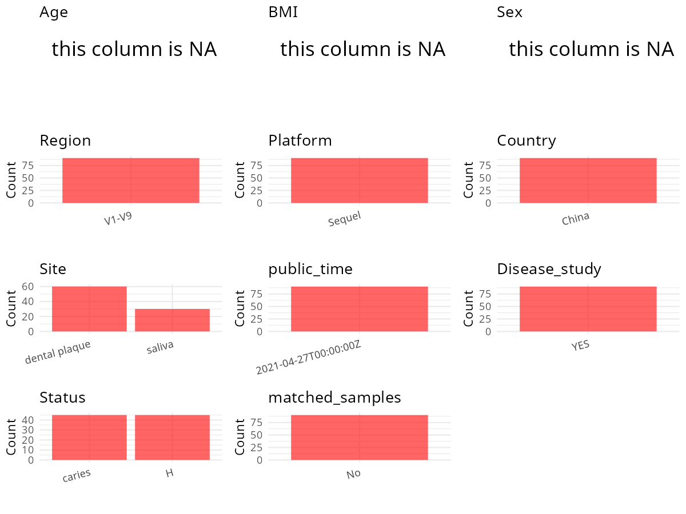

R Notebook: Metadata Processing Workflow
================

# Step 1: Obtain Initial Metadata from Each Project

To obtain the initial metadata: 1. Search for the BioProject ID (e.g.,
“PRJEBXXXX”) on the [NCBI SRA
website](https://www.ncbi.nlm.nih.gov/Traces/study/). 2. In the “Select”
table, click on “Metadata” and download the file. 3. The downloaded file
is typically named “SraRunTable.csv” and contains metadata for the
project.

``` r
# Load necessary libraries
library(dplyr)
library(ggplot2)
library(cowplot)
library(stringr)

# Set working directory (update this path to your local directory)
setwd("/home/hby/oral_project/PRJNA725075")

# Read the initial metadata files
initial_meta <- read.csv("SraRunTable.csv", header = T)

# Combine the two metadata files
# meta <- rbind(initial_meta, initial_meta1)

# Remove entries non-oral samples
# initial_meta <- subset(initial_meta,isolate %in% c("saliva","tongue coat"))

# Check the number of samples containing "HT" in Sample.Name (e.g., healthy controls)
# nrow(subset(meta, grepl("HT", Sample.Name)))

# Display the first few rows of the metadata
head(initial_meta)
```

    ##           Run Assay.Type AvgSpotLen   Bases  BioProject    BioSample                              BioSampleModel   Bytes                                          Center.Name
    ## 1 SRR14322433   AMPLICON       1569 7838094 PRJNA725075 SAMN18869491 MIMARKS.survey,MIGS/MIMS/MIMARKS.human-oral 3555060 STOMATOLOGICAL HOSPITAL, SOUTHERN MEDICAL UNIVERSITY
    ## 2 SRR14322434   AMPLICON       1571 7578450 PRJNA725075 SAMN18869571 MIMARKS.survey,MIGS/MIMS/MIMARKS.human-oral 3491158 STOMATOLOGICAL HOSPITAL, SOUTHERN MEDICAL UNIVERSITY
    ## 3 SRR14322435   AMPLICON       1561 7894227 PRJNA725075 SAMN18869570 MIMARKS.survey,MIGS/MIMS/MIMARKS.human-oral 3836672 STOMATOLOGICAL HOSPITAL, SOUTHERN MEDICAL UNIVERSITY
    ## 4 SRR14322436   AMPLICON       1558 7326156 PRJNA725075 SAMN18869569 MIMARKS.survey,MIGS/MIMS/MIMARKS.human-oral 3387207 STOMATOLOGICAL HOSPITAL, SOUTHERN MEDICAL UNIVERSITY
    ## 5 SRR14322437   AMPLICON       1563 8121537 PRJNA725075 SAMN18869568 MIMARKS.survey,MIGS/MIMS/MIMARKS.human-oral 3744325 STOMATOLOGICAL HOSPITAL, SOUTHERN MEDICAL UNIVERSITY
    ## 6 SRR14322438   AMPLICON       1562 7559313 PRJNA725075 SAMN18869567 MIMARKS.survey,MIGS/MIMS/MIMARKS.human-oral 3556303 STOMATOLOGICAL HOSPITAL, SOUTHERN MEDICAL UNIVERSITY
    ##   Collection_Date Consent DATASTORE.filetype DATASTORE.provider                     DATASTORE.region env_broad_scale env_local_scale    env_medium  Experiment geo_loc_name_country
    ## 1       2019/4/13  public   fastq,run.zq,sra         gs,ncbi,s3 gs.us-east1,ncbi.public,s3.us-east-1   not collected   not collected not collected SRX10677657                China
    ## 2       2019/4/13  public   fastq,run.zq,sra         gs,ncbi,s3 gs.us-east1,ncbi.public,s3.us-east-1   not collected   not collected not collected SRX10677656                China
    ## 3       2019/4/13  public   fastq,run.zq,sra         gs,ncbi,s3 gs.us-east1,ncbi.public,s3.us-east-1   not collected   not collected not collected SRX10677655                China
    ## 4       2019/4/13  public   fastq,run.zq,sra         gs,ncbi,s3 gs.us-east1,ncbi.public,s3.us-east-1   not collected   not collected not collected SRX10677654                China
    ## 5       2019/4/13  public   fastq,run.zq,sra         gs,ncbi,s3 gs.us-east1,ncbi.public,s3.us-east-1   not collected   not collected not collected SRX10677653                China
    ## 6       2019/4/13  public   fastq,run.zq,sra         gs,ncbi,s3 gs.us-east1,ncbi.public,s3.us-east-1   not collected   not collected not collected SRX10677652                China
    ##   geo_loc_name_country_continent    geo_loc_name         HOST Instrument       lat_lon Library.Name LibraryLayout LibrarySelection LibrarySource              Organism    Platform
    ## 1                           Asia China:Guangdong Homo sapiens     Sequel not collected           10        SINGLE            other   METAGENOMIC human oral metagenome PACBIO_SMRT
    ## 2                           Asia China:Guangdong Homo sapiens     Sequel not collected           90        SINGLE            other   METAGENOMIC human oral metagenome PACBIO_SMRT
    ## 3                           Asia China:Guangdong Homo sapiens     Sequel not collected           89        SINGLE            other   METAGENOMIC human oral metagenome PACBIO_SMRT
    ## 4                           Asia China:Guangdong Homo sapiens     Sequel not collected           88        SINGLE            other   METAGENOMIC human oral metagenome PACBIO_SMRT
    ## 5                           Asia China:Guangdong Homo sapiens     Sequel not collected           87        SINGLE            other   METAGENOMIC human oral metagenome PACBIO_SMRT
    ## 6                           Asia China:Guangdong Homo sapiens     Sequel not collected           86        SINGLE            other   METAGENOMIC human oral metagenome PACBIO_SMRT
    ##            ReleaseDate          create_date version Sample_Name source_material_id SRA.Study
    ## 1 2021-04-27T00:00:00Z 2021-04-27T02:54:00Z       1       02H.D                 10 SRP316293
    ## 2 2021-04-27T00:00:00Z 2021-04-27T02:54:00Z       1       15H.S                 90 SRP316293
    ## 3 2021-04-27T00:00:00Z 2021-04-27T02:54:00Z       1       15H.P                 89 SRP316293
    ## 4 2021-04-27T00:00:00Z 2021-04-27T02:55:00Z       1       15H.D                 88 SRP316293
    ## 5 2021-04-27T00:00:00Z 2021-04-27T02:55:00Z       1       15C.S                 87 SRP316293
    ## 6 2021-04-27T00:00:00Z 2021-04-27T02:55:00Z       1       15C.P                 86 SRP316293

# Step 2: Create a Uniform Metadata Template

The uniform metadata should include the following columns:

1.  **BioProject**: Project ID (e.g., “PRJNA339212”)
2.  **Run**: Sample ID (e.g., “ERRXXXXXX” or “SRRXXXXXX”)
3.  **sample_name**: Original sample name submitted by the authors (not
    the database-assigned ID)
4.  **Age**: Age of the subject (if available)
5.  **BMI**: Body Mass Index (if available)
6.  **Sex**: Sex of the subject (“F” or “M”)
7.  **Region**: Targeted 16S rRNA region (e.g., “V3-V4”)
8.  **Platform**: Sequencing platform (e.g., “Illumina MiSeq”)
9.  **Country**: Country of sample origin (e.g., “China”)
10. **Site**: Sample site (e.g., “saliva”, “dental plaque”)
11. **public_time**: Data release date (format: “YYYY-MM-DD”)
12. **PCR_primers**: PCR primers used (e.g., “515F-806R”)
13. **title**: Title of the associated publication
14. **Disease_study**: Whether the study involves a disease (“YES” or
    “NO”)
15. **Status**: Disease status (e.g., “T2DM”, “HC”). Note: If the study
    includes both disease and healthy samples, this must be specified
    per sample.
16. **matched_samples**: matched samples (“YES” or “NO”)

``` r
# Create a uniform metadata dataframe
metadata <- data.frame(
  BioProject = initial_meta$BioProject,
  Run = initial_meta$Run,
  sample_name = initial_meta$Sample_Name,
  Platform = initial_meta$Instrument,
  Country = initial_meta$geo_loc_name_country,
  public_time = initial_meta$ReleaseDate,
  Site = NA,
  Sex = NA,
  Age = NA,
  BMI = NA,
  Status = NA,
  stringsAsFactors = FALSE
)
metadata <- metadata %>%
  mutate(
    Site = case_when(
      str_detect(sample_name, "S") ~ "saliva",
      str_detect(sample_name, "P|D") ~ "dental plaque",
      TRUE ~ NA_character_ # Default to NA if no condition is met
    ),
    Status = case_when(
      str_detect(sample_name, "H") ~ "H",
      str_detect(sample_name, "C") ~ "caries",
      TRUE ~ NA_character_ # Default to NA
    )
  )
```

# Step 3: Manually Add Information from the Publication

Some information (e.g. PCR primers, study title, disease status) must be
manually extracted from the publication and added to the metadata.

``` r
# Add information obtained from the publication
metadata$Region <- "V1-V9"
metadata$PCR_primers <- "FWD:AGAGTTTGATCCTGGCTCAG; REV:GGTTACCTTGTTACGACTT"
metadata$title <- "The impact of caries status on supragingival plaque and salivary microbiome in children with mixed dentition: a cross-sectional survey"
metadata$Disease_study <- "YES"
metadata$matched_samples <- "No"
```

# Step 4: Summarize and Validate the Metadata

``` r
# Check the number of unique runs and sample names
print(paste("Number of unique runs:", length(unique(metadata$Run))))
```

    ## [1] "Number of unique runs: 90"

``` r
print(paste("Number of unique sample names:", length(unique(metadata$sample_name))))
```

    ## [1] "Number of unique sample names: 90"

# Step 5: Visualize the Metadata

``` r

```


# Step 6: Finalize and Export the Metadata

``` r
# Reorder columns to match the desired format
metadata <- metadata[, c(
  "BioProject", "Run", "sample_name", "Age", "BMI", "Sex",
  "Region", "Platform", "Country", "Site", "public_time",
  "PCR_primers", "title", "Disease_study", "Status", "matched_samples"
)]

# Export the uniform metadata to a CSV file
write.csv(metadata, file = "metadata.csv", quote = FALSE)
head(metadata)
```

    ##    BioProject         Run sample_name Age BMI Sex Region Platform Country          Site          public_time                                       PCR_primers
    ## 1 PRJNA725075 SRR14322433       02H.D  NA  NA  NA  V1-V9   Sequel   China dental plaque 2021-04-27T00:00:00Z FWD:AGAGTTTGATCCTGGCTCAG; REV:GGTTACCTTGTTACGACTT
    ## 2 PRJNA725075 SRR14322434       15H.S  NA  NA  NA  V1-V9   Sequel   China        saliva 2021-04-27T00:00:00Z FWD:AGAGTTTGATCCTGGCTCAG; REV:GGTTACCTTGTTACGACTT
    ## 3 PRJNA725075 SRR14322435       15H.P  NA  NA  NA  V1-V9   Sequel   China dental plaque 2021-04-27T00:00:00Z FWD:AGAGTTTGATCCTGGCTCAG; REV:GGTTACCTTGTTACGACTT
    ## 4 PRJNA725075 SRR14322436       15H.D  NA  NA  NA  V1-V9   Sequel   China dental plaque 2021-04-27T00:00:00Z FWD:AGAGTTTGATCCTGGCTCAG; REV:GGTTACCTTGTTACGACTT
    ## 5 PRJNA725075 SRR14322437       15C.S  NA  NA  NA  V1-V9   Sequel   China        saliva 2021-04-27T00:00:00Z FWD:AGAGTTTGATCCTGGCTCAG; REV:GGTTACCTTGTTACGACTT
    ## 6 PRJNA725075 SRR14322438       15C.P  NA  NA  NA  V1-V9   Sequel   China dental plaque 2021-04-27T00:00:00Z FWD:AGAGTTTGATCCTGGCTCAG; REV:GGTTACCTTGTTACGACTT
    ##                                                                                                                                    title Disease_study Status matched_samples
    ## 1 The impact of caries status on supragingival plaque and salivary microbiome in children with mixed dentition: a cross-sectional survey           YES      H              No
    ## 2 The impact of caries status on supragingival plaque and salivary microbiome in children with mixed dentition: a cross-sectional survey           YES      H              No
    ## 3 The impact of caries status on supragingival plaque and salivary microbiome in children with mixed dentition: a cross-sectional survey           YES      H              No
    ## 4 The impact of caries status on supragingival plaque and salivary microbiome in children with mixed dentition: a cross-sectional survey           YES      H              No
    ## 5 The impact of caries status on supragingival plaque and salivary microbiome in children with mixed dentition: a cross-sectional survey           YES caries              No
    ## 6 The impact of caries status on supragingival plaque and salivary microbiome in children with mixed dentition: a cross-sectional survey           YES caries              No

## Notes for Students:

1.  **Metadata Accuracy**: Always cross-check the metadata with the
    original publication to ensure accuracy.
2.  **Manual Entries**: Columns like `PCR_primers`, and `Status` often
    require manual entry based on the publication.
3.  **Disease Status**: Be careful when assigning `Status`—some studies
    include both disease and healthy samples.
4.  **Visualization**: The plots help quickly identify the distribution
    of values in each column, which is useful for quality control.
5.  **Reproducibility**: Update the working directory and file paths to
    match your local environment.
