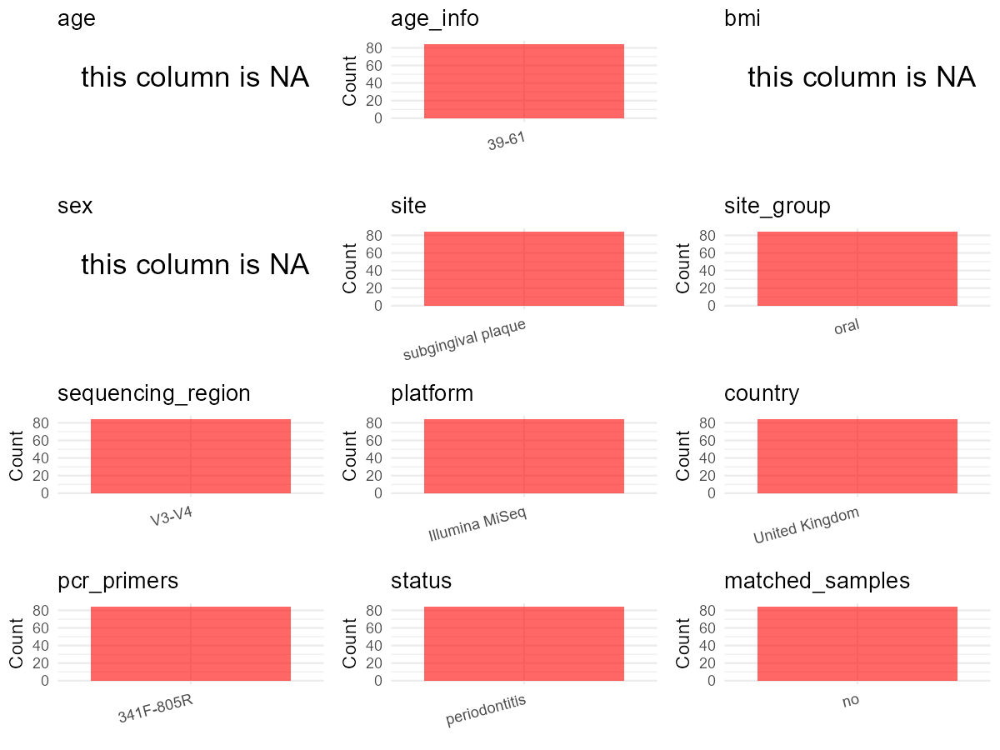

R Notebook: Metadata Processing Workflow
================

# Step 1: Obtain Initial Metadata from Each Project

This step sets the project directory, loads the raw SRA metadata, and
optionally merges supplement tables.

``` r
# Load libraries
library(dplyr)
library(ggplot2)
library(cowplot)

# (1) Setting working directory
# EDIT HERE: change project_id for each study
project_id <- "PRJNA725103" 

base_dir <- "E:/oral/26/metadata-2604/Oral-Metadata-YL-03"
setwd(file.path(base_dir, project_id))

# (2) Loading raw SRA metadata file
sra_file <- "SraRunTable.csv"
initial_meta <- read.csv(sra_file, header = TRUE)

# (3) OPTIONAL: If extra metadata (e.g., Table.x or supplemental materials) are available from the article, you may need to merge the file with initial_meta manually. Below is example code for merging. Depending on the specific case of each study, you can customize the code as needed.
# supp_table <- read.csv("supplemental_table.csv", header = TRUE)
# initial_meta <- left_join(initial_meta, supp_table, by = merge_col_name)
```

# Step 2: Data Overview

First, you need to get an overview of the data, which includes two
steps: reading the article and reading the initial metadata. This step
is very IMPORTANT!

``` r
# (1) Read the article in the following order: abstract, the beginning of the results section, and the methods. Understand the sample size, experimental design, and disease group overview. Clarify the sampling sites; for oral and gut samples, specify the exact sites like supragingival plaque, tongue, etc.

# (2) IMPORTANT: MUST go through each column of initial_meta
head(initial_meta, 10)
```

    ##            Run Assay.Type AvgSpotLen    Bases  BioProject    BioSample
    ## 1  SRR14325659   AMPLICON        598 48967753 PRJNA725103 SAMN18869930
    ## 2  SRR14325660   AMPLICON        598 30280792 PRJNA725103 SAMN18869930
    ## 3  SRR14325661   AMPLICON        597 24285221 PRJNA725103 SAMN18869930
    ## 4  SRR14325662   AMPLICON        598 52630644 PRJNA725103 SAMN18869930
    ## 5  SRR14325663   AMPLICON        598 52176368 PRJNA725103 SAMN18869930
    ## 6  SRR14325664   AMPLICON        598 67502544 PRJNA725103 SAMN18869929
    ## 7  SRR14325665   AMPLICON        597 65487637 PRJNA725103 SAMN18869930
    ## 8  SRR14325666   AMPLICON        598 45375374 PRJNA725103 SAMN18869930
    ## 9  SRR14325667   AMPLICON        598 52042460 PRJNA725103 SAMN18869930
    ## 10 SRR14325668   AMPLICON        598 59718947 PRJNA725103 SAMN18869930
    ##                 BioSampleModel    Bytes Center.Name Collection_Date Consent
    ## 1  Metagenome or environmental 29579767     FISABIO      2017-11-01  public
    ## 2  Metagenome or environmental 17352318     FISABIO      2017-11-01  public
    ## 3  Metagenome or environmental 14426617     FISABIO      2017-11-01  public
    ## 4  Metagenome or environmental 31210045     FISABIO      2017-11-01  public
    ## 5  Metagenome or environmental 30542696     FISABIO      2017-11-01  public
    ## 6  Metagenome or environmental 40037028     FISABIO      2017-08-01  public
    ## 7  Metagenome or environmental 38538522     FISABIO      2017-11-01  public
    ## 8  Metagenome or environmental 27419453     FISABIO      2017-11-01  public
    ## 9  Metagenome or environmental 31721164     FISABIO      2017-11-01  public
    ## 10 Metagenome or environmental 36082657     FISABIO      2017-11-01  public
    ##    DATASTORE.filetype DATASTORE.provider                     DATASTORE.region
    ## 1    fastq,run.zq,sra         gs,ncbi,s3 gs.us-east1,ncbi.public,s3.us-east-1
    ## 2    fastq,run.zq,sra         gs,ncbi,s3 gs.us-east1,ncbi.public,s3.us-east-1
    ## 3    fastq,run.zq,sra         gs,ncbi,s3 gs.us-east1,ncbi.public,s3.us-east-1
    ## 4    fastq,run.zq,sra         gs,ncbi,s3 gs.us-east1,ncbi.public,s3.us-east-1
    ## 5    fastq,run.zq,sra         gs,ncbi,s3 gs.us-east1,ncbi.public,s3.us-east-1
    ## 6    fastq,run.zq,sra         gs,ncbi,s3 gs.us-east1,ncbi.public,s3.us-east-1
    ## 7    fastq,run.zq,sra         gs,ncbi,s3 gs.us-east1,ncbi.public,s3.us-east-1
    ## 8    fastq,run.zq,sra         gs,ncbi,s3 gs.us-east1,ncbi.public,s3.us-east-1
    ## 9    fastq,run.zq,sra         gs,ncbi,s3 gs.us-east1,ncbi.public,s3.us-east-1
    ## 10   fastq,run.zq,sra         gs,ncbi,s3 gs.us-east1,ncbi.public,s3.us-east-1
    ##     Experiment geo_loc_name_country geo_loc_name_country_continent
    ## 1  SRX10680749       United Kingdom                         Europe
    ## 2  SRX10680748       United Kingdom                         Europe
    ## 3  SRX10680747       United Kingdom                         Europe
    ## 4  SRX10680746       United Kingdom                         Europe
    ## 5  SRX10680745       United Kingdom                         Europe
    ## 6  SRX10680744       United Kingdom                         Europe
    ## 7  SRX10680743       United Kingdom                         Europe
    ## 8  SRX10680742       United Kingdom                         Europe
    ## 9  SRX10680741       United Kingdom                         Europe
    ## 10 SRX10680740       United Kingdom                         Europe
    ##                                                                 geo_loc_name
    ## 1  United Kingdom: Scotland\\, Glasgow Dental Hospital and School\\, Glasgow
    ## 2  United Kingdom: Scotland\\, Glasgow Dental Hospital and School\\, Glasgow
    ## 3  United Kingdom: Scotland\\, Glasgow Dental Hospital and School\\, Glasgow
    ## 4  United Kingdom: Scotland\\, Glasgow Dental Hospital and School\\, Glasgow
    ## 5  United Kingdom: Scotland\\, Glasgow Dental Hospital and School\\, Glasgow
    ## 6  United Kingdom: Scotland\\, Glasgow Dental Hospital and School\\, Glasgow
    ## 7  United Kingdom: Scotland\\, Glasgow Dental Hospital and School\\, Glasgow
    ## 8  United Kingdom: Scotland\\, Glasgow Dental Hospital and School\\, Glasgow
    ## 9  United Kingdom: Scotland\\, Glasgow Dental Hospital and School\\, Glasgow
    ## 10 United Kingdom: Scotland\\, Glasgow Dental Hospital and School\\, Glasgow
    ##            HOST     Instrument   isolation_source                  lat_lon
    ## 1  Homo sapiens Illumina MiSeq Subgingival plaque 55.8656865 N 4.2658059 W
    ## 2  Homo sapiens Illumina MiSeq Subgingival plaque 55.8656865 N 4.2658059 W
    ## 3  Homo sapiens Illumina MiSeq Subgingival plaque 55.8656865 N 4.2658059 W
    ## 4  Homo sapiens Illumina MiSeq Subgingival plaque 55.8656865 N 4.2658059 W
    ## 5  Homo sapiens Illumina MiSeq Subgingival plaque 55.8656865 N 4.2658059 W
    ## 6  Homo sapiens Illumina MiSeq Subgingival plaque 55.8656865 N 4.2658059 W
    ## 7  Homo sapiens Illumina MiSeq Subgingival plaque 55.8656865 N 4.2658059 W
    ## 8  Homo sapiens Illumina MiSeq Subgingival plaque 55.8656865 N 4.2658059 W
    ## 9  Homo sapiens Illumina MiSeq Subgingival plaque 55.8656865 N 4.2658059 W
    ## 10 Homo sapiens Illumina MiSeq Subgingival plaque 55.8656865 N 4.2658059 W
    ##             Library.Name LibraryLayout LibrarySelection LibrarySource
    ## 1  54_R1_and_R2.fastq.gz        PAIRED              PCR   METAGENOMIC
    ## 2  53_R1_and_R2.fastq.gz        PAIRED              PCR   METAGENOMIC
    ## 3  52_R1_and_R2.fastq.gz        PAIRED              PCR   METAGENOMIC
    ## 4  51_R1_and_R2.fastq.gz        PAIRED              PCR   METAGENOMIC
    ## 5  50_R1_and_R2.fastq.gz        PAIRED              PCR   METAGENOMIC
    ## 6   8_R1_and_R2.fastq.gz        PAIRED              PCR   METAGENOMIC
    ## 7  49_R1_and_R2.fastq.gz        PAIRED              PCR   METAGENOMIC
    ## 8  48_R1_and_R2.fastq.gz        PAIRED              PCR   METAGENOMIC
    ## 9  47_R1_and_R2.fastq.gz        PAIRED              PCR   METAGENOMIC
    ## 10 46_R1_and_R2.fastq.gz        PAIRED              PCR   METAGENOMIC
    ##            Organism Platform          ReleaseDate          create_date version
    ## 1  human metagenome ILLUMINA 2021-04-27T00:00:00Z 2021-04-27T04:28:00Z       1
    ## 2  human metagenome ILLUMINA 2021-04-27T00:00:00Z 2021-04-27T04:28:00Z       1
    ## 3  human metagenome ILLUMINA 2021-04-27T00:00:00Z 2021-04-27T04:28:00Z       1
    ## 4  human metagenome ILLUMINA 2021-04-27T00:00:00Z 2021-04-27T04:28:00Z       1
    ## 5  human metagenome ILLUMINA 2021-04-27T00:00:00Z 2021-04-27T04:29:00Z       1
    ## 6  human metagenome ILLUMINA 2021-04-27T00:00:00Z 2021-04-27T04:28:00Z       1
    ## 7  human metagenome ILLUMINA 2021-04-27T00:00:00Z 2021-04-27T04:29:00Z       1
    ## 8  human metagenome ILLUMINA 2021-04-27T00:00:00Z 2021-04-27T04:29:00Z       1
    ## 9  human metagenome ILLUMINA 2021-04-27T00:00:00Z 2021-04-27T04:29:00Z       1
    ## 10 human metagenome ILLUMINA 2021-04-27T00:00:00Z 2021-04-27T04:29:00Z       1
    ##                                                            Sample.Name
    ## 1      Subgingival_plaque_periodontitis_perio2.0_day90_after_treatment
    ## 2      Subgingival_plaque_periodontitis_perio2.0_day90_after_treatment
    ## 3      Subgingival_plaque_periodontitis_perio2.0_day90_after_treatment
    ## 4      Subgingival_plaque_periodontitis_perio2.0_day90_after_treatment
    ## 5      Subgingival_plaque_periodontitis_perio2.0_day90_after_treatment
    ## 6  Subgingival_plaque_periodontitis_perio2.0_baseline_before_treatment
    ## 7      Subgingival_plaque_periodontitis_perio2.0_day90_after_treatment
    ## 8      Subgingival_plaque_periodontitis_perio2.0_day90_after_treatment
    ## 9      Subgingival_plaque_periodontitis_perio2.0_day90_after_treatment
    ## 10     Subgingival_plaque_periodontitis_perio2.0_day90_after_treatment
    ##    SRA.Study
    ## 1  SRP316367
    ## 2  SRP316367
    ## 3  SRP316367
    ## 4  SRP316367
    ## 5  SRP316367
    ## 6  SRP316367
    ## 7  SRP316367
    ## 8  SRP316367
    ## 9  SRP316367
    ## 10 SRP316367

``` r
# IMPORTANT: Check the unique values in the column of interest or query column.
lapply(initial_meta[c('isolation_source')], table) # site
```

    ## $isolation_source
    ## 
    ## Subgingival plaque 
    ##                 84

``` r
lapply(initial_meta[c('HOST', 'Organism')], table) # organism
```

    ## $HOST
    ## 
    ## Homo sapiens 
    ##           84 
    ## 
    ## $Organism
    ## 
    ## human metagenome 
    ##               84

``` r
table(initial_meta$Library.Name) # subject id
```

    ## 
    ##    1_R1_and_R2.fastq.gz   10_R1_and_R2.fastq.gz   11_R1_and_R2.fastq.gz 
    ##                       1                       1                       1 
    ##   12_R1_and_R2.fastq.gz   13_R1_and_R2.fastq.gz   14_R1_and_R2.fastq.gz 
    ##                       1                       1                       1 
    ##   15_R1_and_R2.fastq.gz   16_R1_and_R2.fastq.gz   17_R1_and_R2.fastq.gz 
    ##                       1                       1                       1 
    ##   18_R1_and_R2.fastq.gz   19_R1_and_R2.fastq.gz    2_R1_and_R2.fastq.gz 
    ##                       1                       1                       1 
    ##   20_R1_and_R2.fastq.gz   21_R1_and_R2.fastq.gz   22_R1_and_R2.fastq.gz 
    ##                       1                       1                       1 
    ##   23_R1_and_R2.fastq.gz   24_R1_and_R2.fastq.gz   25_R1_and_R2.fastq.gz 
    ##                       1                       1                       1 
    ##   26_R1_and_R2.fastq.gz   27_R1_and_R2.fastq.gz   28_R1_and_R2.fastq.gz 
    ##                       1                       1                       1 
    ##   29_R1_and_R2.fastq.gz   30_R1_and_R2.fastq.gz   31_R1_and_R2.fastq.gz 
    ##                       1                       1                       1 
    ##   32_R1_and_R2.fastq.gz   33_R1_and_R2.fastq.gz   34_R1_and_R2.fastq.gz 
    ##                       1                       1                       1 
    ##   35_R1_and_R2.fastq.gz   36_R1_and_R2.fastq.gz   37_R1_and_R2.fastq.gz 
    ##                       1                       1                       1 
    ##   38_R1_and_R2.fastq.gz   39_R1_and_R2.fastq.gz    4_R1_and_R2.fastq.gz 
    ##                       1                       1                       1 
    ##   40_R1_and_R2.fastq.gz   41_R1_and_R2.fastq.gz   43_R1_and_R2.fastq.gz 
    ##                       1                       1                       1 
    ##   45_R1_and_R2.fastq.gz   46_R1_and_R2.fastq.gz   47_R1_and_R2.fastq.gz 
    ##                       1                       1                       1 
    ##   48_R1_and_R2.fastq.gz   49_R1_and_R2.fastq.gz   50_R1_and_R2.fastq.gz 
    ##                       1                       1                       1 
    ##   51_R1_and_R2.fastq.gz   52_R1_and_R2.fastq.gz   53_R1_and_R2.fastq.gz 
    ##                       1                       1                       1 
    ##   54_R1_and_R2.fastq.gz   55_R1_and_R2.fastq.gz   56_R1_and_R2.fastq.gz 
    ##                       1                       1                       1 
    ##   57_R1_and_R2.fastq.gz   58_R1_and_R2.fastq.gz   59_R1_and_R2.fastq.gz 
    ##                       1                       1                       1 
    ##    6_R1_and_R2.fastq.gz   60_R1_and_R2.fastq.gz   61_R1_and_R2.fastq.gz 
    ##                       1                       1                       1 
    ##   62_R1_and_R2.fastq.gz   63_R1_and_R2.fastq.gz   64_R1_and_R2.fastq.gz 
    ##                       1                       1                       1 
    ##   65_R1_and_R2.fastq.gz   66_R1_and_R2.fastq.gz   67_R1_and_R2.fastq.gz 
    ##                       1                       1                       1 
    ##   68_R1_and_R2.fastq.gz   69_R1_and_R2.fastq.gz    7_R1_and_R2.fastq.gz 
    ##                       1                       1                       1 
    ##   70_R1_and_R2.fastq.gz   71_R1_and_R2.fastq.gz   72_R1_and_R2.fastq.gz 
    ##                       1                       1                       1 
    ##   73_R1_and_R2.fastq.gz   74_R1_and_R2.fastq.gz   75_R1_and_R2.fastq.gz 
    ##                       1                       1                       1 
    ##   76_R1_and_R2.fastq.gz   77_R1_and_R2.fastq.gz   78_R1_and_R2.fastq.gz 
    ##                       1                       1                       1 
    ##    8_R1_and_R2.fastq.gz    9_R1_and_R2.fastq.gz    P141_R1_and_R2.fastq 
    ##                       1                       1                       1 
    ##    P142_R1_and_R2.fastq    P143_R1_and_R2.fastq    P144_R1_and_R2.fastq 
    ##                       1                       1                       1 
    ##    P145_R1_and_R2.fastq P241_R1_and_R2.fastq.gz P242_R1_and_R2.fastq.gz 
    ##                       1                       1                       1 
    ## P243_R1_and_R2.fastq.gz P244_R1_and_R2.fastq.gz P245_R1_and_R2.fastq.gz 
    ##                       1                       1                       1

``` r
#table(initial_meta$sequencing_meth..exp.) # output is Sequencing by synthesis
table(initial_meta$Platform) # output is Illumina. according to the methods,  Illumina is correct.
```

    ## 
    ## ILLUMINA 
    ##       84

``` r
#table(initial_meta$target_subfragment) # output is V4
```

# Step 3: Removing Control and Non-human Samples

First, we need to remove control samples(including both negative
controls and positive controls) and non-human samples.

``` r
# (1) EDIT HERE: Parameter setup
control_column <- "" # column name in initial_meta
# unique(initial_meta[[control_column]])
control_keywords <- c() # Enter exact keywords

species_column <- "" # column name in initial_meta
unique(initial_meta[[species_column]])
```

    ## NULL

``` r
non_human_keywords <- c() # Enter exact keywords

# (2) Remove controls and non-human samples. DO NOT need to modify code in this part, just run it.
n_samples <- nrow(initial_meta)
# Control evaluation
if (length(control_keywords) > 0) {
  if (is.null(control_column) || control_column == "") {
    stop("Error: control_keywords provided but control_column is missing.")
  }
  
  if (!(control_column %in% colnames(initial_meta))) {
    stop(sprintf("Error: Column '%s' not found in initial_meta.", control_column))
  }
  
  control_pattern <- paste(control_keywords, collapse = "|")
  control_text <- initial_meta[[control_column]]
  is_control <- grepl(control_pattern, control_text)
  
} else {
  is_control <- rep(FALSE, n_samples)
}

# Non-human evaluation
if (length(non_human_keywords) > 0) {
  if (is.null(species_column) || species_column == "") {
    stop("Error: non_human_keywords provided but species_column is missing.")
  }
  
  if (!(species_column %in% colnames(initial_meta))) {
    stop(sprintf("Error: Column '%s' not found in initial_meta.", species_column))
  }
  
  non_human_pattern <- paste(non_human_keywords, collapse = "|")
  species_text <- initial_meta[[species_column]]
  is_non_human <- grepl(non_human_pattern, species_text)
} else {
  is_non_human <- rep(FALSE, n_samples)
}

# Execute removal
samples_to_remove <- is_control | is_non_human
initial_meta <- initial_meta[!samples_to_remove, ]

cat("Initial samples counts:",n_samples,"\n")
```

    ## Initial samples counts: 84

``` r
cat("Removed control samples:", sum(is_control), "\n")
```

    ## Removed control samples: 0

``` r
cat("Removed non-human samples:", sum(is_non_human), "\n")
```

    ## Removed non-human samples: 0

``` r
cat("Total samples removed ", sum(samples_to_remove), "\n")
```

    ## Total samples removed  0

``` r
cat("Remaining samples after Step 2:", nrow(initial_meta), "\n")
```

    ## Remaining samples after Step 2: 84

# Step 4: Creating a Uniform Metadata Template

This step converts the raw SRA table into the standard metadata format
used in our meta-analysis. The uniform metadata should include the
following columns: 1. **bioproject**: Project ID from SRA or other
database e.g. `PRJNA1234`, `CNP1234`, ‘OEP1234’, ‘qiita_1234’ 2.
**sample_id**: SRA sample/run ID. Unique id for each sample!
e.g. `DRR1234567`, `ERR1234567` and `SRR1234567`. If no such column
exists, can use column like sample_name. 3. **subject_id**: subject id
for each person if available. e.g. `patient_01`, `Host_03_before`,
`subject12` 4. **age**: Age of the subject if available. e.g. `35`, `42`
\| not `adult`, `chilren` 5. **age_info**: If the age is not explicitly
stated but approximate age range information is available, mark it in
this column. e.g., `18-55`, `children`, `infant`, `elder` 6. **bmi**:
Body Mass Index if available. e.g. `22.5`, `18.9` \| not `normal`,
`overweight` 7. **sex**: Sex of the subject. Mandatory to write as M/F
\| not `female`, `woman` 8. **sequencing_region**: Targeted 16S rRNA
region. e.g. `V3-V4`, `V4` 9. **platform**: Sequencing platform.
e.g. `Illumina MiSeq`, `454 GS FLX Titanium`, `Ion Torrent` 10.
**country**: Country of sample origin. e.g. `China`, `Japan` \| not city
name like `Beijing` 11. **site**: Sampling site. For oral and gut sites,
specify the exact sites as detailed as possible. For example, if it is
known to be supragingival plaque, do not record it as ‘dental plaque’,
unless the original text provides only a vague description.
e.g. `saliva`, `tongue coating` \| not broad term like `oral` 12.
**site_group**: only accepts one of following three values: ‘oral’,
‘gut’, or ‘other’. 13. **public_time**: Data release date.
e.g. `2021-06-22` \| not `June 2021` 14. **pcr_primers**: PCR primers
used. e.g. `515F-806R`, `27F-338R` \| not primer sequences 15.
**title**: Title of the associated publication. 16. **disease_study**:
Whether the study involves disease samples. If it’s not clear, can
record as NA. Only three values accepted: ‘yes’, ‘no’ or NA 17.
**status**: Disease status for each sample if available, else record as
NA. Only accept following abbreviations, Write full names for all other
diseases. HC: healthy control CD: Crohn’s disease CRC: colorectal cancer
COPD: chronic obstructive pulmonary disease HIV: human immunodeficiency
virus ICU: intensive care unit OSCC: oral squamous cell carcinoma RA:
rheumatoid arthritis UC: ulcerative colitis 18. **matched_samples**:
Whether the subject has matched samples. Only accept ‘yes’ or ‘no’. 19.
**is_time_series**: Whether the study is a time series study. Only
accept ‘yes’ or ‘no’.

``` r
# Extract columns from initial_meta as follows: (1) No modification needed → extract directly. (2) Modification needed → create a new column with the prefix raw_ and mark the original column as “pending”. (3) Need to find or determine based on the article.
metadata <- data.frame(
  bioproject = initial_meta$BioProject,
  sample_id = initial_meta$Run,
  raw_subject_id = initial_meta$Library.Name,
  subject_id = "pending", # modify later
  age = NA, 
  age_info = "39-61", # extract from supplement material
  bmi = NA,
  sex = NA,
  sequencing_region = "V3-V4", # extract from methods section
  platform = "Illumina MiSeq", # extract from methods section, NOT initial_meta
  country = initial_meta$geo_loc_name_country,
  raw_site = initial_meta$isolation_source, 
  site = "pending", # modify later
  site_group = "pending", # modify later
  public_time = initial_meta$ReleaseDate,
  pcr_primers = "341F-805R", # Format: xxF-xxR
  title = "Mechanical biofilm disruption causes microbial and immunological shifts in periodontitis patients", # extract from article
  disease_study = "yes", # determine according to the article
  status = "periodontitis",
  matched_samples = "pending", # modify later
  is_time_series = "no", 
  stringsAsFactors = FALSE
)
metadata$public_time <- as.Date(metadata$public_time)
```

# Step 5: Manually solving pending issues

This step involves two parts: (1) handle the columns with the `raw_`
prefix, and next (2) handle the `site_group` and `matched_samples`
columns.

``` r
# (1) Handle the columns with the `raw_` prefix.
# In this part, you need to customize the code based on the situation of the raw_ columns to obtain the content of the target columns. IMPORTANT: Add comments if the modification is not straightforward!!
metadata$subject_id <- gsub("R1_and_R2.fastq", "", metadata$raw_subject_id) # according to the 'Library.Name' column of initial_meta

metadata <- metadata %>%
  mutate(site = case_when(
    grepl("Subgingival plaque", raw_site) ~ "subgingival plaque",
    TRUE ~ NA_character_
  )) # according to the 'isolation_source' column of initial_meta
```

``` r
# (2) Filling the 'site_group' and 'matched_samples' columns
# editing site_group
unique(metadata$site)
```

    ## [1] "subgingival plaque"

``` r
# EDIT HERE: add oral sites
Oral_site = unique(metadata$site)
# EDIT HERE: add gut sites
Gut_site = c()
# just run
metadata <- metadata %>%
  mutate(site_group = case_when(
    site %in% Oral_site ~ "oral",
    site %in% Gut_site ~ "gut",
    TRUE ~ "other" 
  ))

# editing matched_samples, just run.
metadata$matched_samples <- ifelse(
  ave(metadata$subject_id, metadata$subject_id, FUN = length) > 1, 
  "yes", 
  "no"
)
```

``` r
# (3) check if there is pending value in metadata. If there is pending value, go on modify the metadata.
# Function to check if a column contains "pending"
has_pending <- function(col) {
  if (is.character(col) || is.factor(col)) {
    any(col == "pending", na.rm = TRUE)
  } else {
    FALSE
  }
}

# Check for any pending value
any_pending_value <- any(sapply(metadata, has_pending))

if (!any_pending_value) {
  message("Good! No cell contains the value 'pending'.")
} else {
  pending_cols <- names(metadata)[sapply(metadata, has_pending)]
  message("Columns containing 'pending': ", paste(pending_cols, collapse = ", "))
  message("Please continue to resolve these pending columns!")
}
```

    ## Good! No cell contains the value 'pending'.

# Step 6: Visualize the Metadata

This step makes a quick set of plots for checking the distribution of
key metadata fields.

``` r
# Select columns for visualization, just run
plot_data <- metadata %>%
  select(-bioproject, -sample_id, -subject_id, -title)

create_simple_plots <- function(data) {
  plots <- list()
  continuous_vars <- c("age", "bmi")

  for (col in colnames(data)) {
    if (all(is.na(data[[col]]))) {
      p <- ggplot() +
        annotate("text", x = 0.5, y = 0.5, label = "this column is NA", size = 6) +
        labs(title = col) +
        theme_void()
    } else if (col %in% continuous_vars && is.numeric(data[[col]])) {
      p <- ggplot(data, aes(x = .data[[col]])) +
        geom_histogram(fill = "blue", alpha = 0.6, bins = 20, na.rm = TRUE) +
        labs(title = col, x = col, y = "Count") +
        theme_minimal()
    } else {
      count_data <- as.data.frame(table(data[[col]], useNA = "ifany"))
      p <- ggplot(count_data, aes(x = reorder(Var1, -Freq), y = Freq)) +
        geom_col(fill = "red", alpha = 0.6) +
        labs(title = col, x = NULL, y = "Count") +
        theme_minimal() +
        theme(axis.text.x = element_text(angle = 15, hjust = 1))
    }
    plots[[col]] <- p
  }

  return(plots)
}

# Generate and arrange plots
plots <- create_simple_plots(plot_data)
p <- plot_grid(plots$age,
               plots$age_info,
               plots$bmi,
               plots$sex,
               plots$site,
               plots$site_group,
               plots$sequencing_region,
               plots$platform,
               plots$country,
               plots$pcr_primers,
               plots$status,
               plots$matched_samples,
               ncol = 3, align = "hv", axis = "lb")
ggsave("Metadata_Summary_v2.png", plot = p, width = 8, height = 6, dpi = 150)
```

``` r
# Insert Metadata_Summary.png into the current Rmd output

```


# Step 7: Sort and export the metadata

This step saves the cleaned metadata table as the final `metadata.csv`
file.

``` r
# Reorder the data frame
fixed_cols <- c("bioproject", "sample_id", "subject_id", "age", "age_info",
                "bmi", "sex", "platform", "sequencing_region", "pcr_primers", 
                "country", "site", "site_group", "disease_study", "status", 
                "title", "public_time", "matched_samples", "is_time_series")  
metadata <- metadata %>%
  select(all_of(fixed_cols), everything())

# save metadata 
# head(metadata)
write.csv(metadata, file = "metadata_v2.csv", quote = TRUE)
```
