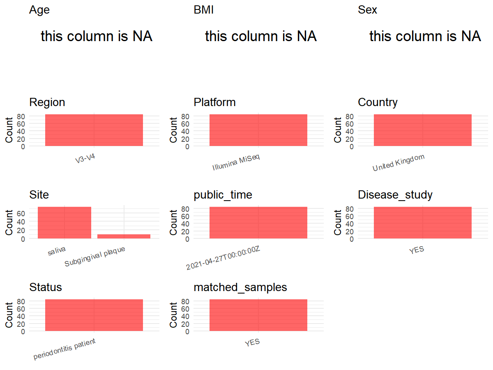

R Notebook: Metadata Processing Workflow
================

# Step 1: Obtain Initial Metadata from Each Project

To obtain the initial metadata: 1. Search for the BioProject ID (e.g.,
“PRJEBXXXX”) on the [NCBI SRA
website](https://www.ncbi.nlm.nih.gov/Traces/study/). 2. In the “Select”
table, click on “Metadata” and download the file. 3. The downloaded file
is typically named “SraRunTable.csv” and contains metadata for the
project.

``` r
library(dplyr)
```

    ## Warning: package 'dplyr' was built under R version 4.5.1

    ## 
    ## Attaching package: 'dplyr'

    ## The following objects are masked from 'package:stats':
    ## 
    ##     filter, lag

    ## The following objects are masked from 'package:base':
    ## 
    ##     intersect, setdiff, setequal, union

``` r
library(ggplot2)
```

    ## Warning: package 'ggplot2' was built under R version 4.5.1

``` r
library(cowplot)
```

    ## Warning: package 'cowplot' was built under R version 4.5.1

``` r
setwd("D:/PRJNA725103")
initial_meta<-read.csv("SraRunTable .csv",header = T)
head(initial_meta)
```

    ##           Run Assay.Type AvgSpotLen    Bases  BioProject    BioSample
    ## 1 SRR14325659   AMPLICON        598 48967753 PRJNA725103 SAMN18869930
    ## 2 SRR14325660   AMPLICON        598 30280792 PRJNA725103 SAMN18869930
    ## 3 SRR14325661   AMPLICON        597 24285221 PRJNA725103 SAMN18869930
    ## 4 SRR14325662   AMPLICON        598 52630644 PRJNA725103 SAMN18869930
    ## 5 SRR14325663   AMPLICON        598 52176368 PRJNA725103 SAMN18869930
    ## 6 SRR14325664   AMPLICON        598 67502544 PRJNA725103 SAMN18869929
    ##                BioSampleModel    Bytes Center.Name Collection_Date Consent
    ## 1 Metagenome or environmental 29579767     FISABIO      2017-11-01  public
    ## 2 Metagenome or environmental 17352318     FISABIO      2017-11-01  public
    ## 3 Metagenome or environmental 14426617     FISABIO      2017-11-01  public
    ## 4 Metagenome or environmental 31210045     FISABIO      2017-11-01  public
    ## 5 Metagenome or environmental 30542696     FISABIO      2017-11-01  public
    ## 6 Metagenome or environmental 40037028     FISABIO      2017-08-01  public
    ##   DATASTORE.filetype DATASTORE.provider                     DATASTORE.region
    ## 1   fastq,run.zq,sra         gs,ncbi,s3 gs.us-east1,ncbi.public,s3.us-east-1
    ## 2   fastq,run.zq,sra         gs,ncbi,s3 gs.us-east1,ncbi.public,s3.us-east-1
    ## 3   fastq,run.zq,sra         gs,ncbi,s3 gs.us-east1,ncbi.public,s3.us-east-1
    ## 4   fastq,run.zq,sra         gs,ncbi,s3 gs.us-east1,ncbi.public,s3.us-east-1
    ## 5   fastq,run.zq,sra         gs,ncbi,s3 gs.us-east1,ncbi.public,s3.us-east-1
    ## 6   fastq,run.zq,sra         gs,ncbi,s3 gs.us-east1,ncbi.public,s3.us-east-1
    ##    Experiment geo_loc_name_country geo_loc_name_country_continent
    ## 1 SRX10680749       United Kingdom                         Europe
    ## 2 SRX10680748       United Kingdom                         Europe
    ## 3 SRX10680747       United Kingdom                         Europe
    ## 4 SRX10680746       United Kingdom                         Europe
    ## 5 SRX10680745       United Kingdom                         Europe
    ## 6 SRX10680744       United Kingdom                         Europe
    ##                                                                geo_loc_name
    ## 1 United Kingdom: Scotland\\, Glasgow Dental Hospital and School\\, Glasgow
    ## 2 United Kingdom: Scotland\\, Glasgow Dental Hospital and School\\, Glasgow
    ## 3 United Kingdom: Scotland\\, Glasgow Dental Hospital and School\\, Glasgow
    ## 4 United Kingdom: Scotland\\, Glasgow Dental Hospital and School\\, Glasgow
    ## 5 United Kingdom: Scotland\\, Glasgow Dental Hospital and School\\, Glasgow
    ## 6 United Kingdom: Scotland\\, Glasgow Dental Hospital and School\\, Glasgow
    ##           HOST     Instrument   isolation_source                  lat_lon
    ## 1 Homo sapiens Illumina MiSeq Subgingival plaque 55.8656865 N 4.2658059 W
    ## 2 Homo sapiens Illumina MiSeq Subgingival plaque 55.8656865 N 4.2658059 W
    ## 3 Homo sapiens Illumina MiSeq Subgingival plaque 55.8656865 N 4.2658059 W
    ## 4 Homo sapiens Illumina MiSeq Subgingival plaque 55.8656865 N 4.2658059 W
    ## 5 Homo sapiens Illumina MiSeq Subgingival plaque 55.8656865 N 4.2658059 W
    ## 6 Homo sapiens Illumina MiSeq Subgingival plaque 55.8656865 N 4.2658059 W
    ##            Library.Name LibraryLayout LibrarySelection LibrarySource
    ## 1 54_R1_and_R2.fastq.gz        PAIRED              PCR   METAGENOMIC
    ## 2 53_R1_and_R2.fastq.gz        PAIRED              PCR   METAGENOMIC
    ## 3 52_R1_and_R2.fastq.gz        PAIRED              PCR   METAGENOMIC
    ## 4 51_R1_and_R2.fastq.gz        PAIRED              PCR   METAGENOMIC
    ## 5 50_R1_and_R2.fastq.gz        PAIRED              PCR   METAGENOMIC
    ## 6  8_R1_and_R2.fastq.gz        PAIRED              PCR   METAGENOMIC
    ##           Organism Platform          ReleaseDate          create_date version
    ## 1 human metagenome ILLUMINA 2021-04-27T00:00:00Z 2021-04-27T04:28:00Z       1
    ## 2 human metagenome ILLUMINA 2021-04-27T00:00:00Z 2021-04-27T04:28:00Z       1
    ## 3 human metagenome ILLUMINA 2021-04-27T00:00:00Z 2021-04-27T04:28:00Z       1
    ## 4 human metagenome ILLUMINA 2021-04-27T00:00:00Z 2021-04-27T04:28:00Z       1
    ## 5 human metagenome ILLUMINA 2021-04-27T00:00:00Z 2021-04-27T04:29:00Z       1
    ## 6 human metagenome ILLUMINA 2021-04-27T00:00:00Z 2021-04-27T04:28:00Z       1
    ##                                                           Sample.Name SRA.Study
    ## 1     Subgingival_plaque_periodontitis_perio2.0_day90_after_treatment SRP316367
    ## 2     Subgingival_plaque_periodontitis_perio2.0_day90_after_treatment SRP316367
    ## 3     Subgingival_plaque_periodontitis_perio2.0_day90_after_treatment SRP316367
    ## 4     Subgingival_plaque_periodontitis_perio2.0_day90_after_treatment SRP316367
    ## 5     Subgingival_plaque_periodontitis_perio2.0_day90_after_treatment SRP316367
    ## 6 Subgingival_plaque_periodontitis_perio2.0_baseline_before_treatment SRP316367

# Step 2: Create a Uniform Metadata Template

The uniform metadata should include the following columns:

1.  **BioProject**: Project ID (e.g., “PRJNA339212”)
2.  **Run**: Sample ID (e.g., “ERRXXXXXX” or “SRRXXXXXX”)
3.  **sample_name**: Original sample name submitted by the authors (not
    the database-assigned ID)
4.  **Age**: Age of the subject (if available)
5.  **BMI**: Body Mass Index (if available)
6.  **Sex**: Sex of the subject (“F” or “M”)
7.  **Region**: Targeted 16S rRNA region (e.g., “V3-V4”)
8.  **Platform**: Sequencing platform (e.g., “Illumina MiSeq”)
9.  **Country**: Country of sample origin (e.g., “China”)
10. **Site**: Sample site (e.g., “saliva”, “dental plaque”)
11. **public_time**: Data release date (format: “YYYY-MM-DD”)
12. **PCR_primers**: PCR primers used (e.g., “515F-806R”)
13. **title**: Title of the associated publication
14. **Disease_study**: Whether the study involves a disease (“YES” or
    “NO”)
15. **Status**: Disease status (e.g., “T2DM”, “HC”). Note: If the study
    includes both disease and healthy samples, this must be specified
    per sample.
16. **matched_samples**: matched samples (“YES” or “NO”)

``` r
metadata <- data.frame(
  BioProject = initial_meta$BioProject,
  Run = initial_meta$Run,
  sample_name = initial_meta$Sample.Name,
  Platform = initial_meta$Instrument,
  Country = initial_meta$geo_loc_name_country,
   Library.Name= initial_meta$Library.Name,
  public_time = initial_meta$ReleaseDate,
  stringsAsFactors = FALSE
)
```

# Step 3: Manually Add Information from the Publication

Some information (e.g. PCR primers, study title, disease status) must be
manually extracted from the publication and added to the metadata.

``` r
metadata$BMI <- NA_character_
metadata$Sex <- NA_character_
metadata$Age <- NA_character_
metadata$Site <- ifelse(substr(metadata$Library.Name, 1, 1) == "P", 
                        "Subgingival plaque",  "saliva")  
metadata$PCR_primers <- "341F-805R"
metadata$Region <- "V3-V4"
metadata$title <- "Mechanical biofilm disruption causes microbial and immunological shifts in periodontitis patients"
metadata$Disease_study <- "YES"
metadata$Status <-"periodontitis patient"
 

#get subjects id according to sample id
metadata$sample_name<-gsub("_R1_and_R2.fastq|P|_R1_and_R2.fastq.gz","",metadata$sample_name)

#get subjects id with Saliva available
keep_subjects<-subset(metadata,Site %in% "saliva")
#remove subjects without Saliva samples
metadata<-subset(metadata,sample_name %in% keep_subjects$sample_name)
#get subjects sampling counts
sample_counts <- table(metadata$sample_name)
# Create matched_samples column, any subjects have >=2 samples will be label "YES", otherwise "NO"
metadata$matched_samples <- ifelse(metadata$sample_name %in% names(sample_counts[sample_counts >= 2]), "YES", "NO")
```

# Step 4: Summarize and Validate the Metadata

``` r
# Check the number of unique runs and sample names
print(paste("Number of unique runs:", length(unique(metadata$Run))))
```

    ## [1] "Number of unique runs: 84"

``` r
print(paste("Number of unique sample names:", length(unique(metadata$sample_name))))
```

    ## [1] "Number of unique sample names: 2"

# Step 5: Visualize the Metadata

``` r

```

<!-- -->

# Step 6: Finalize and Export the Metadata

``` r
# Reorder columns to match the desired format
metadata <- metadata[, c(
  "BioProject", "Run", "sample_name", "Age", "BMI", "Sex", 
  "Region", "Platform", "Country", "Site", "public_time", 
  "PCR_primers", "title", "Disease_study", "Status","matched_samples"
)]

# Export the uniform metadata to a CSV file
write.csv(metadata, file = "metadata.csv", quote = FALSE)
head(metadata)
```

    ##    BioProject         Run
    ## 1 PRJNA725103 SRR14325659
    ## 2 PRJNA725103 SRR14325660
    ## 3 PRJNA725103 SRR14325661
    ## 4 PRJNA725103 SRR14325662
    ## 5 PRJNA725103 SRR14325663
    ## 6 PRJNA725103 SRR14325664
    ##                                                           sample_name  Age  BMI
    ## 1     Subgingival_plaque_periodontitis_perio2.0_day90_after_treatment <NA> <NA>
    ## 2     Subgingival_plaque_periodontitis_perio2.0_day90_after_treatment <NA> <NA>
    ## 3     Subgingival_plaque_periodontitis_perio2.0_day90_after_treatment <NA> <NA>
    ## 4     Subgingival_plaque_periodontitis_perio2.0_day90_after_treatment <NA> <NA>
    ## 5     Subgingival_plaque_periodontitis_perio2.0_day90_after_treatment <NA> <NA>
    ## 6 Subgingival_plaque_periodontitis_perio2.0_baseline_before_treatment <NA> <NA>
    ##    Sex Region       Platform        Country   Site          public_time
    ## 1 <NA>  V3-V4 Illumina MiSeq United Kingdom saliva 2021-04-27T00:00:00Z
    ## 2 <NA>  V3-V4 Illumina MiSeq United Kingdom saliva 2021-04-27T00:00:00Z
    ## 3 <NA>  V3-V4 Illumina MiSeq United Kingdom saliva 2021-04-27T00:00:00Z
    ## 4 <NA>  V3-V4 Illumina MiSeq United Kingdom saliva 2021-04-27T00:00:00Z
    ## 5 <NA>  V3-V4 Illumina MiSeq United Kingdom saliva 2021-04-27T00:00:00Z
    ## 6 <NA>  V3-V4 Illumina MiSeq United Kingdom saliva 2021-04-27T00:00:00Z
    ##   PCR_primers
    ## 1   341F-805R
    ## 2   341F-805R
    ## 3   341F-805R
    ## 4   341F-805R
    ## 5   341F-805R
    ## 6   341F-805R
    ##                                                                                               title
    ## 1 Mechanical biofilm disruption causes microbial and immunological shifts in periodontitis patients
    ## 2 Mechanical biofilm disruption causes microbial and immunological shifts in periodontitis patients
    ## 3 Mechanical biofilm disruption causes microbial and immunological shifts in periodontitis patients
    ## 4 Mechanical biofilm disruption causes microbial and immunological shifts in periodontitis patients
    ## 5 Mechanical biofilm disruption causes microbial and immunological shifts in periodontitis patients
    ## 6 Mechanical biofilm disruption causes microbial and immunological shifts in periodontitis patients
    ##   Disease_study                Status matched_samples
    ## 1           YES periodontitis patient             YES
    ## 2           YES periodontitis patient             YES
    ## 3           YES periodontitis patient             YES
    ## 4           YES periodontitis patient             YES
    ## 5           YES periodontitis patient             YES
    ## 6           YES periodontitis patient             YES
