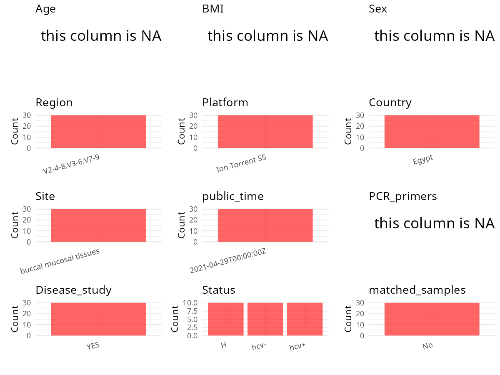

R Notebook: Metadata Processing Workflow
================

# Step 1: Obtain Initial Metadata from Each Project

To obtain the initial metadata: 1. Search for the BioProject ID (e.g.,
“PRJEBXXXX”) on the [NCBI SRA
website](https://www.ncbi.nlm.nih.gov/Traces/study/). 2. In the “Select”
table, click on “Metadata” and download the file. 3. The downloaded file
is typically named “SraRunTable.csv” and contains metadata for the
project.

``` r
# Load necessary libraries
library(dplyr)
library(ggplot2)
library(cowplot)
library(stringr)

# Set working directory (update this path to your local directory)
setwd("/home/hby/oral_project/PRJNA725877")

# Read the initial metadata files
initial_meta <- read.csv("SraRunTable.csv", header = T)

# Combine the two metadata files
# meta <- rbind(initial_meta, initial_meta1)

# Remove entries non-oral samples
# initial_meta <- subset(initial_meta,isolate %in% c("saliva","tongue coat"))

# Check the number of samples containing "HT" in Sample.Name (e.g., healthy controls)
# nrow(subset(meta, grepl("HT", Sample.Name)))

# Display the first few rows of the metadata
head(initial_meta)
```

    ##           Run       AGE Assay.Type AvgSpotLen    Bases BIOMATERIAL_PROVIDER  BioProject    BioSample BioSampleModel    Bytes         Center.Name Consent DATASTORE.filetype
    ## 1 SRR14347781 'missing'   AMPLICON        221 34886557            'missing' PRJNA725877 SAMN18912732          Human 27883143 AL-AZHAR UNIVERSITY  public    TenX,run.zq,sra
    ## 2 SRR14347782 'missing'   AMPLICON        221 37760429            'missing' PRJNA725877 SAMN18912733          Human 29976568 AL-AZHAR UNIVERSITY  public    TenX,run.zq,sra
    ## 3 SRR14347783 'missing'   AMPLICON        237 71610190            'missing' PRJNA725877 SAMN18912742          Human 55499941 AL-AZHAR UNIVERSITY  public    TenX,run.zq,sra
    ## 4 SRR14347784 'missing'   AMPLICON        232 58111503            'missing' PRJNA725877 SAMN18912743          Human 45381673 AL-AZHAR UNIVERSITY  public    TenX,run.zq,sra
    ## 5 SRR14347785 'missing'   AMPLICON        214 66520267            'missing' PRJNA725877 SAMN18912744          Human 51406066 AL-AZHAR UNIVERSITY  public     bam,run.zq,sra
    ## 6 SRR14347786 'missing'   AMPLICON        228 26719001            'missing' PRJNA725877 SAMN18912745          Human 21077958 AL-AZHAR UNIVERSITY  public    TenX,run.zq,sra
    ##   DATASTORE.provider                     DATASTORE.region disease  Experiment     Instrument          isolate Library.Name LibraryLayout LibrarySelection LibrarySource     Organism
    ## 1         gs,ncbi,s3 gs.us-east1,ncbi.public,s3.us-east-1    hcv+ SRX10701660 Ion Torrent S5 'not applicable'           M1        SINGLE              PCR       GENOMIC Homo sapiens
    ## 2         gs,ncbi,s3 gs.us-east1,ncbi.public,s3.us-east-1    hcv+ SRX10701659 Ion Torrent S5 'not applicable'           M4        SINGLE              PCR       GENOMIC Homo sapiens
    ## 3         gs,ncbi,s3 gs.us-east1,ncbi.public,s3.us-east-1    hcv- SRX10701658 Ion Torrent S5 'not applicable'           M5        SINGLE              PCR       GENOMIC Homo sapiens
    ## 4         gs,ncbi,s3 gs.us-east1,ncbi.public,s3.us-east-1    hcv- SRX10701657 Ion Torrent S5 'not applicable'           M6        SINGLE              PCR       GENOMIC Homo sapiens
    ## 5         gs,ncbi,s3 gs.us-east1,ncbi.public,s3.us-east-1    hcv- SRX10701656 Ion Torrent S5 'not applicable'          M21        SINGLE              PCR       GENOMIC Homo sapiens
    ## 6         gs,ncbi,s3 gs.us-east1,ncbi.public,s3.us-east-1    hcv- SRX10701655 Ion Torrent S5 'not applicable'          M24        SINGLE              PCR       GENOMIC Homo sapiens
    ##      Platform          ReleaseDate          replicate          create_date version Sample_Name            sex SRA.Study tissue
    ## 1 ION_TORRENT 2021-04-29T00:00:00Z 1st representative 2021-04-29T03:02:00Z       1          M1 not determined SRP316758   oral
    ## 2 ION_TORRENT 2021-04-29T00:00:00Z 2nd representative 2021-04-29T03:02:00Z       1          M4 not determined SRP316758   oral
    ## 3 ION_TORRENT 2021-04-29T00:00:00Z 1st representative 2021-04-29T03:02:00Z       1          M5 not determined SRP316758   oral
    ## 4 ION_TORRENT 2021-04-29T00:00:00Z 2nd representative 2021-04-29T03:02:00Z       1          M6 not determined SRP316758   oral
    ## 5 ION_TORRENT 2021-04-29T00:00:00Z 3rd representative 2021-04-29T03:02:00Z       1         M21 not determined SRP316758   oral
    ## 6 ION_TORRENT 2021-04-29T00:00:00Z 4th representative 2021-04-29T03:02:00Z       1         M24 not determined SRP316758   oral

# Step 2: Create a Uniform Metadata Template

The uniform metadata should include the following columns:

1.  **BioProject**: Project ID (e.g., “PRJNA339212”)
2.  **Run**: Sample ID (e.g., “ERRXXXXXX” or “SRRXXXXXX”)
3.  **sample_name**: Original sample name submitted by the authors (not
    the database-assigned ID)
4.  **Age**: Age of the subject (if available)
5.  **BMI**: Body Mass Index (if available)
6.  **Sex**: Sex of the subject (“F” or “M”)
7.  **Region**: Targeted 16S rRNA region (e.g., “V3-V4”)
8.  **Platform**: Sequencing platform (e.g., “Illumina MiSeq”)
9.  **Country**: Country of sample origin (e.g., “China”)
10. **Site**: Sample site (e.g., “saliva”, “dental plaque”)
11. **public_time**: Data release date (format: “YYYY-MM-DD”)
12. **PCR_primers**: PCR primers used (e.g., “515F-806R”)
13. **title**: Title of the associated publication
14. **Disease_study**: Whether the study involves a disease (“YES” or
    “NO”)
15. **Status**: Disease status (e.g., “T2DM”, “HC”). Note: If the study
    includes both disease and healthy samples, this must be specified
    per sample.
16. **matched_samples**: matched samples (“YES” or “NO”)

``` r
# Create a uniform metadata dataframe
metadata <- data.frame(
  BioProject = initial_meta$BioProject,
  Run = initial_meta$Run,
  sample_name = initial_meta$Sample_Name,
  Platform = initial_meta$Instrument,
  public_time = initial_meta$ReleaseDate,
  Sex = NA,
  Age = NA,
  BMI = NA,
  PCR_primers = NA,
  Status = initial_meta$disease,
  stringsAsFactors = FALSE
) %>%
  mutate(
    Status = case_when(
      Status == "control" ~ "H",
      TRUE ~ as.character(Status)
    )
  )
```

# Step 3: Manually Add Information from the Publication

Some information (e.g. PCR primers, study title, disease status) must be
manually extracted from the publication and added to the metadata.

``` r
# Add information obtained from the publication
metadata$Region <- "V2-4-8,V3-6,V7-9"
metadata$Country <- "Egypt"
metadata$Site <- "buccal mucosal tissues"
metadata$title <- "The oral microbiome of treated and untreated chronic HCV infection: A preliminary study"
metadata$Disease_study <- "YES"
metadata$matched_samples <- "No"
```

# Step 4: Summarize and Validate the Metadata

``` r
# Check the number of unique runs and sample names
print(paste("Number of unique runs:", length(unique(metadata$Run))))
```

    ## [1] "Number of unique runs: 30"

``` r
print(paste("Number of unique sample names:", length(unique(metadata$sample_name))))
```

    ## [1] "Number of unique sample names: 30"

# Step 5: Visualize the Metadata

``` r

```


# Step 6: Finalize and Export the Metadata

``` r
# Reorder columns to match the desired format
metadata <- metadata[, c(
  "BioProject", "Run", "sample_name", "Age", "BMI", "Sex",
  "Region", "Platform", "Country", "Site", "public_time",
  "PCR_primers", "title", "Disease_study", "Status", "matched_samples"
)]

# Export the uniform metadata to a CSV file
write.csv(metadata, file = "metadata.csv", quote = FALSE)
head(metadata)
```

    ##    BioProject         Run sample_name Age BMI Sex           Region       Platform Country                   Site          public_time PCR_primers
    ## 1 PRJNA725877 SRR14347781          M1  NA  NA  NA V2-4-8,V3-6,V7-9 Ion Torrent S5   Egypt buccal mucosal tissues 2021-04-29T00:00:00Z          NA
    ## 2 PRJNA725877 SRR14347782          M4  NA  NA  NA V2-4-8,V3-6,V7-9 Ion Torrent S5   Egypt buccal mucosal tissues 2021-04-29T00:00:00Z          NA
    ## 3 PRJNA725877 SRR14347783          M5  NA  NA  NA V2-4-8,V3-6,V7-9 Ion Torrent S5   Egypt buccal mucosal tissues 2021-04-29T00:00:00Z          NA
    ## 4 PRJNA725877 SRR14347784          M6  NA  NA  NA V2-4-8,V3-6,V7-9 Ion Torrent S5   Egypt buccal mucosal tissues 2021-04-29T00:00:00Z          NA
    ## 5 PRJNA725877 SRR14347785         M21  NA  NA  NA V2-4-8,V3-6,V7-9 Ion Torrent S5   Egypt buccal mucosal tissues 2021-04-29T00:00:00Z          NA
    ## 6 PRJNA725877 SRR14347786         M24  NA  NA  NA V2-4-8,V3-6,V7-9 Ion Torrent S5   Egypt buccal mucosal tissues 2021-04-29T00:00:00Z          NA
    ##                                                                                     title Disease_study Status matched_samples
    ## 1 The oral microbiome of treated and untreated chronic HCV infection: A preliminary study           YES   hcv+              No
    ## 2 The oral microbiome of treated and untreated chronic HCV infection: A preliminary study           YES   hcv+              No
    ## 3 The oral microbiome of treated and untreated chronic HCV infection: A preliminary study           YES   hcv-              No
    ## 4 The oral microbiome of treated and untreated chronic HCV infection: A preliminary study           YES   hcv-              No
    ## 5 The oral microbiome of treated and untreated chronic HCV infection: A preliminary study           YES   hcv-              No
    ## 6 The oral microbiome of treated and untreated chronic HCV infection: A preliminary study           YES   hcv-              No

## Notes for Students:

1.  **Metadata Accuracy**: Always cross-check the metadata with the
    original publication to ensure accuracy.
2.  **Manual Entries**: Columns like `PCR_primers`, and `Status` often
    require manual entry based on the publication.
3.  **Disease Status**: Be careful when assigning `Status`—some studies
    include both disease and healthy samples.
4.  **Visualization**: The plots help quickly identify the distribution
    of values in each column, which is useful for quality control.
5.  **Reproducibility**: Update the working directory and file paths to
    match your local environment.
