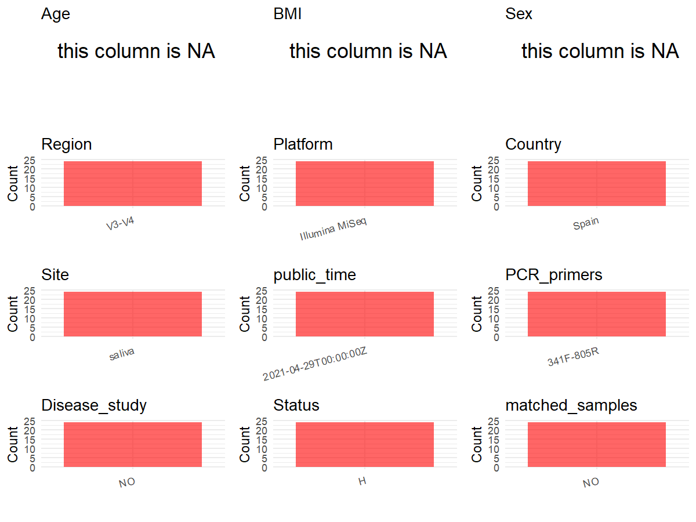

R Notebook: Metadata Processing Workflow
================

# Step 1: Obtain Initial Metadata from Each Project

To obtain the initial metadata: 1. Search for the BioProject ID (e.g.,
“PRJEBXXXX”) on the [NCBI SRA
website](https://www.ncbi.nlm.nih.gov/Traces/study/). 2. In the “Select”
table, click on “Metadata” and download the file. 3. The downloaded file
is typically named “SraRunTable.csv” and contains metadata for the
project.

``` r
# Load necessary libraries
library(dplyr)
library(ggplot2)
library(cowplot)

# Set working directory (update this path to your local directory)
setwd("D:/metadata/3/PRJNA725996")

# Read the initial metadata files
initial_meta<-read.csv("SraRunTable.csv",header = T)

# Combine the two metadata files
#meta <- rbind(initial_meta, initial_meta1)

#Remove entries non-oral samples
#initial_meta <- subset(initial_meta,BioSampleModel != "Metagenome or environmental")

# Check the number of samples containing "HT" in Sample.Name (e.g., healthy controls)
#nrow(subset(meta, grepl("HT", Sample.Name)))

# Display the first few rows of the metadata
head(initial_meta)
```

    ##           Run Assay.Type AvgSpotLen    Bases  BioProject    BioSample
    ## 1 SRR14354784   AMPLICON        598 68431776 PRJNA725996 SAMN18917643
    ## 2 SRR14354785   AMPLICON        598 22202488 PRJNA725996 SAMN18917209
    ## 3 SRR14354786   AMPLICON        598 79317379 PRJNA725996 SAMN18917601
    ## 4 SRR14354787   AMPLICON        598 23649342 PRJNA725996 SAMN18917209
    ## 5 SRR14354788   AMPLICON        598 65285063 PRJNA725996 SAMN18917601
    ## 6 SRR14354789   AMPLICON        598 17657564 PRJNA725996 SAMN18917589
    ##                BioSampleModel    Bytes Center.Name Collection_Date Consent
    ## 1 Metagenome or environmental 36739499     FISABIO      2019-12-09  public
    ## 2 Metagenome or environmental 11453662     FISABIO      2019-12-09  public
    ## 3 Metagenome or environmental 41622472     FISABIO      2019-12-09  public
    ## 4 Metagenome or environmental 12561254     FISABIO      2019-12-09  public
    ## 5 Metagenome or environmental 35274838     FISABIO      2019-12-09  public
    ## 6 Metagenome or environmental  9212995     FISABIO      2019-12-09  public
    ##   DATASTORE.filetype DATASTORE.provider                     DATASTORE.region
    ## 1   fastq,run.zq,sra         gs,ncbi,s3 gs.us-east1,ncbi.public,s3.us-east-1
    ## 2   fastq,run.zq,sra         gs,ncbi,s3 gs.us-east1,ncbi.public,s3.us-east-1
    ## 3   fastq,run.zq,sra         gs,ncbi,s3 gs.us-east1,ncbi.public,s3.us-east-1
    ## 4   fastq,run.zq,sra         gs,ncbi,s3 gs.us-east1,ncbi.public,s3.us-east-1
    ## 5   fastq,run.zq,sra         gs,ncbi,s3 gs.us-east1,ncbi.public,s3.us-east-1
    ## 6   fastq,run.zq,sra         gs,ncbi,s3 gs.us-east1,ncbi.public,s3.us-east-1
    ##    Experiment geo_loc_name_country geo_loc_name_country_continent
    ## 1 SRX10708654                Spain                         Europe
    ## 2 SRX10708653                Spain                         Europe
    ## 3 SRX10708652                Spain                         Europe
    ## 4 SRX10708651                Spain                         Europe
    ## 5 SRX10708650                Spain                         Europe
    ## 6 SRX10708649                Spain                         Europe
    ##                           geo_loc_name         HOST     Instrument
    ## 1 Spain: FISABIO institute\\, Valencia Homo sapiens Illumina MiSeq
    ## 2 Spain: FISABIO institute\\, Valencia Homo sapiens Illumina MiSeq
    ## 3 Spain: FISABIO institute\\, Valencia Homo sapiens Illumina MiSeq
    ## 4 Spain: FISABIO institute\\, Valencia Homo sapiens Illumina MiSeq
    ## 5 Spain: FISABIO institute\\, Valencia Homo sapiens Illumina MiSeq
    ## 6 Spain: FISABIO institute\\, Valencia Homo sapiens Illumina MiSeq
    ##   isolation_source                  lat_lon                Library.Name
    ## 1           saliva 39.4811901 N 0.3533314 W D21_4h_C_R1_and_R2.fastq.gz
    ## 2           saliva 39.4811901 N 0.3533314 W D19_0h_N_R1_and_R2.fastq.gz
    ## 3           saliva 39.4811901 N 0.3533314 W D19_0h_C_R1_and_R2.fastq.gz
    ## 4           saliva 39.4811901 N 0.3533314 W D21_0h_N_R1_and_R2.fastq.gz
    ## 5           saliva 39.4811901 N 0.3533314 W D21_0h_C_R1_and_R2.fastq.gz
    ## 6           saliva 39.4811901 N 0.3533314 W D20_4h_N_R1_and_R2.fastq.gz
    ##   LibraryLayout LibrarySelection LibrarySource         Organism Platform
    ## 1        PAIRED              PCR   METAGENOMIC human metagenome ILLUMINA
    ## 2        PAIRED              PCR   METAGENOMIC human metagenome ILLUMINA
    ## 3        PAIRED              PCR   METAGENOMIC human metagenome ILLUMINA
    ## 4        PAIRED              PCR   METAGENOMIC human metagenome ILLUMINA
    ## 5        PAIRED              PCR   METAGENOMIC human metagenome ILLUMINA
    ## 6        PAIRED              PCR   METAGENOMIC human metagenome ILLUMINA
    ##            ReleaseDate          create_date version samp_size
    ## 1 2021-04-29T00:00:00Z 2021-04-29T09:36:00Z       1         6
    ## 2 2021-04-29T00:00:00Z 2021-04-29T09:36:00Z       1         6
    ## 3 2021-04-29T00:00:00Z 2021-04-29T09:36:00Z       1         6
    ## 4 2021-04-29T00:00:00Z 2021-04-29T09:36:00Z       1         6
    ## 5 2021-04-29T00:00:00Z 2021-04-29T09:36:00Z       1         6
    ## 6 2021-04-29T00:00:00Z 2021-04-29T09:36:00Z       1         6
    ##                                         Sample.Name SRA.Study
    ## 1               Saliva_4h_after_water_intake_study3 SRP316838
    ## 2 Saliva_baseline_0h_beetroot_supplement_day_study3 SRP316838
    ## 3               Saliva_baseline_0h_water_day_study3 SRP316838
    ## 4 Saliva_baseline_0h_beetroot_supplement_day_study3 SRP316838
    ## 5               Saliva_baseline_0h_water_day_study3 SRP316838
    ## 6 Saliva_4h_after_beetroot_supplement_intake_study3 SRP316838

# Step 2: Create a Uniform Metadata Template

The uniform metadata should include the following columns:

1.  **BioProject**: Project ID (e.g., “PRJNA339212”)
2.  **Run**: Sample ID (e.g., “ERRXXXXXX” or “SRRXXXXXX”)
3.  **sample_name**: Original sample name submitted by the authors (not
    the database-assigned ID)
4.  **Age**: Age of the subject (if available)
5.  **BMI**: Body Mass Index (if available)
6.  **Sex**: Sex of the subject (“F” or “M”)
7.  **Region**: Targeted 16S rRNA region (e.g., “V3-V4”)
8.  **Platform**: Sequencing platform (e.g., “Illumina MiSeq”)
9.  **Country**: Country of sample origin (e.g., “China”)
10. **Site**: Sample site (e.g., “saliva”, “dental plaque”)
11. **public_time**: Data release date (format: “YYYY-MM-DD”)
12. **PCR_primers**: PCR primers used (e.g., “515F-806R”)
13. **title**: Title of the associated publication
14. **Disease_study**: Whether the study involves a disease (“YES” or
    “NO”)
15. **Status**: Disease status (e.g., “T2DM”, “HC”). Note: If the study
    includes both disease and healthy samples, this must be specified
    per sample.
16. **matched_samples**: matched samples (“YES” or “NO”)

``` r
# Create a uniform metadata dataframe
metadata <- data.frame(
  BioProject = initial_meta$BioProject,
  Run = initial_meta$Run,
  sample_name = initial_meta$Sample.Name,
  Age = NA,
  BMI = NA,
  Sex=NA,
  Region = "V3-V4",
  Platform = initial_meta$Instrument,
  Country = initial_meta$geo_loc_name_country,
  Site = initial_meta$isolation_source,
  public_time = initial_meta$ReleaseDate,
  Status      = "H",
  stringsAsFactors = FALSE
)
```

# Step 3: Manually Add Information from the Publication

Some information (e.g. PCR primers, study title, disease status) must be
manually extracted from the publication and added to the metadata.

``` r
# Add information obtained from the publication
metadata$PCR_primers <- "341F-805R"
metadata$title <- "A Single Dose of Nitrate Increases Resilience Against Acidification Derived From Sugar Fermentation by the Oral Microbiome"
metadata$Disease_study <- "NO"
# Assign disease status based on sample_name patterns

keep_subjects <- unique(subset(metadata, Site == "saliva")$sample_name)
metadata <- subset(metadata, sample_name %in% keep_subjects)


metadata$matched_samples <- "NO"
```

# Step 4: Summarize and Validate the Metadata

``` r
# Check the number of unique runs and sample names
print(paste("Number of unique runs:", length(unique(metadata$Run))))
```

    ## [1] "Number of unique runs: 24"

``` r
print(paste("Number of unique sample names:", length(unique(metadata$sample_name))))
```

    ## [1] "Number of unique sample names: 4"

# Step 5: Visualize the Metadata

``` r

```

<!-- -->

# Step 6: Finalize and Export the Metadata

``` r
# Reorder columns to match the desired format
metadata <- metadata[, c(
  "BioProject", "Run", "sample_name", "Age", "BMI", "Sex", 
  "Region", "Platform", "Country", "Site", "public_time", 
  "PCR_primers", "title", "Disease_study", "Status","matched_samples"
)]

# Export the uniform metadata to a CSV file
write.csv(metadata, file = "metadata.csv", quote = TRUE)
head(metadata)
```

    ##    BioProject         Run                                       sample_name Age
    ## 1 PRJNA725996 SRR14354784               Saliva_4h_after_water_intake_study3  NA
    ## 2 PRJNA725996 SRR14354785 Saliva_baseline_0h_beetroot_supplement_day_study3  NA
    ## 3 PRJNA725996 SRR14354786               Saliva_baseline_0h_water_day_study3  NA
    ## 4 PRJNA725996 SRR14354787 Saliva_baseline_0h_beetroot_supplement_day_study3  NA
    ## 5 PRJNA725996 SRR14354788               Saliva_baseline_0h_water_day_study3  NA
    ## 6 PRJNA725996 SRR14354789 Saliva_4h_after_beetroot_supplement_intake_study3  NA
    ##   BMI Sex Region       Platform Country   Site          public_time PCR_primers
    ## 1  NA  NA  V3-V4 Illumina MiSeq   Spain saliva 2021-04-29T00:00:00Z   341F-805R
    ## 2  NA  NA  V3-V4 Illumina MiSeq   Spain saliva 2021-04-29T00:00:00Z   341F-805R
    ## 3  NA  NA  V3-V4 Illumina MiSeq   Spain saliva 2021-04-29T00:00:00Z   341F-805R
    ## 4  NA  NA  V3-V4 Illumina MiSeq   Spain saliva 2021-04-29T00:00:00Z   341F-805R
    ## 5  NA  NA  V3-V4 Illumina MiSeq   Spain saliva 2021-04-29T00:00:00Z   341F-805R
    ## 6  NA  NA  V3-V4 Illumina MiSeq   Spain saliva 2021-04-29T00:00:00Z   341F-805R
    ##                                                                                                                        title
    ## 1 A Single Dose of Nitrate Increases Resilience Against Acidification Derived From Sugar Fermentation by the Oral Microbiome
    ## 2 A Single Dose of Nitrate Increases Resilience Against Acidification Derived From Sugar Fermentation by the Oral Microbiome
    ## 3 A Single Dose of Nitrate Increases Resilience Against Acidification Derived From Sugar Fermentation by the Oral Microbiome
    ## 4 A Single Dose of Nitrate Increases Resilience Against Acidification Derived From Sugar Fermentation by the Oral Microbiome
    ## 5 A Single Dose of Nitrate Increases Resilience Against Acidification Derived From Sugar Fermentation by the Oral Microbiome
    ## 6 A Single Dose of Nitrate Increases Resilience Against Acidification Derived From Sugar Fermentation by the Oral Microbiome
    ##   Disease_study Status matched_samples
    ## 1            NO      H              NO
    ## 2            NO      H              NO
    ## 3            NO      H              NO
    ## 4            NO      H              NO
    ## 5            NO      H              NO
    ## 6            NO      H              NO

## Notes for Students:

1.  **Metadata Accuracy**: Always cross-check the metadata with the
    original publication to ensure accuracy.
2.  **Manual Entries**: Columns like `PCR_primers`, and `Status` often
    require manual entry based on the publication.
3.  **Disease Status**: Be careful when assigning `Status`—some studies
    include both disease and healthy samples.
4.  **Visualization**: The plots help quickly identify the distribution
    of values in each column, which is useful for quality control.
5.  **Reproducibility**: Update the working directory and file paths to
    match your local environment.
