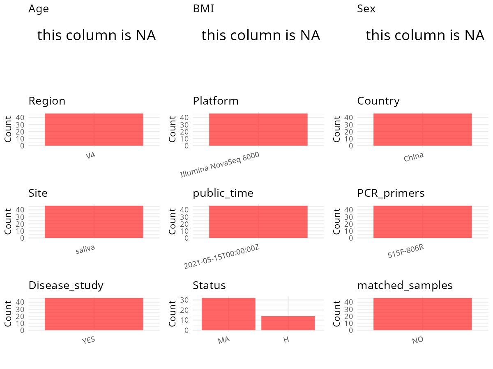

R Notebook: Metadata Processing Workflow
================

# Step 1: Obtain Initial Metadata from Each Project

To obtain the initial metadata: 1. Search for the BioProject ID (e.g.,
“PRJEBXXXX”) on the [NCBI SRA
website](https://www.ncbi.nlm.nih.gov/Traces/study/). 2. In the “Select”
table, click on “Metadata” and download the file. 3. The downloaded file
is typically named “SraRunTable.csv” and contains metadata for the
project.

``` r
# Load necessary libraries
library(dplyr)
library(ggplot2)
library(cowplot)
library(stringr)

# Set working directory (update this path to your local directory)
setwd("/home/hby/oral_project/PRJNA728576")

# Read the initial metadata files
initial_meta <- read.csv("SraRunTable.csv", header = T)

# Combine the two metadata files
# meta <- rbind(initial_meta, initial_meta1)

# Remove entries non-oral samples
# initial_meta <- subset(initial_meta,isolate %in% c("saliva","tongue coat"))

# Check the number of samples containing "HT" in Sample.Name (e.g., healthy controls)
# nrow(subset(meta, grepl("HT", Sample.Name)))

# Display the first few rows of the metadata
head(initial_meta)
```

    ##           Run Assay.Type AvgSpotLen    Bases  BioProject    BioSample                    BioSampleModel    Bytes                                   Center.Name Collection_Date Consent
    ## 1 SRR14536045   AMPLICON        435 37612708 PRJNA728576 SAMN19092178 Microbe\\, viral or environmental 13035308 HUAZHONG UNIVERSITY OF SCIENCE AND TECHNOLOGY  not applicable  public
    ## 2 SRR14536046   AMPLICON        438 37311023 PRJNA728576 SAMN19092177 Microbe\\, viral or environmental 12916314 HUAZHONG UNIVERSITY OF SCIENCE AND TECHNOLOGY  not applicable  public
    ## 3 SRR14536047   AMPLICON        438 35675358 PRJNA728576 SAMN19092176 Microbe\\, viral or environmental 12569201 HUAZHONG UNIVERSITY OF SCIENCE AND TECHNOLOGY  not applicable  public
    ## 4 SRR14536048   AMPLICON        438 41719658 PRJNA728576 SAMN19092175 Microbe\\, viral or environmental 14438131 HUAZHONG UNIVERSITY OF SCIENCE AND TECHNOLOGY  not applicable  public
    ## 5 SRR14536055   AMPLICON        436 36557367 PRJNA728576 SAMN19092174 Microbe\\, viral or environmental 12505071 HUAZHONG UNIVERSITY OF SCIENCE AND TECHNOLOGY  not applicable  public
    ## 6 SRR14536066   AMPLICON        436 42113108 PRJNA728576 SAMN19092173 Microbe\\, viral or environmental 14497848 HUAZHONG UNIVERSITY OF SCIENCE AND TECHNOLOGY  not applicable  public
    ##   DATASTORE.filetype DATASTORE.provider                     DATASTORE.region  Experiment geo_loc_name_country geo_loc_name_country_continent geo_loc_name         HOST
    ## 1   fastq,run.zq,sra         gs,ncbi,s3 gs.us-east1,ncbi.public,s3.us-east-1 SRX10880286                China                           Asia        China Homo sapiens
    ## 2   fastq,run.zq,sra         gs,ncbi,s3 gs.us-east1,ncbi.public,s3.us-east-1 SRX10880285                China                           Asia        China Homo sapiens
    ## 3   fastq,run.zq,sra         gs,ncbi,s3 gs.us-east1,ncbi.public,s3.us-east-1 SRX10880284                China                           Asia        China Homo sapiens
    ## 4   fastq,run.zq,sra         gs,ncbi,s3 gs.us-east1,ncbi.public,s3.us-east-1 SRX10880283                China                           Asia        China Homo sapiens
    ## 5   fastq,run.zq,sra         gs,ncbi,s3 gs.us-east1,ncbi.public,s3.us-east-1 SRX10880276                China                           Asia        China Homo sapiens
    ## 6   fastq,run.zq,sra         gs,ncbi,s3 gs.us-east1,ncbi.public,s3.us-east-1 SRX10880265                China                           Asia        China Homo sapiens
    ##              Instrument   isolate isolation_source status Library.Name LibraryLayout LibrarySelection LibrarySource   Organism Platform          ReleaseDate              replicate
    ## 1 Illumina NovaSeq 6000 bacterium            sliva     MA          MA9        PAIRED              PCR       GENOMIC Firmicutes ILLUMINA 2021-05-15T00:00:00Z biological replicate 9
    ## 2 Illumina NovaSeq 6000 bacterium            sliva     MA          MA8        PAIRED              PCR       GENOMIC Firmicutes ILLUMINA 2021-05-15T00:00:00Z biological replicate 8
    ## 3 Illumina NovaSeq 6000 bacterium            sliva     MA          MA7        PAIRED              PCR       GENOMIC Firmicutes ILLUMINA 2021-05-15T00:00:00Z biological replicate 7
    ## 4 Illumina NovaSeq 6000 bacterium            sliva     MA          MA6        PAIRED              PCR       GENOMIC Firmicutes ILLUMINA 2021-05-15T00:00:00Z biological replicate 6
    ## 5 Illumina NovaSeq 6000 bacterium            sliva     MA          MA5        PAIRED              PCR       GENOMIC Firmicutes ILLUMINA 2021-05-15T00:00:00Z biological replicate 5
    ## 6 Illumina NovaSeq 6000 bacterium            sliva     MA          MA4        PAIRED              PCR       GENOMIC Firmicutes ILLUMINA 2021-05-15T00:00:00Z biological replicate 4
    ##            create_date version Sample_Name          sample_type SRA.Study
    ## 1 2021-05-15T10:07:00Z       1         MA9 metagenomic assembly SRP319839
    ## 2 2021-05-15T10:07:00Z       1         MA8 metagenomic assembly SRP319839
    ## 3 2021-05-15T10:07:00Z       1         MA7 metagenomic assembly SRP319839
    ## 4 2021-05-15T10:07:00Z       1         MA6 metagenomic assembly SRP319839
    ## 5 2021-05-15T10:07:00Z       1         MA5 metagenomic assembly SRP319839
    ## 6 2021-05-15T10:07:00Z       1         MA4 metagenomic assembly SRP319839

# Step 2: Create a Uniform Metadata Template

The uniform metadata should include the following columns:

1.  **BioProject**: Project ID (e.g., “PRJNA339212”)
2.  **Run**: Sample ID (e.g., “ERRXXXXXX” or “SRRXXXXXX”)
3.  **sample_name**: Original sample name submitted by the authors (not
    the database-assigned ID)
4.  **Age**: Age of the subject (if available)
5.  **BMI**: Body Mass Index (if available)
6.  **Sex**: Sex of the subject (“F” or “M”)
7.  **Region**: Targeted 16S rRNA region (e.g., “V3-V4”)
8.  **Platform**: Sequencing platform (e.g., “Illumina MiSeq”)
9.  **Country**: Country of sample origin (e.g., “China”)
10. **Site**: Sample site (e.g., “saliva”, “dental plaque”)
11. **public_time**: Data release date (format: “YYYY-MM-DD”)
12. **PCR_primers**: PCR primers used (e.g., “515F-806R”)
13. **title**: Title of the associated publication
14. **Disease_study**: Whether the study involves a disease (“YES” or
    “NO”)
15. **Status**: Disease status (e.g., “T2DM”, “HC”). Note: If the study
    includes both disease and healthy samples, this must be specified
    per sample.
16. **matched_samples**: matched samples (“YES” or “NO”)

``` r
# Create a uniform metadata dataframe
metadata <- data.frame(
  BioProject = initial_meta$BioProject,
  Run = initial_meta$Run,
  sample_name = initial_meta$Sample_Name,
  Platform = initial_meta$Instrument,
  Country = initial_meta$geo_loc_name_country,
  public_time = initial_meta$ReleaseDate,
  Sex = NA,
  Age = NA,
  BMI = NA,
  Status = initial_meta$status
)
```

# Step 3: Manually Add Information from the Publication

Some information (e.g. PCR primers, study title, disease status) must be
manually extracted from the publication and added to the metadata.

``` r
# Add information obtained from the publication
metadata$Region <- "V4"
metadata$Site <- "saliva"
metadata$PCR_primers <- "515F-806R"
metadata$title <- "Oral Microbiota Profile of Individuals Who Abuse Methamphetamine"
metadata$Disease_study <- "YES"
metadata$matched_samples <- "NO"
```

# Step 4: Summarize and Validate the Metadata

``` r
# Check the number of unique runs and sample names
print(paste("Number of unique runs:", length(unique(metadata$Run))))
```

    ## [1] "Number of unique runs: 46"

``` r
print(paste("Number of unique sample names:", length(unique(metadata$sample_name))))
```

    ## [1] "Number of unique sample names: 46"

# Step 5: Visualize the Metadata

``` r

```


# Step 6: Finalize and Export the Metadata

``` r
# Reorder columns to match the desired format
metadata <- metadata[, c(
  "BioProject", "Run", "sample_name", "Age", "BMI", "Sex",
  "Region", "Platform", "Country", "Site", "public_time",
  "PCR_primers", "title", "Disease_study", "Status", "matched_samples"
)]

# Export the uniform metadata to a CSV file
write.csv(metadata, file = "metadata.csv", quote = FALSE)
head(metadata)
```

    ##    BioProject         Run sample_name Age BMI Sex Region              Platform Country   Site          public_time PCR_primers
    ## 1 PRJNA728576 SRR14536045         MA9  NA  NA  NA     V4 Illumina NovaSeq 6000   China saliva 2021-05-15T00:00:00Z   515F-806R
    ## 2 PRJNA728576 SRR14536046         MA8  NA  NA  NA     V4 Illumina NovaSeq 6000   China saliva 2021-05-15T00:00:00Z   515F-806R
    ## 3 PRJNA728576 SRR14536047         MA7  NA  NA  NA     V4 Illumina NovaSeq 6000   China saliva 2021-05-15T00:00:00Z   515F-806R
    ## 4 PRJNA728576 SRR14536048         MA6  NA  NA  NA     V4 Illumina NovaSeq 6000   China saliva 2021-05-15T00:00:00Z   515F-806R
    ## 5 PRJNA728576 SRR14536055         MA5  NA  NA  NA     V4 Illumina NovaSeq 6000   China saliva 2021-05-15T00:00:00Z   515F-806R
    ## 6 PRJNA728576 SRR14536066         MA4  NA  NA  NA     V4 Illumina NovaSeq 6000   China saliva 2021-05-15T00:00:00Z   515F-806R
    ##                                                              title Disease_study Status matched_samples
    ## 1 Oral Microbiota Profile of Individuals Who Abuse Methamphetamine           YES     MA              NO
    ## 2 Oral Microbiota Profile of Individuals Who Abuse Methamphetamine           YES     MA              NO
    ## 3 Oral Microbiota Profile of Individuals Who Abuse Methamphetamine           YES     MA              NO
    ## 4 Oral Microbiota Profile of Individuals Who Abuse Methamphetamine           YES     MA              NO
    ## 5 Oral Microbiota Profile of Individuals Who Abuse Methamphetamine           YES     MA              NO
    ## 6 Oral Microbiota Profile of Individuals Who Abuse Methamphetamine           YES     MA              NO

## Notes for Students:

1.  **Metadata Accuracy**: Always cross-check the metadata with the
    original publication to ensure accuracy.
2.  **Manual Entries**: Columns like `PCR_primers`, and `Status` often
    require manual entry based on the publication.
3.  **Disease Status**: Be careful when assigning `Status`—some studies
    include both disease and healthy samples.
4.  **Visualization**: The plots help quickly identify the distribution
    of values in each column, which is useful for quality control.
5.  **Reproducibility**: Update the working directory and file paths to
    match your local environment.
