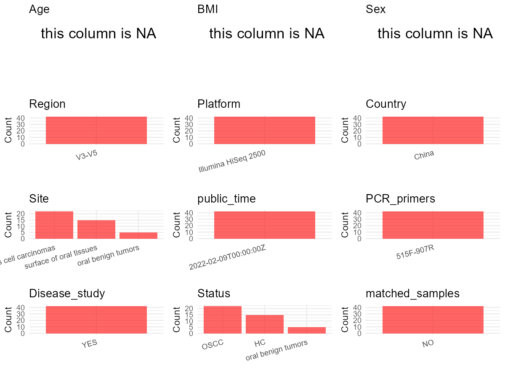

# Step 1: Obtain Initial Metadata from Each Project

To obtain the initial metadata: 1. Search for the BioProject ID (e.g.,
“PRJEBXXXX”) on the [NCBI SRA
website](https://www.ncbi.nlm.nih.gov/Traces/study/). 2. In the “Select”
table, click on “Metadata” and download the file. 3. The downloaded file
is typically named “SraRunTable.csv” and contains metadata for the
project.

    library(tidyverse)
    library(ggplot2)
    library(cowplot)

    setwd("C:/Users/zyc/Desktop/oral_project/data/projects/PRJNA730970")
    initial_meta <- read.csv("SraRunTable.csv", header = TRUE) 
    head(initial_meta)

    ##           Run Assay.Type AvgSpotLen    Bases  BioProject    BioSample                                BioSampleModel
    ## 1 SRR14583850   AMPLICON        373 14323317 PRJNA730970 SAMN19246722 MIMARKS.specimen,MIGS/MIMS/MIMARKS.human-oral
    ## 2 SRR14583851   AMPLICON        375 12463413 PRJNA730970 SAMN19246721 MIMARKS.specimen,MIGS/MIMS/MIMARKS.human-oral
    ## 3 SRR14583852   AMPLICON        376 15834457 PRJNA730970 SAMN19246720 MIMARKS.specimen,MIGS/MIMS/MIMARKS.human-oral
    ## 4 SRR14583853   AMPLICON        374 11463869 PRJNA730970 SAMN19246719 MIMARKS.specimen,MIGS/MIMS/MIMARKS.human-oral
    ## 5 SRR14583854   AMPLICON        373 14059310 PRJNA730970 SAMN19246718 MIMARKS.specimen,MIGS/MIMS/MIMARKS.human-oral
    ## 6 SRR14583855   AMPLICON        375 13141471 PRJNA730970 SAMN19246754 MIMARKS.specimen,MIGS/MIMS/MIMARKS.human-oral
    ##     Bytes                                         Center.Name Collection_Date Consent DATASTORE.filetype
    ## 1 8124635 GUANGZHOU CENTER FOR DISEASE CONTROL AND PREVENTION      2018-07-24  public   fastq,run.zq,sra
    ## 2 6946463 GUANGZHOU CENTER FOR DISEASE CONTROL AND PREVENTION      2018-07-02  public   fastq,run.zq,sra
    ## 3 8907034 GUANGZHOU CENTER FOR DISEASE CONTROL AND PREVENTION      2018-07-14  public   fastq,run.zq,sra
    ## 4 6612259 GUANGZHOU CENTER FOR DISEASE CONTROL AND PREVENTION      2018-07-02  public   fastq,run.zq,sra
    ## 5 7873649 GUANGZHOU CENTER FOR DISEASE CONTROL AND PREVENTION      2018-07-07  public   fastq,run.zq,sra
    ## 6 7584699 GUANGZHOU CENTER FOR DISEASE CONTROL AND PREVENTION      2018-07-04  public   fastq,run.zq,sra
    ##   DATASTORE.provider                     DATASTORE.region env_broad_scale               env_local_scale     env_medium
    ## 1         gs,ncbi,s3 gs.us-east1,ncbi.public,s3.us-east-1 human oral biom oral squamous cell carcinomas not applicable
    ## 2         gs,ncbi,s3 gs.us-east1,ncbi.public,s3.us-east-1 human oral biom            oral benign tumors not applicable
    ## 3         gs,ncbi,s3 gs.us-east1,ncbi.public,s3.us-east-1 human oral biom oral squamous cell carcinomas not applicable
    ## 4         gs,ncbi,s3 gs.us-east1,ncbi.public,s3.us-east-1 human oral biom            oral benign tumors not applicable
    ## 5         gs,ncbi,s3 gs.us-east1,ncbi.public,s3.us-east-1 human oral biom oral squamous cell carcinomas not applicable
    ## 6         gs,ncbi,s3 gs.us-east1,ncbi.public,s3.us-east-1 human oral biom              healthy subjects not applicable
    ##    Experiment geo_loc_name_country geo_loc_name_country_continent    geo_loc_name Group         HOST
    ## 1 SRX10931223                China                           Asia China:Guangzhou     C Homo sapiens
    ## 2 SRX10931222                China                           Asia China:Guangzhou     T Homo sapiens
    ## 3 SRX10931221                China                           Asia China:Guangzhou     C Homo sapiens
    ## 4 SRX10931220                China                           Asia China:Guangzhou     T Homo sapiens
    ## 5 SRX10931219                China                           Asia China:Guangzhou     C Homo sapiens
    ## 6 SRX10931218                China                           Asia China:Guangzhou     H Homo sapiens
    ##            Instrument isol_growth_condt        lat_lon Library.Name LibraryLayout LibrarySelection LibrarySource
    ## 1 Illumina HiSeq 2500    not applicable not applicable           16        PAIRED              PCR       GENOMIC
    ## 2 Illumina HiSeq 2500    not applicable not applicable           14        PAIRED              PCR       GENOMIC
    ## 3 Illumina HiSeq 2500    not applicable not applicable           13        PAIRED              PCR       GENOMIC
    ## 4 Illumina HiSeq 2500    not applicable not applicable           12        PAIRED              PCR       GENOMIC
    ## 5 Illumina HiSeq 2500    not applicable not applicable           11        PAIRED              PCR       GENOMIC
    ## 6 Illumina HiSeq 2500    not applicable not applicable           C9        PAIRED              PCR       GENOMIC
    ##                Organism Platform          ReleaseDate               replicate          create_date version Sample.Name
    ## 1 human oral metagenome ILLUMINA 2022-02-09T00:00:00Z  biological replicate 7 2021-05-19T04:40:00Z       1       16.fq
    ## 2 human oral metagenome ILLUMINA 2022-02-09T00:00:00Z  biological replicate 3 2021-05-19T04:40:00Z       1       14.fq
    ## 3 human oral metagenome ILLUMINA 2022-02-09T00:00:00Z  biological replicate 6 2021-05-19T04:40:00Z       1       13.fq
    ## 4 human oral metagenome ILLUMINA 2022-02-09T00:00:00Z  biological replicate 2 2021-05-19T04:40:00Z       1       12.fq
    ## 5 human oral metagenome ILLUMINA 2022-02-09T00:00:00Z  biological replicate 5 2021-05-19T04:40:00Z       1       11.fq
    ## 6 human oral metagenome ILLUMINA 2022-02-09T00:00:00Z biological replicate 15 2021-05-19T04:40:00Z       1       C9.fq
    ##   SRA.Study         strain
    ## 1 SRP320428 not applicable
    ## 2 SRP320428 not applicable
    ## 3 SRP320428 not applicable
    ## 4 SRP320428 not applicable
    ## 5 SRP320428 not applicable
    ## 6 SRP320428 not applicable

# Step 2: Create a Uniform Metadata Template

The uniform metadata should include the following columns:

1.  **BioProject**: Project ID (e.g., “PRJNA339212”)
2.  **Run**: Sample ID (e.g., “ERRXXXXXX” or “SRRXXXXXX”)
3.  **sample\_name**: Original sample name submitted by the authors (not
    the database-assigned ID)
4.  **Age**: Age of the subject (if available)
5.  **BMI**: Body Mass Index (if available)
6.  **Sex**: Sex of the subject (“F” or “M”)
7.  **Region**: Targeted 16S rRNA region (e.g., “V3-V4”)
8.  **Platform**: Sequencing platform (e.g., “Illumina MiSeq”)
9.  **Country**: Country of sample origin (e.g., “China”)
10. **Site**: Sample site (e.g., “saliva”, “dental plaque”)
11. **public\_time**: Data release date (format: “YYYY-MM-DD”)
12. **PCR\_primers**: PCR primers used (e.g., “515F-806R”)
13. **title**: Title of the associated publication
14. **Disease\_study**: Whether the study involves a disease (“YES” or
    “NO”)
15. **Status**: Disease status (e.g., “T2DM”, “HC”). Note: If the study
    includes both disease and healthy samples, this must be specified
    per sample.
16. **matched\_samples**: matched samples (“YES” or “NO”)

<!-- -->

    metadata <- data.frame(
      BioProject = initial_meta$BioProject,
      Run = initial_meta$Run,
      sample_name = initial_meta$Sample.Name,
      Age = NA, 
      BMI = NA,  
      Sex = NA,
      Platform = initial_meta$Instrument,
      Country = initial_meta$geo_loc_name_country,
      Site = initial_meta$env_local_scale,
      public_time = initial_meta$ReleaseDate,
      Status = initial_meta$env_local_scale,
      stringsAsFactors = FALSE
    )

# Step 3: Manually Add Information from the Publication

Some information (e.g. PCR primers, study title, disease status) must be
manually extracted from the publication and added to the metadata.

    # metadata <- metadata %>% mutate(Site = case_when(
    #   grepl("Supragingival dental plaque",Site) ~ "Supragingival dental plaque",
    #   TRUE ~ Site
    # ))

    metadata <- metadata %>% mutate(Status = case_when(
      grepl("oral squamous cell carcinomas",Status) ~ "OSCC",
      grepl("healthy subjects",Status) ~ "HC",
      TRUE ~ Status
    ))

    metadata <- metadata %>% mutate(Site = case_when(
      Site == "healthy subjects" ~ "surface of oral tissues",
      TRUE ~ Site
    ))
    # metadata <- metadata %>%mutate(Status = case_when(
    #   Status == "Oral Neoplasm (Healthy Control)" ~ "HC",
    #   Status == "Oral Neoplasm (OSCC)" ~ "OSCC",
    #   TRUE ~ "Precancer"
    # ))
    # metadata <- metadata %>%
    #   mutate(Sex = recode(Sex, "female" = "F", "male" = "M"))
    # metadata <-metadata%>%
    #   mutate(Country = case_when(Country == "Taiwan" ~ "China"))

    metadata$matched_samples <- "NO"
    metadata$Region <- "V3-V5"
    metadata$title <- "Variations in oral microbiome and its predictive functions between tumorous and healthy individuals"
    metadata$Disease_study <- "YES"
    metadata$PCR_primers <- "515F-907R"

    head(metadata)

    ##    BioProject         Run sample_name Age BMI Sex            Platform Country                          Site
    ## 1 PRJNA730970 SRR14583850       16.fq  NA  NA  NA Illumina HiSeq 2500   China oral squamous cell carcinomas
    ## 2 PRJNA730970 SRR14583851       14.fq  NA  NA  NA Illumina HiSeq 2500   China            oral benign tumors
    ## 3 PRJNA730970 SRR14583852       13.fq  NA  NA  NA Illumina HiSeq 2500   China oral squamous cell carcinomas
    ## 4 PRJNA730970 SRR14583853       12.fq  NA  NA  NA Illumina HiSeq 2500   China            oral benign tumors
    ## 5 PRJNA730970 SRR14583854       11.fq  NA  NA  NA Illumina HiSeq 2500   China oral squamous cell carcinomas
    ## 6 PRJNA730970 SRR14583855       C9.fq  NA  NA  NA Illumina HiSeq 2500   China       surface of oral tissues
    ##            public_time             Status matched_samples Region
    ## 1 2022-02-09T00:00:00Z               OSCC              NO  V3-V5
    ## 2 2022-02-09T00:00:00Z oral benign tumors              NO  V3-V5
    ## 3 2022-02-09T00:00:00Z               OSCC              NO  V3-V5
    ## 4 2022-02-09T00:00:00Z oral benign tumors              NO  V3-V5
    ## 5 2022-02-09T00:00:00Z               OSCC              NO  V3-V5
    ## 6 2022-02-09T00:00:00Z                 HC              NO  V3-V5
    ##                                                                                                 title Disease_study
    ## 1 Variations in oral microbiome and its predictive functions between tumorous and healthy individuals           YES
    ## 2 Variations in oral microbiome and its predictive functions between tumorous and healthy individuals           YES
    ## 3 Variations in oral microbiome and its predictive functions between tumorous and healthy individuals           YES
    ## 4 Variations in oral microbiome and its predictive functions between tumorous and healthy individuals           YES
    ## 5 Variations in oral microbiome and its predictive functions between tumorous and healthy individuals           YES
    ## 6 Variations in oral microbiome and its predictive functions between tumorous and healthy individuals           YES
    ##   PCR_primers
    ## 1   515F-907R
    ## 2   515F-907R
    ## 3   515F-907R
    ## 4   515F-907R
    ## 5   515F-907R
    ## 6   515F-907R

# Step 4: Summarize and Validate the Metadata

    print(paste("Number of unique runs:", length(unique(metadata$Run))))

    ## [1] "Number of unique runs: 42"

    print(paste("Number of unique sample names:", length(unique(metadata$sample_name))))

    ## [1] "Number of unique sample names: 42"

# Step 5: Visualize the Metadata

    plot_data <- metadata %>%
      select(-BioProject, -Run, -sample_name, -title)

    # Function to create simple plots for each column
    create_simple_plots <- function(data) {
      plots <- list()
      
      for (col in colnames(data)) {
        # Check if the column is all NA
        if (all(is.na(data[[col]]))) {
          # Create an empty plot with text indicating all NA
          p <- ggplot() +
            annotate("text", x = 0.5, y = 0.5, label = "this column is NA", size = 6) +
            labs(title = col) +
            theme_void()
        } else if (is.numeric(data[[col]])) {
          # Numeric variable: histogram
          p <- ggplot(data, aes(x = .data[[col]])) +
            geom_histogram(fill = "blue", alpha = 0.6, bins = 20, na.rm = TRUE) +
            labs(title = col) +
            theme_minimal()
        } else {
          # Categorical variable: bar plot (remove NA values)
          count_data <- as.data.frame(table(data[[col]], useNA = "ifany"))
          p <- ggplot(count_data, aes(x = reorder(Var1, -Freq), y = Freq)) +
            geom_col(fill = "red", alpha = 0.6) +
            labs(title = col, x = NULL, y = "Count") +
            theme_minimal() +
            theme(axis.text.x = element_text(angle = 15, hjust = 1))
        }
        plots[[col]] <- p
      }
      
      return(plots)
    }

    plots <- create_simple_plots(plot_data)
    p<-plot_grid(plots$Age, 
              plots$BMI, 
              plots$Sex, 
              plots$Region, 
              plots$Platform, 
              plots$Country, 
              plots$Site,
              plots$public_time, 
              plots$PCR_primers,
              plots$Disease_study,
              plots$Status,
              plots$matched_samples,# add 
              ncol = 3, align = "hv", axis = "lb")
    ggsave("Metadata_Summary.png", plot = p, width = 8, height = 6, dpi = 150)

    

 \# Step 6: Finalize and Export the Metadata

    metadata <- metadata[, c(
      "BioProject", "Run", "sample_name", "Age", "BMI", "Sex", 
      "Region", "Platform", "Country", "Site", "public_time", 
      "PCR_primers", "title", "Disease_study", "Status","matched_samples"
    )]

    write.csv(metadata, file = "metadata.csv", quote = TRUE)
