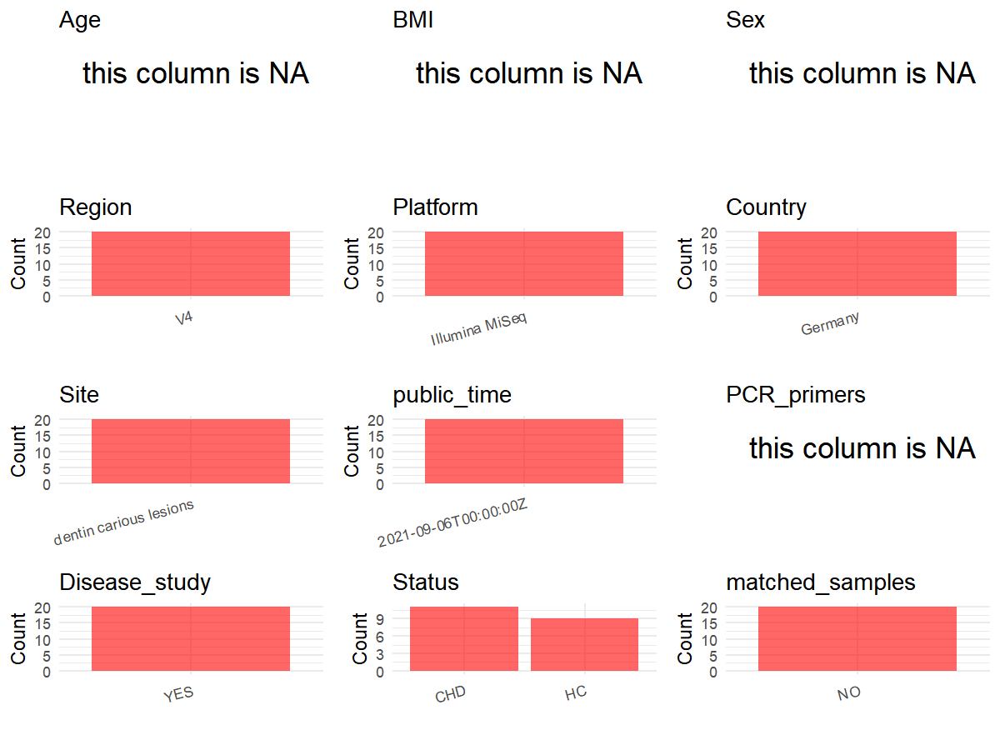

R Notebook: Metadata Processing Workflow
================

# Step 1: Obtain Initial Metadata from Each Project

To obtain the initial metadata: 1. Search for the BioProject ID (e.g.,
“PRJEBXXXX”) on the [NCBI SRA
website](https://www.ncbi.nlm.nih.gov/Traces/study/). 2. In the “Select”
table, click on “Metadata” and download the file. 3. The downloaded file
is typically named “SraRunTable.csv” and contains metadata for the
project.

``` r
library(dplyr)
```

    ## Warning: package 'dplyr' was built under R version 4.5.1

    ## 
    ## Attaching package: 'dplyr'

    ## The following objects are masked from 'package:stats':
    ## 
    ##     filter, lag

    ## The following objects are masked from 'package:base':
    ## 
    ##     intersect, setdiff, setequal, union

``` r
library(ggplot2)
```

    ## Warning: package 'ggplot2' was built under R version 4.5.1

``` r
library(cowplot)
```

    ## Warning: package 'cowplot' was built under R version 4.5.1

``` r
setwd("D:/PRJNA731066")
initial_meta<-read.csv("SraRunTable .csv",header = T)
head(initial_meta)
```

    ##           Run Assay.Type AvgSpotLen    Bases  BioProject    BioSample
    ## 1 SRR14585963   AMPLICON        501 72704748 PRJNA731066 SAMN19267559
    ## 2 SRR14585964   AMPLICON        501 43002635 PRJNA731066 SAMN19267558
    ## 3 SRR14585965   AMPLICON        501 19478039 PRJNA731066 SAMN19267557
    ## 4 SRR14585966   AMPLICON        501  5614168 PRJNA731066 SAMN19267556
    ## 5 SRR14585967   AMPLICON        501 21256063 PRJNA731066 SAMN19267555
    ## 6 SRR14585968   AMPLICON        499  2215535 PRJNA731066 SAMN19267554
    ##                BioSampleModel    Bytes                      Center.Name
    ## 1 Metagenome or environmental 51448407 JUSTUS LIEBIG UNIVERSITY GIESSEN
    ## 2 Metagenome or environmental 30190798 JUSTUS LIEBIG UNIVERSITY GIESSEN
    ## 3 Metagenome or environmental 13530303 JUSTUS LIEBIG UNIVERSITY GIESSEN
    ## 4 Metagenome or environmental  3973501 JUSTUS LIEBIG UNIVERSITY GIESSEN
    ## 5 Metagenome or environmental 15016443 JUSTUS LIEBIG UNIVERSITY GIESSEN
    ## 6 Metagenome or environmental  1643653 JUSTUS LIEBIG UNIVERSITY GIESSEN
    ##   Collection_Date Consent DATASTORE.filetype DATASTORE.provider
    ## 1            2019  public   fastq,run.zq,sra         gs,ncbi,s3
    ## 2            2019  public   fastq,run.zq,sra         gs,ncbi,s3
    ## 3            2019  public   fastq,run.zq,sra         gs,ncbi,s3
    ## 4            2019  public   fastq,run.zq,sra         gs,ncbi,s3
    ## 5            2019  public   fastq,run.zq,sra         gs,ncbi,s3
    ## 6            2019  public   fastq,run.zq,sra         gs,ncbi,s3
    ##                       DATASTORE.region  Experiment geo_loc_name_country
    ## 1 gs.us-east1,ncbi.public,s3.us-east-1 SRX10933206              Germany
    ## 2 gs.us-east1,ncbi.public,s3.us-east-1 SRX10933205              Germany
    ## 3 gs.us-east1,ncbi.public,s3.us-east-1 SRX10933204              Germany
    ## 4 gs.us-east1,ncbi.public,s3.us-east-1 SRX10933203              Germany
    ## 5 gs.us-east1,ncbi.public,s3.us-east-1 SRX10933202              Germany
    ## 6 gs.us-east1,ncbi.public,s3.us-east-1 SRX10933201              Germany
    ##   geo_loc_name_country_continent geo_loc_name         HOST host_subject
    ## 1                         Europe      Germany Homo sapiens        CHD10
    ## 2                         Europe      Germany Homo sapiens        CHD09
    ## 3                         Europe      Germany Homo sapiens        CHD08
    ## 4                         Europe      Germany Homo sapiens        CHD07
    ## 5                         Europe      Germany Homo sapiens        CHD06
    ## 6                         Europe      Germany Homo sapiens        CHD05
    ##       Instrument isolation_source        lat_lon Library.Name LibraryLayout
    ## 1 Illumina MiSeq carious material not applicable        CHD10        PAIRED
    ## 2 Illumina MiSeq carious material not applicable        CHD09        PAIRED
    ## 3 Illumina MiSeq carious material not applicable        CHD08        PAIRED
    ## 4 Illumina MiSeq carious material not applicable        CHD07        PAIRED
    ## 5 Illumina MiSeq carious material not applicable        CHD06        PAIRED
    ## 6 Illumina MiSeq carious material not applicable        CHD05        PAIRED
    ##   LibrarySelection LibrarySource              Organism Platform
    ## 1              PCR   METAGENOMIC human oral metagenome ILLUMINA
    ## 2              PCR   METAGENOMIC human oral metagenome ILLUMINA
    ## 3              PCR   METAGENOMIC human oral metagenome ILLUMINA
    ## 4              PCR   METAGENOMIC human oral metagenome ILLUMINA
    ## 5              PCR   METAGENOMIC human oral metagenome ILLUMINA
    ## 6              PCR   METAGENOMIC human oral metagenome ILLUMINA
    ##            ReleaseDate          create_date version Sample.Name SRA.Study
    ## 1 2021-09-06T00:00:00Z 2021-05-19T13:28:00Z       1       CHD10 SRP320499
    ## 2 2021-09-06T00:00:00Z 2021-05-19T13:28:00Z       1       CHD09 SRP320499
    ## 3 2021-09-06T00:00:00Z 2021-05-19T13:28:00Z       1       CHD08 SRP320499
    ## 4 2021-09-06T00:00:00Z 2021-05-19T13:28:00Z       1       CHD07 SRP320499
    ## 5 2021-09-06T00:00:00Z 2021-05-19T13:28:00Z       1       CHD06 SRP320499
    ## 6 2021-09-06T00:00:00Z 2021-05-19T13:28:00Z       1       CHD05 SRP320499

# Step 2: Create a Uniform Metadata Template

The uniform metadata should include the following columns:

1.  **BioProject**: Project ID (e.g., “PRJNA339212”)
2.  **Run**: Sample ID (e.g., “ERRXXXXXX” or “SRRXXXXXX”)
3.  **sample_name**: Original sample name submitted by the authors (not
    the database-assigned ID)
4.  **Age**: Age of the subject (if available)
5.  **BMI**: Body Mass Index (if available)
6.  **Sex**: Sex of the subject (“F” or “M”)
7.  **Region**: Targeted 16S rRNA region (e.g., “V3-V4”)
8.  **Platform**: Sequencing platform (e.g., “Illumina MiSeq”)
9.  **Country**: Country of sample origin (e.g., “China”)
10. **Site**: Sample site (e.g., “saliva”, “dental plaque”)
11. **public_time**: Data release date (format: “YYYY-MM-DD”)
12. **PCR_primers**: PCR primers used (e.g., “515F-806R”)
13. **title**: Title of the associated publication
14. **Disease_study**: Whether the study involves a disease (“YES” or
    “NO”)
15. **Status**: Disease status (e.g., “T2DM”, “HC”). Note: If the study
    includes both disease and healthy samples, this must be specified
    per sample.
16. **matched_samples**: matched samples (“YES” or “NO”)

``` r
metadata <- data.frame(
  BioProject = initial_meta$BioProject,
  Run = initial_meta$Run,
  sample_name = initial_meta$Sample.Name,
  Platform = initial_meta$Instrument,
  Country =initial_meta$geo_loc_name_country,
  public_time = initial_meta$ReleaseDate,
  Library.Name=initial_meta$Library.Name,
  stringsAsFactors = FALSE
)
```

# Step 3: Manually Add Information from the Publication

Some information (e.g. PCR primers, study title, disease status) must be
manually extracted from the publication and added to the metadata.

``` r
metadata$Age <- NA_character_
metadata$Site <-"dentin carious lesions"
metadata$BMI <- NA_character_
metadata$Sex <- NA_character_
metadata$PCR_primers <- NA_character_
metadata$Region <-"V4"
metadata$title <-"Microbiome Analysis of Carious Lesions in Pre-School Children with Early Childhood Caries and Congenital Heart Disease"
metadata$Disease_study <- "YES"
metadata<-metadata%>%
    mutate(Status=case_when(grepl("CHD",Library.Name)~"CHD",grepl("HCG",Library.Name)~"HC"))
metadata$matched_samples <- "NO"
```

``` r
# Check initial data distribution
cat("Initial sample distribution:\n")
```

    ## Initial sample distribution:

``` r
table(metadata$sample_name)
```

    ## 
    ## CHD01 CHD02 CHD03 CHD04 CHD05 CHD06 CHD07 CHD08 CHD09 CHD10 CHD11 HCG01 HCG02 
    ##     1     1     1     1     1     1     1     1     1     1     1     1     1 
    ## HCG04 HCG05 HCG06 HCG07 HCG08 HCG09 HCG10 
    ##     1     1     1     1     1     1     1

``` r
table(metadata$Site)
```

    ## 
    ## dentin carious lesions 
    ##                     20

``` r
# Calculate sampling frequency per subject
sample_counts <- table(metadata$sample_name)
cat("\nNumber of samples per subject:\n")
```

    ## 
    ## Number of samples per subject:

``` r
print(sample_counts)
```

    ## 
    ## CHD01 CHD02 CHD03 CHD04 CHD05 CHD06 CHD07 CHD08 CHD09 CHD10 CHD11 HCG01 HCG02 
    ##     1     1     1     1     1     1     1     1     1     1     1     1     1 
    ## HCG04 HCG05 HCG06 HCG07 HCG08 HCG09 HCG10 
    ##     1     1     1     1     1     1     1

# Step 4: Summarize and Validate the Metadata

# Step 6: Finalize and Export the Metadata

``` r

```

<!-- -->

``` r
# Reorder columns to match the desired format
metadata <- metadata[, c(
  "BioProject", "Run", "sample_name", "Age", "BMI", "Sex", 
  "Region", "Platform", "Country", "Site", "public_time", 
  "PCR_primers", "title", "Disease_study", "Status","matched_samples"
)]

# Export the uniform metadata to a CSV file
write.csv(metadata, file = "metadata.csv", quote = FALSE)
head(metadata)
```

    ##    BioProject         Run sample_name  Age  BMI  Sex Region       Platform
    ## 1 PRJNA731066 SRR14585963       CHD10 <NA> <NA> <NA>     V4 Illumina MiSeq
    ## 2 PRJNA731066 SRR14585964       CHD09 <NA> <NA> <NA>     V4 Illumina MiSeq
    ## 3 PRJNA731066 SRR14585965       CHD08 <NA> <NA> <NA>     V4 Illumina MiSeq
    ## 4 PRJNA731066 SRR14585966       CHD07 <NA> <NA> <NA>     V4 Illumina MiSeq
    ## 5 PRJNA731066 SRR14585967       CHD06 <NA> <NA> <NA>     V4 Illumina MiSeq
    ## 6 PRJNA731066 SRR14585968       CHD05 <NA> <NA> <NA>     V4 Illumina MiSeq
    ##   Country                   Site          public_time PCR_primers
    ## 1 Germany dentin carious lesions 2021-09-06T00:00:00Z        <NA>
    ## 2 Germany dentin carious lesions 2021-09-06T00:00:00Z        <NA>
    ## 3 Germany dentin carious lesions 2021-09-06T00:00:00Z        <NA>
    ## 4 Germany dentin carious lesions 2021-09-06T00:00:00Z        <NA>
    ## 5 Germany dentin carious lesions 2021-09-06T00:00:00Z        <NA>
    ## 6 Germany dentin carious lesions 2021-09-06T00:00:00Z        <NA>
    ##                                                                                                                    title
    ## 1 Microbiome Analysis of Carious Lesions in Pre-School Children with Early Childhood Caries and Congenital Heart Disease
    ## 2 Microbiome Analysis of Carious Lesions in Pre-School Children with Early Childhood Caries and Congenital Heart Disease
    ## 3 Microbiome Analysis of Carious Lesions in Pre-School Children with Early Childhood Caries and Congenital Heart Disease
    ## 4 Microbiome Analysis of Carious Lesions in Pre-School Children with Early Childhood Caries and Congenital Heart Disease
    ## 5 Microbiome Analysis of Carious Lesions in Pre-School Children with Early Childhood Caries and Congenital Heart Disease
    ## 6 Microbiome Analysis of Carious Lesions in Pre-School Children with Early Childhood Caries and Congenital Heart Disease
    ##   Disease_study Status matched_samples
    ## 1           YES    CHD              NO
    ## 2           YES    CHD              NO
    ## 3           YES    CHD              NO
    ## 4           YES    CHD              NO
    ## 5           YES    CHD              NO
    ## 6           YES    CHD              NO
