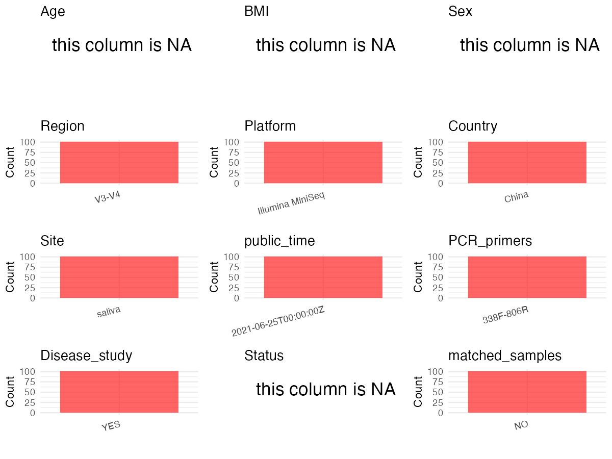

R Notebook: Metadata Processing Workflow
================

# Step 1: Obtain Initial Metadata from Each Project

To obtain the initial metadata: 1. Search for the BioProject ID (e.g.,
“PRJEBXXXX”) on the [NCBI SRA
website](https://www.ncbi.nlm.nih.gov/Traces/study/). 2. In the “Select”
table, click on “Metadata” and download the file. 3. The downloaded file
is typically named “SraRunTable.csv” and contains metadata for the
project.

``` r
# Load necessary libraries
library(dplyr)
library(ggplot2)
library(cowplot)
# Set working directory (update this path to your local directory)
setwd("/Users/dongbiao/Documents/oral/global-oral-microbiome/data/projects/PRJNA732238/")

# Read the initial metadata files
initial_meta<-read.csv("SraRunTable.csv",header = T)

head(initial_meta)
```

    ##           Run Assay.Type AvgSpotLen    Bases  BioProject    BioSample
    ## 1 SRR14635845   AMPLICON        289 12363249 PRJNA732238 SAMN19314507
    ## 2 SRR14635846   AMPLICON        290 15088942 PRJNA732238 SAMN19314506
    ## 3 SRR14635847   AMPLICON        287 15002698 PRJNA732238 SAMN19314505
    ## 4 SRR14635848   AMPLICON        288 15501862 PRJNA732238 SAMN19314504
    ## 5 SRR14635849   AMPLICON        287 15984460 PRJNA732238 SAMN19314503
    ## 6 SRR14635850   AMPLICON        298 14790526 PRJNA732238 SAMN19314431
    ##                BioSampleModel    Bytes         Center.Name Collection_Date
    ## 1 Metagenome or environmental  8036810 ZHEJIANG UNIVERSITY      2020-05-30
    ## 2 Metagenome or environmental  9726132 ZHEJIANG UNIVERSITY      2020-05-30
    ## 3 Metagenome or environmental  9653726 ZHEJIANG UNIVERSITY      2020-05-30
    ## 4 Metagenome or environmental  9961132 ZHEJIANG UNIVERSITY      2020-05-30
    ## 5 Metagenome or environmental 10311033 ZHEJIANG UNIVERSITY      2020-05-30
    ## 6 Metagenome or environmental  7099303 ZHEJIANG UNIVERSITY      2020-05-30
    ##   Consent DATASTORE.filetype DATASTORE.provider
    ## 1  public   fastq,run.zq,sra         gs,ncbi,s3
    ## 2  public   fastq,run.zq,sra         gs,ncbi,s3
    ## 3  public   fastq,run.zq,sra         gs,ncbi,s3
    ## 4  public   fastq,run.zq,sra         gs,ncbi,s3
    ## 5  public   fastq,run.zq,sra         gs,ncbi,s3
    ## 6  public   fastq,run.zq,sra         gs,ncbi,s3
    ##                       DATASTORE.region  Experiment geo_loc_name_country
    ## 1 gs.us-east1,ncbi.public,s3.us-east-1 SRX10975724                China
    ## 2 gs.us-east1,ncbi.public,s3.us-east-1 SRX10975723                China
    ## 3 gs.us-east1,ncbi.public,s3.us-east-1 SRX10975722                China
    ## 4 gs.us-east1,ncbi.public,s3.us-east-1 SRX10975721                China
    ## 5 gs.us-east1,ncbi.public,s3.us-east-1 SRX10975720                China
    ## 6 gs.us-east1,ncbi.public,s3.us-east-1 SRX10975719                China
    ##   geo_loc_name_country_continent   geo_loc_name         HOST       Instrument
    ## 1                           Asia China:Hangzhou Homo sapiens Illumina MiniSeq
    ## 2                           Asia China:Hangzhou Homo sapiens Illumina MiniSeq
    ## 3                           Asia China:Hangzhou Homo sapiens Illumina MiniSeq
    ## 4                           Asia China:Hangzhou Homo sapiens Illumina MiniSeq
    ## 5                           Asia China:Hangzhou Homo sapiens Illumina MiniSeq
    ## 6                           Asia China:Hangzhou Homo sapiens Illumina MiniSeq
    ##   isolation_source    lat_lon Library.Name LibraryLayout LibrarySelection
    ## 1           saliva 30 N 120 E        G3-09        PAIRED              PCR
    ## 2           saliva 30 N 120 E        G3-08        PAIRED              PCR
    ## 3           saliva 30 N 120 E        G3-07        PAIRED              PCR
    ## 4           saliva 30 N 120 E        G3-06        PAIRED              PCR
    ## 5           saliva 30 N 120 E        G3-05        PAIRED              PCR
    ## 6           saliva 30 N 120 E        G1-09        PAIRED              PCR
    ##   LibrarySource                Organism Platform          ReleaseDate
    ## 1   METAGENOMIC human saliva metagenome ILLUMINA 2021-06-25T00:00:00Z
    ## 2   METAGENOMIC human saliva metagenome ILLUMINA 2021-06-25T00:00:00Z
    ## 3   METAGENOMIC human saliva metagenome ILLUMINA 2021-06-25T00:00:00Z
    ## 4   METAGENOMIC human saliva metagenome ILLUMINA 2021-06-25T00:00:00Z
    ## 5   METAGENOMIC human saliva metagenome ILLUMINA 2021-06-25T00:00:00Z
    ## 6   METAGENOMIC human saliva metagenome ILLUMINA 2021-06-25T00:00:00Z
    ##            create_date version Sample.Name SRA.Study
    ## 1 2021-05-24T19:28:00Z       1       G3-09 SRP321202
    ## 2 2021-05-24T19:28:00Z       1       G3-08 SRP321202
    ## 3 2021-05-24T19:28:00Z       1       G3-07 SRP321202
    ## 4 2021-05-24T19:28:00Z       1       G3-06 SRP321202
    ## 5 2021-05-24T19:28:00Z       1       G3-05 SRP321202
    ## 6 2021-05-24T19:28:00Z       1       G1-09 SRP321202

# Step 2: Create a Uniform Metadata Template

The uniform metadata should include the following columns:

1.  **BioProject**: Project ID (e.g., “PRJNA339212”)
2.  **Run**: Sample ID (e.g., “ERRXXXXXX” or “SRRXXXXXX”)
3.  **sample_name**: Original sample name submitted by the authors (not
    the database-assigned ID)
4.  **Age**: Age of the subject (if available)
5.  **BMI**: Body Mass Index (if available)
6.  **Sex**: Sex of the subject (“F” or “M”)
7.  **Region**: Targeted 16S rRNA region (e.g., “V3-V4”)
8.  **Platform**: Sequencing platform (e.g., “Illumina MiSeq”)
9.  **Country**: Country of sample origin (e.g., “China”)
10. **Site**: Sample site (e.g., “saliva”, “dental plaque”)
11. **public_time**: Data release date (format: “YYYY-MM-DD”)
12. **PCR_primers**: PCR primers used (e.g., “515F-806R”)
13. **title**: Title of the associated publication
14. **Disease_study**: Whether the study involves a disease (“YES” or
    “NO”)
15. **Status**: Disease status (e.g., “T2DM”, “HC”). Note: If the study
    includes both disease and healthy samples, this must be specified
    per sample.
16. **matched_samples** : matched samples (“YES” or “NO”)

``` r
# Create a uniform metadata dataframe
metadata <- data.frame(
  BioProject = initial_meta$BioProject,
  Run = initial_meta$Run,
  sample_name = initial_meta$`Sample.Name`,
  Age = NA,
  BMI = NA,
  Sex=NA,
  Region = "V3-V4",
  Platform = initial_meta$Instrument,
  Country = initial_meta$geo_loc_name_country,
  Site = initial_meta$isolation_source,
  public_time = initial_meta$ReleaseDate,
  stringsAsFactors = FALSE
)
```

# Step 3: Manually Add Information from the Publication

Some information (e.g. PCR primers, study title, disease status) must be
manually extracted from the publication and added to the metadata.

``` r
# Add information obtained from the publication
metadata$PCR_primers <- "338F-806R"
metadata$title <- "The Salivary Microbiota of Patients With Primary Biliary Cholangitis Is Distinctive and Pathogenic"
metadata$Disease_study <- "YES"

# Assign disease status based on sample_name patterns
metadata$Status <- NA

# Create matched_samples column
metadata$matched_samples <- "NO"

# Check initial data distribution
cat("Initial sample distribution:\n")
```

    ## Initial sample distribution:

``` r
table(metadata$sample_name)
```

    ## 
    ## G1-01 G1-02 G1-03 G1-04 G1-05 G1-06 G1-07 G1-08 G1-09 G1-10 G1-11 G1-12 G1-13 
    ##     1     1     1     1     1     1     1     1     1     1     1     1     1 
    ## G1-14 G1-15 G1-16 G1-17 G1-18 G1-19 G1-20 G1-21 G1-22 G1-23 G1-24 G1-25 G1-26 
    ##     1     1     1     1     1     1     1     1     1     1     1     1     1 
    ## G1-27 G1-28 G1-29 G1-30 G1-31 G1-32 G1-33 G1-34 G1-35 G1-36 G1-37 G2-01 G2-02 
    ##     1     1     1     1     1     1     1     1     1     1     1     1     1 
    ## G2-03 G2-04 G2-05 G2-06 G2-07 G2-08 G2-09 G2-10 G2-11 G2-12 G2-13 G2-14 G2-15 
    ##     1     1     1     1     1     1     1     1     1     1     1     1     1 
    ## G2-16 G2-17 G2-18 G2-19 G2-20 G2-21 G2-22 G2-23 G2-24 G2-25 G2-26 G2-27 G2-28 
    ##     1     1     1     1     1     1     1     1     1     1     1     1     1 
    ## G2-29 G2-30 G2-31 G2-32 G2-33 G2-34 G2-35 G2-36 G2-37 G2-38 G2-39 G3-01 G3-02 
    ##     1     1     1     1     1     1     1     1     1     1     1     1     1 
    ## G3-03 G3-04 G3-05 G3-06 G3-07 G3-08 G3-09 G3-10 G3-11 G3-12 G3-13 G3-14 G3-15 
    ##     1     1     1     1     1     1     1     1     1     1     1     1     1 
    ## G3-16 G3-17 G3-18 G3-19 G3-20 G3-21 G3-22 G3-23 G3-24 G3-25 
    ##     1     1     1     1     1     1     1     1     1     1

``` r
table(metadata$Site)
```

    ## 
    ## saliva 
    ##    101

# Step 4: Summarize and Validate the Metadata

``` r
# Check the number of unique runs and sample names
print(paste("Number of unique runs:", length(unique(metadata$Run))))
```

    ## [1] "Number of unique runs: 101"

``` r
print(paste("Number of unique sample names:", length(unique(metadata$sample_name))))
```

    ## [1] "Number of unique sample names: 101"

# Step 5: Visualize the Metadata

``` r
# Select columns for visualization
plot_data <- metadata %>%
  select(-BioProject, -Run, -sample_name, -title)

# Function to create simple plots for each column
create_simple_plots <- function(data) {
  plots <- list()
  
  for (col in colnames(data)) {
    # Check if the column is all NA
    if (all(is.na(data[[col]]))) {
      # Create an empty plot with text indicating all NA
      p <- ggplot() +
        annotate("text", x = 0.5, y = 0.5, label = "this column is NA", size = 6) +
        labs(title = col) +
        theme_void()
    } else if (is.numeric(data[[col]])) {
      # Numeric variable: histogram
      p <- ggplot(data, aes(x = .data[[col]])) +
        geom_histogram(fill = "blue", alpha = 0.6, bins = 20, na.rm = TRUE) +
        labs(title = col) +
        theme_minimal()
    } else {
      # Categorical variable: bar plot (remove NA values)
      count_data <- as.data.frame(table(data[[col]], useNA = "ifany"))
      p <- ggplot(count_data, aes(x = reorder(Var1, -Freq), y = Freq)) +
        geom_col(fill = "red", alpha = 0.6) +
        labs(title = col, x = NULL, y = "Count") +
        theme_minimal() +
        theme(axis.text.x = element_text(angle = 15, hjust = 1))
    }
    plots[[col]] <- p
  }
  
  return(plots)
}

# Generate and arrange plots
plots <- create_simple_plots(plot_data)
p<-plot_grid(plots$Age, 
          plots$BMI, 
          plots$Sex, 
          plots$Region, 
          plots$Platform, 
          plots$Country, 
          plots$Site,
          plots$public_time, 
          plots$PCR_primers,
          plots$Disease_study,
          plots$Status,
          plots$matched_samples,# add 
          ncol = 3, align = "hv", axis = "lb")
ggsave("Metadata_Summary.png", plot = p, width = 8, height = 6, dpi = 150)
```

``` r

```


# Step 6: Finalize and Export the Metadata

``` r
# Reorder columns to match the desired format
metadata <- metadata[, c(
  "BioProject", "Run", "sample_name", "Age", "BMI", "Sex", 
  "Region", "Platform", "Country", "Site", "public_time", 
  "PCR_primers", "title", "Disease_study", "Status","matched_samples"
)]

# Export the uniform metadata to a CSV file
write.csv(metadata, file = "metadata.csv", quote = FALSE)
head(metadata)
```

    ##    BioProject         Run sample_name Age BMI Sex Region         Platform
    ## 1 PRJNA732238 SRR14635845       G3-09  NA  NA  NA  V3-V4 Illumina MiniSeq
    ## 2 PRJNA732238 SRR14635846       G3-08  NA  NA  NA  V3-V4 Illumina MiniSeq
    ## 3 PRJNA732238 SRR14635847       G3-07  NA  NA  NA  V3-V4 Illumina MiniSeq
    ## 4 PRJNA732238 SRR14635848       G3-06  NA  NA  NA  V3-V4 Illumina MiniSeq
    ## 5 PRJNA732238 SRR14635849       G3-05  NA  NA  NA  V3-V4 Illumina MiniSeq
    ## 6 PRJNA732238 SRR14635850       G1-09  NA  NA  NA  V3-V4 Illumina MiniSeq
    ##   Country   Site          public_time PCR_primers
    ## 1   China saliva 2021-06-25T00:00:00Z   338F-806R
    ## 2   China saliva 2021-06-25T00:00:00Z   338F-806R
    ## 3   China saliva 2021-06-25T00:00:00Z   338F-806R
    ## 4   China saliva 2021-06-25T00:00:00Z   338F-806R
    ## 5   China saliva 2021-06-25T00:00:00Z   338F-806R
    ## 6   China saliva 2021-06-25T00:00:00Z   338F-806R
    ##                                                                                                title
    ## 1 The Salivary Microbiota of Patients With Primary Biliary Cholangitis Is Distinctive and Pathogenic
    ## 2 The Salivary Microbiota of Patients With Primary Biliary Cholangitis Is Distinctive and Pathogenic
    ## 3 The Salivary Microbiota of Patients With Primary Biliary Cholangitis Is Distinctive and Pathogenic
    ## 4 The Salivary Microbiota of Patients With Primary Biliary Cholangitis Is Distinctive and Pathogenic
    ## 5 The Salivary Microbiota of Patients With Primary Biliary Cholangitis Is Distinctive and Pathogenic
    ## 6 The Salivary Microbiota of Patients With Primary Biliary Cholangitis Is Distinctive and Pathogenic
    ##   Disease_study Status matched_samples
    ## 1           YES     NA              NO
    ## 2           YES     NA              NO
    ## 3           YES     NA              NO
    ## 4           YES     NA              NO
    ## 5           YES     NA              NO
    ## 6           YES     NA              NO

## Notes for Students:

1.  **Metadata Accuracy**: Always cross-check the metadata with the
    original publication to ensure accuracy.
2.  **Manual Entries**: Columns like `PCR_primers`, and `Status` often
    require manual entry based on the publication.
3.  **Disease Status**: Be careful when assigning `Status`—some studies
    include both disease and healthy samples.
4.  **Visualization**: The plots help quickly identify the distribution
    of values in each column, which is useful for quality control.
5.  **Reproducibility**: Update the working directory and file paths to
    match your local environment.
